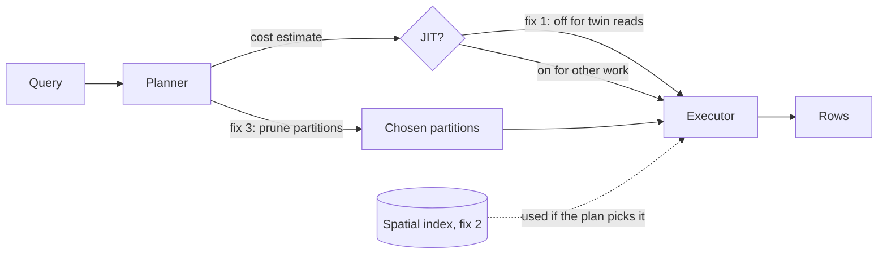

Database tuning often starts with a setting someone read about. Turn this on. Raise that limit. Add an index because it sounds right.

I want to write about the other way. Measure one slow case, find the stage where its time goes, change one thing, and measure again.

I work on [Tesar](https://tesar.ai) in my free time. Phase 1 of its new software is closed, and its core is a digital twin: the place where we keep everything we know about an asset and its environment. Every entry is one observation, and nothing is deleted or overwritten. The table only grows. That makes both the write path and the read path matter, because a slow path on a table this size is never a small problem.

I ran a benchmark on my homelab with one billion rows of synthetic observations. It reported **127k writes per second** and a **328 ms p95** for a read query. Those are the headline numbers. The more useful part is what I found on the way: three slow cases, each with a specific cause and a specific change.

This post covers those three fixes, what I looked at before each one, and what the numbers do not show.

## Short answer

Three changes account for the gains I can point to. Turning JIT compilation off for twin reads returned about **310 ms** per wide query. Rewriting a spatial query over 1,000 places cut it from **406 ms to 35 ms**. Writing the time bound so the planner could discard months cut partition planning from **515 ms to 0.6 ms**. None of them was a tuning guess. Each one started with a measurement of a single case, and each one was measured again after the change.

## Key takeaways

- Measure the slow case by itself before you change anything. An average over the whole workload hides it.
- JIT is a bet that a query runs long enough to repay its compilation. Turn it off where that bet loses.
- A spatial index helps only when the query can use it the way you wrote the query. Read the plan, not the timing alone.
- Partition pruning depends on the planner reading the bound on the partition key. A bound it cannot read means every partition gets planned.
- Planning time is a real cost. A query can spend longer choosing partitions than reading them.
- A benchmark number without its data, workload and hardware is a slogan.

## Why the rule is "measure, then change"

Tuning by habit has a specific failure. The setting you changed may have helped a different workload, and the change now hides the problem you actually have. The twin has a mix of work: long reads over wide time ranges, area reads over places, and a steady stream of writes. A global setting that helps one of those can hurt another.

So the working rule was simple. Nothing is adjusted on a guess. Everything is measured, and every measurement is read before it is trusted. The three fixes below are what that rule found. None of them was visible in the headline numbers, and none of them was a setting I would have changed on purpose at the start.

Postgres gives you what you need to work this way. `EXPLAIN` shows the plan the planner chose. `EXPLAIN (ANALYZE, BUFFERS)` runs the query and adds timing and buffer counts. `EXPLAIN ANALYZE` also reports `Planning Time` on its own line, separate from `Execution Time`. That separation matters, because one of the three costs lived entirely in planning.

## Why the write path is the steady load

The twin stores one kind of thing. An observation is one value a source reported about one place at one time: a rain reading, a statistic extracted from a satellite image, a model's forecast. Every observation is a row, and the write path has to keep up with every source at once.

That makes the write rate the number that never goes away. A read is driven by a person looking at a map or a query that someone asked. A write is driven by the sources, and they do not wait. So the 127k writes per second figure is the one I watch first, and the read figure comes second.

The table is laid out to keep writes cheap. The design partitions observations by origin, and then by month of their time, so new rows land in the current month's partition. The key index puts the variable first. In the design's laptop test of 2026-11-06, a network-wide question ran in 0.3 s with the variable first in the index, against 7 s with the place first. That was a SQL schema test on a laptop, not the billion-row run, so I use it only to explain the layout.

## Fix 1: JIT was compiling every wide read

Postgres can compile parts of a query expression with LLVM. This is just-in-time compilation, usually called JIT. When the planner estimates that a query is expensive enough, the executor compiles some of its expression evaluation before running it. Compilation takes time, and that time is paid on every query that qualifies.

For a long query, the compiled code can repay the cost many times over. For a short query, it is pure overhead. The question is which kind of work you actually run.

The twin's wide reads were compiling on every query. The cost was about **310 ms per query**, paid before the first row came back. The fix was to turn JIT off for twin reads only and leave it on for everything else. JIT is a session setting, so the change can be as narrow as the work it covers:

```sql
-- JIT is a session setting. Scope the change to the work it affects.
SHOW jit;        -- on by default in current Postgres versions
SET jit = off;   -- for the session that runs twin reads
```

What made this visible was a fixed cost that did not change with the number of rows returned. A fixed cost that does not grow with the data is the first thing I check for. Compilation is one of the few things that looks like that.

### What this fix does not show

I measured the wide reads of the twin. I did not measure every query in the system, and I did not run a broad comparison of JIT on and off across all of them. A long analytical query with heavy expressions may still benefit from JIT, and that is exactly the kind of query I would measure before copying this change.

## Fix 2: A spatial index that did not do what I thought

A query over 1,000 places took **406 ms**. The index behind it was badly built. After I rewrote it, the same query took **35 ms**.

To see why spatial queries are so sensitive to index shape, it helps to recall how the twin answers a geographic question. The design writes it down as two steps. First, find the places in the area. Then read their values by variable and time. The first step is a spatial lookup, and the second is an ordinary indexed read. A spatial lookup can be fast on paper and still slow in practice, if the planner cannot use the index for the predicate that was actually written.

PostGIS indexes geometry with GiST by default, and that is usually the right starting point. An index is used only when the operator in the query matches what the index supports. So the predicate and the index have to agree, and the plan is the only reliable way to check that:

```sql
-- Sketch: the shape of the check, not the twin's query.
EXPLAIN (ANALYZE, BUFFERS)
SELECT place_id
FROM place
WHERE footprint && ST_MakeEnvelope($1, $2, $3, $4, 4326);
```

The `&&` operator compares bounding boxes, and it is the one a GiST index on the geometry column can serve. If the plan shows a sequential scan where you expected an index scan, you have found the first problem, whatever the timing says afterwards.

The twin's stack also lists BRIN indexes and a covering index. BRIN suits data that is stored in a physical order, such as rows that arrive by time. A covering index lets a query read everything it needs from the index alone. Which of them helps depends on the query and on the plan, not on the name of the index type. I would not pick one because it sounds faster.

### What this fix does not show

The 406 ms and 35 ms figures come from one query over one dataset. They are not a promise about every area query, and a different polygon size or a different set of places can change the answer.

## Fix 3: Partition pruning and 515 ms of planning

Observations are partitioned by origin, then by month. A query that asks for one month of one origin should touch one partition. Whether it does depends on whether the planner can see the bound.

```text
observation
├── 2026-08   partition
├── 2026-09   partition
├── 2026-10   partition
├── 2026-11   partition   <- the query asks for this month
└── ...       one partition per month, many years of them

Without pruning: the planner considers every partition.
With pruning:    the planner considers the one partition that matches.
```

Postgres prunes partitions in two places. At plan time, it removes partitions when the `WHERE` clause compares the partition key with a constant or a value that is stable during the query. At execution time, it can remove partitions using parameters, which is run-time pruning. Both depend on the same thing: the planner must see the bound on the partition key in a form it can compare with the partition boundaries.

The bound in the slow version of the query was written in a form the planner could not use to skip months. So it planned every partition. Planning all of them took **515 ms**, before a single row was read. When I rewrote the bound so that the planner could discard months, planning dropped to **0.6 ms**.

The general shape of the problem looks like this. This is a sketch of the pattern, not a copy of the query from the benchmark:

```sql
-- The bound on the partition key, in a form the planner can compare:
WHERE valid_from >= $1 AND valid_from < $2;

-- The same intent with the key wrapped in an expression. The planner
-- cannot match the wrapped column against the partition boundaries.
WHERE date_trunc('month', valid_from) >= date_trunc('month', $1);
```

Check the plan, not only the clock. The plan lists the partitions it touches. A plan that names every month is the problem, even when the total time looks acceptable on a warm cache. `EXPLAIN ANALYZE` prints `Planning Time`, and that line is where this problem showed up.

### What this fix does not show

The planning cost grows with the number of partitions and with the shape of the query. A table with a few partitions will never show 515 ms of planning. The gain I measured applies to a table with a large number of partitions, which is the case the twin has to handle.

## How the three fixes sit in the query path

Each fix removes a cost from a different stage. Pruning works in planning. JIT is decided after planning, from the estimated cost. The spatial index only helps when the executor uses it. They do not add up to one speedup, and the numbers should not be read as if they did.



That is also why each fix had to be found separately. A change at one stage is invisible if you only look at the total time of the request. The totals were the first thing I looked at, and they were the least useful.

## The numbers, and what they do not show

| Result | Figure | What it measures |
|---|---|---|
| Sustained writes | 127k per second | Writes into a table of 1B synthetic observation rows |
| Read query, p95 | 328 ms | One read query, 95th percentile |
| JIT, wide reads | About 310 ms per query | Compilation time before the first row |
| Spatial query, 1,000 places | 406 ms to 35 ms | One area query before and after the index rewrite |
| Partition planning | 515 ms to 0.6 ms | Planning time with all months versus pruned |

Read the table as a set of before-and-after numbers from one system. Here are the limits that matter most:

- **The data is synthetic.** Real sources arrive in bursts and cluster around some places. A synthetic set may not reproduce that, and the cache behaves differently under a burst.
- **It is one homelab.** Disk, memory and Postgres configuration decide how much of each fix shows. The gains on other hardware may be larger or smaller.
- **A p95 for one read is not a latency promise.** It describes one read query on this table, not the product as a whole.
- **The write figure depends on the setup.** Batch size and the indexes the table carries both change writes per second. I would not compare it with another system's number without the same setup.
- **There is no second database in the comparison.** These are changes inside one system, measured before and after. They say nothing about whether a different database would be faster.

## What I would check before copying any of this

Check your own plans first. Run `EXPLAIN (ANALYZE, BUFFERS)` on the query you care about, and read the partitions and the index it uses. Then check how many partitions your table has, since pruning matters more as that number grows. Finally, measure JIT on your own wide reads before you change it, because the right setting depends on how long your queries run.

Do not copy the numbers. Copy the method: one slow case, one stage, one change, and a measurement after it.

## The rule I keep coming back to

> Tune the case you measured, not the database you remember.

The three fixes were small. Finding them was the work. Measure each slow case, read the plan, change one thing, and measure again. Everything else is a setting you read about and hope for.
