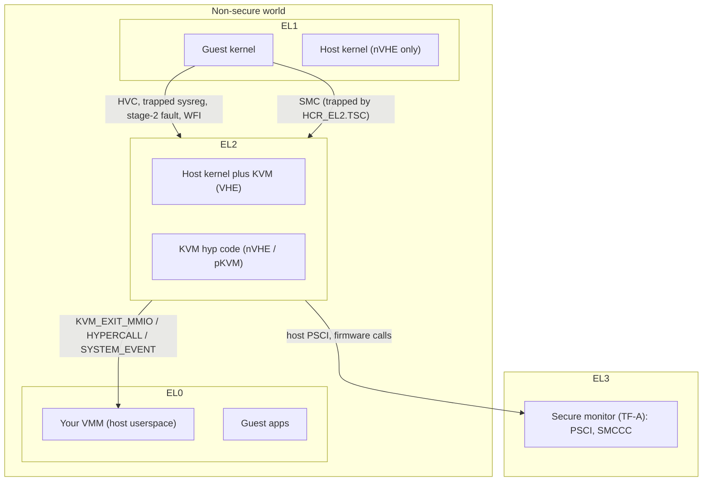
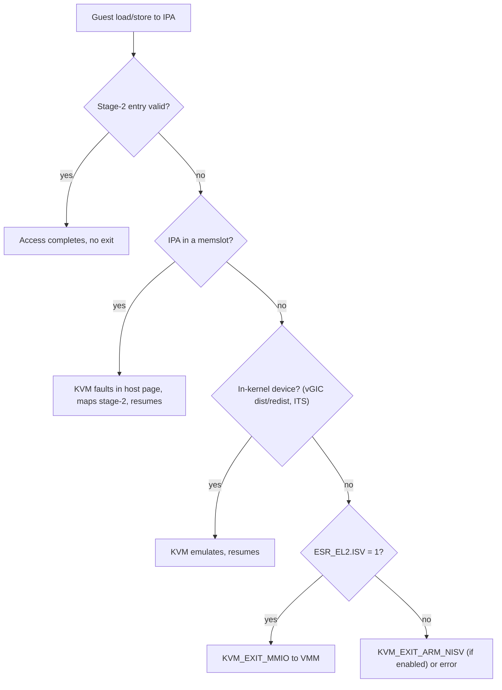
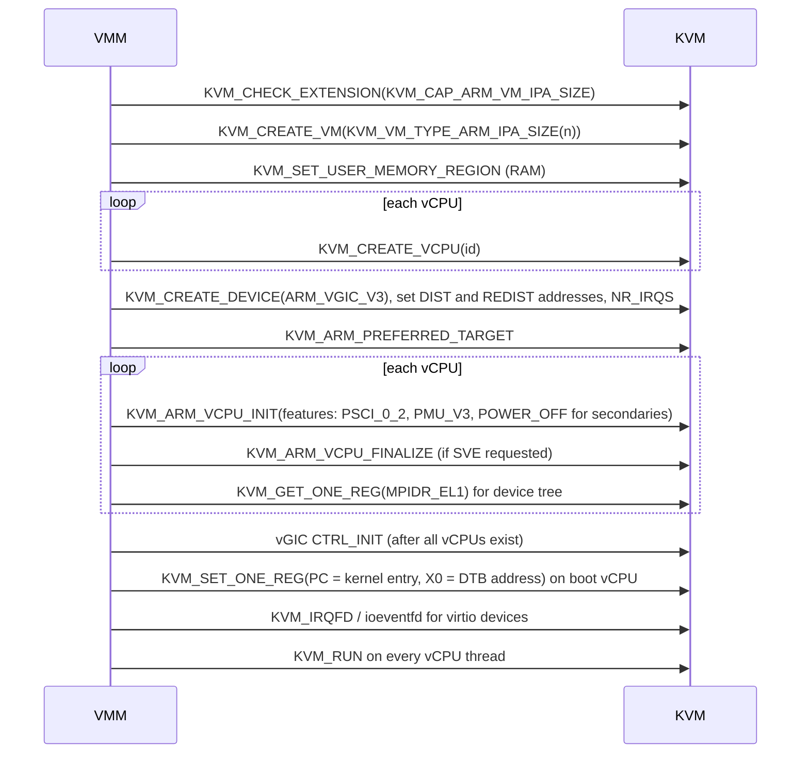

Purpose: explain how Armv8/Armv9 virtualizes CPUs, memory, interrupts and timers (EL2, stage-2, VHE, vGIC, generic timer) and exactly what a KVM-based Rust VMM must do differently on arm64 compared with x86-64.

# ARM64 Virtualization: EL2, VHE, and the GIC

Related notes: [02 x86-64 Architecture for Hypervisor Authors](/compendium/virtualization/x86-64-architecture-for-hypervisor-authors), [03 Intel VT-x and AMD-V Hardware Virtualization](/compendium/virtualization/intel-vt-x-and-amd-v-hardware-virtualization), [04 KVM API and the vCPU Run Loop](/compendium/virtualization/kvm-api-and-the-vcpu-run-loop), [05 Memory Virtualization EPT NPT and Guest Memory](/compendium/virtualization/memory-virtualization-ept-npt-and-guest-memory), [06 Interrupts Timers and Interrupt Controller Virtualization](/compendium/virtualization/interrupts-timers-and-interrupt-controller-virtualization), [09 Booting Guests Firmware and the Linux Boot Protocol](/compendium/virtualization/booting-guests-firmware-and-the-linux-boot-protocol), [11 Device Passthrough VFIO IOMMU and Nested Virtualization](/compendium/virtualization/device-passthrough-vfio-iommu-and-nested-virtualization), [12 Snapshots Live Migration and Dirty Page Tracking](/compendium/virtualization/snapshots-live-migration-and-dirty-page-tracking), [13 Security Isolation and Attack Surface](/compendium/virtualization/security-isolation-and-attack-surface), [16 RISC-V Virtualization and the Hypervisor Extension](/compendium/virtualization/risc-v-virtualization-and-the-hypervisor-extension), [18 Rust VMM Ecosystem and Project Templates](/compendium/virtualization/rust-vmm-ecosystem-and-project-templates).

## The big picture: virtualization was designed in, not bolted on

x86 virtualization added a new "root/non-root" dimension (VMX, SVM) orthogonal to rings. Arm instead added a dedicated privilege level, EL2, between the OS (EL1) and the secure monitor (EL3). The hypervisor is not a mode of the kernel; it is a different exception level with its own registers, its own page tables and its own exception vector.

| Exception level | Typical software | Virtualization role |
|---|---|---|
| EL0 | Applications | Guest and host userspace |
| EL1 | OS kernel | Guest kernel (and host kernel in nVHE mode) |
| EL2 | Hypervisor | KVM world switch code; whole host kernel under VHE |
| EL3 | Secure monitor (Trusted Firmware-A) | PSCI implementation for the host, world switch to Secure state |
| R-EL2 (with RME) | Realm Management Monitor | Confidential realm VMs (Arm CCA) |

Key consequence for you as a VMM author: you never touch EL2 directly. KVM runs there. Your VMM talks to KVM through the same ioctl API as on x86, but the arch-specific parts (vCPU init, register access, interrupt controller, timer, firmware interface, device tree) are completely different.



## EL2 control registers you must know

You will not program these from userspace, but every exit reason, every KVM capability and every performance trait on arm64 is explained by them.

| Register | Role |
|---|---|
| `HCR_EL2` | Hypervisor Configuration Register: what traps to EL2, stage-2 enable, interrupt routing, VHE controls |
| `VTTBR_EL2` | Stage-2 translation table base plus VMID |
| `VTCR_EL2` | Stage-2 translation control: IPA size (T0SZ), starting level (SL0), granule (TG0), physical address size (PS), 16-bit VMID enable (VS), hardware access/dirty flags (HA/HD) |
| `ESR_EL2` | Exception Syndrome: exception class (EC) and instruction-specific syndrome (ISS) for each trap |
| `FAR_EL2` | Faulting virtual address |
| `HPFAR_EL2` | Faulting IPA (guest physical) page for stage-2 aborts |
| `VBAR_EL2` | EL2 exception vector base |
| `ELR_EL2`, `SPSR_EL2` | Return address and saved PSTATE when entering EL2 |
| `CPTR_EL2` | Traps for FP/SIMD, SVE, SME, trace |
| `MDCR_EL2` | Traps for debug and PMU registers |
| `CNTHCTL_EL2` | Controls EL1 access to physical timer and counter |
| `CNTVOFF_EL2` | Offset subtracted from physical counter to produce the guest virtual counter |
| `VMPIDR_EL2`, `VPIDR_EL2` | Values the guest sees for MPIDR_EL1 and MIDR_EL1 |
| `ICH_HCR_EL2`, `ICH_LR&lt;n&gt;_EL2`, `ICH_VMCR_EL2` | GICv3 virtual CPU interface control and list registers |

### HCR_EL2 bits that shape the guest

| Bit | Name | Meaning |
|---|---|---|
| 0 | VM | Enable stage-2 translation for EL1/EL0 |
| 1 | SWIO | Set/way invalidation override |
| 3, 4, 5 | FMO, IMO, AMO | Route physical FIQ, IRQ, SError to EL2 and enable virtual FIQ/IRQ/SError for EL1 |
| 6, 7, 8 | VF, VI, VSE | Inject virtual FIQ, IRQ, SError (legacy path when not using the GIC list registers) |
| 13, 14 | TWI, TWE | Trap WFI / WFE (KVM traps WFI to deschedule an idle vCPU) |
| 15 to 18 | TID0 to TID3 | Trap ID register reads (lets KVM present sanitized feature registers) |
| 19 | TSC | Trap SMC to EL2 |
| 26 | TVM | Trap writes to virtual memory control registers |
| 27 | TGE | Trap General Exceptions: host EL0 exceptions go to EL2 (used with VHE for host userspace) |
| 31 | RW | EL1 is AArch64 |
| 34 | E2H | EL2 Host: enables VHE |
| 40, 41 | APK, API | Pointer authentication key and instruction trapping control |
| 42, 43, 45 | NV, NV1, NV2 | Nested virtualization support |
| 46 | FWB | Stage-2 forced write-back memory attributes (FEAT_FWB) |

### Exception classes that become exits

| ESR_EL2.EC | Meaning | KVM handling |
|---|---|---|
| 0x01 | WFI / WFE | Block vCPU until interrupt (WFI) or yield (WFE) |
| 0x07 | FP/SIMD access trap | Lazy FP context switch |
| 0x16 | HVC from AArch64 | SMCCC dispatch: PSCI, TRNG, PV time, or forward to userspace |
| 0x17 | SMC from AArch64 | Same SMCCC dispatch when trapped |
| 0x18 | MSR/MRS/system instruction trap | Emulate sysreg (ID registers, debug, PMU, GIC ICC_* for some cases) |
| 0x19 | SVE access trap | Lazy SVE context switch |
| 0x20 | Instruction abort from lower EL | Stage-2 fault: map page or report error |
| 0x24 | Data abort from lower EL | Stage-2 fault: map RAM, or emulate MMIO (in-kernel device or `KVM_EXIT_MMIO`) |

## Stage-2 translation

Arm calls guest physical addresses Intermediate Physical Addresses (IPA). Stage 1 (guest-controlled, `TTBR0/1_EL1`) maps VA to IPA; stage 2 (hypervisor-controlled, `VTTBR_EL2`) maps IPA to PA. This is the arm64 equivalent of EPT/NPT, discussed in [05 Memory Virtualization EPT NPT and Guest Memory](/compendium/virtualization/memory-virtualization-ept-npt-and-guest-memory).

| Concept | Arm64 detail | x86 analogue |
|---|---|---|
| Table base | `VTTBR_EL2.BADDR` | EPTP / nCR3 |
| Tag | VMID (8 bits, or 16 with `VTCR_EL2.VS`) | VPID / ASID |
| IPA size | `VTCR_EL2.T0SZ`, chosen per VM | Guest physical width fixed by MAXPHYADDR |
| Starting level concatenation | Up to 16 concatenated tables at the start level so fewer levels are needed | None |
| Attributes | Stage-2 memory type combined with stage-1; FWB lets stage 2 force write-back | EPT memory type with IPAT |
| Faults | EC 0x20/0x24 with `HPFAR_EL2` | EPT violation / NPF |
| Hardware dirty bit | FEAT_HAFDBS (`VTCR_EL2.HD`); KVM still mostly uses write protection for dirty logging | EPT A/D bits, PML |

### IPA size is a VM creation parameter

On arm64 the `type` argument to `KVM_CREATE_VM` encodes the IPA size. Query `KVM_CAP_ARM_VM_IPA_SIZE` (or `Kvm::get_host_ipa_limit()` in kvm-ioctls), then create with `KVM_VM_TYPE_ARM_IPA_SIZE(bits)` (kvm-ioctls: `Kvm::create_vm_with_ipa_size`). Default without a type is 40 bits (1 TiB). Your guest memory map (RAM, MMIO, PCIe ECAM, GIC regions) must fit below that limit. On small hosts (some boards and Apple Silicon) the limit can be below 40 bits, which breaks memory maps that place high MMIO at large addresses.

### MMIO and the ISV problem

A stage-2 data abort on an address with no memslot becomes MMIO emulation. KVM needs `ESR_EL2.ISS.ISV` (instruction syndrome valid) to know the access size, target register (`SRT`), sign extension and direction. ISV is only set for simple single-register loads and stores without writeback. If the guest uses, for example, a load pair (`LDP`) or post-indexed access to MMIO, ISV is 0 and KVM cannot emulate it:

- By default KVM returns an error to `KVM_RUN` for this case.
- With `KVM_CAP_ARM_NISV_TO_USER` enabled, KVM exits with `KVM_EXIT_ARM_NISV` and gives you the ESR and fault IPA; you would have to decode the instruction yourself (rarely worth it).

Practical rule: guest drivers for your devices must use plain `ldr`/`str` (Linux `readl`/`writel` do). This is why Linux arm64 MMIO accessors are written in inline asm.



## VHE vs nVHE vs pKVM

Before Armv8.1, EL2 had a reduced register set and a single translation regime without EL0 support. A hosted hypervisor like KVM therefore had to split itself: the host Linux kernel ran at EL1, and a small "hyp" component at EL2 performed world switches. Every guest exit bounced EL1 to EL2 to EL1. This is nVHE (non-VHE).

The Virtualization Host Extensions (FEAT_VHE, Armv8.1) let the host kernel run at EL2 directly:

| Feature | Effect under VHE (`HCR_EL2.E2H = 1`) |
|---|---|
| Register redirection | Kernel code that accesses `TTBR0_EL1`, `SCTLR_EL1`, `CNTV_CTL_EL0` and so on at EL2 actually accesses the EL2 counterparts, so an unmodified kernel runs at EL2 |
| `_EL12` / `_EL02` aliases | Allow the EL2 kernel to reach the real EL1/EL0 registers to save and restore guest context |
| EL2 translation regime with two ranges | EL2 gets TTBR0/TTBR1 like EL1 and supports EL0 (host userspace) under it |
| `HCR_EL2.TGE = 1` | Host userspace exceptions go to EL2; KVM clears TGE when entering a guest |

| Mode | Where host kernel runs | Exit cost | Use |
|---|---|---|---|
| nVHE | EL1 | Higher (extra EL transitions and more register switching) | Pre-v8.1 cores, or when isolation of host from hypervisor is desired |
| VHE | EL2 | Lower | Default on modern server and desktop cores |
| pKVM (protected) | EL1, with a small trusted hypervisor at EL2 that also applies a stage-2 to the host | nVHE-like | Android Virtualization Framework; protects guests from a compromised host kernel |
| hVHE | EL1 host, EL2 hyp code running with E2H set | nVHE-like with VHE translation features | Used by pKVM on newer cores |

Select with the kernel command line `kvm-arm.mode=` (`nvhe`, `protected`, `nested`, or default). Your VMM mostly does not care, except that protected VMs restrict which ioctls work (for example `KVM_ARM_VCPU_INIT` returns `EPERM` once a protected vCPU has run, `KVM_ARM_VCPU_PSCI_0_2` is mandatory, and one-reg access after run is refused).

### pKVM in one paragraph

pKVM treats the host kernel as untrusted relative to guests. The EL2 hypervisor owns stage-2 tables for the host as well as for guests, so once memory is donated to a protected VM the host cannot map it. Guests share memory back explicitly with hypercalls (`MEM_SHARE`, `MEM_UNSHARE`) and declare MMIO regions with `MMIO_GUARD`. It is the Arm mobile analogue of confidential computing without memory encryption. See [13 Security Isolation and Attack Surface](/compendium/virtualization/security-isolation-and-attack-surface).

### Nested virtualization

FEAT_NV (Armv8.3) and FEAT_NV2 (Armv8.4) let a guest hypervisor run at virtual EL2. NV2 rewrites many EL2 system register accesses into loads and stores to a memory page (the VNCR page), reducing trap counts. In KVM, request it per vCPU with the `KVM_ARM_VCPU_HAS_EL2` feature (and optionally `KVM_ARM_VCPU_HAS_EL2_E2H0` to restrict the guest hypervisor to nVHE), gated by `KVM_CAP_ARM_EL2`. Upstream support became generally usable around Linux 6.16; check `dmesg` for "VHE+NV2" on the host. Only enable it if you need it: nested support is a large attack surface.

## The KVM/arm64 VMM bring-up sequence



Ordering rules that bite:

1. Create all vCPUs before `KVM_ARM_VCPU_INIT` on any of them: some registers (MPIDR, redistributor layout) reflect the machine topology.
2. Create the vGIC before running, and issue `KVM_DEV_ARM_VGIC_CTRL_INIT` after all vCPUs are created.
3. Secondary vCPUs should be initialized with `KVM_ARM_VCPU_POWER_OFF`; the guest brings them up with PSCI `CPU_ON`, which KVM handles in kernel.
4. If you request SVE, call `KVM_ARM_VCPU_FINALIZE(KVM_ARM_VCPU_SVE)` after configuring vector lengths and before accessing SVE registers or running.
5. Without `KVM_ARM_VCPU_INIT`, `KVM_RUN` fails with `ENOEXEC`.

### vCPU features

| Feature bit | Meaning | Capability |
|---|---|---|
| `KVM_ARM_VCPU_POWER_OFF` (0) | Start powered off; wait for PSCI CPU_ON | `KVM_CAP_ARM_PSCI` |
| `KVM_ARM_VCPU_EL1_32BIT` (1) | AArch32 EL1 guest | `KVM_CAP_ARM_EL1_32BIT` (many new cores lack AArch32 EL1) |
| `KVM_ARM_VCPU_PSCI_0_2` (2) | PSCI v0.2 or later semantics | `KVM_CAP_ARM_PSCI_0_2` |
| `KVM_ARM_VCPU_PMU_V3` (3) | Emulated PMUv3 | `KVM_CAP_ARM_PMU_V3` |
| `KVM_ARM_VCPU_SVE` (4) | SVE, needs finalize | `KVM_CAP_ARM_SVE` |
| `KVM_ARM_VCPU_PTRAUTH_ADDRESS` (5), `_GENERIC` (6) | Pointer authentication; request both or neither | `KVM_CAP_ARM_PTRAUTH_*` |
| `KVM_ARM_VCPU_HAS_EL2` (7) | Nested virtualization | `KVM_CAP_ARM_EL2` |

### Rust: VM, vCPU and vGIC setup with kvm-ioctls

Checked against kvm-ioctls 0.25.x and kvm-bindings 0.14 (sources in rust-vmm/kvm). On aarch64, `VcpuFd::vcpu_init(&kvm_vcpu_init)`, `VmFd::get_preferred_target(&mut kvm_vcpu_init)`, `VcpuFd::set_one_reg(u64, &[u8])`, `VcpuFd::get_one_reg(u64, &mut [u8])` and `VmFd::create_device(&mut kvm_create_device)` returning a `DeviceFd` with `set_device_attr(&kvm_device_attr)`.

```rust
use kvm_bindings::{
    kvm_create_device, kvm_device_attr, kvm_device_type_KVM_DEV_TYPE_ARM_VGIC_V3,
    kvm_vcpu_init, KVM_ARM_VCPU_POWER_OFF, KVM_ARM_VCPU_PSCI_0_2,
    KVM_DEV_ARM_VGIC_CTRL_INIT, KVM_DEV_ARM_VGIC_GRP_ADDR, KVM_DEV_ARM_VGIC_GRP_CTRL,
    KVM_DEV_ARM_VGIC_GRP_NR_IRQS, KVM_VGIC_V3_ADDR_TYPE_DIST, KVM_VGIC_V3_ADDR_TYPE_REDIST,
};
use kvm_ioctls::{DeviceFd, Kvm, VcpuFd, VmFd};

// Example guest memory map (IPA).
const GIC_DIST_BASE: u64 = 0x0800_0000;
const GIC_DIST_SIZE: u64 = 0x1_0000; // 64 KiB

// addr is a userspace pointer to the value (u64 for addresses, u32 for NR_IRQS), or 0.
fn set_attr(dev: &DeviceFd, group: u32, attr: u64, addr: u64) {
    let a = kvm_device_attr { group, attr, addr, flags: 0 };
    dev.set_device_attr(&a).expect("vgic attr");
}

pub fn build(n_vcpus: u64) -> (VmFd, Vec<VcpuFd>, DeviceFd) {
    let kvm = Kvm::new().unwrap();
    // 0 means KVM_CAP_ARM_VM_IPA_SIZE is unsupported: fall back to the 40-bit default.
    let limit = kvm.get_host_ipa_limit() as u32;
    let vm = if limit == 0 { kvm.create_vm().unwrap() } else { kvm.create_vm_with_ipa_size(limit.min(48)).unwrap() };

    let vcpus: Vec<VcpuFd> = (0..n_vcpus).map(|i| vm.create_vcpu(i).unwrap()).collect();

    // vGICv3: distributor below the redistributor array.
    let mut cd = kvm_create_device {
        type_: kvm_device_type_KVM_DEV_TYPE_ARM_VGIC_V3,
        fd: 0,
        flags: 0,
    };
    let gic = vm.create_device(&mut cd).unwrap();
    let dist: u64 = GIC_DIST_BASE;
    let redist: u64 = GIC_DIST_BASE + GIC_DIST_SIZE;
    set_attr(&gic, KVM_DEV_ARM_VGIC_GRP_ADDR, KVM_VGIC_V3_ADDR_TYPE_DIST as u64, &dist as *const u64 as u64);
    set_attr(&gic, KVM_DEV_ARM_VGIC_GRP_ADDR, KVM_VGIC_V3_ADDR_TYPE_REDIST as u64, &redist as *const u64 as u64);
    let nr_irqs: u32 = 128; // 32 private plus 96 SPIs; multiple of 32
    set_attr(&gic, KVM_DEV_ARM_VGIC_GRP_NR_IRQS, 0, &nr_irqs as *const u32 as u64);

    let mut kvi = kvm_vcpu_init::default();
    vm.get_preferred_target(&mut kvi).unwrap();
    kvi.features[0] |= 1 << KVM_ARM_VCPU_PSCI_0_2;
    for (i, vcpu) in vcpus.iter().enumerate() {
        let mut k = kvi;
        if i > 0 {
            k.features[0] |= 1 << KVM_ARM_VCPU_POWER_OFF;
        }
        vcpu.vcpu_init(&k).unwrap();
    }

    // All vCPUs exist: finalize the vGIC.
    set_attr(&gic, KVM_DEV_ARM_VGIC_GRP_CTRL, KVM_DEV_ARM_VGIC_CTRL_INIT as u64, 0);
    (vm, vcpus, gic)
}
```

Redistributor space is `n_vcpus * 0x20000` bytes starting at the redistributor base; make sure it does not overlap the next region in your memory map. For large vCPU counts or split layouts use `KVM_VGIC_V3_ADDR_TYPE_REDIST_REGION`.

## Registers: the one-reg interface

arm64 KVM has no `KVM_GET_REGS`/`KVM_SET_SREGS` struct API. Every register is accessed by a 64-bit ID through `KVM_GET_ONE_REG` / `KVM_SET_ONE_REG`, and `KVM_GET_REG_LIST` enumerates what exists (crucial for snapshots and migration: save every register in the list).

ID layout (from `arch/arm64/include/uapi/asm/kvm.h` and the KVM API doc):

| Group | ID pattern | Example |
|---|---|---|
| Core registers (`struct kvm_regs`, indexed in 32-bit units) | `0x6030 0000 0010 &lt;index&gt;` | X0 `0x6030000000100000`, X1 `...0002`, SP `...003e`, PC `...0040`, PSTATE `...0042` |
| System registers | `0x6030 0000 0013 &lt;op0:2&gt;&lt;op1:3&gt;&lt;crn:4&gt;&lt;crm:4&gt;&lt;op2:3&gt;` | MPIDR_EL1 is op0=3, op1=0, CRn=0, CRm=0, op2=5 |
| Firmware pseudo-registers | `0x6030 0000 0014 &lt;regno:16&gt;` | `KVM_REG_ARM_PSCI_VERSION`, `KVM_REG_ARM_SMCCC_ARCH_WORKAROUND_1/2/3` |
| SVE | `0x60x0 0000 0015 ...` | Z, P, FFR registers sized by vector length |
| Firmware feature bitmaps | `0x6030 0000 0016 &lt;regno:16&gt;` | `KVM_REG_ARM_STD_BMAP`, `KVM_REG_ARM_STD_HYP_BMAP`, `KVM_REG_ARM_VENDOR_HYP_BMAP` |
| Timer | sysreg encodings | `KVM_REG_ARM_TIMER_CTL`, `_CVAL`, `_CNT` |

```rust
use kvm_ioctls::VcpuFd;

const KVM_REG_ARM64: u64 = 0x6000_0000_0000_0000;
const KVM_REG_SIZE_U64: u64 = 0x0030_0000_0000_0000;
const KVM_REG_ARM_CORE: u64 = 0x0010 << 16;
const KVM_REG_ARM64_SYSREG: u64 = 0x0013 << 16;

/// Core register by 64-bit slot in struct kvm_regs (regs[0..31], sp, pc, pstate).
const fn core_reg(slot64: u64) -> u64 {
    KVM_REG_ARM64 | KVM_REG_SIZE_U64 | KVM_REG_ARM_CORE | (slot64 * 2)
}
const X0: u64 = core_reg(0);
const PC: u64 = core_reg(32);

const fn sysreg(op0: u64, op1: u64, crn: u64, crm: u64, op2: u64) -> u64 {
    KVM_REG_ARM64 | KVM_REG_SIZE_U64 | KVM_REG_ARM64_SYSREG
        | (op0 << 14) | (op1 << 11) | (crn << 7) | (crm << 3) | op2
}
const MPIDR_EL1: u64 = sysreg(3, 0, 0, 0, 5);

pub fn setup_boot_vcpu(vcpu: &VcpuFd, kernel_entry: u64, dtb_addr: u64) {
    vcpu.set_one_reg(PC, &kernel_entry.to_le_bytes()).unwrap();
    vcpu.set_one_reg(X0, &dtb_addr.to_le_bytes()).unwrap();
    // PSTATE is already EL1h with DAIF masked after KVM_ARM_VCPU_INIT.
}

pub fn mpidr(vcpu: &VcpuFd) -> u64 {
    let mut buf = [0u8; 8];
    vcpu.get_one_reg(MPIDR_EL1, &mut buf).unwrap();
    u64::from_le_bytes(buf)
}
```

The kvm-ioctls test suite itself uses `0x6030_0000_0010_0000 + 2 * 32` for PC, which matches the arithmetic above. Use the value returned by `get_one_reg(MPIDR_EL1)` (masked to affinity fields, `& 0xff_00ff_ffff`) as the `reg` property of each CPU node in the device tree; do not assume MPIDR equals the vCPU index, because KVM packs vCPUs into Aff0 clusters of 16 for GICv3 compatibility.

## Firmware interface: SMCCC and PSCI

On arm64 the guest talks to "firmware" with `HVC` (or `SMC`) using the SMC Calling Convention: function ID in `W0`, arguments in `X1` to `X17`, results in `X0` to `X17`. KVM implements the important services in kernel.

| Service | Function IDs (SMC64) | Who handles it |
|---|---|---|
| PSCI_VERSION | 0x84000000 | KVM |
| CPU_ON | 0xC4000003 | KVM (wakes a powered-off vCPU at given entry with context ID in X0) |
| CPU_OFF | 0x84000002 | KVM |
| AFFINITY_INFO | 0xC4000004 | KVM |
| SYSTEM_OFF | 0x84000008 | KVM, then `KVM_EXIT_SYSTEM_EVENT` with `KVM_SYSTEM_EVENT_SHUTDOWN` |
| SYSTEM_RESET | 0x84000009 | KVM, then `KVM_EXIT_SYSTEM_EVENT` with `KVM_SYSTEM_EVENT_RESET` |
| SYSTEM_SUSPEND | 0xC400000E | Exit `KVM_SYSTEM_EVENT_SUSPEND` if `KVM_CAP_ARM_SYSTEM_SUSPEND` is enabled |
| SMCCC_ARCH_WORKAROUND_1/2/3 | 0x80008000 range | KVM (Spectre mitigations) |
| TRNG, PTP_KVM, PV time | Standard / vendor ranges | KVM |

Userspace control:

- `KVM_ARM_VM_SMCCC_CTRL` / `KVM_ARM_VM_SMCCC_FILTER` (VM device attribute) installs a `struct kvm_smccc_filter { base, nr_functions, action }` with actions `KVM_SMCCC_FILTER_HANDLE`, `KVM_SMCCC_FILTER_DENY`, or `KVM_SMCCC_FILTER_FWD_TO_USER`. Forwarded calls exit with `KVM_EXIT_HYPERCALL`; flags `KVM_HYPERCALL_EXIT_SMC` and `KVM_HYPERCALL_EXIT_16BIT` describe the conduit. This lets your VMM implement vendor services or deny services you do not want exposed.
- The firmware pseudo-registers (`KVM_REG_ARM_PSCI_VERSION`, workaround registers, feature bitmaps) must be saved and restored for migration, and can be written before first run to hide services from the guest.

Handling a shutdown in the run loop:

```rust
use kvm_bindings::{KVM_SYSTEM_EVENT_RESET, KVM_SYSTEM_EVENT_SHUTDOWN};
use kvm_ioctls::{VcpuExit, VcpuFd};

pub enum Stop { Shutdown, Reset }

pub fn run_vcpu(vcpu: &mut VcpuFd, bus: &mut impl FnMut(u64, Option<&[u8]>, Option<&mut [u8]>)) -> Stop {
    loop {
        match vcpu.run() {
            Ok(VcpuExit::MmioRead(addr, data)) => bus(addr, None, Some(data)),
            Ok(VcpuExit::MmioWrite(addr, data)) => bus(addr, Some(data), None),
            Ok(VcpuExit::SystemEvent(t, _)) if t == KVM_SYSTEM_EVENT_SHUTDOWN => return Stop::Shutdown,
            Ok(VcpuExit::SystemEvent(t, _)) if t == KVM_SYSTEM_EVENT_RESET => return Stop::Reset,
            Ok(other) => panic!("unhandled exit: {other:?}"),
            Err(e) if e.errno() == libc::EINTR || e.errno() == libc::EAGAIN => continue,
            Err(e) => panic!("KVM_RUN failed: {e}"),
        }
    }
}
```

There is no `IoIn`/`IoOut` on arm64: there is no port I/O space. Every device is MMIO (or PCI config through ECAM MMIO).

## The Generic Interrupt Controller and vGIC

The GIC is to arm64 what the LAPIC plus IOAPIC plus MSI are to x86, but with a different interrupt model.

| Interrupt type | INTID range | x86 analogue |
|---|---|---|
| SGI (Software Generated) | 0 to 15 | IPIs |
| PPI (Private Peripheral) | 16 to 31 | LAPIC timer, per-CPU interrupts |
| SPI (Shared Peripheral) | 32 to 1019 | IOAPIC pins |
| LPI (Locality-specific Peripheral) | 8192 and up | MSI / MSI-X |

| GIC version | Key properties | KVM device |
|---|---|---|
| GICv2 | Memory-mapped CPU interface (GICC), virtualization via GICH/GICV MMIO, max 8 CPUs | `KVM_DEV_TYPE_ARM_VGIC_V2` |
| GICv3 | System-register CPU interface (`ICC_*_EL1`), affinity routing, per-CPU redistributors, LPIs via ITS, list registers `ICH_LR&lt;n&gt;_EL2` | `KVM_DEV_TYPE_ARM_VGIC_V3` |
| GICv3 ITS | Translates (DeviceID, EventID) writes to LPIs using tables in memory | `KVM_DEV_TYPE_ARM_VGIC_ITS` |
| GICv4 | Direct injection of virtual LPIs from passthrough devices without hypervisor exit (vPE residency) | Used transparently by KVM with VFIO |
| GICv4.1 | Adds direct injection of virtual SGIs | Transparent |
| GICv5 | New architecture with redesigned interrupt routing | `KVM_DEV_TYPE_ARM_VGIC_V5` now exists in the uapi; early |

### How a virtual interrupt reaches the guest (GICv3)

1. A device (your VMM via irqfd, or a timer, or a passthrough device) signals an interrupt for a vCPU.
2. KVM's vGIC model updates its distributor/redistributor state (pending, enabled, priority, target).
3. On guest entry, KVM writes pending virtual interrupts into the List Registers `ICH_LR&lt;n&gt;_EL2` (typically 4 to 16 of them).
4. The hardware virtual CPU interface presents the highest-priority LR to the guest as a virtual IRQ; the guest acknowledges and EOIs through `ICC_*_EL1` system registers without trapping.
5. If more interrupts are pending than LRs, or KVM needs to know when one is EOIed (level-triggered), it requests a maintenance interrupt (PPI 25 by convention) to refill LRs.

Unlike x86 APICv/AVIC posted interrupts, this design has virtualized acknowledge/EOI from the start; the cost is the LR refill when many interrupts are pending.

### Injecting interrupts from the VMM

| Mechanism | Use | Encoding |
|---|---|---|
| `KVM_IRQ_LINE` | Level changes for SPIs or PPIs from userspace | `irq = (vcpu2_index &lt;&lt; 28) | (type &lt;&lt; 24) | (vcpu_index &lt;&lt; 16) | irq_id`; type `KVM_ARM_IRQ_TYPE_SPI` (1) with `irq_id` = INTID 32 to 1019, or `KVM_ARM_IRQ_TYPE_PPI` (2) with INTID 16 to 31 and a target vCPU |
| `KVM_IRQFD` | Fast path for virtio interrupts | GSI routed to an SPI; default routing maps GSI n to INTID n + 32 |
| `KVM_SIGNAL_MSI` / MSI routing | MSI for virtio-pci through the ITS | `kvm_msi` with `KVM_MSI_VALID_DEVID` and the PCI requester ID as device ID |

Device tree interrupt specifiers for GICv3 use 3 cells: type (0 = SPI, 1 = PPI), number relative to the type base (SPI INTID minus 32, PPI INTID minus 16), flags (1 = edge rising, 4 = level high). A classic bug is putting the INTID (for example 33) in the DT instead of the SPI number (1), which shifts every device interrupt by 32.

### Save and restore

vGIC state is part of a snapshot: distributor registers (`KVM_DEV_ARM_VGIC_GRP_DIST_REGS`), redistributor registers (`_GRP_REDIST_REGS`), CPU sysregs (`_GRP_CPU_SYSREGS`), line levels (`_GRP_LEVEL_INFO`), and for the ITS, flush tables to guest memory with `KVM_DEV_ARM_ITS_SAVE_TABLES` and restore with `KVM_DEV_ARM_ITS_RESTORE_TABLES`. The ITS tables live in guest RAM, so save them before you snapshot memory. See [12 Snapshots Live Migration and Dirty Page Tracking](/compendium/virtualization/snapshots-live-migration-and-dirty-page-tracking).

## Generic timer virtualization

Every arm64 core has an architected generic timer: a system counter (`CNTPCT_EL0`, `CNTVCT_EL0`) and per-CPU comparators (physical `CNTP_*`, virtual `CNTV_*`, and hypervisor timers at EL2).

| Timer | PPI INTID | Guest use |
|---|---|---|
| EL1 physical timer | 30 | Usually trapped or emulated by KVM |
| EL1 virtual timer | 27 | Main guest timer, runs directly on hardware |
| EL2 physical (hypervisor) timer | 26 | Only for nested virtualization |
| EL2 virtual timer | 28 | Nested virtualization with VHE |
| Secure physical timer | 29 | Listed in DT for completeness |

Mechanics:

- The guest virtual counter is `CNTPCT - CNTVOFF_EL2`. KVM sets `CNTVOFF_EL2` per VM so that guest time starts near zero and stays consistent across vCPUs.
- The guest programs `CNTV_CVAL_EL0` / `CNTV_CTL_EL0` directly without traps. When the guest is not running and the timer would fire, KVM uses a host hrtimer to kick the vCPU.
- `KVM_ARM_VCPU_TIMER_CTRL` (vCPU device attribute) lets you change the PPI numbers (`KVM_ARM_VCPU_TIMER_IRQ_VTIMER`, `_PTIMER`, `_HVTIMER`, `_HPTIMER`); they must match what you put in the device tree.
- For migration, `KVM_ARM_SET_COUNTER_OFFSET` (capability `KVM_CAP_COUNTER_OFFSET`) applies one VM-wide offset to both virtual and physical counters; after using it KVM ignores one-reg writes to `CNTVCT_EL0`/`CNTPCT_EL0`. This avoids per-vCPU counter skew on restore.
- FEAT_ECV (Armv8.6) adds `CNTPOFF_EL2`, allowing the physical counter to be offset in hardware as well.

The timer frequency (`CNTFRQ_EL0`) is set by firmware on the host and is not virtualized per VM on most hardware. Migration between hosts with different counter frequencies is not transparent.

## Device tree generation

arm64 guests discover hardware through a Flattened Device Tree (or ACPI). Your VMM must build it at boot; there is no BIOS probing. Minimum nodes for a Linux guest:

| Node | Key properties |
|---|---|
| `/` | `compatible = "linux,dummy-virt"`, `#address-cells = 2`, `#size-cells = 2`, `interrupt-parent = &lt;&gic&gt;` |
| `/cpus/cpu@N` | `device_type = "cpu"`, `compatible = "arm,arm-v8"`, `enable-method = "psci"`, `reg = &lt;MPIDR affinity&gt;` |
| `/psci` | `compatible = "arm,psci-1.0", "arm,psci-0.2"`, `method = "hvc"` |
| `/memory@...` | `device_type = "memory"`, `reg = &lt;base size&gt;` |
| `/intc@...` (GIC) | `compatible = "arm,gic-v3"`, `interrupt-controller`, `#interrupt-cells = 3`, `reg = &lt;dist&gt; &lt;redist&gt;`, optional ITS child with `msi-controller` |
| `/timer` | `compatible = "arm,armv8-timer"`, 4 PPI interrupts (secure phys, non-secure phys, virt, hyp), `always-on` |
| `/chosen` | `bootargs`, `stdout-path`, `linux,initrd-start`, `linux,initrd-end` |
| UART | `compatible = "ns16550a"` (with `vm-superio`) or `"arm,pl011"`, `reg`, `interrupts`, `clock-frequency` |
| virtio-mmio | `compatible = "virtio,mmio"`, `reg`, `interrupts = &lt;0 spi 1&gt;`, `dma-coherent` |
| PCIe (optional) | `compatible = "pci-host-ecam-generic"`, `ranges`, `bus-range`, `msi-map` to ITS |
| RTC (optional) | `compatible = "arm,pl031", "arm,primecell"` |

Example with `vm-fdt` 0.3.0 (rust-vmm; API `FdtWriter::new`, `begin_node`, `property_*`, `end_node`, `finish`):

```rust
use vm_fdt::{Error, FdtWriter};

const GIC_PHANDLE: u32 = 1;
const GIC_FDT_IRQ_TYPE_SPI: u32 = 0;
const GIC_FDT_IRQ_TYPE_PPI: u32 = 1;
const IRQ_LEVEL_HIGH: u32 = 4;
const IRQ_EDGE_RISING: u32 = 1;

pub fn build_fdt(mpidrs: &[u64], ram: (u64, u64), gic: (u64, u64, u64, u64),
                 uart: (u64, u32), cmdline: &str) -> Result<Vec<u8>, Error> {
    let mut f = FdtWriter::new()?;
    let root = f.begin_node("")?;
    f.property_string("compatible", "linux,dummy-virt")?;
    f.property_u32("#address-cells", 2)?;
    f.property_u32("#size-cells", 2)?;
    f.property_u32("interrupt-parent", GIC_PHANDLE)?;

    let cpus = f.begin_node("cpus")?;
    f.property_u32("#address-cells", 2)?;
    f.property_u32("#size-cells", 0)?;
    for (i, m) in mpidrs.iter().enumerate() {
        let cpu = f.begin_node(&format!("cpu@{i:x}"))?;
        f.property_string("device_type", "cpu")?;
        f.property_string("compatible", "arm,arm-v8")?;
        f.property_string("enable-method", "psci")?;
        f.property_u64("reg", m & 0xff_00ff_ffff)?;
        f.end_node(cpu)?;
    }
    f.end_node(cpus)?;

    let psci = f.begin_node("psci")?;
    f.property_string_list("compatible", vec!["arm,psci-1.0".into(), "arm,psci-0.2".into()])?;
    f.property_string("method", "hvc")?;
    f.end_node(psci)?;

    let mem = f.begin_node(&format!("memory@{:x}", ram.0))?;
    f.property_string("device_type", "memory")?;
    f.property_array_u64("reg", &[ram.0, ram.1])?;
    f.end_node(mem)?;

    let intc = f.begin_node(&format!("intc@{:x}", gic.0))?;
    f.property_string("compatible", "arm,gic-v3")?;
    f.property_null("interrupt-controller")?;
    f.property_u32("#interrupt-cells", 3)?;
    f.property_array_u64("reg", &[gic.0, gic.1, gic.2, gic.3])?;
    f.property_phandle(GIC_PHANDLE)?;
    f.end_node(intc)?;

    let timer = f.begin_node("timer")?;
    f.property_string("compatible", "arm,armv8-timer")?;
    f.property_null("always-on")?;
    let mut irqs = Vec::new();
    for ppi in [13u32, 14, 11, 10] { // INTIDs 29, 30, 27, 26 minus 16
        irqs.extend_from_slice(&[GIC_FDT_IRQ_TYPE_PPI, ppi, IRQ_LEVEL_HIGH]);
    }
    f.property_array_u32("interrupts", &irqs)?;
    f.end_node(timer)?;

    let serial = f.begin_node(&format!("uart@{:x}", uart.0))?;
    f.property_string("compatible", "ns16550a")?;
    f.property_array_u64("reg", &[uart.0, 0x1000])?;
    f.property_u32("clock-frequency", 1_843_200)?;
    f.property_array_u32("interrupts", &[GIC_FDT_IRQ_TYPE_SPI, uart.1 - 32, IRQ_EDGE_RISING])?;
    f.end_node(serial)?;

    let chosen = f.begin_node("chosen")?;
    f.property_string("bootargs", cmdline)?;
    f.property_string("stdout-path", &format!("/uart@{:x}", uart.0))?;
    f.end_node(chosen)?;

    f.end_node(root)?;
    f.finish()
}
```

Validate generated blobs during development with `dtc -I dtb -O dts` and boot Linux with `earlycon` to see DT parsing errors before the console driver loads.

### Loading an arm64 Linux kernel

From `Documentation/arch/arm64/booting.rst`:

1. Load the `Image` at a 2 MiB aligned address in RAM (the header's `text_offset` is 0 on modern kernels; read the 64-byte header to get `image_size` and flags).
2. Place the DTB on an 8-byte boundary, at most 2 MiB in size, inside RAM and not overlapping the kernel or initrd.
3. Set `x0` to the DTB physical address, `x1` to `x3` to zero, PC to the image start.
4. MMU off, D-cache off for the kernel image region (KVM provides this at vCPU init), all interrupts masked (DAIF set by `KVM_ARM_VCPU_INIT`), CPU at EL1 (or EL2 for nested).
5. Secondary CPUs are brought up by the kernel via PSCI `CPU_ON` because the DT says `enable-method = "psci"`.

`linux-loader` supports the arm64 `Image` (PE) format. UEFI firmware (edk2 ArmVirtQemu) is the alternative for generic distro images. See [09 Booting Guests Firmware and the Linux Boot Protocol](/compendium/virtualization/booting-guests-firmware-and-the-linux-boot-protocol).

## Differences from x86 that change your VMM

| Topic | x86-64 with KVM | arm64 with KVM |
|---|---|---|
| CPU model | `KVM_SET_CPUID2` to shape CPUID | `KVM_ARM_VCPU_INIT` features plus writable ID registers via one-reg (KVM allows narrowing some `ID_AA64*` fields) |
| Register API | `KVM_GET/SET_REGS`, `SREGS`, `MSRS`, `XSAVE` | Only one-reg; enumerate with `KVM_GET_REG_LIST` |
| I/O | Port I/O and MMIO exits | MMIO only (and ISV restrictions) |
| Boot protocol | bzImage, zero page, E820, or PVH | `Image`, DTB in X0, or UEFI with ACPI |
| Firmware tables | ACPI, MP tables, E820 | Device tree (or ACPI via UEFI) |
| Interrupt controller | In-kernel LAPIC/IOAPIC (`KVM_CREATE_IRQCHIP`) or split | vGIC device via `KVM_CREATE_DEVICE`; no userspace GIC in practice |
| Timer | LAPIC timer, TSC deadline, kvmclock pvclock | Architected generic timer, counter offset |
| SMP bring-up | INIT-SIPI-SIPI emulated by KVM | PSCI CPU_ON handled by KVM |
| Shutdown/reset | i8042 reset, ACPI, triple fault | PSCI `SYSTEM_OFF` / `SYSTEM_RESET` as `KVM_EXIT_SYSTEM_EVENT` |
| Guest physical size | MAXPHYADDR from CPUID | VM type IPA size |
| Hypercalls | `VMCALL`/`VMMCALL`, `KVM_EXIT_HYPERCALL` opt-in | SMCCC through HVC, PSCI in kernel, filter to userspace |
| Page sizes | 4 KiB plus huge pages | 4 KiB, 16 KiB or 64 KiB granule; guest and host can differ |
| Spectre controls exposed to guest | CPUID bits, `IA32_SPEC_CTRL` MSR | SMCCC workaround pseudo-registers |
| Nested | VMX/SVM nested, mature | FEAT_NV2, newer |
| Confidential VMs | SEV-SNP, TDX | CCA realms (host support still under review) |

Cache maintenance is a real difference: on arm64, when your VMM writes code into guest memory (loading the kernel), the instruction cache is not guaranteed coherent with those writes from the guest's perspective. KVM performs the necessary cache maintenance when it first maps pages at stage 2 (and FWB simplifies attribute handling), but if you modify guest code at runtime (for example a debugger inserting breakpoints into already-mapped pages) you must think about I-cache coherency.

## Apple Silicon note

Apple M-series CPUs are Armv8.x/v9-derived with EL2, but differ from Arm reference designs in ways that matter to VMM authors:

- The cores run with `HCR_EL2.E2H` effectively fixed to 1 (VHE only), so nVHE and pKVM modes are not available. Linux gained support for such "E2H RES1" CPUs to run KVM on them.
- There is no Arm GIC distributor; Apple uses its own interrupt controller (AIC). The cores implement the GICv3 virtual CPU interface registers, so KVM can still offer an emulated vGICv3 to guests, with the maintenance interrupt arriving as an FIQ. Exact behavior depends on chip generation; verify against the Asahi Linux kernel tree before relying on it.
- Host pages are natively 16 KiB. Guests with 4 KiB pages work under stage-2, but a host kernel built with 16 KiB pages changes your memory slot alignment assumptions.
- On macOS you do not get KVM: you use Hypervisor.framework (`hv_vm_create`, `hv_vcpu_run`), which exposes a lower-level, single-process API where your VMM handles exits that KVM would handle in kernel (including most of the GIC on older macOS versions; newer macOS versions provide an in-framework GIC). Apple has documented nested virtualization in Hypervisor.framework for M3 and later chips starting with macOS 15.
- For a Rust VMM targeting both, keep a hypervisor abstraction layer (as Cloud Hypervisor's `hypervisor` crate does for KVM and MSHV) so the device model and boot code are shared.

Treat Apple specifics as moving targets; verify per chip and OS release.

## Common pitfalls

| Pitfall | Symptom | Fix |
|---|---|---|
| Calling `KVM_ARM_VCPU_INIT` before all vCPUs are created | Wrong topology, vGIC init failure | Create all vCPUs first |
| Forgetting `KVM_ARM_VCPU_POWER_OFF` on secondaries | All CPUs start executing at PC 0 | Set POWER_OFF on all but the boot vCPU |
| Not setting `KVM_ARM_VCPU_PSCI_0_2` | Guest cannot bring up secondaries or power off | Always request it |
| DT interrupt numbers using INTID instead of SPI offset | Devices get wrong interrupts (off by 32) | SPI cell is INTID minus 32, PPI cell is INTID minus 16 |
| Redistributor region overlapping other MMIO | Silent corruption or vGIC init error | Size it as `n_vcpus * 128 KiB` |
| MMIO accessed with `ldp`/writeback in guest | `KVM_RUN` error or `KVM_EXIT_ARM_NISV` | Use standard `readl`/`writel`; avoid exotic guest drivers |
| Placing MMIO above the host IPA limit | `KVM_SET_USER_MEMORY_REGION` or vGIC address setting fails | Query `KVM_CAP_ARM_VM_IPA_SIZE` and size the memory map accordingly |
| Assuming MPIDR equals vCPU index | Wrong CPU `reg` in DT, secondaries fail to boot | Read MPIDR_EL1 through one-reg |
| Missing firmware pseudo-registers in snapshots | Restored guest sees different PSCI or Spectre workaround state | Save every ID from `KVM_GET_REG_LIST` |
| Saving ITS state after guest memory | ITS tables in snapshot are stale | Flush ITS tables to guest RAM first, then copy RAM |
| Per-vCPU counter restore | Time skew between vCPUs after restore | Use `KVM_ARM_SET_COUNTER_OFFSET` |
| Timer PPIs in DT differ from KVM's | Guest never receives timer interrupt, hangs in early boot | Keep defaults (27/30) or set `KVM_ARM_VCPU_TIMER_CTRL` consistently |
| Enabling SVE without finalize | Register access fails with `EPERM` | `KVM_ARM_VCPU_FINALIZE` after configuring |

## Review checklist

- [ ] VM created with an explicit IPA size compatible with the host limit and the memory map.
- [ ] All vCPUs created before any `KVM_ARM_VCPU_INIT`; secondaries start powered off; PSCI 0.2 requested.
- [ ] vGICv3 created, distributor and redistributor addresses set without overlap, `CTRL_INIT` after vCPU creation.
- [ ] Interrupt numbers consistent between KVM injection (INTID), irqfd GSI routing (GSI + 32) and DT specifiers (SPI offset).
- [ ] Device tree validated with `dtc`; CPU `reg` from real MPIDR values; timer and PSCI nodes present.
- [ ] Boot vCPU has PC at kernel entry and X0 at DTB address; DTB 8-byte aligned and under 2 MiB.
- [ ] Run loop handles `MmioRead`, `MmioWrite`, `SystemEvent` (shutdown, reset, suspend) and `EINTR`.
- [ ] SMCCC filter configured deliberately; unknown vendor calls denied or forwarded on purpose.
- [ ] Snapshot path saves every register from `KVM_GET_REG_LIST`, vGIC and ITS state, and uses counter offset on restore.
- [ ] Nested virtualization (`KVM_ARM_VCPU_HAS_EL2`) disabled unless explicitly required.
- [ ] Hypervisor abstraction keeps KVM-specific code separate if macOS Hypervisor.framework is a target.

## Primary Sources

- [Linux KVM API documentation (KVM_ARM_VCPU_INIT, one-reg, KVM_IRQ_LINE, counter offset)](https://docs.kernel.org/virt/kvm/api.html)
- [KVM API source text (api.rst)](https://github.com/torvalds/linux/blob/master/Documentation/virt/kvm/api.rst)
- [arm64 KVM uapi header](https://github.com/torvalds/linux/blob/master/arch/arm64/include/uapi/asm/kvm.h)
- [KVM arm64 hypercall documentation](https://docs.kernel.org/virt/kvm/arm/hypercalls.html)
- [KVM vGICv3 device documentation](https://docs.kernel.org/virt/kvm/devices/arm-vgic-v3.html)
- [KVM vGIC ITS device documentation](https://docs.kernel.org/virt/kvm/devices/arm-vgic-its.html)
- [Booting AArch64 Linux](https://docs.kernel.org/arch/arm64/booting.html)
- [Arm Architecture Reference Manual for A-profile (DDI 0487)](https://developer.arm.com/documentation/ddi0487/latest)
- [Arm GICv3 and GICv4 architecture specification (IHI 0069)](https://developer.arm.com/documentation/ihi0069/latest)
- [Arm Power State Coordination Interface (DEN 0022)](https://developer.arm.com/documentation/den0022/latest)
- [Arm SMC Calling Convention (DEN 0028)](https://developer.arm.com/documentation/den0028/latest)
- [rust-vmm kvm-ioctls source (vcpu.rs, vm.rs, system.rs)](https://github.com/rust-vmm/kvm)
- [vm-fdt crate](https://github.com/rust-vmm/vm-fdt)
- [Arm learning path: nested virtualization on Arm servers](https://learn.arm.com/learning-paths/servers-and-cloud-computing/nested-virtualization/)
- [Apple Hypervisor framework documentation](https://developer.apple.com/documentation/hypervisor)
