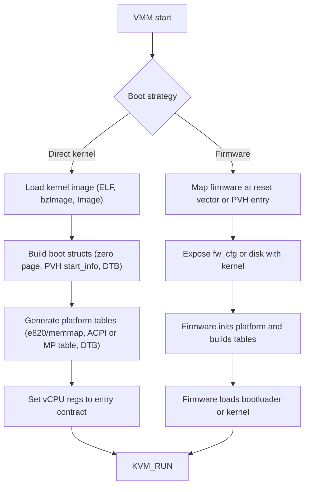
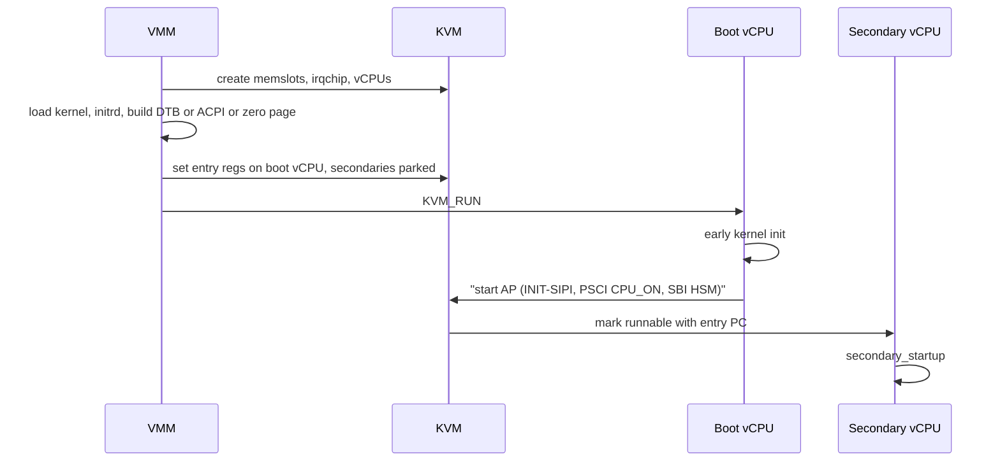
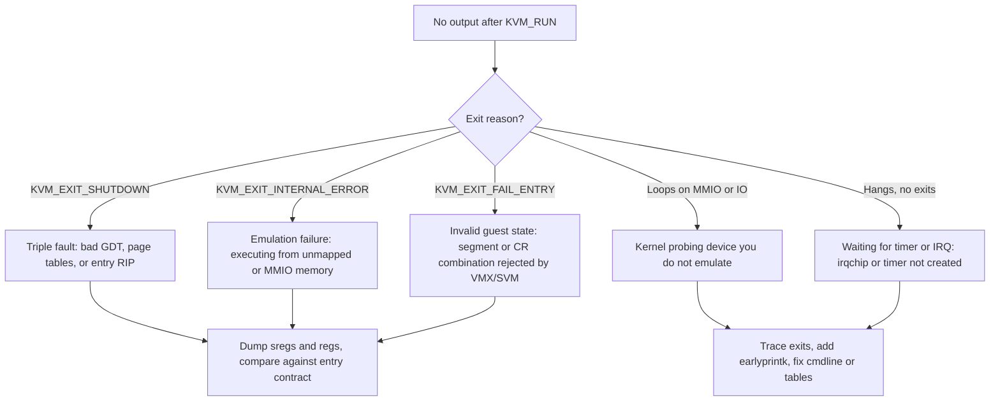

Purpose: explain exactly what a VMM must place in guest memory and in vCPU registers so that a Linux kernel (or firmware) starts executing correctly on x86-64, ARM64 and RISC-V, and how to choose between direct kernel boot and a firmware boot path.

# Booting Guests: Firmware and the Linux Boot Protocol

Related notes: [04 KVM API and the vCPU Run Loop](/compendium/virtualization/kvm-api-and-the-vcpu-run-loop), [05 Memory Virtualization EPT NPT and Guest Memory](/compendium/virtualization/memory-virtualization-ept-npt-and-guest-memory), [06 Interrupts Timers and Interrupt Controller Virtualization](/compendium/virtualization/interrupts-timers-and-interrupt-controller-virtualization), [07 Device Emulation PIO MMIO and the Bus Model](/compendium/virtualization/device-emulation-pio-mmio-and-the-bus-model), [08 Virtio Devices Virtqueues and vhost](/compendium/virtualization/virtio-devices-virtqueues-and-vhost), [15 ARM64 Virtualization EL2 VHE and GIC](/compendium/virtualization/arm64-virtualization-el2-vhe-and-gic), [16 RISC-V Virtualization and the Hypervisor Extension](/compendium/virtualization/risc-v-virtualization-and-the-hypervisor-extension), [18 Rust VMM Ecosystem and Project Templates](/compendium/virtualization/rust-vmm-ecosystem-and-project-templates), [01 Linux Mental Model User Space Kernel and Hardware](/compendium/linux-systems-engineering/linux-mental-model-user-space-kernel-and-hardware).

## The boot problem in one paragraph

A physical machine powers on with the CPU in a fixed reset state, and firmware (BIOS, UEFI, ATF, OpenSBI) walks it forward: initialize RAM, discover devices, build hardware description tables, load a bootloader, which loads a kernel. A VMM controls every byte of guest RAM and every vCPU register before the first `KVM_RUN`, so it can skip most of that chain. The question is always the same: **which contract does the code at the entry point expect, and have I satisfied every clause of it?** Get one clause wrong and the guest triple-faults, hangs silently, or boots but cannot find its CPUs, memory, or interrupt controller.

There are three broad strategies:

| Strategy | What the VMM does | Examples | Boot latency | Guest flexibility |
|---|---|---|---|---|
| Direct kernel boot | Loads vmlinux/bzImage/Image into RAM, builds boot structures, sets registers to the kernel's entry contract | Firecracker, Cloud Hypervisor `--kernel`, crosvm, QEMU `-kernel` | Lowest (tens of ms to the kernel entry) | Linux (or a PVH-aware kernel) only, kernel supplied by host |
| Minimal firmware | Loads a small firmware (PVH or reset vector entry) which then loads a kernel or EFI app from a disk | rust-hypervisor-firmware, qboot | Low | Guest owns its kernel on its own disk |
| Full firmware | Maps a firmware image at the reset vector; firmware does full platform init | SeaBIOS, OVMF (EDK II), U-Boot, EDK II for ArmVirt / RISC-V | Highest (hundreds of ms to seconds) | Any OS, Secure Boot, boot menus |



Why it matters for your VMM: the boot path decides which devices you must emulate on day one. Direct boot needs only RAM, a serial port, and the interrupt controller. SeaBIOS needs a PIT, CMOS RTC, PCI config space, fw_cfg, and a VGA or serial console. OVMF needs pflash (CFI flash) for variable storage, PCI, an ACPI table loader, and more. Start with direct boot.

## x86-64 Linux boot protocol

The authoritative document is `Documentation/arch/x86/boot.rst` (rendered at docs.kernel.org/arch/x86/boot.html). The latest protocol version at the time of writing is **2.15**. Version 2.14 was burnt by a bad patch and must be treated as 2.13.

### Kernel image formats on x86

| Format | What it is | How a VMM loads it |
|---|---|---|
| `vmlinux` | Uncompressed ELF64 of the kernel proper | Parse program headers, copy `PT_LOAD` segments to their physical addresses, enter at the 64-bit entry (or PVH entry if the `XEN_ELFNOTE_PHYS32_ENTRY` note is present) |
| `bzImage` | Real-mode setup code + setup header + compressed protected-mode payload with a decompressor | Read the setup header at offset 0x1F1, copy the protected-mode part to the load address (usually 1 MiB), copy the header into `boot_params.hdr`, enter at 64-bit entry |
| `bzImage` with EFI stub | Same file is also a PE/COFF executable | Firmware (OVMF) runs it as an EFI app; a VMM doing direct boot can ignore the PE part |

The bzImage layout: the first `(setup_sects + 1) * 512` bytes are the real-mode portion (boot sector + setup). If `setup_sects` is 0, the real value is 4. Everything after that is the protected-mode kernel, which is what you copy to the load address.

### The setup header

The setup header lives in the real-mode portion starting at file offset **0x1F1**. The same bytes, at the same offsets relative to the start of `struct boot_params`, become `boot_params.hdr`. Fields a direct-boot VMM reads or writes:

| Offset | Field | Size | Protocol | VMM action |
|---|---|---|---|---|
| 0x1F1 | `setup_sects` | 1 | all | Read: size of real-mode part (0 means 4) |
| 0x1FE | `boot_flag` | 2 | all | Validate 0xAA55 |
| 0x202 | `header` | 4 | 2.00+ | Validate `"HdrS"` (0x53726448) |
| 0x206 | `version` | 2 | 2.00+ | Read; reject below what you depend on (2.12 for `xloadflags`) |
| 0x210 | `type_of_loader` | 1 | 2.00+ | Write 0xFF (no assigned ID) |
| 0x211 | `loadflags` | 1 | 2.00+ | Set `LOADED_HIGH` (bit 0) expectation; set `CAN_USE_HEAP` (bit 7) if you set `heap_end_ptr` |
| 0x214 | `code32_start` | 4 | 2.00+ | 32-bit entry address (default 0x100000) |
| 0x218 | `ramdisk_image` | 4 | 2.00+ | Write initrd physical address (low 32 bits) |
| 0x21C | `ramdisk_size` | 4 | 2.00+ | Write initrd size |
| 0x224 | `heap_end_ptr` | 2 | 2.01+ | Only matters for the real-mode entry |
| 0x228 | `cmd_line_ptr` | 4 | 2.02+ | Write command line physical address (low 32 bits) |
| 0x22C | `initrd_addr_max` | 4 | 2.03+ | Read: highest address the initrd may end at |
| 0x230 | `kernel_alignment` | 4 | 2.05+ | Read: required alignment if relocating |
| 0x234 | `relocatable_kernel` | 1 | 2.05+ | Read: may you load somewhere other than `pref_address` |
| 0x236 | `xloadflags` | 2 | 2.12+ | Read: `XLF_KERNEL_64` (bit 0), `XLF_CAN_BE_LOADED_ABOVE_4G` (bit 1), EFI handover bits |
| 0x238 | `cmdline_size` | 4 | 2.06+ | Read: max command line length excluding NUL |
| 0x248 | `payload_offset` | 4 | 2.08+ | Location of compressed payload (rarely needed) |
| 0x250 | `setup_data` | 8 | 2.09+ | Physical address of a linked list of extra data (e.g. `SETUP_RNG_SEED`, `SETUP_E820_EXT`, `SETUP_DTB`) |
| 0x258 | `pref_address` | 8 | 2.10+ | Read: preferred load address |
| 0x260 | `init_size` | 4 | 2.10+ | Read: bytes of linear memory the kernel needs from its start during early boot |
| 0x264 | `handover_offset` | 4 | 2.11+ | EFI handover entry (only for EFI loaders) |

`xloadflags` bit meanings:

| Bit | Name | Meaning |
|---|---|---|
| 0 | `XLF_KERNEL_64` | Kernel has the legacy 64-bit entry at load address + 0x200 |
| 1 | `XLF_CAN_BE_LOADED_ABOVE_4G` | Kernel, `boot_params`, cmdline and ramdisk may live above 4 GiB (high halves go in `ext_*` fields of `boot_params`) |
| 2 | `XLF_EFI_HANDOVER_32` | 32-bit EFI handover supported |
| 3 | `XLF_EFI_HANDOVER_64` | 64-bit EFI handover at `handover_offset + 0x200` |
| 4 | `XLF_EFI_KEXEC` | kexec EFI boot with runtime services |

### boot_params, a.k.a. the zero page

`struct boot_params` (`arch/x86/include/uapi/asm/bootparam.h`) is a 4 KiB structure. Bootloaders traditionally place it at a low address (often 0x7000 in VMMs; Firecracker uses `0x7000`, as do several rust-vmm examples). Its name "zero page" comes from it being the first page the kernel reads its parameters from, not from it living at address 0.

Key regions inside it (offsets from the start of the struct, see `Documentation/arch/x86/zero-page.rst`):

| Offset | Field | Notes |
|---|---|---|
| 0x0C0 | `ext_ramdisk_image` | High 32 bits of initrd address |
| 0x0C4 | `ext_ramdisk_size` | High 32 bits of initrd size |
| 0x0C8 | `ext_cmd_line_ptr` | High 32 bits of cmdline address |
| 0x1E8 | `e820_entries` | Number of entries in `e820_table` |
| 0x1F1 | `hdr` | The setup header, copied from the image and patched |
| 0x2D0 | `e820_table` | Up to 128 entries of `{ u64 addr; u64 size; u32 type; }` (packed, 20 bytes) |

The direct boot recipe for bzImage:

1. Read the image, validate `boot_flag`, `"HdrS"`, `version`.
2. Copy the protected-mode kernel (everything after `(setup_sects + 1) * 512`) to the load address (usually `0x100000`, or `pref_address` if not relocatable).
3. Zero a 4 KiB `boot_params` buffer, copy the setup header bytes from the image into `boot_params.hdr`.
4. Patch: `type_of_loader = 0xFF`, `cmd_line_ptr`, `cmdline_size` (keep image value or set your length), `ramdisk_image`, `ramdisk_size`, `loadflags |= LOADED_HIGH` (bit already implied for bzImage).
5. Fill `e820_table` and `e820_entries` with the guest memory map.
6. Write `boot_params` to guest memory.
7. Write the command line (NUL-terminated) and the initrd.
8. Set up page tables, GDT, and registers for the 64-bit entry, then run.

### The e820 memory map

The guest discovers RAM from e820 entries (or from the EFI memory map under UEFI). Types: 1 = RAM, 2 = reserved, 3 = ACPI reclaimable, 4 = ACPI NVS, 5 = unusable, 7 = persistent memory. A typical microVM layout:

| Range | Type | Why |
|---|---|---|
| `0x0` to `0x9FC00` (or `0xA0000`) | RAM | Low memory, where zero page, cmdline, page tables, MP/ACPI tables live |
| `0xA0000` to `0x100000` | (not listed, or reserved) | Legacy VGA hole and BIOS ROM area; omitted so the kernel does not use it |
| `0x100000` to start of MMIO gap | RAM | Kernel, initrd, the bulk of memory below 4 GiB |
| MMIO gap (e.g. `0xC0000000` to `0x100000000`) | not listed or reserved | PCI MMIO, LAPIC at `0xFEE00000`, IOAPIC at `0xFEC00000` |
| `0x100000000` to end | RAM | Memory above 4 GiB when the guest has more RAM than fits below the gap |

The e820 map must agree with the KVM memslots you created (see [05 Memory Virtualization EPT NPT and Guest Memory](/compendium/virtualization/memory-virtualization-ept-npt-and-guest-memory)). Listing RAM that has no memslot behind it causes the guest to fault into an MMIO exit storm or a `KVM_EXIT_INTERNAL_ERROR` when it touches it.

### Command line and initrd placement

- Protocol 2.02+: `cmd_line_ptr` is a linear address. boot.rst describes the classic real-mode constraint (between end of setup heap and 0xA0000); for 64-bit direct boot any address the kernel can reach is fine in practice, and VMMs typically put it at a fixed low address like `0x20000`. Must be NUL terminated and no longer than `cmdline_size`.
- Initrd: must end below `initrd_addr_max` unless `XLF_CAN_BE_LOADED_ABOVE_4G` is set. VMMs commonly place it at the top of low memory, page aligned, below the MMIO gap.
- Above-4 GiB placement uses the `ext_*` fields for the high 32 bits.

A typical microVM command line:

```text
console=ttyS0 reboot=k panic=1 pci=off nomodule 8250.nr_uarts=1 i8042.noaux i8042.nomux i8042.dumbkbd root=/dev/vda rw
```

Each item has a reason: `reboot=k` makes reboot use the keyboard controller reset (which the VMM traps as a shutdown signal), `panic=1` reboots one second after panic, `pci=off` skips PCI probing when you have no PCI bus, `i8042.*` avoids probing a mostly-absent keyboard controller (which otherwise costs boot time).

### 32-bit and 64-bit entry contracts

**32-bit boot protocol** (entering at `code32_start`, normally the protected-mode kernel start):

- CPU in 32-bit protected mode, paging disabled.
- A GDT with `__BOOT_CS` (selector 0x10, flat 4 GiB execute/read) and `__BOOT_DS` (selector 0x18, flat 4 GiB read/write).
- `CS = __BOOT_CS`, `DS = ES = SS = __BOOT_DS`.
- Interrupts disabled.
- `ESI` = physical address of `boot_params`. `EBP`, `EDI`, `EBX` zero.

**64-bit boot protocol** (requires `XLF_KERNEL_64`):

- Entry at the loaded 64-bit kernel start address **+ 0x200**.
- CPU in 64-bit long mode with paging enabled.
- Identity mapping covering the kernel from its start address for `init_size` bytes, plus the zero page and the command line buffer.
- Same GDT selector requirements (`__BOOT_CS` 0x10, `__BOOT_DS` 0x18), interrupts disabled.
- `RSI` = physical address of `boot_params`.

For vmlinux ELF direct boot (Firecracker's default), the ELF entry point is `startup_64`, which follows the 64-bit protocol contract. The VMM must therefore build page tables and a GDT itself.

### Building long mode from the VMM

Because KVM lets you set `CR0`, `CR3`, `CR4`, `EFER` and segment descriptors directly via `KVM_SET_SREGS`, you do not run any real-mode trampoline. You write the structures into guest RAM and load registers.

```rust
// Checked against kvm-bindings 0.14 / kvm-ioctls 0.25 / vm-memory 0.17-era APIs.
use kvm_bindings::{kvm_regs, kvm_segment};
use kvm_ioctls::VcpuFd;
use vm_memory::{Bytes, GuestAddress, GuestMemoryMmap};

const BOOT_GDT_OFFSET: u64 = 0x500;
const PML4_START: u64 = 0x9000;
const PDPTE_START: u64 = 0xA000;
const PDE_START: u64 = 0xB000;
const ZERO_PAGE_START: u64 = 0x7000;
const BOOT_STACK_POINTER: u64 = 0x8FF0;

const X86_CR0_PE: u64 = 1 << 0;
const X86_CR0_PG: u64 = 1 << 31;
const X86_CR4_PAE: u64 = 1 << 5;
const EFER_LME: u64 = 1 << 8;
const EFER_LMA: u64 = 1 << 10;

/// Identity map the first 1 GiB with 2 MiB pages. Enough for a microVM kernel.
fn setup_page_tables(mem: &GuestMemoryMmap) -> Result<(), vm_memory::GuestMemoryError> {
    mem.write_obj(PDPTE_START | 0x03, GuestAddress(PML4_START))?; // present | writable
    mem.write_obj(PDE_START | 0x03, GuestAddress(PDPTE_START))?;
    for i in 0..512u64 {
        // present | writable | page size (2 MiB)
        mem.write_obj((i << 21) | 0x83, GuestAddress(PDE_START + i * 8))?;
    }
    Ok(())
}

fn gdt_entry(flags: u16, base: u32, limit: u32) -> u64 {
    ((u64::from(base) & 0xff00_0000) << (56 - 24))
        | ((u64::from(flags) & 0x0000_f0ff) << 40)
        | ((u64::from(limit) & 0x000f_0000) << (48 - 16))
        | ((u64::from(base) & 0x00ff_ffff) << 16)
        | (u64::from(limit) & 0x0000_ffff)
}

fn setup_sregs(mem: &GuestMemoryMmap, vcpu: &VcpuFd) -> anyhow::Result<()> {
    // null, null, code (0x10), data (0x18): selectors match __BOOT_CS/__BOOT_DS.
    let gdt = [
        gdt_entry(0, 0, 0),
        gdt_entry(0, 0, 0),
        gdt_entry(0xa09b, 0, 0xfffff), // 64-bit code, L=1
        gdt_entry(0xc093, 0, 0xfffff), // data
    ];
    for (i, e) in gdt.iter().enumerate() {
        mem.write_obj(*e, GuestAddress(BOOT_GDT_OFFSET + (i as u64) * 8))?;
    }
    let mut sregs = vcpu.get_sregs()?;
    let code = kvm_segment {
        base: 0, limit: 0xffff_ffff, selector: 0x10, type_: 0xb,
        present: 1, dpl: 0, db: 0, s: 1, l: 1, g: 1, avl: 0, unusable: 0, padding: 0,
    };
    let data = kvm_segment { selector: 0x18, type_: 0x3, l: 0, db: 1, ..code };
    sregs.cs = code;
    sregs.ds = data;
    sregs.es = data;
    sregs.fs = data;
    sregs.gs = data;
    sregs.ss = data;
    sregs.gdt.base = BOOT_GDT_OFFSET;
    sregs.gdt.limit = (gdt.len() * 8 - 1) as u16;

    setup_page_tables(mem)?;
    sregs.cr3 = PML4_START;
    sregs.cr4 |= X86_CR4_PAE;
    sregs.cr0 |= X86_CR0_PE | X86_CR0_PG;
    sregs.efer |= EFER_LME | EFER_LMA;
    vcpu.set_sregs(&sregs)?;

    let regs = kvm_regs {
        rflags: 0x2, // reserved bit 1 must be set, IF clear
        rip: 0, // filled by caller with the kernel entry
        rsp: BOOT_STACK_POINTER,
        rbp: BOOT_STACK_POINTER,
        rsi: ZERO_PAGE_START, // boot_params pointer, required by the protocol
        ..Default::default()
    };
    vcpu.set_regs(&regs)?;
    Ok(())
}
```

Things the snippet deliberately glosses over: setting the IDT to an empty table (`sregs.idt.limit = 0` is fine because interrupts are disabled), setting up FPU state (`KVM_SET_FPU` with `fcw = 0x37f`, `mxcsr = 0x1f80`), boot MSRs (`IA32_MISC_ENABLE` fast strings, `IA32_TSC`, `IA32_APICBASE` handled by LAPIC setup), and CPUID (`KVM_SET_CPUID2` must happen before the first run, see [04 KVM API and the vCPU Run Loop](/compendium/virtualization/kvm-api-and-the-vcpu-run-loop)). Firecracker's `arch/src/x86_64/regs.rs` is the canonical reference for these values.

### PVH boot

PVH is the Xen-originated boot ABI that Linux (`CONFIG_PVH=y`), FreeBSD, and rust-hypervisor-firmware support. It is simpler than the Linux protocol because the guest builds its own page tables.

- Entry point is advertised by the ELF note `XEN_ELFNOTE_PHYS32_ENTRY` (note type 18) in the `"Xen"` note namespace. The note's presence means "this image supports PVH".
- Entry state: 32-bit protected mode, `CR0.PE` set and all other writable `CR0` bits clear, `CR4` all clear, paging off, `EFLAGS.IF/TF/VM` clear.
- `CS` flat 32-bit code segment, `DS/ES/SS` flat 32-bit data segments (selectors unspecified), `TR` a 32-bit TSS with base 0 and limit 0x67.
- `EBX` = physical address of `struct hvm_start_info`.
- `hvm_start_info` (defined in Xen's `xen/include/public/arch-x86/hvm/start_info.h`): magic `0x336ec578` (`XEN_HVM_START_MAGIC_VALUE`), version, flags, module list (initrd), `cmdline_paddr`, `rsdp_paddr`, and since version 1 a `memmap_paddr` and `memmap_entries` describing memory with `hvm_memmap_table_entry` records (e820-like types).

PVH versus the 64-bit Linux protocol:

| Aspect | Linux 64-bit protocol | PVH |
|---|---|---|
| Who builds page tables | VMM | Guest |
| CPU mode at entry | Long mode | 32-bit protected, paging off |
| Parameter struct | `boot_params` (4 KiB, x86-specific, kernel-version sensitive) | `hvm_start_info` (small, stable, OS-neutral) |
| Image format | bzImage or vmlinux | ELF with PVH note |
| Hardware description | e820 in zero page, MP table or ACPI | memmap in start_info, ACPI via `rsdp_paddr` |
| Firmware support | Linux only | Linux, FreeBSD, rust-hypervisor-firmware, qboot-like loaders |

Cloud Hypervisor prefers PVH when the ELF contains the note, falling back to the Linux 64-bit protocol otherwise. linux-loader reports this as `KernelLoaderResult::pvh_boot_cap`.

### MP tables and ACPI: describing CPUs and interrupt controllers

The kernel must learn how many CPUs exist and where the LAPIC and IOAPIC live. Two mechanisms:

**Intel MultiProcessor Specification table (MP table).** A floating pointer structure (`"_MP_"` signature, 16-byte aligned) placed in one of the regions the kernel scans (first KiB of EBDA, last KiB of base memory, or `0xF0000` to `0xFFFFF`), pointing to a configuration table (`"PCMP"`) with processor entries (one per vCPU, APIC ID, enabled flag, BSP flag), bus entries, an IOAPIC entry (ID, version, address `0xFEC00000`), and I/O interrupt assignment entries mapping ISA IRQs to IOAPIC pins. Simple to generate, but it cannot describe modern features (no NUMA, no hotplug, no power management). Linux needs `CONFIG_X86_MPPARSE=y`.

**ACPI.** The modern path, and required for PCI hotplug, NUMA (SRAT/SLIT), CPU hotplug, power button, VM generation ID, and anything UEFI. Minimum table set for an x86 guest:

| Table | Purpose |
|---|---|
| RSDP | Root pointer, found by scanning `0xE0000` to `0xFFFFF` (16-byte aligned, `"RSD PTR "`), via EFI config table, or via PVH `rsdp_paddr` |
| XSDT | List of 64-bit pointers to the other tables |
| FADT (`FACP`) | Fixed hardware description, points to DSDT; for a hardware-reduced microVM set the `HW_REDUCED_ACPI` flag so the guest does not expect PM timer or legacy fixed events |
| DSDT | AML bytecode describing devices: serial ports, virtio-mmio devices, PCI host bridge (`_CRS`, `_PRT`), power button, GED |
| MADT (`APIC`) | One Local APIC (or x2APIC) entry per vCPU, an IOAPIC entry, interrupt source overrides |
| MCFG | ECAM base for PCIe config space, if you have PCIe |
| SRAT / SLIT | NUMA topology, optional |

Every table has a 36-byte common header with a checksum such that all bytes sum to zero modulo 256. Getting the checksum wrong is the classic first bug: Linux prints `ACPI BIOS Warning (bug): Incorrect checksum` and may ignore the table.

Generating DSDT means emitting AML. Cloud Hypervisor's `acpi_tables` crate (now under `rust-vmm/acpi_tables`) provides an `Aml` trait and builders (`Device`, `Name`, `Method`, `ResourceTemplate`) so you never hand-assemble bytecode.

Firecracker history is a good reference point: it generated only an MP table for years, then added ACPI for x86_64 guests (PR #4428), describing vCPUs, interrupt controllers, virtio and legacy devices, and deprecated booting MPTable-dependent kernels, with removal planned for v2.0 or later. Its kernel policy notes that ACPI boot on x86_64 needs `CONFIG_PCI` even without a PCI bus, and that `CONFIG_X86_MPPARSE=n` plus `CONFIG_VIRTIO_MMIO_CMDLINE_DEVICES=n` turns off the legacy paths.

### Describing virtio-mmio devices without ACPI

Without ACPI or a DTB, x86 Linux learns virtio-mmio devices from the command line with `CONFIG_VIRTIO_MMIO_CMDLINE_DEVICES=y`:

```text
virtio_mmio.device=4K@0xd0000000:5 virtio_mmio.device=4K@0xd0001000:6
```

Format: `&lt;size&gt;@&lt;base&gt;:&lt;irq&gt;[:&lt;id&gt;]`. linux-loader's `Cmdline::add_virtio_mmio_device(size, baseaddr, irq, id)` produces exactly this. It is a stopgap: ACPI DSDT entries (`LNRO0005` HID) or a DTB `virtio,mmio` node are the durable descriptions.

## Firmware paths on x86

### Reset vector boot

A full-firmware boot starts the BSP in real mode with `CS.base = 0xFFFF0000` and `RIP = 0xFFF0`, so the first fetch is at physical `0xFFFFFFF0`. KVM vCPUs start in exactly this architectural reset state, so a VMM that maps a firmware ROM at the top of the 4 GiB space (as a read-only memslot, `KVM_MEM_READONLY`) and runs the vCPU without touching registers gets a real BIOS-style boot. Application processors start in wait-for-SIPI (`KVM_MP_STATE_UNINITIALIZED`) and are woken by INIT-SIPI-SIPI from the BSP, which KVM's in-kernel LAPIC handles.

### SeaBIOS

Open-source legacy BIOS used by QEMU's default i440fx/q35 machines. Needs: CMOS/RTC (memory size at CMOS 0x34/0x35 and 0x5B to 0x5D in QEMU's convention), fw_cfg (QEMU's firmware configuration interface at I/O ports 0x510/0x511 or MMIO, carrying `etc/e820`, ACPI tables via the table loader, the kernel and initrd for `-kernel`), PCI config space, a PIT, a keyboard controller for reset. Gives you legacy boot from disks and option ROMs. Reasonable if you need to boot arbitrary legacy images; poor fit for a microVM.

qboot is a minimal x86 firmware from the QEMU community that boots in a few milliseconds by only doing what Linux needs, using fw_cfg for the kernel.

### OVMF (EDK II for VMs)

UEFI firmware built from EDK II's `OvmfPkg`. Two image layouts matter:

- **Split** `OVMF_CODE.fd` + `OVMF_VARS.fd`: code is read-only, variables live in a separate writable flash so Secure Boot keys and boot entries persist per VM.
- **Unified** `OVMF.fd`.

OVMF expects to be mapped as CFI pflash at the top of 4 GiB, and it emulates variable writes through the flash command protocol, so the VMM must implement a CFI flash device (or use a ROM plus an emulated variable store). It discovers memory and tables through fw_cfg on QEMU, or through other hooks on Cloud Hypervisor (Cloud Hypervisor has an OVMF build `CLOUDHV.fd` using the PVH entry and its own ACPI tables). OVMF is the way to get Windows, Secure Boot, and confidential computing (SEV, TDX) guests, which need measured firmware.

### rust-hypervisor-firmware

`cloud-hypervisor/rust-hypervisor-firmware` is a small Rust firmware intended for Cloud Hypervisor and Firecracker-style VMMs. It is started via the PVH entry on x86 (Image entry on aarch64), finds a virtio-block disk, and either loads a Linux kernel per the Boot Loader Specification or runs an EFI application (it implements a minimal subset of UEFI boot services, enough for shim/grub or a Linux EFI stub). It is the shortest path to letting tenants own their kernel inside their disk image while keeping firmware boot cheap. Supported targets include x86-64 and aarch64; check its README for RISC-V status before depending on it.

| Firmware | Entry mechanism | Devices it needs from the VMM | Typical use |
|---|---|---|---|
| SeaBIOS | Reset vector | fw_cfg, PCI, PIT, RTC, i8042, VGA or serial | Legacy OS images |
| qboot | Reset vector | fw_cfg, PCI | Fast Linux boot on QEMU |
| OVMF | Reset vector (pflash) or PVH (CLOUDHV build) | pflash, PCI, ACPI loader or VMM ACPI, RTC | UEFI, Windows, Secure Boot, SEV/TDX |
| rust-hypervisor-firmware | PVH (x86), Image (arm64) | virtio-blk (PCI or MMIO), serial, ACPI from VMM | Guest-owned kernels with minimal cost |

## ARM64 boot

Authoritative: `Documentation/arch/arm64/booting.rst`.

### The Image header

The arm64 `Image` is a raw binary with a 64-byte header at offset 0:

| Offset | Field | Size | Meaning |
|---|---|---|---|
| 0x00 | `code0` | u32 | Executable branch (or `MZ` when the EFI stub is enabled) |
| 0x04 | `code1` | u32 | Executable code |
| 0x08 | `text_offset` | u64 | Load offset above a 2 MiB-aligned base, little-endian |
| 0x10 | `image_size` | u64 | Effective image size including BSS; reserve at least this much |
| 0x18 | `flags` | u64 | Bit 0 endianness (1 = BE), bits 1-2 page size (1 = 4K, 2 = 16K, 3 = 64K, 0 = unspecified), bit 3 physical placement |
| 0x20 | `res2` | u64 | 0 |
| 0x28 | `res3` | u64 | 0 |
| 0x30 | `res4` | u64 | 0 |
| 0x38 | `magic` | u32 | `0x644d5241` ("ARM\x64") |
| 0x3C | `res5` | u32 | Offset to PE header |

Before v3.17, `image_size` is zero and `text_offset` is assumed to be `0x80000`. Modern kernels report `text_offset = 0`. Load rule: place the Image at `text_offset` above a 2 MiB-aligned base in RAM and leave `image_size` bytes free.

### Entry contract

- `x0` = physical address of the DTB. `x1`, `x2`, `x3` = 0 (reserved).
- MMU off. The kernel image range cleaned to the Point of Coherency. I-cache may be on but must not contain stale entries.
- All DAIF masks set (Debug, SError, IRQ, FIQ masked).
- Non-secure state, at EL2 (recommended, required if the guest wants to run KVM itself) or EL1. All CPUs enter at the same EL.
- `CNTFRQ_EL0` programmed with the timer frequency; `CNTVOFF_EL2` consistent across CPUs.
- DTB 8-byte aligned, at most 2 MiB, not in a 2 MiB region needing special attributes.
- An initrd must lie in a 1 GiB-aligned window of up to 32 GiB that also covers the Image.

Under KVM, most of this is satisfied by `KVM_ARM_VCPU_INIT`: it resets the vCPU to a known state with MMU off, at EL1 by default (or EL2 when the `KVM_ARM_VCPU_HAS_EL2` feature is requested, see [11 Device Passthrough VFIO IOMMU and Nested Virtualization](/compendium/virtualization/device-passthrough-vfio-iommu-and-nested-virtualization)), with `PSTATE` = EL1h and DAIF masked. The VMM then sets `PC` and `x0` with `KVM_SET_ONE_REG`:

```rust
// kvm-ioctls 0.25 / kvm-bindings, arm64 target.
use kvm_bindings::{kvm_vcpu_init, KVM_ARM_VCPU_PSCI_0_2, KVM_ARM_VCPU_POWER_OFF};
use kvm_ioctls::{VcpuFd, VmFd};

// Register ID helpers: core regs are encoded as KVM_REG_ARM64 | KVM_REG_SIZE_U64 |
// KVM_REG_ARM_CORE | (offset_of!(kvm_regs, field) / 4). rust-vmm VMMs wrap this in a macro.
fn init_vcpu(vm: &VmFd, vcpu: &VcpuFd, index: u64, kernel_entry: u64, dtb_addr: u64,
             pc_id: u64, x0_id: u64) -> anyhow::Result<()> {
    let mut kvi = kvm_vcpu_init::default();
    vm.get_preferred_target(&mut kvi)?;
    kvi.features[0] |= 1 << KVM_ARM_VCPU_PSCI_0_2;
    if index > 0 {
        // Secondaries start powered off; the guest wakes them with PSCI CPU_ON.
        kvi.features[0] |= 1 << KVM_ARM_VCPU_POWER_OFF;
    }
    vcpu.vcpu_init(&kvi)?;
    if index == 0 {
        vcpu.set_one_reg(pc_id, &kernel_entry.to_le_bytes())?;
        vcpu.set_one_reg(x0_id, &dtb_addr.to_le_bytes())?;
    }
    Ok(())
}
```

Signatures to double check against your kvm-ioctls version: `get_preferred_target(&self, kvi: &mut kvm_vcpu_init)`, `vcpu_init(&self, kvi: &kvm_vcpu_init)`, and `set_one_reg(&self, reg_id: u64, data: &[u8])` (older releases took a `u128` value instead of a byte slice).

### Secondary CPUs: PSCI

booting.rst defines two enable methods per CPU node in the DTB: `spin-table` (CPU polls `cpu-release-addr`) and `psci`. VMMs always use PSCI: request `KVM_ARM_VCPU_PSCI_0_2`, start secondaries with `KVM_ARM_VCPU_POWER_OFF`, add a `/psci` node with `compatible = "arm,psci-0.2"` (or `"arm,psci-1.0"`) and `method = "hvc"`, and give each CPU node `enable-method = "psci"`. KVM handles `CPU_ON`, `CPU_OFF`, `SYSTEM_OFF`, and `SYSTEM_RESET` in the kernel; the latter two exit to userspace as `KVM_EXIT_SYSTEM_EVENT` with `KVM_SYSTEM_EVENT_SHUTDOWN` or `KVM_SYSTEM_EVENT_RESET`. Userspace can opt into handling PSCI/SMCCC calls itself with `KVM_CAP_ARM_SMCCC_FILTER` if needed.

### The device tree an arm64 VMM must generate

Minimum DTB nodes (generated with the `vm-fdt` crate from rust-vmm, or `libfdt` bindings):

| Node | Key properties |
|---|---|
| `/` | `compatible`, `#address-cells = &lt;2&gt;`, `#size-cells = &lt;2&gt;`, `interrupt-parent` |
| `/chosen` | `bootargs` (the command line), `linux,initrd-start`, `linux,initrd-end`, `stdout-path` |
| `/memory@...` | `device_type = "memory"`, `reg` |
| `/cpus/cpu@N` | `device_type = "cpu"`, `compatible = "arm,arm-v8"`, `reg` = MPIDR affinity, `enable-method = "psci"` |
| `/psci` | `compatible`, `method = "hvc"` |
| `/intc` | GICv3: `compatible = "arm,gic-v3"`, distributor and redistributor `reg`, `#interrupt-cells = &lt;3&gt;`; optional ITS child for MSIs |
| `/timer` | `compatible = "arm,armv8-timer"`, the four PPIs (secure phys, non-secure phys, virt, hyp) |
| `/uart@...` | PL011 (`arm,pl011`) or 16550 (`ns16550a`), `clocks` if PL011 |
| `/virtio_mmio@...` | `compatible = "virtio,mmio"`, `reg`, `interrupts` |
| `/rtc` | PL031 if you emulate it |

The GIC addresses in the DTB must match those you configured with `KVM_CREATE_DEVICE` + `KVM_DEV_ARM_VGIC_GRP_ADDR` (see [15 ARM64 Virtualization EL2 VHE and GIC](/compendium/virtualization/arm64-virtualization-el2-vhe-and-gic)). Arm also supports ACPI boot (via UEFI) for server-class guests; EDK II's `ArmVirtPkg` builds firmware for that.

## RISC-V boot

Authoritative: `Documentation/arch/riscv/boot.rst` and `boot-image-header.rst`.

### Firmware layering on real hardware vs under KVM

On hardware: M-mode firmware (OpenSBI) implements the Supervisor Binary Interface, then jumps to the S-mode kernel or to U-Boot/EDK II. Under KVM, the guest runs in VS-mode and **KVM itself implements SBI** for the guest (base, timer, IPI, RFENCE, HSM, SRST, PMU, and others), so the guest does not need OpenSBI. SBI calls that KVM does not handle, or that userspace has asked to handle (for example the console extension), exit as `KVM_EXIT_RISCV_SBI`. QEMU's `virt` machine without KVM does run OpenSBI as the M-mode firmware; do not confuse the two.

### Image header

| Offset | Field | Size | Value |
|---|---|---|---|
| 0x00 | `code0` | u32 | Executable code (`MZ` with EFI stub) |
| 0x04 | `code1` | u32 | Executable code |
| 0x08 | `text_offset` | u64 | Image load offset |
| 0x10 | `image_size` | u64 | Effective size, mandatory for the loader |
| 0x18 | `flags` | u64 | Bit 0 endianness |
| 0x20 | `version` | u32 | Major in bits 16-31, minor in 0-15; current 0.2 |
| 0x24 | `res1` | u32 | 0 |
| 0x28 | `res2` | u64 | 0 |
| 0x30 | `magic` | u64 | `0x5643534952` ("RISCV"), deprecated since 0.2 |
| 0x38 | `magic2` | u32 | `0x05435352` ("RSC\x05"), the one to check |
| 0x3C | `res3` | u32 | PE/COFF offset |

### Entry contract

- `a0` = hart ID of the boot hart. `a1` = physical address of the DTB.
- `satp = 0` (MMU off), S-mode (VS-mode from the guest's point of view).
- Kernel placed at a PMD boundary: 2 MiB aligned on RV64, 4 MiB on RV32.
- Secondary harts: preferred method is **ordered booting**, where only the boot hart runs and it starts others with SBI HSM `sbi_hart_start`. `RISCV_BOOT_SPINWAIT` (all harts released, one wins) is a legacy path for old firmware and M-mode kernels.

Under KVM, the VMM sets `pc`, `a0`, `a1` via `KVM_SET_ONE_REG` using `KVM_REG_RISCV_CORE` IDs, and marks non-boot vCPUs as stopped with `KVM_SET_MP_STATE` (`KVM_MP_STATE_STOPPED`) so the in-kernel SBI HSM implementation can start them on the guest's request.

### RISC-V DTB essentials

| Node | Key properties |
|---|---|
| `/cpus` | `timebase-frequency` (must match the host's time CSR frequency KVM exposes) |
| `/cpus/cpu@N` | `riscv,isa-base` and `riscv,isa-extensions` (or legacy `riscv,isa` string), `mmu-type = "riscv,sv48"` or sv39/sv57, child `interrupt-controller` with `compatible = "riscv,cpu-intc"` |
| `/memory` | RAM `reg` |
| `/soc/aplic` or `/soc/plic` | Interrupt controller; AIA (APLIC + IMSIC) when KVM AIA device is used, PLIC emulated in userspace otherwise |
| `/chosen` | `bootargs`, initrd range, `stdout-path` |
| `/soc/serial` | `ns16550a` |

The ISA string in the DTB must not advertise extensions you disabled through `KVM_REG_RISCV_ISA_EXT` registers; mismatches cause illegal-instruction traps very early in boot.

## Architecture comparison

| Concern | x86-64 | ARM64 | RISC-V |
|---|---|---|---|
| Kernel format for direct boot | vmlinux (ELF) or bzImage | `Image` (raw + header) | `Image` (raw + header) |
| Hardware description | e820 + MP table or ACPI | DTB (or ACPI via UEFI) | DTB (or ACPI via UEFI) |
| Parameter pointer | `RSI` -&gt; `boot_params` (or `EBX` -&gt; `hvm_start_info` for PVH) | `x0` -&gt; DTB | `a0` = hart ID, `a1` -&gt; DTB |
| CPU mode the VMM must establish | Long mode with identity map (or 32-bit flat for PVH) | MMU off, EL1 or EL2, DAIF masked | `satp = 0`, S-mode |
| Secondary CPU start | INIT-SIPI-SIPI via LAPIC | PSCI `CPU_ON` (HVC) | SBI HSM `hart_start` |
| Who implements the firmware interface under KVM | Nothing needed for direct boot | KVM (PSCI) | KVM (SBI) |
| Firmware for full boot | SeaBIOS, OVMF, qboot | EDK II ArmVirtPkg, U-Boot | EDK II RiscVVirt, U-Boot (OpenSBI only in TCG/hardware) |



Secondary vCPU threads still run `KVM_RUN` in a loop from the start. They simply block inside the kernel while their MP state says powered off or waiting for SIPI.

## The linux-loader crate

`linux-loader` (rust-vmm) is what Firecracker, Cloud Hypervisor and most Rust VMMs use. Checked version: **0.14.0** on docs.rs.

| Module / item | Purpose |
|---|---|
| `loader::KernelLoader` trait | `load` a kernel image into guest memory |
| `loader::elf::Elf` (feature `elf`, x86) | ELF vmlinux loader, detects PVH note |
| `loader::bzimage::BzImage` (feature `bzimage`, x86) | bzImage loader, returns the parsed `setup_header` |
| `loader::pe::PE` (feature `pe`, arm64 / riscv64) | Loader for arm64 and riscv `Image` (header is PE-compatible) |
| `loader::KernelLoaderResult` | `kernel_load: GuestAddress`, `kernel_end: GuestUsize`, `setup_header: Option&lt;setup_header&gt;` (x86), `pvh_boot_cap: PvhBootCapability` (x86 + elf) |
| `loader::load_cmdline` | Writes a NUL-terminated `Cmdline` into guest memory |
| `cmdline::Cmdline` | Builder with capacity checks: `new(capacity)`, `try_from(&str, capacity)`, `insert(key, val)`, `insert_str`, `insert_init_args`, `as_cstring`, `add_virtio_mmio_device` |
| `configurator::linux::LinuxBootConfigurator` | Writes `boot_params` |
| `configurator::pvh::PvhBootConfigurator` | Writes `hvm_start_info` plus memmap |
| `configurator::fdt::FdtBootConfigurator` | Writes a DTB blob |
| `configurator::BootParams` | Header + sections + modules container passed to configurators |

`KernelLoader::load` in 0.14:

```rust
fn load<F, M: GuestMemoryBackend>(
    guest_mem: &M,
    kernel_offset: Option<GuestAddress>,
    kernel_image: &mut F,
    highmem_start_address: Option<GuestAddress>,
) -> Result<KernelLoaderResult>
where
    F: Read + ReadVolatile + Seek;
```

Note the bound is `GuestMemoryBackend` (the newer vm-memory trait name) and `ReadVolatile` (vm-memory's volatile I/O trait). Older linux-loader releases used `GuestMemory` and plain `Read`; match the linux-loader release to the vm-memory release your VMM uses or you will fight trait mismatches.

A direct-boot loader for x86 combining these:

```rust
use std::fs::File;
use linux_loader::cmdline::Cmdline;
use linux_loader::configurator::{linux::LinuxBootConfigurator, BootConfigurator, BootParams};
use linux_loader::loader::{bootparam::boot_params, elf::Elf, load_cmdline, KernelLoader};
use vm_memory::{GuestAddress, GuestMemoryMmap};

const CMDLINE_START: u64 = 0x20000;
const ZERO_PAGE_START: u64 = 0x7000;
const HIMEM_START: u64 = 0x10_0000; // 1 MiB
const KERNEL_BOOT_FLAG_MAGIC: u16 = 0xaa55;
const KERNEL_HDR_MAGIC: u32 = 0x5372_6448; // "HdrS"
const KERNEL_LOADER_OTHER: u8 = 0xff;

fn load_linux(mem: &GuestMemoryMmap, kernel_path: &str) -> anyhow::Result<u64> {
    let mut kernel = File::open(kernel_path)?;
    let result = Elf::load(mem, None, &mut kernel, Some(GuestAddress(HIMEM_START)))?;

    let mut cmdline = Cmdline::new(4096)?;
    cmdline.insert_str("console=ttyS0 reboot=k panic=1 pci=off")?;
    load_cmdline(mem, GuestAddress(CMDLINE_START), &cmdline)?;
    let cmdline_len = cmdline.as_cstring()?.as_bytes_with_nul().len();

    let mut params = boot_params::default();
    params.hdr.type_of_loader = KERNEL_LOADER_OTHER;
    params.hdr.boot_flag = KERNEL_BOOT_FLAG_MAGIC;
    params.hdr.header = KERNEL_HDR_MAGIC;
    params.hdr.cmd_line_ptr = CMDLINE_START as u32;
    params.hdr.cmdline_size = cmdline_len as u32;
    params.hdr.kernel_alignment = 0x0100_0000;
    // Fill params.e820_table / params.e820_entries from your memory layout here.

    LinuxBootConfigurator::write_bootparams::<GuestMemoryMmap>(
        &BootParams::new::<boot_params>(&params, GuestAddress(ZERO_PAGE_START)),
        mem,
    )?;
    // Entry: 64-bit protocol, RIP = kernel entry, RSI = ZERO_PAGE_START.
    Ok(result.kernel_load.0)
}
```

For a vmlinux ELF the entry point is the ELF `e_entry`, which linux-loader returns as `kernel_load` in the Linux-protocol case. For bzImage you take `kernel_load + 0x200` for the 64-bit entry and use `result.setup_header` as the starting `hdr` instead of building one from constants. For PVH, check `result.pvh_boot_cap` and use `PvhBootConfigurator` with `hvm_start_info` and `hvm_memmap_table_entry` sections. Verify the exact field names (`kernel_load`, `pvh_boot_cap`) and whether `load_cmdline` takes a `&Cmdline` in your version; they have changed across 0.x releases.

## Building a minimal guest kernel

A guest kernel built for your VMM boots faster and has less attack surface than a distro kernel. Start from `make tinyconfig` or Firecracker's published microVM configs (`resources/guest_configs/` in the Firecracker repo) and add only what your device model needs.

| Area | Options (x86_64 example) | Reason |
|---|---|---|
| Base | `CONFIG_64BIT`, `CONFIG_SMP`, `CONFIG_PRINTK`, `CONFIG_TTY`, `CONFIG_BINFMT_ELF`, `CONFIG_BLK_DEV_INITRD` (if initrd) | Something useful has to run |
| Paravirt | `CONFIG_HYPERVISOR_GUEST`, `CONFIG_PARAVIRT`, `CONFIG_KVM_GUEST` | kvmclock, PV EOI, PV TLB flush, steal time |
| Boot | `CONFIG_PVH` (for PVH entry), `CONFIG_ACPI` or `CONFIG_X86_MPPARSE` | Entry ABI and CPU discovery |
| Console | `CONFIG_SERIAL_8250`, `CONFIG_SERIAL_8250_CONSOLE` (x86, riscv), `CONFIG_SERIAL_AMBA_PL011_CONSOLE` (arm64) | Early serial output |
| Virtio | `CONFIG_VIRTIO`, `CONFIG_VIRTIO_MMIO` and/or `CONFIG_VIRTIO_PCI`, `CONFIG_VIRTIO_BLK`, `CONFIG_VIRTIO_NET`, `CONFIG_VIRTIO_CONSOLE`, `CONFIG_HW_RANDOM_VIRTIO`, `CONFIG_VIRTIO_VSOCKETS` | Device model from [08 Virtio Devices Virtqueues and vhost](/compendium/virtualization/virtio-devices-virtqueues-and-vhost) |
| virtio-mmio discovery | `CONFIG_VIRTIO_MMIO_CMDLINE_DEVICES` (cmdline) or ACPI/DT | How devices are announced |
| Filesystems | `CONFIG_EXT4_FS`, `CONFIG_DEVTMPFS`, `CONFIG_DEVTMPFS_MOUNT` | Root FS |
| Time | `CONFIG_RTC_DRV_CMOS` (x86), `CONFIG_RTC_DRV_PL031` (arm64), `CONFIG_RTC_DRV_GOLDFISH` (riscv virt) | Wall clock at boot |
| VM generation | `CONFIG_VMGENID` | RNG reseed after snapshot restore, see [12 Snapshots Live Migration and Dirty Page Tracking](/compendium/virtualization/snapshots-live-migration-and-dirty-page-tracking) |
| Leave out | Modules (`CONFIG_MODULES=n`), sound, USB, DRM, wireless, most of `drivers/` | Boot time, image size, attack surface |

ARM64 additions: `CONFIG_ARM_GIC_V3`, `CONFIG_ARM_GIC_V3_ITS` (for MSI), `CONFIG_ARM_PSCI_FW`, `CONFIG_ARM_ARCH_TIMER`. RISC-V additions: `CONFIG_RISCV_SBI`, `CONFIG_RISCV_SBI_V01=n`, `CONFIG_RISCV_APLIC`/`CONFIG_RISCV_IMSIC` if you expose AIA, `CONFIG_SERIAL_EARLYCON_RISCV_SBI` for very early prints.

Build commands:

```bash
make ARCH=x86_64 tinyconfig
./scripts/config --enable 64BIT --enable SMP --enable KVM_GUEST --enable PVH \
  --enable VIRTIO_MMIO --enable VIRTIO_BLK --enable SERIAL_8250_CONSOLE
make ARCH=x86_64 olddefconfig
make ARCH=x86_64 -j16 vmlinux bzImage

# arm64 cross build
make ARCH=arm64 CROSS_COMPILE=aarch64-linux-gnu- defconfig
make ARCH=arm64 CROSS_COMPILE=aarch64-linux-gnu- -j16 Image

# riscv64 cross build
make ARCH=riscv CROSS_COMPILE=riscv64-linux-gnu- defconfig
make ARCH=riscv CROSS_COMPILE=riscv64-linux-gnu- -j16 Image
```

Boot-time diagnostics: add `earlyprintk=serial,ttyS0,115200` (x86) or `earlycon` (arm64/riscv with `stdout-path` in the DTB) while bringing up a new VMM. If you see nothing at all, the problem is before the console driver: check entry registers, page tables, and that the serial port at `0x3f8` actually produces `KVM_EXIT_IO`.

## Debugging a boot that does not boot



Useful technique: run the same kernel and command line in QEMU with `-kernel` and `-d int,cpu_reset` or with `-s -S` for a GDB stub, then diff register state at entry against your VMM's. Under KVM, `perf kvm stat` and the `kvm:kvm_exit` tracepoint show exit reasons per vCPU (see [14 Performance Observability and Debugging](/compendium/virtualization/performance-observability-and-debugging)).

## Common pitfalls

- Forgetting `RSI = boot_params` (x86) or `x0 = DTB` (arm64) or `a1 = DTB` (riscv). The kernel then reads garbage as parameters and usually dies before printing anything.
- Using the ELF entry for a bzImage, or forgetting the `+ 0x200` for the 64-bit bzImage entry.
- Not setting `type_of_loader`; some kernel paths treat 0 as "ancient loader" and refuse features.
- Placing the initrd above `initrd_addr_max` without `XLF_CAN_BE_LOADED_ABOVE_4G`, or overlapping it with the kernel's `init_size` region (the decompressor uses that space).
- Identity mapping too little memory: the 64-bit protocol requires the kernel range through `init_size`, the zero page and the cmdline to be mapped.
- e820 or DTB memory nodes that disagree with KVM memslots, or that include the MMIO gap.
- ACPI checksums wrong, or an XSDT pointing to tables not covered by an e820 entry (mark ACPI memory as type 3 or 4, or place it in reserved space).
- MADT or DTB listing a different number of CPUs than you created vCPUs, so the guest waits forever for an AP to come up.
- arm64: GIC addresses in the DTB differ from `KVM_DEV_ARM_VGIC_GRP_ADDR`, or secondaries not started with `KVM_ARM_VCPU_POWER_OFF` so they run the kernel entry concurrently with the boot CPU.
- arm64: not cleaning caches is not an issue under KVM for memory the VMM wrote, but it is an issue when you hand-write code into memory on hosts with non-coherent DMA devices; follow the booting.rst rules if you write a firmware.
- RISC-V: advertising ISA extensions in the DTB that the vCPU does not have, or a `timebase-frequency` that differs from the host value, producing wildly wrong time.
- RISC-V: assuming OpenSBI is needed under KVM. KVM provides SBI to the guest.
- linux-loader and vm-memory version mismatch causing trait bound errors that look unrelated to boot.
- Mixing PVH and Linux-protocol assumptions: PVH enters in 32-bit mode with paging off, so pre-building page tables for it is wasted work and setting `EFER.LME` breaks it.

## Review checklist

- [ ] Boot strategy chosen per guest type (direct kernel, minimal firmware, full UEFI) and documented.
- [ ] Image format detected by magic (`ELF`, `HdrS`, `ARM\x64`, `RSC\x05`), never by filename.
- [ ] x86: setup header version checked; `xloadflags` honored; `type_of_loader = 0xFF`.
- [ ] x86: e820 map generated from the same layout object that creates memslots.
- [ ] x86: page tables cover kernel through `init_size`, zero page and cmdline; GDT selectors 0x10/0x18.
- [ ] x86: CPUID, MSRs, FPU, LAPIC set before first `KVM_RUN`.
- [ ] PVH path tested separately: `EBX` -&gt; `hvm_start_info`, magic `0x336ec578`, memmap populated.
- [ ] ACPI tables checksummed; MADT CPU count equals vCPU count; RSDP reachable by the chosen discovery method.
- [ ] arm64: `KVM_ARM_VCPU_PSCI_0_2` on all vCPUs; secondaries powered off; PC and x0 set on vCPU 0.
- [ ] arm64: DTB 8-byte aligned and under 2 MiB; GIC, timer, PSCI nodes match the in-kernel devices.
- [ ] RISC-V: `a0` hart ID, `a1` DTB, kernel 2 MiB aligned (RV64); non-boot harts `KVM_MP_STATE_STOPPED`.
- [ ] Command line length checked against `cmdline_size` / `Cmdline` capacity.
- [ ] Guest kernel config versioned with the VMM and includes `CONFIG_VMGENID` and the paravirt clock.
- [ ] Early console path verified on every architecture before adding devices.

## Primary Sources

- [Linux x86 boot protocol (boot.rst)](https://docs.kernel.org/arch/x86/boot.html)
- [Linux x86 zero page layout](https://docs.kernel.org/arch/x86/zero-page.html)
- [Booting AArch64 Linux (booting.rst)](https://docs.kernel.org/arch/arm64/booting.html)
- [RISC-V kernel boot requirements and constraints](https://docs.kernel.org/arch/riscv/boot.html)
- [RISC-V boot image header](https://docs.kernel.org/arch/riscv/boot-image-header.html)
- [Xen PVH boot ABI](https://xenbits.xen.org/docs/unstable/misc/pvh.html)
- [KVM API documentation](https://docs.kernel.org/virt/kvm/api.html)
- [linux-loader on docs.rs](https://docs.rs/linux-loader/latest/linux_loader/)
- [linux-loader KernelLoader trait](https://docs.rs/linux-loader/latest/linux_loader/loader/trait.KernelLoader.html)
- [linux-loader Cmdline](https://docs.rs/linux-loader/latest/linux_loader/cmdline/struct.Cmdline.html)
- [Firecracker ACPI support PR #4428](https://github.com/firecracker-microvm/firecracker/pull/4428)
- [Firecracker kernel policy](https://github.com/firecracker-microvm/firecracker/blob/main/docs/kernel-policy.md)
- [Firecracker DEPRECATED.md](https://github.com/firecracker-microvm/firecracker/blob/main/DEPRECATED.md)
- [rust-hypervisor-firmware](https://github.com/cloud-hypervisor/rust-hypervisor-firmware)
- [rust-vmm acpi_tables](https://github.com/rust-vmm/acpi_tables)
- [rust-vmm vm-fdt](https://github.com/rust-vmm/vm-fdt)
- [SBI specification](https://github.com/riscv-non-isa/riscv-sbi-doc)
- [PSCI specification (Arm DEN0022)](https://developer.arm.com/documentation/den0022/latest)
