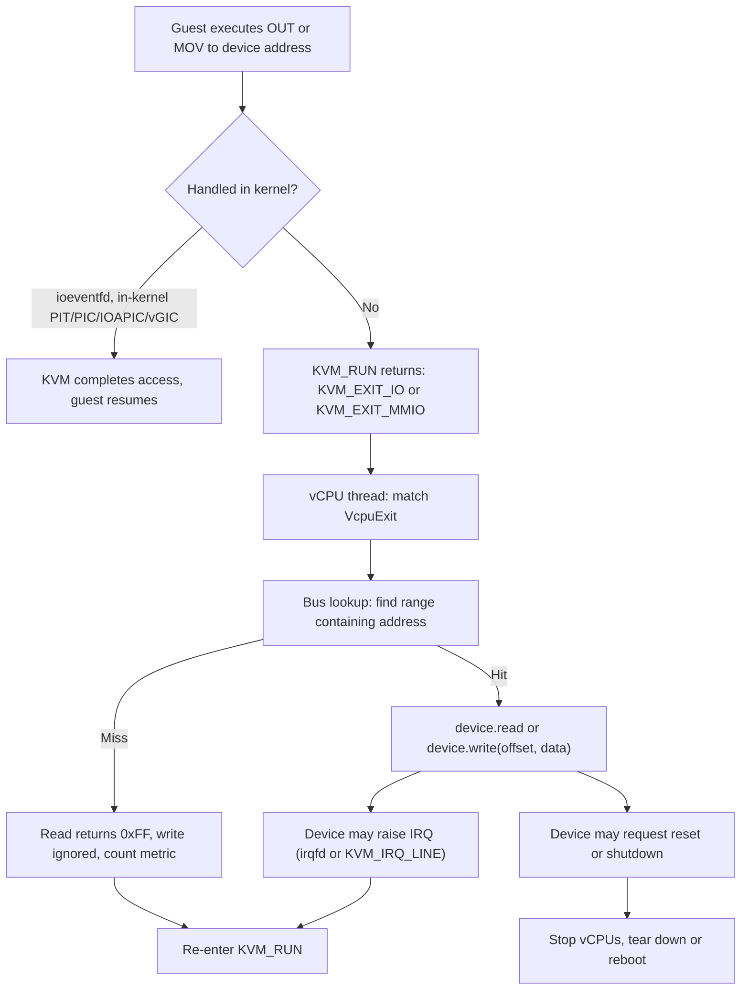
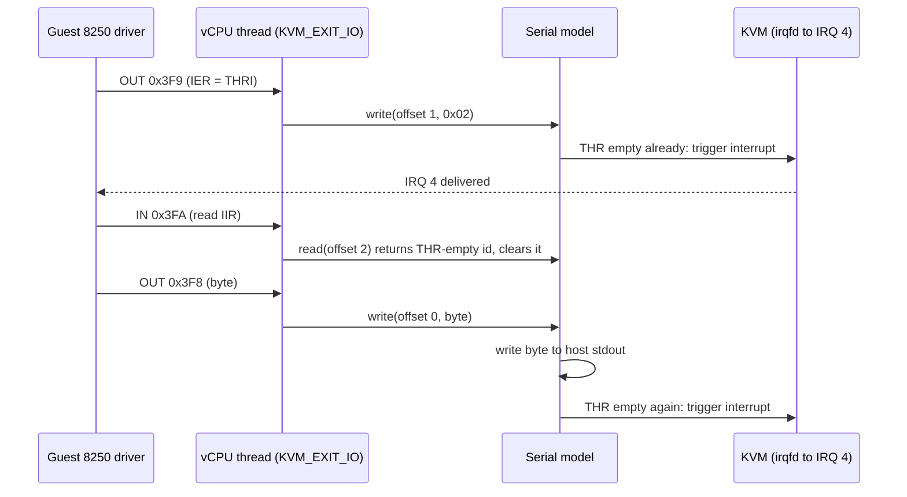
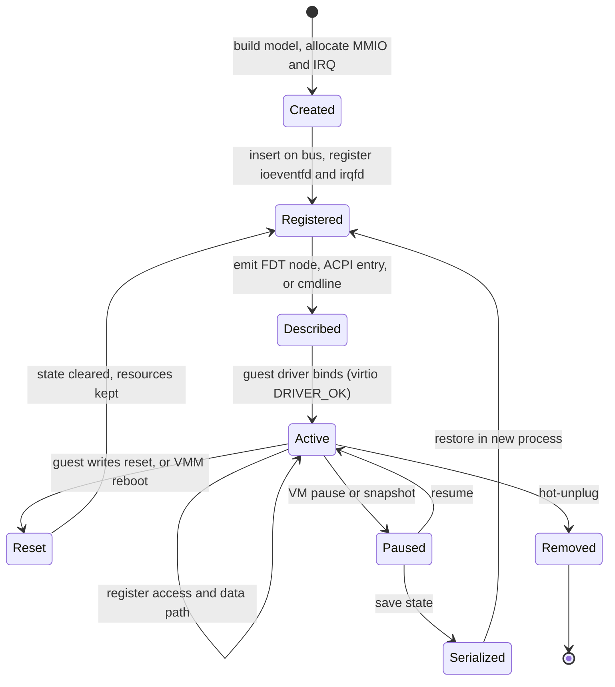

Purpose: explain how guest accesses to device registers become VM exits, how a VMM routes those exits through address-space buses to device models, and how to emulate the small set of legacy and PCI devices every real VMM needs.

# Device Emulation: PIO, MMIO, and the Bus Model

Related notes: [04 KVM API and the vCPU Run Loop](/compendium/virtualization/kvm-api-and-the-vcpu-run-loop), [05 Memory Virtualization EPT NPT and Guest Memory](/compendium/virtualization/memory-virtualization-ept-npt-and-guest-memory), [06 Interrupts Timers and Interrupt Controller Virtualization](/compendium/virtualization/interrupts-timers-and-interrupt-controller-virtualization), [08 Virtio Devices Virtqueues and vhost](/compendium/virtualization/virtio-devices-virtqueues-and-vhost), [09 Booting Guests Firmware and the Linux Boot Protocol](/compendium/virtualization/booting-guests-firmware-and-the-linux-boot-protocol), [13 Security Isolation and Attack Surface](/compendium/virtualization/security-isolation-and-attack-surface), [13 Kernel Architecture Modules Drivers and Device Model](/compendium/linux-systems-engineering/kernel-architecture-modules-drivers-and-device-model), [07 Concurrency Parallelism and Synchronization](/compendium/rust/concurrency-parallelism-and-synchronization).

## Why device emulation is the center of the VMM

KVM virtualizes the CPU, the MMU, and (optionally) the interrupt controllers and timers. Everything else the guest believes is hardware is code in your VMM: the serial port it prints to, the keyboard controller it pokes to reboot, the RTC it reads at boot, the PCI host bridge it enumerates, and every virtio device. A minimal Linux microVM needs surprisingly little:

| Device | Why the guest needs it | Who usually emulates it |
|---|---|---|
| Serial console (16550 or PL011) | Early boot log, `console=ttyS0` | VMM userspace |
| Reset path (i8042, PSCI, SBI SRST, ACPI) | `reboot` must terminate or restart the VM | VMM, sometimes KVM |
| RTC (CMOS on x86, PL031 on arm64, goldfish on RISC-V `virt`) | Wall clock at boot | VMM userspace |
| Interrupt controller and timer | Every device interrupt and the scheduler tick | KVM in-kernel (see [06 Interrupts Timers and Interrupt Controller Virtualization](/compendium/virtualization/interrupts-timers-and-interrupt-controller-virtualization)) |
| Block and network devices | Root filesystem, connectivity | virtio in VMM, vhost in kernel or another process |
| PCI host bridge (optional) | Device discovery, BARs, MSI-X | VMM userspace |

Device models are also the largest attack surface in a hypervisor. Most published VM escapes (VENOM in the QEMU floppy controller, many virtio and USB bugs) live in device emulation code, not in the CPU virtualization layer. Every register handler is a parser of attacker-controlled input. See [13 Security Isolation and Attack Surface](/compendium/virtualization/security-isolation-and-attack-surface).

Why it matters for your VMM: the shape of your bus and device traits decides how fast exits are dispatched, how devices are locked, how snapshots serialize state, and how much of the device layer you can later move out of the vCPU thread.

## Two ways to touch a device: PIO and MMIO

### Port I/O (x86 only)

x86 has a separate 16-bit I/O address space (ports `0x0000` to `0xFFFF`) accessed with `IN`, `OUT`, `INS`, and `OUTS`. Under VT-x and SVM, the hypervisor configures I/O bitmaps; KVM intercepts all port accesses that are not handled in-kernel and, when no in-kernel device claims the port, exits to userspace with `KVM_EXIT_IO`.

The `kvm_run` structure describes the access:

```c
/* KVM_EXIT_IO, from include/uapi/linux/kvm.h */
struct {
#define KVM_EXIT_IO_IN  0
#define KVM_EXIT_IO_OUT 1
    __u8  direction;
    __u8  size;        /* bytes per access: 1, 2 or 4 */
    __u16 port;
    __u32 count;       /* > 1 for string instructions (rep outsb) */
    __u64 data_offset; /* relative to the start of the kvm_run mapping */
} io;
```

Facts that bite:

- `count` can be greater than 1 for `REP INS` and `REP OUTS`. The data for all iterations sits contiguously at `data_offset`. kvm-ioctls hands you a single slice; you must loop over `size`-sized chunks if you want per-access semantics.
- For `IN`, you write the result into the shared buffer and the next `KVM_RUN` completes the instruction. The guest register is not updated until you re-enter.
- Port accesses that hit nothing should read as all ones (`0xFF` per byte) and silently drop writes. Real chipsets float the bus high, and guest probe code depends on it.

### Memory-mapped I/O (all architectures)

MMIO devices live at guest physical addresses that are not backed by a memory slot. When the guest loads or stores to such an address, the second-stage page walk (EPT on Intel, NPT on AMD, stage 2 on arm64, G-stage on RISC-V) fails, the CPU exits to KVM, KVM decodes the faulting access, and if no in-kernel device claims the address it exits to userspace with `KVM_EXIT_MMIO`:

```c
/* KVM_EXIT_MMIO */
struct {
    __u64 phys_addr;
    __u8  data[8];
    __u32 len;
    __u8  is_write;
} mmio;
```

On x86, KVM marks unbacked GPAs with special "MMIO SPTEs" so repeated accesses take a fast EPT misconfiguration path instead of a full page walk. The decode step is still costly: KVM must fetch and emulate the instruction, because a VM exit for an EPT violation does not tell it the register or width on Intel. See [05 Memory Virtualization EPT NPT and Guest Memory](/compendium/virtualization/memory-virtualization-ept-npt-and-guest-memory).

### Architecture comparison

| Aspect | x86-64 | ARM64 | RISC-V |
|---|---|---|---|
| Separate I/O space | Yes, 64 Ki ports | No | No |
| Userspace exit for PIO | `KVM_EXIT_IO` | n/a | n/a |
| How MMIO traps | EPT/NPT violation or misconfig on unbacked GPA | Stage 2 data abort at EL2 | G-stage guest page fault into HS-mode |
| How KVM learns width and register | Instruction emulator decodes guest code | `ESR_EL2` syndrome when `ISV=1` | Transformed instruction in `htinst`, or KVM reads and decodes the trapping instruction |
| Undecodable access | Rare (emulator covers most instructions) | `ISV=0` (for example load pair, writeback addressing): exits with `KVM_EXIT_ARM_NISV` if userspace enabled `KVM_CAP_ARM_NISV_TO_USER`, otherwise an error | KVM handles the base load/store encodings; unusual encodings fail |
| Userspace exit for MMIO | `KVM_EXIT_MMIO` | `KVM_EXIT_MMIO` | `KVM_EXIT_MMIO` |

On arm64, Linux guest drivers use `readl`/`writel` accessors that compile to simple single-register loads and stores precisely so that the syndrome is valid. Firmware or bare-metal guests that use load-pair or vector instructions on device memory break under virtualization; this is a guest bug, but your VMM must report it clearly rather than hang.

### Batched exits: coalesced MMIO and PIO

For write-only registers whose side effects can be deferred (framebuffers, some legacy device registers), KVM can queue writes into a ring shared with userspace instead of exiting:

| Ioctl or capability | Effect |
|---|---|
| `KVM_REGISTER_COALESCED_MMIO` | Writes to the zone are appended to the coalesced ring; no exit |
| `KVM_CAP_COALESCED_PIO` | Same mechanism for ports (zone with `pio = 1`) |
| `KVM_UNREGISTER_COALESCED_MMIO` | Remove a zone |

The ring is drained by userspace on the next exit of any kind. Never coalesce a register whose write must be observed before the guest's next read (for example a doorbell, or an index register paired with a data register), because the read would see stale device state.

## The exit-to-device path



With kvm-ioctls (checked against 0.25.1 on docs.rs), `VcpuFd::run` returns a `VcpuExit` that borrows the `kvm_run` data buffer:

```rust
use kvm_ioctls::{VcpuExit, VcpuFd};

fn run_vcpu(vcpu: &mut VcpuFd, bus: &Buses) -> anyhow::Result<()> {
    loop {
        match vcpu.run()? {
            VcpuExit::IoIn(port, data) => bus.pio.read(u64::from(port), data),
            VcpuExit::IoOut(port, data) => bus.pio.write(u64::from(port), data),
            VcpuExit::MmioRead(addr, data) => bus.mmio.read(addr, data),
            VcpuExit::MmioWrite(addr, data) => bus.mmio.write(addr, data),
            VcpuExit::Hlt => return Ok(()),
            VcpuExit::Shutdown => anyhow::bail!("guest triple fault or shutdown"),
            VcpuExit::SystemEvent(kind, _flags) => {
                // arm64 PSCI and RISC-V SBI reset/shutdown land here
                anyhow::bail!("system event {kind}");
            }
            other => anyhow::bail!("unhandled exit: {other:?}"),
        }
    }
}
```

Notes on this loop:

- `IoIn` and `IoOut` slices already cover `size * count` bytes. If you need per-iteration semantics for string I/O, chunk by the original access size; most VMMs simply pass the whole slice and accept that `rep outsb` to a UART writes several bytes.
- The `SystemEvent` variant's payload changed between kvm-ioctls releases (older versions passed `flags` as `u64`, newer ones pass the `data` array). Check the version you pin.
- `Hlt` only appears if you do not use an in-kernel LAPIC (or on configurations where KVM forwards HLT). With `KVM_CREATE_IRQCHIP`, KVM handles HLT internally.

## The bus model

A bus maps address ranges to devices. The VMM typically keeps two on x86 (PIO and MMIO) and one on arm64 and RISC-V (MMIO only). Requirements:

| Requirement | Reason |
|---|---|
| Ranges never overlap | Overlap means two devices claim the same register; reject at registration |
| Lookup is `O(log n)` or better | Lookup runs on every userspace exit |
| Device receives an offset, not an absolute address | Devices can be relocated (PCI BAR reprogramming) without code changes |
| Lookup holds no lock across the device call, or a read lock only | Concurrent vCPUs must not serialize on the bus map |
| Ranges can be added and removed at runtime | PCI BAR moves, hotplug, device reset |

### A minimal bus in std Rust

The canonical structure is a `BTreeMap` keyed by range base, searched with `range(..=addr).next_back()`:

```rust
use std::collections::BTreeMap;
use std::sync::{Arc, Mutex, RwLock};

pub trait BusDevice: Send {
    fn read(&mut self, offset: u64, data: &mut [u8]);
    fn write(&mut self, offset: u64, data: &[u8]);
}

#[derive(Clone, Copy, Debug, PartialEq, Eq, PartialOrd, Ord)]
struct Range {
    base: u64,
    len: u64,
}

#[derive(Default)]
pub struct Bus {
    devices: RwLock<BTreeMap<u64, (Range, Arc<Mutex<dyn BusDevice>>)>>,
}

impl Bus {
    pub fn insert(&self, dev: Arc<Mutex<dyn BusDevice>>, base: u64, len: u64) -> Result<(), String> {
        if len == 0 || base.checked_add(len).is_none() {
            return Err("invalid range".into());
        }
        let mut map = self.devices.write().unwrap();
        // Overlap check: predecessor must end before base, successor must start after end.
        if let Some((_, (r, _))) = map.range(..=base).next_back() {
            if r.base + r.len > base {
                return Err(format!("overlaps {:#x}", r.base));
            }
        }
        if let Some((&next, _)) = map.range(base..).next() {
            if next < base + len {
                return Err(format!("overlaps {next:#x}"));
            }
        }
        map.insert(base, (Range { base, len }, dev));
        Ok(())
    }

    fn resolve(&self, addr: u64) -> Option<(u64, Arc<Mutex<dyn BusDevice>>)> {
        let map = self.devices.read().unwrap();
        let (_, (r, dev)) = map.range(..=addr).next_back()?;
        (addr < r.base + r.len).then(|| (addr - r.base, dev.clone()))
    }

    pub fn read(&self, addr: u64, data: &mut [u8]) {
        match self.resolve(addr) {
            Some((off, dev)) => dev.lock().unwrap().read(off, data),
            None => data.fill(0xff),
        }
    }

    pub fn write(&self, addr: u64, data: &[u8]) {
        if let Some((off, dev)) = self.resolve(addr) {
            dev.lock().unwrap().write(off, data);
        }
    }
}
```

The read lock on the map is released before the device lock is taken (the `Arc` is cloned out). This keeps lock ordering simple: bus map lock, then device lock, never the reverse, and never both at once.

An access that straddles two devices (an 8-byte read starting 4 bytes before the end of a range) is legal on real hardware for some buses but is almost always a guest bug. Production VMMs either deliver it to the first device with the full length or reject it. Pick one and log it.

### rust-vmm vm-device

The rust-vmm `vm-device` crate (0.1.0 on docs.rs at time of writing) packages the same idea with typed addresses:

| Item | Role |
|---|---|
| `bus::BusRange&lt;A&gt;`, `MmioAddress`, `PioAddress` | Typed, non-overlapping ranges |
| `DeviceMmio`, `DevicePio` | Device traits with `&self` methods (device does its own interior locking) |
| `MutDeviceMmio`, `MutDevicePio` | `&mut self` variants, adapted through `Mutex` |
| `device_manager::IoManager` | Holds an MMIO bus and a PIO bus |
| `MmioManager`, `PioManager` | `mmio_read(&self, addr: MmioAddress, data: &mut [u8])`, `pio_write(&self, addr: PioAddress, data: &[u8])`, each returning `Result&lt;(), bus::Error&gt;` |

The `MutDevicePio` methods have the shape `fn pio_read(&mut self, base: PioAddress, offset: PioAddressOffset, data: &mut [u8])` and `fn pio_write(&mut self, base: PioAddress, offset: PioAddressOffset, data: &[u8])`. The crate is still 0.x and lightly versioned; Firecracker and Cloud Hypervisor each carry their own bus implementation (Cloud Hypervisor's `vm-device` fork has a `BusDevice` trait whose `write` can return a barrier so the vCPU thread waits for a device-side action). Copy the idea, pin the version, and expect to own the code.

### Allocating addresses

Addresses come from a layout you define per architecture (see [09 Booting Guests Firmware and the Linux Boot Protocol](/compendium/virtualization/booting-guests-firmware-and-the-linux-boot-protocol)):

| Region | x86-64 (typical microVM) | ARM64 (typical) | RISC-V (typical) |
|---|---|---|---|
| Low RAM | 0 to below 3 GiB | starts at 1 GiB or 2 GiB (`0x4000_0000` or `0x8000_0000`) | starts at 2 GiB (`0x8000_0000`) |
| 32-bit MMIO hole | 3 GiB to 4 GiB (below LAPIC `0xFEE0_0000`, IOAPIC `0xFEC0_0000`) | below RAM | below RAM |
| 64-bit MMIO | above top of RAM | above top of RAM | above top of RAM |
| Interrupt controller | IOAPIC, LAPIC fixed addresses | GIC distributor and redistributors | PLIC or APLIC/IMSIC |

rust-vmm `vm-allocator` provides an address allocator and an ID allocator (for GSIs or device IDs). Whether you use it or a few lines of bump allocation, the rule is the same: allocate every MMIO window and IRQ from one authority, record the allocation in the device's state (snapshots need it), and generate the FDT or ACPI tables from the same records so they cannot drift.

## Legacy x86 platform devices

| Port(s) | Device | Usually emulated by | Notes |
|---|---|---|---|
| `0x20-0x21`, `0xA0-0xA1` | 8259 PIC | KVM (`KVM_CREATE_IRQCHIP`) | See [06 Interrupts Timers and Interrupt Controller Virtualization](/compendium/virtualization/interrupts-timers-and-interrupt-controller-virtualization) |
| `0x40-0x43` | 8254 PIT | KVM (`KVM_CREATE_PIT2`) | Linux may calibrate TSC against it |
| `0x60`, `0x64` | i8042 keyboard controller | VMM | Reset path |
| `0x61` | System control port B (PC speaker, PIT gate) | KVM with in-kernel PIT (`speaker_dummy`) | |
| `0x70-0x71` | CMOS and RTC | VMM | Wall clock |
| `0x80` | POST diagnostic port | VMM (ignore writes) | Linux uses it as an I/O delay; make it cheap |
| `0x2F8-0x2FF` | COM2 | VMM | IRQ 3 |
| `0x3F8-0x3FF` | COM1 | VMM | IRQ 4 |
| `0xCF8`, `0xCFC-0xCFF` | PCI configuration mechanism #1 | VMM | Only if you expose PCI |
| `0x510-0x511` | QEMU `fw_cfg` | QEMU only | Not needed for direct kernel boot |

Linux writes to port `0x80` for I/O delays during early boot. If every one of those writes costs a userspace exit, boot gets measurably slower. Register an `ioeventfd` with no reader, or handle the port with an empty match arm high in the dispatch order.

## Emulating a 16550 UART

The 16550A is the default x86 console and is also used as `ns16550a` on arm64 and RISC-V boards and the QEMU RISC-V `virt` machine.

### Register map

Eight byte-wide registers at consecutive offsets. Offset 0 and 1 change meaning when the Divisor Latch Access Bit (DLAB, bit 7 of LCR) is set.

| Offset | DLAB=0 read | DLAB=0 write | DLAB=1 |
|---|---|---|---|
| 0 | RBR (receive buffer) | THR (transmit holding) | DLL (divisor low) |
| 1 | IER (interrupt enable) | IER | DLM (divisor high) |
| 2 | IIR (interrupt identification) | FCR (FIFO control) | same |
| 3 | LCR (line control) | LCR | same |
| 4 | MCR (modem control) | MCR | same |
| 5 | LSR (line status) | ignored (factory test) | same |
| 6 | MSR (modem status) | ignored | same |
| 7 | SCR (scratch) | SCR | same |

Key bits for a console-only model:

| Register | Bit | Meaning |
|---|---|---|
| IER | 0 | Enable "received data available" interrupt |
| IER | 1 | Enable "THR empty" interrupt |
| IIR | 0 | 1 = no interrupt pending |
| IIR | 3:1 | `010` THR empty, `100` RX data available |
| LSR | 0 | Data ready (RX FIFO non-empty) |
| LSR | 5 | THR empty |
| LSR | 6 | Transmitter empty |
| MCR | 4 | Loopback mode (Linux probes with it) |
| MCR | 3 | OUT2: gates the interrupt line on PC hardware |

### Interrupt behavior



Two subtleties:

- Reading IIR clears a pending THR-empty interrupt. If you raise the interrupt but do not clear it on IIR read, the guest's interrupt handler loops.
- Linux's 8250 driver probes for a broken "THRE interrupt on enable" behavior by toggling IER and reading IIR. Getting this wrong produces the classic "serial console hangs after a few lines" symptom, where output only progresses when something else interrupts the guest.

### Using vm-superio

The rust-vmm `vm-superio` crate (checked against 0.8.2) implements the register state machine; you provide the interrupt trigger and the output sink.

| Item | Signature (0.8.2) |
|---|---|
| Constructor | `Serial::new(trigger: T, out: W) -&gt; Serial&lt;T, NoEvents, W&gt;` |
| With metrics hooks | `Serial::with_events(trigger: T, serial_evts: EV, out: W) -&gt; Self` |
| Register read | `fn read(&mut self, offset: u8) -&gt; u8` |
| Register write | `fn write(&mut self, offset: u8, value: u8) -&gt; Result&lt;(), Error&lt;T::E&gt;&gt;` |
| Guest input | `fn enqueue_raw_bytes(&mut self, input: &[u8]) -&gt; Result&lt;usize, Error&lt;T::E&gt;&gt;` |
| Input backpressure | `fn fifo_capacity(&self) -&gt; usize` |

```rust
use std::io::{self, Stdout};
use vm_superio::{Serial, Trigger};
use vmm_sys_util::eventfd::EventFd;

/// Newtype so we can implement the foreign Trigger trait for an eventfd
/// that is registered with KVM as an irqfd on GSI 4.
pub struct IrqTrigger(pub EventFd);

impl Trigger for IrqTrigger {
    type E = io::Error;
    fn trigger(&self) -> io::Result<()> {
        self.0.write(1)
    }
}

pub struct SerialDevice {
    inner: Serial<IrqTrigger, vm_superio::serial::NoEvents, Stdout>,
}

impl SerialDevice {
    pub fn new(irq: EventFd) -> Self {
        Self { inner: Serial::new(IrqTrigger(irq), io::stdout()) }
    }

    /// Called from the VMM event loop when host stdin is readable.
    pub fn feed_input(&mut self, bytes: &[u8]) -> usize {
        let room = self.inner.fifo_capacity();
        let take = bytes.len().min(room);
        self.inner.enqueue_raw_bytes(&bytes[..take]).unwrap_or(0)
    }
}

impl BusDevice for SerialDevice {
    fn read(&mut self, offset: u64, data: &mut [u8]) {
        if data.len() == 1 {
            data[0] = self.inner.read(offset as u8);
        } else {
            data.fill(0xff);
        }
    }

    fn write(&mut self, offset: u64, data: &[u8]) {
        if data.len() == 1 {
            // Interrupt or output errors are logged, never propagated to the guest.
            let _ = self.inner.write(offset as u8, data[0]);
        }
    }
}
```

Input design: when the RX FIFO is full, stop polling host stdin (remove it from epoll) and re-arm when the guest drains the FIFO. Otherwise a paste of a large buffer is either dropped or spins the event loop. vm-superio's `SerialEvents` hook (`with_events`) lets you observe "buffer ready" and similar events to drive that re-arm.

Production consoles often redirect output to a rate-limited log file instead of stdout: a guest that prints in a tight loop can otherwise fill the host disk or stall the vCPU thread on a blocked pipe. Firecracker caps serial output for this reason and does not enable the serial console in its recommended production configuration.

### UART per architecture

| Architecture | Common choice | Description to guest | Interrupt |
|---|---|---|---|
| x86-64 | 16550 at port `0x3F8` | Implicit (legacy ISA), `console=ttyS0` | IOAPIC pin 4 (edge) |
| ARM64 | PL011 (Cloud Hypervisor, QEMU) or 16550 on MMIO (Firecracker) | FDT node `arm,pl011` or `ns16550a`, or ACPI SPCR | GIC SPI |
| RISC-V | 16550 on MMIO (`ns16550a`) | FDT node | PLIC or APLIC source |

On MMIO, a 16550 may be laid out with 1-byte or 4-byte register stride; the FDT `reg-shift` and `reg-io-width` properties tell the guest which. A mismatch prints nothing and is a common first-boot failure on arm64 and RISC-V.

## The i8042 reset path

On PC-compatible hardware the keyboard controller drives the CPU reset line. Linux's `reboot=k` path (and several fallbacks in the default sequence) writes command `0xFE` (pulse output line 0) to the command port `0x64`. A VMM implements just enough i8042 to see this:

| Access | Behavior in a minimal model |
|---|---|
| Read `0x64` (status) | Return 0 (input and output buffers empty) so the guest does not wait |
| Read `0x60` (data) | Return 0 |
| Write `0xFE` to `0x64` | Signal reset to the VMM |
| Other writes | Ignore |

vm-superio provides `I8042Device::new(reset_evt: T)` with `read(&mut self, _offset: u8) -&gt; u8` and `write(&mut self, offset: u8, value: u8) -&gt; Result&lt;(), T::E&gt;`. The device's docs describe it as handling only the CPU reset, and its example writes `0xFE` at offset 4 (the device is placed at base `0x60`, so offset 4 is port `0x64`). Treat the reset eventfd as "the guest wants to reboot": Firecracker's policy is to exit the VMM process and let the orchestrator decide, because a fresh process is cheaper and safer than an in-place reset of every device model.

Other reset and shutdown mechanisms you will see:

| Mechanism | Architecture | How the VMM sees it |
|---|---|---|
| i8042 `0xFE` | x86 | PIO write to `0x64` |
| Triple fault | x86 | `KVM_EXIT_SHUTDOWN` |
| ACPI reset register / PM1 sleep | x86 (and arm64 with ACPI) | PIO or MMIO write to addresses you advertise in FADT |
| Port `0xCF9` reset control | x86 | PIO write (some Linux reboot fallbacks use it) |
| PSCI `SYSTEM_RESET` / `SYSTEM_OFF` | ARM64 | `KVM_EXIT_SYSTEM_EVENT` (KVM implements PSCI in kernel) |
| SBI System Reset extension (SRST) | RISC-V | `KVM_EXIT_SYSTEM_EVENT` (KVM implements SBI in kernel) |

If you do not implement any reset path on x86, `reboot` in the guest ends in a triple fault, which is also an acceptable termination signal as long as you treat `KVM_EXIT_SHUTDOWN` as "guest wants to stop".

## CMOS and RTC

The MC146818-compatible RTC lives behind an index/data pair: write the register index to `0x70`, then read or write `0x71`. Bit 7 of the index write is the NMI-disable bit on real hardware; mask it off before using the index.

| Index | Register | Notes |
|---|---|---|
| `0x00`, `0x02`, `0x04` | Seconds, minutes, hours | BCD unless Status B bit 2 is set |
| `0x06` | Day of week | |
| `0x07`, `0x08`, `0x09` | Day of month, month, year (2 digits) | |
| `0x0A` | Status A | Bit 7: update in progress (UIP) |
| `0x0B` | Status B | Bit 1: 24-hour mode, bit 2: binary mode, bits 4-6: interrupt enables |
| `0x0C` | Status C | Interrupt flags, cleared on read |
| `0x0D` | Status D | Bit 7: RTC power valid; return `0x80` |
| `0x32` | Century (common convention, advertised via ACPI FADT `century` field) | |
| `0x34`, `0x35` | Memory above 16 MiB in 64 KiB units (SeaBIOS and QEMU convention) | Only needed with legacy firmware |

```rust
pub struct Cmos {
    index: u8,
    nvram: [u8; 128],
}

impl Cmos {
    fn to_bcd(v: u8) -> u8 {
        ((v / 10) << 4) | (v % 10)
    }

    fn rtc_reg(&self, index: u8) -> u8 {
        // shortcut: host UTC each read, no guest-set offset; store a delta if guests may set time.
        let now = time_now_utc(); // returns (sec, min, hour, wday, mday, mon, year)
        match index {
            0x00 => Self::to_bcd(now.sec),
            0x02 => Self::to_bcd(now.min),
            0x04 => Self::to_bcd(now.hour),
            0x06 => now.wday + 1,
            0x07 => Self::to_bcd(now.mday),
            0x08 => Self::to_bcd(now.mon),
            0x09 => Self::to_bcd((now.year % 100) as u8),
            0x32 => Self::to_bcd((now.year / 100) as u8),
            0x0A => 0x26, // UIP clear, 32.768 kHz divider, 1024 Hz rate
            0x0B => 0x02, // 24-hour, BCD
            0x0D => 0x80, // battery good
            i => self.nvram[i as usize],
        }
    }
}

impl BusDevice for Cmos {
    fn read(&mut self, offset: u64, data: &mut [u8]) {
        data[0] = if offset == 1 { self.rtc_reg(self.index) } else { 0xff };
    }
    fn write(&mut self, offset: u64, data: &[u8]) {
        match offset {
            0 => self.index = data[0] & 0x7f,
            1 if self.index >= 0x0E => self.nvram[self.index as usize] = data[0],
            _ => {}
        }
    }
}

struct Now { sec: u8, min: u8, hour: u8, wday: u8, mday: u8, mon: u8, year: u16 }
fn time_now_utc() -> Now { unimplemented!("convert SystemTime::now() to calendar fields") }
```

Reading the host clock on every register read is the simplest correct model because the guest polls UIP and re-reads until two reads agree. It breaks across snapshot restore only if you promise the guest a frozen clock; most microVM platforms prefer the guest seeing real time after restore and rely on kvm-clock and NTP for the rest.

Equivalents elsewhere: arm64 uses the PL031 (vm-superio `rtc_pl031::Rtc`, a 32-bit seconds counter at an MMIO base), and the QEMU RISC-V `virt` machine uses the Goldfish RTC. On arm64 and RISC-V many minimal VMMs omit the RTC entirely and let the guest take time from the network or a paravirtual clock.

## PCI configuration space

PCI gives you discovery, resource assignment (BARs), and MSI-X without per-device guest drivers needing hard-coded addresses. The cost is a larger emulation surface and more boot-time exits.

### Configuration space layout (type 0 header)

| Offset | Size | Field |
|---|---|---|
| `0x00` | 2 | Vendor ID (`0xFFFF` means "no device") |
| `0x02` | 2 | Device ID |
| `0x04` | 2 | Command (bit 0 I/O space, bit 1 memory space, bit 2 bus master, bit 10 INTx disable) |
| `0x06` | 2 | Status (bit 4 capabilities list present) |
| `0x08` | 1 | Revision ID |
| `0x09` | 3 | Class code (prog IF, subclass, base class) |
| `0x0E` | 1 | Header type (bit 7 multifunction) |
| `0x10-0x24` | 6 x 4 | BAR0 to BAR5 |
| `0x2C` | 2 | Subsystem vendor ID |
| `0x2E` | 2 | Subsystem ID |
| `0x34` | 1 | Capabilities pointer |
| `0x3C` | 1 | Interrupt line (software scratch) |
| `0x3D` | 1 | Interrupt pin (1 = INTA, 0 = none) |

Conventional PCI has 256 bytes of configuration space per function; PCI Express extends it to 4 KiB, reachable only through ECAM.

### CAM: configuration mechanism #1 (x86 port I/O)

The guest writes an address to port `0xCF8` and accesses data at `0xCFC` to `0xCFF`:

| Bits of `0xCF8` value | Meaning |
|---|---|
| 31 | Enable |
| 23:16 | Bus |
| 15:11 | Device |
| 10:8 | Function |
| 7:2 | Register (dword index) |

Byte and word accesses to `0xCFD` to `0xCFF` address bytes within the selected dword. Two exits per config access (address write, data access) make CAM enumeration slow, which is one reason microVMs skip PCI or use ECAM.

### ECAM: memory-mapped configuration

ECAM maps every function's 4 KiB configuration space into a contiguous MMIO window:

```text
address = ecam_base + (bus << 20) + (device << 15) + (function << 12) + register
```

One bus needs 1 MiB; 256 buses need 256 MiB. x86 advertises the window in the ACPI `MCFG` table. ARM64 and RISC-V advertise it in the FDT with a `pci-host-ecam-generic` node (or `MCFG` under ACPI). ECAM is the only option on arm64 and RISC-V because there is no port I/O.

```rust
fn ecam_decode(offset: u64) -> (u8, u8, u8, u16) {
    let bus = ((offset >> 20) & 0xff) as u8;
    let dev = ((offset >> 15) & 0x1f) as u8;
    let func = ((offset >> 12) & 0x7) as u8;
    let reg = (offset & 0xfff) as u16;
    (bus, dev, func, reg)
}

#[test]
fn ecam_decode_roundtrip() {
    let off = (1u64 << 20) | (3 << 15) | (2 << 12) | 0x10;
    assert_eq!(ecam_decode(off), (1, 3, 2, 0x10));
}
```

### BARs and sizing

A BAR tells the guest where a device's registers live and how large the window is. Bit 0 distinguishes I/O BARs (1) from memory BARs (0). For memory BARs, bits 2:1 give the type (`00` 32-bit, `10` 64-bit, consuming the next BAR as the upper half) and bit 3 marks prefetchable.

Sizing protocol the guest (or firmware) runs:

1. Disable decoding (clear command bits 0 and 1).
2. Write `0xFFFF_FFFF` to the BAR.
3. Read it back. The device returns ones only in writable address bits; low read-only bits encode the type.
4. Size is `!(value & !0xF) + 1` for memory BARs (`!0x3` for I/O BARs).
5. Program the chosen address, restore the command register.

Your config space model must implement this with per-register write masks, not special cases:

```rust
pub struct Bar {
    addr: u64,
    size: u64, // power of two, at least 16 for memory BARs
    is_64: bool,
    prefetch: bool,
}

impl Bar {
    fn low_dword(&self) -> u32 {
        let flags = (u32::from(self.is_64) << 2) | (u32::from(self.prefetch) << 3);
        (self.addr as u32 & !(self.size as u32 - 1)) | flags
    }

    fn write_low(&mut self, value: u32) {
        let mask = !(self.size - 1) & 0xffff_fff0;
        self.addr = (self.addr & !0xffff_ffff) | (u64::from(value) & mask);
    }
}
```

When the guest moves a BAR, the VMM must:

1. Remove the old range from the MMIO bus and insert the new one.
2. Move every ioeventfd registered inside the BAR (virtio notify addresses) by unregistering and re-registering them with KVM.
3. If the BAR maps host memory directly (VFIO, virtio shared memory regions), move the KVM memory slot.

Missing step 2 is a classic bug: after the guest reassigns BARs, doorbells silently stop working because KVM is still listening at the old address. Linux usually keeps firmware-assigned BARs, so the bug only appears with some firmware or with `pci=realloc`.

### Capabilities and MSI-X

The capability list starts at the pointer at `0x34`; each entry is `(id, next)` followed by capability data.

| ID | Capability | Why a VMM cares |
|---|---|---|
| `0x05` | MSI | Simple message-signaled interrupts |
| `0x09` | Vendor specific | virtio-pci uses it for its structure locations |
| `0x10` | PCI Express | Required for PCIe devices and extended config space |
| `0x11` | MSI-X | Per-queue interrupt vectors, table lives in a BAR |

MSI-X table entries are 16 bytes: message address low, message address high, message data, vector control (bit 0 masks the vector). When the guest programs an entry, translate it into a KVM GSI route (`KVM_SET_GSI_ROUTING` with an MSI entry) and attach an irqfd, or call `KVM_SIGNAL_MSI` directly. Masking must be honored: a masked vector sets the Pending Bit Array bit instead of firing. See [06 Interrupts Timers and Interrupt Controller Virtualization](/compendium/virtualization/interrupts-timers-and-interrupt-controller-virtualization) and [11 Device Passthrough VFIO IOMMU and Nested Virtualization](/compendium/virtualization/device-passthrough-vfio-iommu-and-nested-virtualization).

## Transports: PCI versus virtio-mmio

Virtio devices need a transport for discovery, configuration, and notification. The device logic is identical; only registers and discovery differ. Details are in [08 Virtio Devices Virtqueues and vhost](/compendium/virtualization/virtio-devices-virtqueues-and-vhost).

| Property | virtio-pci | virtio-mmio |
|---|---|---|
| Discovery | PCI enumeration | FDT node, ACPI, or x86 kernel cmdline `virtio_mmio.device=` |
| Interrupts | MSI-X per queue (or INTx) | One wired interrupt per device, shared by all queues |
| Hotplug | PCIe native or ACPI hotplug | Not supported by the transport |
| Guest boot cost | Bus enumeration, config space exits | Almost none |
| Firmware support | UEFI and SeaBIOS drivers exist | Limited (some edk2 builds) |
| Passthrough coexistence | Same bus as VFIO devices | Separate |
| Typical users | QEMU, Cloud Hypervisor, crosvm | Firecracker, QEMU `microvm`, many arm64 microVMs |

A pragmatic path for a new VMM: start with virtio-mmio (one register block per device, no config space machinery), then add a PCI host bridge when you need MSI-X per queue, multiqueue scalability, hotplug, or VFIO.

## Describing devices to the guest

| Architecture | Usual description mechanism |
|---|---|
| x86-64 | ACPI tables (DSDT, MADT, MCFG), implicit legacy ports, or `virtio_mmio.device=4K@0xd0000000:5` on the kernel cmdline for microVMs |
| ARM64 | FDT nodes (ACPI on SBSA-style servers) |
| RISC-V | FDT nodes (ACPI support is newer and less common) |

### Flattened device tree (ARM64 and RISC-V)

The FDT is the authoritative device list on arm64 and RISC-V microVMs. With rust-vmm `vm-fdt` (checked against 0.3.0), a virtio-mmio node looks like this:

```rust
use vm_fdt::{FdtWriter, FdtWriterResult};

const GIC_FDT_IRQ_TYPE_SPI: u32 = 0;
const IRQ_TYPE_EDGE_RISING: u32 = 1;

fn add_virtio_mmio_node(fdt: &mut FdtWriter, base: u64, size: u64, spi: u32) -> FdtWriterResult<()> {
    let node = fdt.begin_node(&format!("virtio_mmio@{base:x}"))?;
    fdt.property_string("compatible", "virtio,mmio")?;
    fdt.property_array_u64("reg", &[base, size])?;
    // arm64 GIC binding: <type number flags>. RISC-V PLIC uses a single cell instead.
    fdt.property_array_u32("interrupts", &[GIC_FDT_IRQ_TYPE_SPI, spi, IRQ_TYPE_EDGE_RISING])?;
    fdt.property_null("dma-coherent")?;
    fdt.end_node(node)
}
```

The `interrupts` cell format depends on the parent interrupt controller's `#interrupt-cells`: three cells for a GICv3 (`type`, `number`, `flags`, where SPI numbers are offset by 32 from the INTID), one or two for a RISC-V PLIC or APLIC. Getting the cell count wrong produces a device that probes but never receives interrupts.

`dma-coherent` matters on arm64 and RISC-V: without it the guest assumes the device is not cache-coherent and performs cache maintenance on every virtqueue access, which is slow, and on some guests subtly wrong for a software device that reads through the cache.

### ACPI (x86-64, and arm64 servers)

x86 guests discover the interrupt controllers (MADT), PCI ECAM (MCFG), and non-enumerable devices (DSDT AML) through ACPI. Firecracker historically relied on the MP table and kernel cmdline instead of ACPI on x86; it added ACPI support later. Cloud Hypervisor generates full ACPI tables (and uses the `acpi_tables` crate). On arm64, ACPI is the norm for SBSA-style servers and required for some Windows guests; FDT dominates in microVMs. On RISC-V, ACPI support exists in recent Linux kernels but FDT remains the common path.

## Device lifecycle



| Phase | Owner | Things that go wrong |
|---|---|---|
| Create and allocate | VMM builder | Overlapping ranges, IRQ reused across devices |
| Register | VMM builder | ioeventfd registered before the event loop subscribes to it |
| Describe | Boot setup | FDT and bus disagree after a refactor |
| Activate | Guest driver | Backend opened too early (before features are known) or too late |
| Reset | Guest or VMM | Backend threads still writing guest memory after reset |
| Pause and snapshot | VMM control plane | In-flight I/O not drained, interrupt state lost |
| Remove | Hotplug path | Bus entry removed but eventfds still registered with KVM |

Keep device state serializable from day one: a plain `struct` with explicit registers, queue indices, and pending interrupt flags, separate from host resources (file descriptors, threads). That separation is what makes snapshot and live migration tractable; see [12 Snapshots Live Migration and Dirty Page Tracking](/compendium/virtualization/snapshots-live-migration-and-dirty-page-tracking).

## Threading device models

A device register access arrives on whichever vCPU thread executed the instruction. Data-plane work arrives from host I/O completions. You must decide where each piece of work runs.

| Model | Description | Used by | Tradeoff |
|---|---|---|---|
| Inline on vCPU thread | Register access and all side effects run in the exit handler | Simple devices everywhere (UART, RTC, config space) | Simple; any blocking stalls the guest CPU |
| vCPU handles registers, event loop handles data | Doorbell via ioeventfd wakes a VMM thread running epoll | Firecracker (single VMM thread for all devices, using `event-manager`) | Low thread count; one slow device delays others |
| Thread per device or per queue | Each virtio device owns epoll threads | Cloud Hypervisor | Scales across host CPUs; more threads, more locking |
| Device in a separate process | Device runs sandboxed, talks over sockets and shared memory | crosvm (jailed device processes), vhost-user backends | Strong isolation; IPC and memory-sharing complexity |
| Device in host kernel | vhost-net, vhost-vsock, in-kernel irqchip | Most production stacks | Fastest; kernel attack surface |

Rules that hold across all models:

- Never perform blocking host I/O (disk reads, network sends that can block, stdout to a pipe) in a register handler. Hand it off.
- Use one lock per device and keep it short. If a register write must wait for a device thread (for example "reset the queue and confirm the worker stopped"), make the wait explicit and bounded.
- Two vCPUs can access the same device concurrently. With `&mut self` traits behind a `Mutex`, correctness is easy but contention is real for hot registers; with `&self` traits, the device chooses atomics or finer locks.
- Interrupt injection must not require taking another device's lock. Use irqfd so raising an interrupt is just an eventfd write.
- Lock order: bus map, then device, then backend. Never call back into the bus from inside a device handler.

See [07 Concurrency Parallelism and Synchronization](/compendium/rust/concurrency-parallelism-and-synchronization) for the Rust primitives and [14 Performance Observability and Debugging](/compendium/virtualization/performance-observability-and-debugging) for measuring exit costs.

## Architecture summary

| Topic | x86-64 | ARM64 | RISC-V |
|---|---|---|---|
| I/O spaces | PIO and MMIO | MMIO | MMIO |
| Console | 16550 at `0x3F8` | PL011 or 16550 MMIO | 16550 MMIO |
| Reset | i8042, `0xCF9`, ACPI, triple fault | PSCI via `KVM_EXIT_SYSTEM_EVENT` | SBI SRST via `KVM_EXIT_SYSTEM_EVENT` |
| RTC | CMOS at `0x70` | PL031 | Goldfish RTC or none |
| PCI config | CAM ports or ECAM | ECAM only | ECAM only |
| Discovery | ACPI, cmdline for virtio-mmio | FDT (ACPI on servers) | FDT |
| Wired interrupts | IOAPIC pins | GIC SPIs | PLIC or APLIC sources |
| MSI | LAPIC message format | GIC ITS (LPIs) | IMSIC (AIA) |
| Undecodable MMIO | Rare | `ISV=0` aborts | Rare, depends on KVM decoder |

## Common pitfalls

| Pitfall | Symptom | Fix |
|---|---|---|
| Unmapped port reads return 0 | Guest believes devices exist, probes hang | Return `0xFF` bytes for misses |
| Serial THR interrupt not cleared on IIR read | Guest stuck in interrupt storm | Model IIR read side effect exactly |
| Serial output written synchronously to a blocking pipe | Guest vCPU stalls when the consumer is slow | Buffer and rate limit output, or write from the event loop |
| Port `0x80` traps to userspace | Slow early boot | Ignore cheaply, or handle in kernel |
| CMOS index not masked with `0x7F` | Random reads return NVRAM garbage | Mask NMI bit |
| BAR sizing returns stale address bits | Guest computes a huge or zero BAR size | Implement write masks per register |
| ioeventfds not moved with BAR | Doorbells stop after guest reassigns resources | Re-register on BAR move |
| Wrong `#interrupt-cells` in FDT | Device probes, interrupts never arrive | Generate cells from the irqchip model |
| Missing `dma-coherent` on arm64 or RISC-V | Slow virtio, odd cache behavior | Add the property for software devices |
| Blocking I/O in vCPU exit handler | Latency spikes, soft lockups in guest | Hand off to event loop or worker |
| Overlapping device ranges accepted | Last device registered silently wins | Reject overlap at insert |
| Coalesced MMIO on a register with read side effects | Guest reads stale state | Coalesce only pure write sinks |
| Treating `KVM_EXIT_ARM_NISV` as fatal without context | Unexplained VM crash on arm64 | Log PC and address, explain guest used an undecodable instruction |

## Review checklist

- [ ] Every device range is allocated from one allocator and checked for overlap.
- [ ] Bus misses return all-ones on read and are counted in metrics.
- [ ] No register handler performs blocking host I/O.
- [ ] Device state is a plain serializable struct separate from host resources.
- [ ] Serial console output is bounded and cannot block the vCPU.
- [ ] Reset paths (i8042, triple fault, PSCI, SBI SRST) all reach one shutdown or reboot routine.
- [ ] CMOS model masks the NMI bit and reports Status D valid.
- [ ] PCI config space uses write masks; BAR sizing returns correct type bits.
- [ ] BAR moves update the bus, ioeventfds, and any memory slots.
- [ ] MSI-X masking and the pending bit array are honored.
- [ ] FDT, ACPI, and cmdline descriptions are generated from the same device registry as the bus.
- [ ] `#interrupt-cells`, `reg-shift`, and `dma-coherent` are correct per architecture.
- [ ] Lock order is documented: bus, device, backend.
- [ ] Fuzzing or at least property tests cover register handlers with random offsets, widths, and values.

## Primary Sources

- [Linux KVM API documentation](https://docs.kernel.org/virt/kvm/api.html)
- [kvm-ioctls on docs.rs](https://docs.rs/kvm-ioctls/latest/kvm_ioctls/)
- [vm-superio on docs.rs](https://docs.rs/vm-superio/latest/vm_superio/)
- [vm-superio `Serial`](https://docs.rs/vm-superio/latest/vm_superio/serial/struct.Serial.html)
- [vm-superio `I8042Device`](https://docs.rs/vm-superio/latest/vm_superio/i8042/struct.I8042Device.html)
- [vm-device on docs.rs](https://docs.rs/vm-device/latest/vm_device/)
- [vm-device `IoManager`](https://docs.rs/vm-device/latest/vm_device/device_manager/struct.IoManager.html)
- [vm-fdt `FdtWriter`](https://docs.rs/vm-fdt/latest/vm_fdt/struct.FdtWriter.html)
- [Firecracker design document](https://github.com/firecracker-microvm/firecracker/blob/main/docs/design.md)
- [OASIS virtio 1.3 specification (transports chapter)](https://docs.oasis-open.org/virtio/virtio/v1.3/csd01/virtio-v1.3-csd01.html)
- [Linux virtio-mmio driver documentation of `virtio_mmio.device`](https://docs.kernel.org/admin-guide/kernel-parameters.html)
- [Devicetree specification](https://www.devicetree.org/specifications/)
- [Cloud Hypervisor repository](https://github.com/cloud-hypervisor/cloud-hypervisor)
- [crosvm book: architecture](https://crosvm.dev/book/architecture.html)
