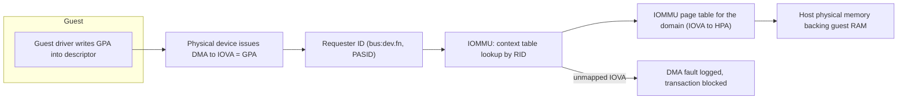
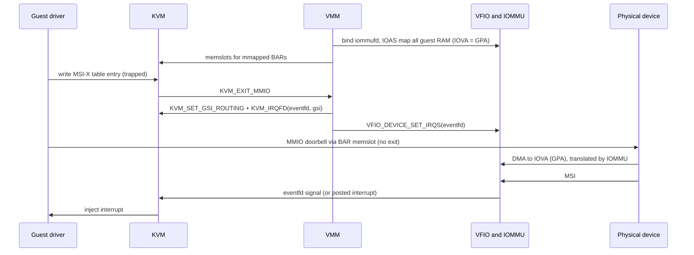
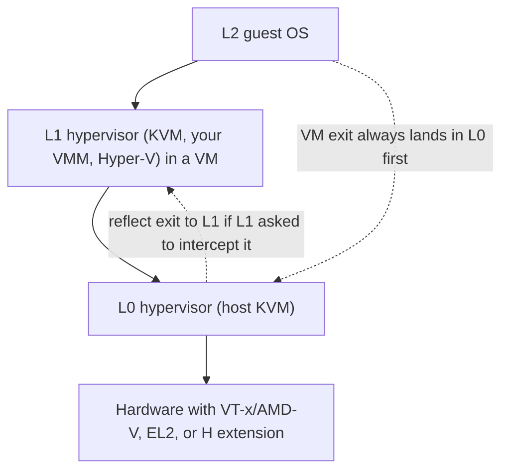

Purpose: explain how a VMM hands a physical device (or a slice of one) directly to a guest safely, using the IOMMU and the Linux VFIO and iommufd interfaces, and how nested virtualization lets a guest run its own hypervisor, so you know what to build, what to delegate to the kernel, and when to avoid both.

# Device Passthrough, VFIO, IOMMU, and Nested Virtualization

Related notes: [05 Memory Virtualization EPT NPT and Guest Memory](/compendium/virtualization/memory-virtualization-ept-npt-and-guest-memory), [06 Interrupts Timers and Interrupt Controller Virtualization](/compendium/virtualization/interrupts-timers-and-interrupt-controller-virtualization), [07 Device Emulation PIO MMIO and the Bus Model](/compendium/virtualization/device-emulation-pio-mmio-and-the-bus-model), [08 Virtio Devices Virtqueues and vhost](/compendium/virtualization/virtio-devices-virtqueues-and-vhost), [12 Snapshots Live Migration and Dirty Page Tracking](/compendium/virtualization/snapshots-live-migration-and-dirty-page-tracking), [13 Security Isolation and Attack Surface](/compendium/virtualization/security-isolation-and-attack-surface), [03 Intel VT-x and AMD-V Hardware Virtualization](/compendium/virtualization/intel-vt-x-and-amd-v-hardware-virtualization), [15 ARM64 Virtualization EL2 VHE and GIC](/compendium/virtualization/arm64-virtualization-el2-vhe-and-gic), [16 RISC-V Virtualization and the Hypervisor Extension](/compendium/virtualization/risc-v-virtualization-and-the-hypervisor-extension), [13 Kernel Architecture Modules Drivers and Device Model](/compendium/linux-systems-engineering/kernel-architecture-modules-drivers-and-device-model).

## Why passthrough exists

Emulated and paravirtual devices ([07 Device Emulation PIO MMIO and the Bus Model](/compendium/virtualization/device-emulation-pio-mmio-and-the-bus-model), [08 Virtio Devices Virtqueues and vhost](/compendium/virtualization/virtio-devices-virtqueues-and-vhost)) cost at least one exit or one host thread wakeup per batch of I/O, and they cap at what the host software stack can push. Passthrough gives the guest the real device: the guest driver programs real registers through MMIO mapped straight into its address space, and the device DMAs straight into guest memory. Exits on the data path drop to near zero.

The price:

| Gain | Cost |
|---|---|
| Near-native throughput and latency (NICs at line rate, NVMe at device IOPS, GPUs) | Device is owned by one VM; no overcommit |
| Guest uses the vendor driver and features | Guest needs that driver; image becomes hardware-specific |
| Host CPU freed from the data path | Live migration hard or impossible without device support |
| | Guest memory must be pinned (no overcommit, no lazy restore, no swap) |
| | Security depends on IOMMU isolation, ACS topology, and device firmware behavior |
| | Device reset quirks and error handling become your problem |

Why it matters for your VMM: passthrough changes your memory model (pinning), your snapshot story (no snapshot unless the device supports migration state), and your security boundary (a DMA-capable device is now partly controlled by the guest). Design for it from the beginning or explicitly rule it out.

## The IOMMU: an MMU for devices

Without an IOMMU, a device that does DMA uses **bus addresses that equal host physical addresses**. A guest driver would program guest physical addresses into the device, which would DMA to the wrong host memory (best case) or into another VM or the host kernel (worst case). The IOMMU sits between devices and memory and translates **I/O virtual addresses (IOVA)** to host physical addresses using per-device (per-domain) page tables, faulting on anything unmapped.



For passthrough the VMM builds an IOMMU domain whose mapping is **IOVA = GPA -&gt; HPA**, the same function EPT/NPT/stage-2 implements for the CPU. The guest driver can then hand the device guest physical addresses unchanged.

### IOMMU functions

| Function | What it does | Why the VMM cares |
|---|---|---|
| DMA remapping | Translates and checks every device memory access | Isolation and the GPA-as-IOVA trick |
| Interrupt remapping | Validates and translates MSI writes (address/data) through a table the host controls | Without it, a malicious guest can forge MSIs to arbitrary vectors on arbitrary CPUs. VFIO refuses passthrough on platforms lacking it unless `allow_unsafe_interrupts` is set |
| Posted interrupts (VT-d PI, AMD AVIC with IOMMU GA mode) | Device MSIs delivered directly into a running vCPU's virtual APIC without a VM exit | Removes interrupt exits on the data path |
| PASID / process address spaces | Multiple address spaces per device (Shared Virtual Addressing) | Scalable IOV, SVA, nested translation |
| Nested (two-stage) translation | Stage 1 owned by guest, stage 2 by host | Exposing a virtual IOMMU to the guest efficiently |
| Fault reporting | Logs DMA faults with RID and address | Debugging bad mappings |

### IOMMU implementations by architecture

| Architecture | IOMMU | Discovered via | Notes |
|---|---|---|---|
| x86 Intel | VT-d (DMAR units) | ACPI DMAR table | Root/context tables keyed by bus/devfn, scalable mode adds PASID tables; interrupt remapping table; posted interrupts |
| x86 AMD | AMD-Vi (AMD IOMMU) | ACPI IVRS table | Device table keyed by DeviceID; guest virtual APIC (GA) mode for posted interrupts with AVIC |
| ARM64 | SMMUv3 (SMMUv2 on older SoCs) | ACPI IORT or DT `iommu-map` | Stream ID per device, Stream Table Entries, Context Descriptors; Stage 1 and Stage 2, nested support; MSIs go through the GIC ITS, which identifies devices by DeviceID, so interrupt isolation is the ITS's job |
| RISC-V | RISC-V IOMMU (ratified spec, 2023) | DT or ACPI RIMT | Device context keyed by device ID, first stage and G-stage (second stage) mirroring the H extension, MSI page tables for IMSIC. Linux driver merged in 6.13; VFIO passthrough support on RISC-V was still an RFC as of 6.17 according to QEMU's docs |

## IOMMU groups and isolation

An **IOMMU group** is the smallest set of devices the kernel can isolate from everything else. Devices in a group can potentially DMA to each other without going through the IOMMU (peer-to-peer through a switch that lacks ACS, multi-function devices without isolation, devices behind a PCIe-to-PCI bridge that all share the bridge's requester ID). Therefore VFIO treats the **group as the unit of ownership**: every device in a group must be bound to `vfio-pci` (or be a bridge, or unbound) before any of them can be given to userspace.

```bash
# List every group with its member devices
find /sys/kernel/iommu_groups/ -mindepth 3 -maxdepth 3 -type l | sort -V
```

| Group problem | Cause | Fix |
|---|---|---|
| NIC shares a group with the SATA controller | Root port or switch without ACS | Use a slot behind an ACS-capable root port; vendor ACS quirks in the kernel |
| GPU and its HDMI audio function in one group | Multi-function device | Pass both functions to the same VM |
| Whole group is behind a conventional PCI bridge | Bridge aliases requester IDs | Unavoidable; pass all or none |

`pcie_acs_override` patches exist out of tree; they lie to the kernel about isolation and break the security model. Do not ship them.

## VFIO: the userspace driver framework

VFIO exposes a device to userspace through file descriptors: regions (BARs, config space, ROM) that can be read, written, or `mmap`ed; interrupts that are delivered to eventfds; and DMA mapping through an IOMMU backend. A VMM uses it to map BARs into the guest, route interrupts into KVM, and program the IOMMU with guest memory.

### Legacy container/group model

```c
int container = open("/dev/vfio/vfio", O_RDWR);
if (ioctl(container, VFIO_GET_API_VERSION) != VFIO_API_VERSION) abort();
if (!ioctl(container, VFIO_CHECK_EXTENSION, VFIO_TYPE1v2_IOMMU)) abort();

int group = open("/dev/vfio/26", O_RDWR);
struct vfio_group_status status = { .argsz = sizeof(status) };
ioctl(group, VFIO_GROUP_GET_STATUS, &status);
if (!(status.flags & VFIO_GROUP_FLAGS_VIABLE)) abort(); /* some group member not bound to vfio */

ioctl(group, VFIO_GROUP_SET_CONTAINER, &container);
ioctl(container, VFIO_SET_IOMMU, VFIO_TYPE1v2_IOMMU);

/* Map one guest RAM region: IOVA = guest physical address. */
struct vfio_iommu_type1_dma_map map = {
    .argsz = sizeof(map),
    .flags = VFIO_DMA_MAP_FLAG_READ | VFIO_DMA_MAP_FLAG_WRITE,
    .vaddr = (uint64_t)host_va_of_guest_ram,
    .iova  = guest_ram_gpa,
    .size  = guest_ram_size,
};
ioctl(container, VFIO_IOMMU_MAP_DMA, &map);

int device = ioctl(group, VFIO_GROUP_GET_DEVICE_FD, "0000:06:0d.0");
```

Concepts:

| Object | Path | Role |
|---|---|---|
| Container | `/dev/vfio/vfio` | Holds an IOMMU context (address space) shared by attached groups |
| Group | `/dev/vfio/&lt;group number&gt;` | Unit of ownership; attached to one container |
| Device | fd from `VFIO_GROUP_GET_DEVICE_FD` | Regions, IRQs, reset |

`VFIO_TYPE1v2_IOMMU` is the backend to use (v2 fixed unmap semantics). `VFIO_IOMMU_MAP_DMA` **pins** the backing pages: they are faulted in and locked, counted against `RLIMIT_MEMLOCK` of the process. A VMM with a 64 GiB guest and passthrough needs a 64 GiB memlock limit (or `CAP_IPC_LOCK`).

### iommufd and the device cdev model

Since Linux 6.2 (iommufd) and 6.6 (VFIO device cdev), the modern path decouples IOMMU management from VFIO:

1. Open `/dev/vfio/devices/vfioX` (the per-device cdev). Opening alone grants nothing.
2. Open `/dev/iommu`.
3. `VFIO_DEVICE_BIND_IOMMUFD` on the device fd with the iommufd. This claims DMA ownership and unlocks device access.
4. `IOMMU_IOAS_ALLOC` creates an I/O address space (IOAS) and returns its ID.
5. `VFIO_DEVICE_ATTACH_IOMMUFD_PT` with `pt_id` = the IOAS ID.
6. `IOMMU_IOAS_MAP` with user VA, IOVA (fixed flag), length, and read/write flags.

Advantages over the container model:

| Area | Container (type1) | iommufd |
|---|---|---|
| Ownership unit | Group | Device (group rules still enforced by the kernel) |
| Address spaces | One per container | IOAS objects, shareable, plus hardware page table (HWPT) objects |
| Nested translation for vIOMMU | Not supported | `IOMMU_HWPT_ALLOC` with nesting parent, vIOMMU objects (newer kernels) |
| Dirty tracking for migration | Limited | IOMMU hardware dirty bit tracking (`IOMMU_HWPT_SET_DIRTY_TRACKING`, `IOMMU_HWPT_GET_DIRTY_BITMAP`) where hardware supports it |
| Shared pinning across devices | Per container | Pages pinned once per IOAS |

Kernel configs: `CONFIG_IOMMUFD`, `CONFIG_VFIO_DEVICE_CDEV` (cdev path, requires iommufd), `CONFIG_IOMMUFD_VFIO_CONTAINER` (iommufd provides a compatible `/dev/vfio/vfio`, not fully feature-complete relative to type1v2), `CONFIG_VFIO_GROUP` and `CONFIG_VFIO_CONTAINER` for the legacy path. New VMMs should support iommufd first and keep the container path as a fallback for older hosts.

### Device regions and interrupts

| ioctl | Purpose |
|---|---|
| `VFIO_DEVICE_GET_INFO` | Number of regions and IRQ indexes, flags (PCI, platform, reset support) |
| `VFIO_DEVICE_GET_REGION_INFO` | Per region: size, offset into the device fd, flags (read, write, mmap), capabilities (sparse mmap areas, MSI-X BAR exclusions) |
| `VFIO_DEVICE_GET_IRQ_INFO` | Per IRQ index (INTx, MSI, MSI-X, ERR, REQ): count and flags |
| `VFIO_DEVICE_SET_IRQS` | Attach eventfds to IRQ vectors (trigger), and for INTx, an unmask eventfd |
| `VFIO_DEVICE_RESET` | Function-level or other reset |

For PCI, region indexes are fixed: `VFIO_PCI_BAR0_REGION_INDEX` to BAR5, `VFIO_PCI_ROM_REGION_INDEX`, `VFIO_PCI_CONFIG_REGION_INDEX`, and VGA.

## Wiring a VFIO device into a KVM guest

The VMM's job, step by step:

1. **Bind** the device to `vfio-pci` on the host (`driver_override` + `drivers_probe`), check the group is viable.
2. **Open** the device via iommufd (or container/group).
3. **Map guest RAM for DMA**: for each guest RAM region, map IOVA = GPA to the host VA backing it. Do this for all RAM, not only where you think the guest will DMA, because the guest driver can pick any buffer. Update mappings on memory hotplug and on balloon inflate (or disable ballooning).
4. **Expose config space**: emulate PCI config space in the VMM, mostly by forwarding reads/writes to the config region, but intercepting BAR registers (the guest programs guest-physical BAR addresses, the VMM moves the memslots), MSI/MSI-X capability writes (the VMM must translate them to KVM routes), and some capability lists.
5. **Map BARs**: `mmap` each mmappable BAR region from the device fd and register it as a KVM memslot at the guest BAR address, so guest MMIO goes straight to hardware with no exits. Non-mmappable areas (the MSI-X table and PBA, if the kernel does not allow mapping them) trap and are emulated.
6. **Route interrupts**: for each MSI/MSI-X vector the guest enables, create an eventfd, register it with `VFIO_DEVICE_SET_IRQS`, and connect the same eventfd to KVM with `KVM_IRQFD` on a GSI whose route (`KVM_SET_GSI_ROUTING`, `KVM_IRQ_ROUTING_MSI`) carries the guest's MSI address/data. The device interrupt then goes hardware -&gt; host IRQ -&gt; VFIO -&gt; eventfd -&gt; KVM -&gt; guest vCPU without userspace. With posted interrupts and an IRQ bypass, KVM programs the IOMMU so it skips the host handler entirely.
7. **INTx**: legacy level-triggered interrupts need an unmask path: KVM resampler irqfd (`KVM_IRQFD_FLAG_RESAMPLE`) connected to VFIO's unmask eventfd. Avoid INTx when MSI is available.
8. **Tell KVM about VFIO**: create the KVM VFIO pseudo device (`KVM_DEV_TYPE_VFIO`) and add the group or device file (`KVM_DEV_VFIO_FILE_ADD`, formerly `KVM_DEV_VFIO_GROUP_ADD`). KVM uses this for things like non-coherent DMA handling (honoring guest cache attributes on x86 when a device does non-snooped DMA) and for SPAPR TCE on POWER.



### Rust ecosystem

The rust-vmm `vfio` repository provides `vfio-bindings` (generated uapi structs) and `vfio-ioctls` (`VfioContainer`, `VfioDevice`, region and IRQ helpers), used by Cloud Hypervisor. Cloud Hypervisor's `pci` crate contains `VfioPciDevice`, the most complete open-source Rust implementation of config space interception, BAR relocation, and MSI-X routing. iommufd support in rust-vmm landed later (`iommufd-ioctls`/`iommufd-bindings` in the same family of crates); check the current state of the `vfio` repository before relying on it, since APIs there move faster than kvm-ioctls. I did not verify exact signatures for these crates, so read docs.rs for the version you pin.

## Config space interception in detail

The guest sees a PCI function whose config space is a blend of real hardware and VMM emulation. The rule of thumb: forward everything except what encodes host-physical facts or interrupt routing.

| Config space area | Policy | Reason |
|---|---|---|
| Vendor ID, device ID, class code, revision | Forward (read-only) | Guest driver needs the real identity to bind |
| Command register | Forward, but track Memory Space Enable and Bus Master Enable | Remove BAR memslots while memory decoding is disabled; BME off should stop DMA |
| Status register | Forward | Error bits are real |
| BAR0 to BAR5 | Emulate | Guest programs guest-physical addresses; the VMM moves the BAR memslot and never writes them to hardware |
| Expansion ROM BAR | Emulate, read ROM through the ROM region | Same reason as BARs |
| Interrupt Line / Pin | Emulate | Legacy INTx routing is a guest-side concept |
| MSI capability | Emulate address/data, forward enable via `VFIO_DEVICE_SET_IRQS` | Guest MSI address/data are meaningless to the host |
| MSI-X capability (control word) | Emulate enable and function mask, forward through `VFIO_DEVICE_SET_IRQS` | Same |
| MSI-X table and PBA (in a BAR) | Trap (do not map into the guest) | Each vector entry becomes a KVM GSI route |
| PCIe capability | Mostly forward, filter link control and some device control bits | Guest must not retrain links or change max payload behind the host's back |
| Power management capability | Forward with care | D3 transitions can break devices that do not recover |
| Extended capabilities (AER, SR-IOV, ACS, ATS) | Hide most | The guest should not create VFs or change ACS on host hardware |
| Vendor-specific capabilities | Forward, or quirk per device | Some GPUs and NICs need specific handling |

Cloud Hypervisor and QEMU both keep a per-register mask table: for each config byte, a "writable by guest and forwarded" mask and an "emulated" shadow value. A VMM author can copy that structure; it is the clearest way to keep the policy auditable.

## A passthrough skeleton in Rust

This is the shape of the code, using raw ioctls through `vmm-sys-util` macros and `vfio-bindings` structs rather than higher-level crates, so the mechanism is visible. Error handling is reduced to `?`. Constants and struct names come from the kernel uapi (`linux/vfio.h`); confirm them against the `vfio-bindings` version you pin.

```rust
use std::fs::{File, OpenOptions};
use std::os::fd::AsRawFd;
use vfio_bindings::bindings::vfio::{
    vfio_device_info, vfio_iommu_type1_dma_map, vfio_region_info,
    VFIO_DMA_MAP_FLAG_READ, VFIO_DMA_MAP_FLAG_WRITE, VFIO_TYPE1v2_IOMMU,
};
use vmm_sys_util::ioctl::{ioctl_with_mut_ref, ioctl_with_ref, ioctl_with_val};
use vmm_sys_util::{ioctl_io_nr, ioctl_ioc_nr};

// VFIO ioctls are _IO(VFIO_TYPE, VFIO_BASE + n) with VFIO_TYPE = ';' (0x3b), VFIO_BASE = 100.
ioctl_io_nr!(VFIO_SET_IOMMU, 0x3b, 100 + 2);
ioctl_io_nr!(VFIO_GROUP_SET_CONTAINER, 0x3b, 100 + 4);
ioctl_io_nr!(VFIO_GROUP_GET_DEVICE_FD, 0x3b, 100 + 6);
ioctl_io_nr!(VFIO_DEVICE_GET_INFO, 0x3b, 100 + 7);
ioctl_io_nr!(VFIO_DEVICE_GET_REGION_INFO, 0x3b, 100 + 8);
ioctl_io_nr!(VFIO_IOMMU_MAP_DMA, 0x3b, 100 + 13);

pub struct GuestRamRegion {
    pub gpa: u64,
    pub host_va: u64,
    pub size: u64,
}

pub fn attach(group_no: u32, bdf: &str, ram: &[GuestRamRegion]) -> std::io::Result<File> {
    let container = OpenOptions::new().read(true).write(true).open("/dev/vfio/vfio")?;
    let group = OpenOptions::new()
        .read(true)
        .write(true)
        .open(format!("/dev/vfio/{group_no}"))?;

    // SAFETY: valid fds and correctly sized arguments per linux/vfio.h.
    unsafe {
        let cfd = container.as_raw_fd();
        check(ioctl_with_ref(&group, VFIO_GROUP_SET_CONTAINER(), &cfd))?;
        check(ioctl_with_val(&container, VFIO_SET_IOMMU(), VFIO_TYPE1v2_IOMMU.into()))?;

        for r in ram {
            let map = vfio_iommu_type1_dma_map {
                argsz: std::mem::size_of::<vfio_iommu_type1_dma_map>() as u32,
                flags: VFIO_DMA_MAP_FLAG_READ | VFIO_DMA_MAP_FLAG_WRITE,
                vaddr: r.host_va,
                iova: r.gpa, // IOVA = GPA: the guest driver can use guest addresses as-is
                size: r.size,
            };
            check(ioctl_with_ref(&container, VFIO_IOMMU_MAP_DMA(), &map))?;
        }

        let name = std::ffi::CString::new(bdf).unwrap();
        let dev_fd = vmm_sys_util::ioctl::ioctl_with_ptr(&group, VFIO_GROUP_GET_DEVICE_FD(), name.as_ptr());
        if dev_fd < 0 {
            return Err(std::io::Error::last_os_error());
        }
        let device = <File as std::os::fd::FromRawFd>::from_raw_fd(dev_fd);

        let mut info = vfio_device_info {
            argsz: std::mem::size_of::<vfio_device_info>() as u32,
            ..Default::default()
        };
        check(ioctl_with_mut_ref(&device, VFIO_DEVICE_GET_INFO(), &mut info))?;
        for index in 0..info.num_regions {
            let mut reg = vfio_region_info {
                argsz: std::mem::size_of::<vfio_region_info>() as u32,
                index,
                ..Default::default()
            };
            check(ioctl_with_mut_ref(&device, VFIO_DEVICE_GET_REGION_INFO(), &mut reg))?;
            // reg.offset: where to pread/pwrite/mmap this region on the device fd
            // reg.flags: VFIO_REGION_INFO_FLAG_{READ,WRITE,MMAP}; reg.cap_offset for sparse mmap caps
        }
        Ok(device)
    }
}

fn check(ret: i32) -> std::io::Result<()> {
    if ret < 0 { Err(std::io::Error::last_os_error()) } else { Ok(()) }
}
```

After this: mmap each mmappable BAR at `reg.offset` on the device fd, register it with `VmFd::set_user_memory_region` at the guest BAR address whenever the guest programs that BAR, and wire MSI-X as described above. The ioctl numbers in the snippet follow `linux/vfio.h` (`VFIO_BASE + 2`, `+ 4`, `+ 6`, `+ 7`, `+ 8`, `+ 13`); double check them against the header if you reuse this instead of `vfio-ioctls`.

## Debugging passthrough

| Symptom | Likely cause | Where to look |
|---|---|---|
| `VFIO_GROUP_SET_CONTAINER` or bind fails with `EPERM`/`EBUSY` | Another group member bound to a host driver, or device still in use | `/sys/kernel/iommu_groups/N/devices/*/driver` |
| `MAP_DMA` fails with `ENOMEM` | Memlock limit | `ulimit -l`, `/proc/&lt;pid&gt;/status` VmLck |
| Guest driver loads, device never interrupts | MSI-X table writes not routed, or irqfd/GSI route mismatch | Trace `KVM_SET_GSI_ROUTING`, `kvm:kvm_set_irq`, `vfio` tracepoints |
| Host logs `DMAR: DRHD: handling fault status` or `AMD-Vi: Event logged [IO_PAGE_FAULT ...]` | Device DMA to an unmapped IOVA | Compare fault address with your IOVA map (often a RAM region you forgot, or ballooned page) |
| Arm `arm-smmu-v3: event 0x10 received` | Translation fault from the SMMU | Same: unmapped IOVA or wrong StreamID |
| Device works once, fails after VM reboot | No reset, or reset leaves stale state | Check `reset_method` in sysfs; use bus reset or vendor quirk |
| Very slow MMIO | BAR not mmapped (trapping every access) or sparse mmap areas ignored | Region flags and sparse mmap capability |

## VFIO migration in one paragraph

VFIO migration v2 defines a device state machine controlled by `VFIO_DEVICE_FEATURE` with `VFIO_DEVICE_FEATURE_MIG_DEVICE_STATE`. The main states are `RUNNING`, `STOP`, `STOP_COPY` (device stopped, state readable through a data fd), `RESUMING` (state writable on the destination), with optional `PRE_COPY` and `RUNNING_P2P` for multi-device quiescing. Dirty pages written by the device are tracked either by the variant driver (`VFIO_DEVICE_FEATURE_DMA_LOGGING_START`) or by the IOMMU's dirty bits through iommufd. The VMM integrates these into its pre-copy loop exactly like vCPU dirty logging, see [12 Snapshots Live Migration and Dirty Page Tracking](/compendium/virtualization/snapshots-live-migration-and-dirty-page-tracking). Without a variant driver for the specific device, passthrough VMs are not migratable.

## Mapping guest memory for DMA: the hard parts

| Problem | Consequence | Mitigation |
|---|---|---|
| Pinning | All guest RAM resident and locked; no overcommit, no KSM, no swap | Size hosts accordingly; or use a vIOMMU so only mapped buffers are pinned (costly) |
| Memory ballooning | Guest returns pages the host unmaps, but the device still has IOMMU mappings | Disable balloon for passthrough VMs, or unmap/remap in the IOMMU (virtio-balloon with VFIO is a known incompatibility) |
| Lazy restore and UFFD | IOMMU needs pages present at map time; device DMA cannot take a userfault | Prefault before mapping; no lazy restore for passthrough VMs ([12 Snapshots Live Migration and Dirty Page Tracking](/compendium/virtualization/snapshots-live-migration-and-dirty-page-tracking)) |
| Hugepages | IOMMU uses large pages only if backing is contiguous | Back guest RAM with hugetlbfs or THP to reduce IOTLB pressure |
| Memory hotplug | New RAM not DMA-able until mapped | Map in the hotplug path before telling the guest |
| Guest MMIO overlap | IOVA space must not overlap reserved regions (e.g. x86 MSI window `0xFEE00000`) | Query reserved IOVA ranges (`VFIO_IOMMU_TYPE1_INFO_CAP_IOVA_RANGE`, iommufd `IOMMU_IOAS_IOVA_RANGES`) and keep guest RAM out of them |

## SR-IOV: one device, many functions

Single Root I/O Virtualization lets one PCIe device expose a **Physical Function (PF)** and many lightweight **Virtual Functions (VFs)**, each with its own requester ID (therefore its own IOMMU context), BARs, and MSI-X vectors. The host PF driver creates VFs (`echo 8 &gt; /sys/class/net/&lt;pf&gt;/device/sriov_numvfs`) and configures them (MAC, VLAN, rate limits, spoof checking). Each VF is then a normal VFIO passthrough device.

| Property | SR-IOV VF | Full device passthrough | Mediated device |
|---|---|---|---|
| Isolation | Hardware (own RID, IOMMU context) | Hardware | Software in the parent driver |
| Density | Tens to hundreds per device | One | Driver-defined |
| Host control | PF driver enforces policy (MAC, VLAN, QoS) | None after handoff | Full (parent driver mediates) |
| Migration | Needs vendor VFIO migration driver | Needs vendor support | Possible in the parent driver |

Typical uses: NICs (Intel E810, Mellanox ConnectX), NVMe controllers with SR-IOV, some GPUs.

## Mediated devices and newer variants

**mdev** (VFIO mediated devices): the parent driver carves a device into virtual instances in software, exposing them through VFIO with the same device fd API. The parent driver traps sensitive operations and passes through the fast path. Used by Intel GVT-g (older Intel GPUs), NVIDIA vGPU, s390 channel I/O. Created through sysfs (`mdev_supported_types/&lt;type&gt;/create`).

Successors and related models:

- **Scalable IOV** (Intel SIOV): devices expose Assignable Device Interfaces isolated by PASID instead of separate RIDs; relies on iommufd and PASID support.
- **vfio-user**: the device model runs in another process and talks to the VMM over a socket using the VFIO protocol, useful for software devices (SPDK NVMe targets) with VFIO semantics.
- **VFIO variant drivers** (`mlx5-vfio-pci`, `hisi-acc-vfio-pci`, `pds-vfio-pci`, and others) that add device state save/restore so passthrough devices can live migrate (VFIO migration v2 protocol, with `VFIO_DEVICE_FEATURE_MIGRATION` and state transitions such as `RUNNING`, `STOP`, `STOP_COPY`, `RESUMING`).

## virtio-iommu: giving the guest an IOMMU

Sometimes the guest itself needs an IOMMU: to run DPDK or its own VFIO inside the guest, to protect the guest kernel from a passthrough device, or for nested passthrough. Options:

| Option | How | Cost |
|---|---|---|
| Emulated VT-d / SMMUv3 | VMM emulates the vendor IOMMU registers and tables | Complex; every guest map triggers a trap and a host-side shadow map |
| virtio-iommu | Paravirtual IOMMU (virtio device ID 23): guest sends `ATTACH`, `DETACH`, `MAP`, `UNMAP`, `PROBE` requests on a request virtqueue | Simple, architecture-neutral (x86, ARM64, RISC-V), one implementation for all; still one exit per map/unmap batch |
| Hardware nested translation (iommufd HWPT nesting) | Guest owns stage 1 page tables, host owns stage 2 | Fastest, needs SMMUv3 nesting or VT-d scalable mode nesting plus recent kernel and VMM work |

When a vIOMMU fronts a passthrough device, the VMM must translate each guest MAP (IOVA -&gt; GPA) into a host map (IOVA -&gt; HPA backing that GPA) in the physical IOMMU domain. That shadowing cost makes vIOMMU with passthrough expensive for workloads that map and unmap per I/O (Linux's default strict mode); `iommu.strict=0` (lazy flush) in the guest helps. virtio-iommu topology is described via ACPI VIOT or DT `iommus` properties.

Cloud Hypervisor implements virtio-iommu (in Rust) and can place VFIO devices behind it; read its `virtio-devices/src/iommu.rs` for a reference.

## Architecture-specific passthrough notes

| Topic | x86-64 | ARM64 | RISC-V |
|---|---|---|---|
| IOMMU | VT-d, AMD-Vi | SMMUv3 | RISC-V IOMMU |
| MSI isolation | IOMMU interrupt remapping | GIC ITS with DeviceID tagging; KVM vITS translates guest MSIs | IMSIC with IOMMU MSI page tables; guest interrupt files in IMSIC for direct delivery |
| Direct interrupt delivery | VT-d posted interrupts, AMD AVIC/GA | GICv4/v4.1 vLPI direct injection | AIA IMSIC guest interrupt files (hardware VS-level files) |
| Firmware table for IOMMU | DMAR, IVRS | IORT | RIMT (ACPI) or DT |
| Maturity in KVM + VFIO | Production | Production on servers with SMMUv3 + GICv3 ITS | Early; verify upstream status before committing |

## Nested virtualization

Nested virtualization lets a guest (the **L1** hypervisor) run its own guests (**L2**). The physical host hypervisor is **L0**. Use cases: CI for hypervisors (including your own VMM), cloud instances that run Kata Containers or Firecracker inside, Windows guests with VBS/Hyper-V features enabled, WSL2 in a cloud VM, and training.



Hardware supports only one level of virtualization. L0 runs both L1 and L2 as real guests and **emulates the virtualization extensions for L1**: when L1 executes `VMLAUNCH`/`VMRUN`/`ERET` to its guest, that traps to L0, which merges L1's desired controls with its own and enters L2 directly. When L2 exits, L0 decides whether the exit is one L1 wanted to intercept (then it synthesizes a VM exit into L1) or one L0 handles itself (for example a host page fault), resuming L2 without involving L1.

### x86: VMX on VMX and SVM on SVM

| Mechanism | What it does |
|---|---|
| vmcs12, vmcs02 | L1's VMCS for L2 is "vmcs12" (lives in L1 memory, L0 reads it). L0 builds "vmcs02" combining vmcs12 with its own requirements and runs L2 with it. vmcs01 is the VMCS L0 uses for L1 |
| VMCS shadowing (Intel, since Haswell) | L1's `VMREAD`/`VMWRITE` to most fields are served from a shadow VMCS by hardware, instead of trapping to L0 per instruction. Cuts exits during L1's exit handling dramatically |
| Nested EPT (EPT on EPT) | L1 has an EPT for L2 (L2 GPA -&gt; L1 GPA); L0 has EPT for L1 (L1 GPA -&gt; HPA). L0 builds a **shadow EPT** (L2 GPA -&gt; HPA) by walking both, write-protects L1's EPT pages to track changes, and handles EPT violations by deciding whose fault it is |
| Nested NPT (AMD) | Same idea with NPT; AMD's nested paging plus VMCB clean bits and virtual VMLOAD/VMSAVE reduce exits |
| Enlightenments | Hyper-V enlightened VMCS (eVMCS) and KVM PV features let L1 skip expensive operations when L0 is KVM or Hyper-V |
| State save | `KVM_GET_NESTED_STATE` / `KVM_SET_NESTED_STATE` (size from `KVM_CAP_NESTED_STATE`, `E2BIG` if buffer too small) for migrating a VM that is currently running an L2 |

Enable on the host: `kvm_intel nested=1` or `kvm_amd nested=1` (both default to enabled on current kernels; check `/sys/module/kvm_intel/parameters/nested`). The VMM must expose VMX or SVM in CPUID to the L1 vCPU (`CPUID.1:ECX.VMX`, or `CPUID.80000001h:ECX.SVM`) and the VMX capability MSRs, which KVM populates from `KVM_GET_MSR_FEATURE_INDEX_LIST` / `KVM_GET_MSRS` on the system fd. In kvm-ioctls, `VcpuFd::nested_state(&self, buffer: &mut KvmNestedStateBuffer)` wraps `KVM_GET_NESTED_STATE` (checked against kvm-ioctls 0.25.1).

### ARM64: FEAT_NV and FEAT_NV2

Running a hypervisor at virtual EL2 requires trapping EL2 system register accesses from a guest that actually runs at EL1. Armv8.3 FEAT_NV makes those accesses trap; Armv8.4 **FEAT_NV2** turns most of them into memory accesses to a page pointed to by `VNCR_EL2`, so L1's EL2 register reads and writes no longer trap individually. That is the arm64 equivalent of VMCS shadowing.

KVM/arm64 status, as far as I could verify:

- Marc Zyngier's NV series (with NV2 support, and FEAT_NV alone effectively dropped because no hardware implements NV without NV2) was merged in stages through 2024 and 2025. The `KVM_ARM_VCPU_HAS_EL2` vCPU feature, gated by `KVM_CAP_ARM_EL2`, boots the vCPU at EL2. The VM uses VHE at virtual EL2 unless `KVM_ARM_VCPU_HAS_EL2_E2H0` is also set.
- The host must run KVM in VHE mode on FEAT_NV2 hardware; the host log shows "VHE+NV2 mode initialized successfully". Inside L1, Linux logs "CPU: All CPU(s) started at EL2" and `/dev/kvm` appears.
- The KVM/arm64 6.16 pull documents `KVM_ARM_VCPU_HAS_EL2` as enabling nested virtualization; treat roughly 6.16 as the first release where it is generally usable, and check your host kernel's api.rst and boot parameters (some kernels need `kvm-arm.mode=nested`, which I could not confirm for current mainline).
- The vGIC must emulate the GIC virtualization interface (ICH_* registers) for L1, and timers need the EL2 timers, so nested on arm64 has more moving parts than on x86.

### RISC-V: H extension in a guest

Nested on RISC-V means L0 emulates the H extension (HS-mode CSRs, `hfence`, `hlv`/`hsv`, two-stage translation) for an L1 running in virtual HS-mode. As of 2026, Anup Patel posted a 27-patch "Nested virtualization for KVM RISC-V" series in January 2026; parts were merged as fixes and a further subset queued for Linux 7.1, while an April 2026 follow-up reported that L1 hypervisors (KVM RISC-V, Xvisor) boot but running nested guests was still incomplete. Treat RISC-V nested as experimental and verify against the current kernel before depending on it.

| Aspect | x86-64 | ARM64 | RISC-V |
|---|---|---|---|
| Hardware assist for L1 control structure accesses | VMCS shadowing (Intel), VMCB clean bits and virtual VMLOAD/VMSAVE (AMD) | FEAT_NV2 (`VNCR_EL2` memory-backed EL2 registers) | None specific; L0 emulates HS CSRs via traps |
| Two-dimensional paging for L2 | Shadow EPT/NPT built by L0 | Shadow stage-2 built by L0 | Shadow G-stage built by L0 |
| KVM uapi | CPUID VMX/SVM bits, `KVM_{GET,SET}_NESTED_STATE` | `KVM_ARM_VCPU_HAS_EL2`, `KVM_CAP_ARM_EL2` | ISA extension register for H (in progress upstream) |
| Maturity | Production (major clouds expose it) | Newly upstream, needs NV2 hardware | Experimental |

### Performance and correctness of nesting

Every L2 exit that L1 must handle costs an L2 -&gt; L0 exit, an L0 -&gt; L1 synthetic exit, L1's handler (which itself traps to L0 for privileged operations not covered by shadowing), then L1 -&gt; L0 -&gt; L2 re-entry. Exit-heavy workloads can be several times slower than single-level virtualization. Memory-heavy workloads suffer from shadow EPT maintenance when L1 changes its EPT often. Passthrough inside nested (L0 passes a VF to L1 which passes it to L2) needs a vIOMMU in L1 and is expensive without hardware nested IOMMU translation.

### When not to use nested virtualization

- **Production multi-tenant isolation**: nested emulation is a large, complex attack surface in L0 (historically a frequent source of KVM CVEs in nested VMX/SVM code). Prefer bare-metal hosts for running your VMM in production.
- **Performance-sensitive benchmarks**: numbers measured in L1 do not reflect bare metal; exit costs, timer behavior, and TLB effects differ.
- **Snapshot/migration-heavy fleets**: a VM with active L2 state needs nested state save/restore support in every layer.
- **Hardware features under test**: L0 may hide or emulate features (APICv, posted interrupts, PMU, SGX, SEV) differently than real hardware.

Good uses: CI for your VMM (GitHub Actions larger runners and most clouds expose `/dev/kvm` via nested), developer laptops running a Linux VM, functional testing of guest-hypervisor features.

## Common pitfalls

- Passing through one device of a multi-device IOMMU group and wondering why VFIO refuses (`VFIO_GROUP_FLAGS_VIABLE` not set).
- Forgetting to raise `RLIMIT_MEMLOCK`, causing `VFIO_IOMMU_MAP_DMA` or `IOMMU_IOAS_MAP` to fail with `ENOMEM` for large guests.
- Mapping only "the DMA region" of guest RAM. Guest drivers pick buffers anywhere; map all RAM.
- Letting guest RAM overlap reserved IOVA windows (x86 MSI range at `0xFEE00000`, platform-specific reserved regions).
- Not intercepting the MSI-X table, so the guest writes guest vectors straight into hardware and interrupts go nowhere (or somewhere wrong).
- Using INTx without a resample irqfd, causing interrupt storms or a stuck line.
- Combining passthrough with balloon, lazy UFFD restore, KSM, or memory overcommit.
- Assuming snapshot or live migration works with a passthrough device. Without a VFIO migration driver, it does not.
- Ignoring device reset: some devices lack FLR and need bus reset, which affects other devices on the bus; some GPUs cannot reset cleanly at all.
- Shipping `pcie_acs_override` or `allow_unsafe_interrupts` in production.
- Measuring performance or security properties of your VMM only inside a nested environment.
- On arm64, enabling `KVM_ARM_VCPU_HAS_EL2` but generating a DTB or timer configuration that assumes EL1 entry.

## Review checklist

- [ ] Passthrough explicitly in or out of scope; if in, the memory model pins all RAM and disables balloon and lazy restore.
- [ ] IOMMU groups validated; whole group owned or rejected with a clear error.
- [ ] iommufd path implemented first; container/type1v2 fallback for older hosts.
- [ ] All guest RAM mapped IOVA = GPA, updated on hotplug, reserved IOVA ranges respected.
- [ ] Memlock limit sized to guest RAM plus overhead.
- [ ] Config space emulation intercepts BARs, MSI, MSI-X, and ROM; BARs mmapped as memslots.
- [ ] MSI/MSI-X routed via `KVM_IRQFD` + GSI routing, with posted interrupts used when available.
- [ ] KVM VFIO pseudo device created and files added.
- [ ] Device reset strategy tested, including VM reboot with the device attached.
- [ ] Interrupt remapping (x86), ITS (arm64), or IMSIC MSI page tables (riscv) present, never bypassed.
- [ ] Snapshot and migration blocked or delegated to a VFIO migration driver for passthrough VMs.
- [ ] Nested virtualization used for CI and development only, not as the production isolation layer.
- [ ] Nested state (`KVM_GET_NESTED_STATE`) included in snapshots when L1 can run guests.

## Primary Sources

- [VFIO: Virtual Function I/O (kernel docs)](https://docs.kernel.org/driver-api/vfio.html)
- [IOMMUFD (kernel docs)](https://docs.kernel.org/userspace-api/iommufd.html)
- [KVM API documentation](https://docs.kernel.org/virt/kvm/api.html)
- [KVM VFIO device documentation](https://docs.kernel.org/virt/kvm/devices/vfio.html)
- [Intel Virtualization Technology for Directed I/O specification](https://www.intel.com/content/www/us/en/content-details/774206/intel-virtualization-technology-for-directed-i-o-architecture-specification.html)
- [AMD I/O Virtualization Technology (IOMMU) specification](https://www.amd.com/content/dam/amd/en/documents/processor-tech-docs/specifications/48882_IOMMU.pdf)
- [Arm SMMUv3 architecture specification](https://developer.arm.com/documentation/ihi0070/latest)
- [RISC-V IOMMU specification](https://github.com/riscv-non-isa/riscv-iommu)
- [QEMU RISC-V IOMMU documentation (kernel support status)](https://qemu.readthedocs.io/en/master/specs/riscv-iommu.html)
- [Linux RISC-V IOMMU support v9 series](https://lists.infradead.org/pipermail/linux-riscv/2024-October/061487.html)
- [OASIS virtio 1.3 specification (virtio-iommu device)](https://docs.oasis-open.org/virtio/virtio/v1.3/virtio-v1.3.html)
- [Nested virtualization for KVM RISC-V patch series](https://lists.infradead.org/pipermail/linux-riscv/2026-January/084034.html)
- [Re: Nested virtualization for KVM RISC-V, April 2026 status](https://lkml.iu.edu/2604.0/05335.html)
- [Arm Learning Path: nested virtualization on Arm servers](https://learn.arm.com/learning-paths/servers-and-cloud-computing/nested-virtualization/)
- [KVM nested VMX documentation](https://docs.kernel.org/virt/kvm/x86/nested-vmx.html)
- [kvm-ioctls VcpuFd](https://docs.rs/kvm-ioctls/latest/kvm_ioctls/struct.VcpuFd.html)
- [rust-vmm vfio crates](https://github.com/rust-vmm/vfio)
- [Cloud Hypervisor](https://github.com/cloud-hypervisor/cloud-hypervisor)
