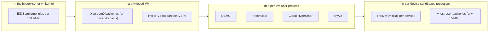
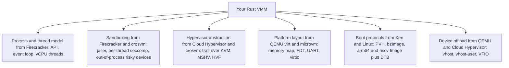

Purpose: Compare the production hypervisors and VMMs you will be measured against (where they put device models, what language they use, what they expose to the guest, what they boot and how fast) so you can deliberately copy the right decisions into your own Rust VMM.

# Hypervisor Architectures Compared

Related notes: [01 Virtualization Mental Model and History](/compendium/virtualization/virtualization-mental-model-and-history), [07 Device Emulation PIO MMIO and the Bus Model](/compendium/virtualization/device-emulation-pio-mmio-and-the-bus-model), [08 Virtio Devices Virtqueues and vhost](/compendium/virtualization/virtio-devices-virtqueues-and-vhost), [11 Device Passthrough VFIO IOMMU and Nested Virtualization](/compendium/virtualization/device-passthrough-vfio-iommu-and-nested-virtualization), [13 Security Isolation and Attack Surface](/compendium/virtualization/security-isolation-and-attack-surface), [18 Rust VMM Ecosystem and Project Templates](/compendium/virtualization/rust-vmm-ecosystem-and-project-templates), [09 cgroups Namespaces Containers and Runtime Isolation](/compendium/linux-systems-engineering/cgroups-namespaces-containers-and-runtime-isolation).

Every hypervisor answers the same five questions differently:

1. Which component runs in the most privileged mode, and how big is it?
2. Where do device models run (hypervisor, kernel, privileged VM, per-VM process, per-device process)?
3. What language are the guest-reachable parts written in?
4. What virtual platform does the guest see (legacy PC, minimal microVM, paravirtual-only)?
5. Who manages lifecycle (API, CLI, libvirt, a cloud control plane)?

Once you can answer those for each system below, the rest of the comparison falls out.

## The placement axis: where device models live

The single most important architectural decision is where device emulation runs, because device models parse guest-controlled data and are therefore the main attack surface.

Moving right reduces blast radius per bug and increases IPC cost and engineering complexity. KVM-based VMMs sit in the right half by construction: KVM itself contains only the CPU, MMU and a few interrupt-controller and timer models; everything else is in user space.

## Summary table

| System | Hypervisor core | Device model placement | Language | Guest arches (host = guest) | Typical boot path | Primary use |
|---|---|---|---|---|---|---|
| QEMU (with KVM) | KVM (or TCG, HVF, WHPX, Xen, NVMM) | Per-VM process, optional vhost and vhost-user offload | C (some Rust experiments in progress) | Very broad: x86, ARM, RISC-V, POWER, s390x, MIPS, and more (TCG emulates any) | SeaBIOS, OVMF/edk2, direct kernel, many machine types | General purpose, libvirt, OpenStack, desktop |
| Firecracker | KVM | Per-VM process (VMM thread plus vCPU threads), jailed | Rust | x86-64 (Intel, AMD), aarch64 (AWS Graviton) | Direct kernel boot (ELF vmlinux on x86, PE Image on aarch64), no firmware | Serverless (Lambda, Fargate), multi-tenant sandboxes |
| Cloud Hypervisor | KVM or MSHV | Per-VM process, device threads, vhost-user offload | Rust | x86-64, aarch64; riscv64 experimental | Rust Hypervisor Firmware (PVH), edk2 (`CLOUDHV.fd`, `CLOUDHV_EFI.fd`), direct kernel (PVH or bzImage) | Cloud workloads, Kata, Windows guests |
| crosvm | KVM (also Gunyah, GenieZone, HAXM, WHPX backends in tree) | Per-device processes sandboxed with minijail | Rust | x86-64, aarch64, riscv64 directories in tree | Direct kernel, BIOS option, Android pVM firmware | ChromeOS (Crostini), Android Virtualization Framework |
| Xen | Xen (type 1 microkernel-ish hypervisor) | dom0 or driver domains (QEMU for HVM emulation, PV backends in dom0 kernel) | C | x86-64, ARM64 (ARM32), RISC-V port in progress | PV, HVM (firmware), PVH | Cloud (historic AWS), embedded/automotive, Qubes OS |
| Hyper-V | Hyper-V hypervisor (type 1) | Root partition (VSPs), worker process per VM | C/C++ (Microsoft is adding Rust, OpenVMM/OpenHCL) | x86-64, ARM64 | UEFI (Gen 2), BIOS (Gen 1) | Windows Server, Azure, WSL2 |
| bhyve | vmm.ko in FreeBSD kernel | Per-VM user process (`bhyve`) | C | amd64; arm64 and riscv added in FreeBSD 15.0 | bhyveload, UEFI (edk2), u-boot on arm64/riscv | FreeBSD hosting, TrueNAS, SmartOS/illumos port |
| VMware ESXi | vmkernel (type 1) | Per-VM VMX user world plus vmkernel device layer | C/C++ (proprietary) | x86-64, ARM64 (ESXi-Arm fling, limited) | BIOS or EFI | Enterprise data center |
| Apple Hypervisor.framework | macOS kernel owns VT-x / EL2 | Entirely in the client app (or Virtualization.framework) | C/Swift API, clients in any language | Host-native: x86-64 on Intel Macs, ARM64 on Apple silicon | Whatever the client implements | Docker Desktop, UTM, Lima, Tart |

Treat the guest-arch column as "host architecture equals guest architecture with hardware acceleration". Only QEMU's TCG offers cross-architecture emulation.

## QEMU

QEMU is the reference implementation of "everything". Architecture:

- One process per VM. A main loop thread (glib-based AIO context), one thread per vCPU, optional IOThreads for block and virtio, migration thread.
- Accelerators: KVM on Linux, HVF on macOS, WHPX on Windows, Xen, NVMM on NetBSD, and TCG (its own dynamic binary translator) everywhere.
- QOM (QEMU Object Model): typed object hierarchy with properties; every device is a QOM object composable from the command line.
- Device breadth: hundreds of devices across dozens of machine types (`pc`, `q35`, `microvm`, `virt` on ARM and RISC-V, `pseries`, `s390-ccw-virtio`, ...).
- Management: QMP (JSON over a socket), HMP for humans, usually driven by libvirt.
- Offload: vhost-net (kernel), vhost-user (external process), vhost-vdpa.

Attack surface: large. Even if a given VM exposes few devices, the binary contains them, and QEMU historically had a steady stream of device-model CVEs (VENOM in the floppy controller, 2015, is the canonical example). Mitigations: build-time device trimming, the `microvm` machine type, seccomp sandbox (`-sandbox on`), running under SELinux sVirt or AppArmor via libvirt, and offloading devices to vhost-user.

What to copy:

- The `virt` machine types on ARM64 and RISC-V are the de facto reference platform for "what Linux expects": memory at a fixed base, GIC or AIA/PLIC, PL011 or 16550 UART, virtio-mmio or PCIe ECAM, generated FDT. Read QEMU's `hw/arm/virt.c` and `hw/riscv/virt.c` when designing your FDT.
- QMP's model of an async event stream plus synchronous commands.
- Use QEMU as your differential oracle: when your guest misbehaves, boot the same kernel on QEMU with `-machine microvm` or `virt` and compare.

What not to copy: the breadth. Every device you add is code reachable by a hostile guest.

## Firecracker

Firecracker (AWS, open sourced 2018) is the canonical minimal Rust VMM.

- Process model: one Firecracker process per microVM, launched by the `jailer`, which sets up a chroot, cgroups, namespaces (including a network namespace), drops privileges to an unprivileged uid/gid, then execs Firecracker.
- Threads: an API server thread (REST over a Unix socket), a VMM thread running the event loop with all device emulation, and one thread per vCPU. Each thread type gets its own seccomp filter (compiled from JSON by `seccompiler`).
- Devices: virtio-net, virtio-block, virtio-vsock, virtio-balloon, virtio-rng (entropy), virtio-pmem, a serial console, an i8042 controller used only for guest reset on x86, an RTC (PL031 on aarch64), and a guest-facing metadata service (MMDS). Transport historically virtio-mmio; virtio-pci hotplug is listed as a developer preview in the current README.
- Rate limiters: token buckets for bandwidth and ops/s per block and net device.
- Boot: direct kernel boot only, no BIOS or UEFI. x86 uses an uncompressed ELF vmlinux (PVH entry is supported); aarch64 loads a PE-format Image and passes an FDT.
- Snapshots: full and diff snapshots (guest memory file plus serialized VMM state), restore from a memory file with lazy loading (UFFD backend option).
- Supported hosts: x86-64 Intel and AMD, aarch64 on AWS Graviton; tested host kernels listed in the README (5.10, 6.1 lines).

Published targets from `SPECIFICATION.md` (on specific EC2 metal instances, minimal kernel and rootfs, serial console disabled):

| Metric | Target |
|---|---|
| Boot time (InstanceStart to guest `/sbin/init`) | At most 125 ms |
| VMM memory overhead (1 vCPU, 128 MiB guest) | At most 5 MiB |
| Startup to API socket available | 8 CPU ms (typical wall clock about 12 ms) |
| Guest CPU performance | Greater than 95 percent of bare metal |

What to copy:

- The thread model and per-thread seccomp filters. Small, auditable, effective.
- The jailer as a separate binary. Your VMM should not need root; the launcher does the privileged setup and then the VMM runs with nothing.
- Direct kernel boot as the default fast path.
- Rate limiters as a first-class device property for multi-tenant fairness.
- A small, versioned REST API with explicit pre-boot vs post-boot actions.
- A specification document with measurable targets and tests that enforce them.

What it chooses not to do: no PCI passthrough, no GPU, no live migration (snapshot and restore instead), no Windows guests, no firmware. Those omissions are the product.

## Cloud Hypervisor

Cloud Hypervisor (started by Intel, now a Linux Foundation project) aims for modern cloud workloads with a minimal but broader device set.

- Runs on KVM or the Microsoft Hypervisor (MSHV), through a `hypervisor` crate abstraction. Minimum host kernel stated as 6.8 in the current README.
- Arches: x86-64 and aarch64 as primary; riscv64 explicitly experimental.
- Guests: 64-bit Linux and Windows 10 / Windows Server 2019.
- Devices: virtio-net, virtio-block, virtio-pmem, virtio-fs, virtio-vsock, virtio-rng, virtio-console, virtio-iommu, virtio-mem, virtio-balloon, VFIO passthrough, vDPA, vhost-user for net/block/fs. PCI (virtio-pci) is the main transport, with hotplug of vCPUs, memory, VFIO and virtio devices.
- Firmware: Rust Hypervisor Firmware (a lightweight PVH firmware), or edk2 builds (`CLOUDHV.fd` for x86-64, `CLOUDHV_EFI.fd` for aarch64). Direct kernel boot needs PVH support or bzImage on x86-64.
- Management: REST API over a Unix socket plus `ch-remote` CLI; live migration and snapshot/restore.
- Security: seccomp per thread, Landlock support, memory-safe Rust.
- Built on rust-vmm crates and shares code with other VMMs.

What to copy:

- The `hypervisor` abstraction crate if you ever want MSHV or another backend. Keep KVM types out of device code.
- PCI as the main transport if you want hotplug, MSI-X and passthrough. virtio-mmio is simpler but does not scale to many devices or hotplug as cleanly.
- vhost-user as the escape hatch for heavyweight backends (virtiofsd, SPDK, DPDK).
- Its CI approach: integration tests that boot real guests across firmware and kernel combinations.

## crosvm

crosvm (Google, for ChromeOS and Android) is the most security-paranoid of the Rust VMMs.

- Each virtual device runs by default in its own process, sandboxed with minijail (namespaces, seccomp policy per device). The main process proxies MMIO/PIO accesses to device processes over sockets. A compromised device process sees only its own resources.
- Hypervisor backends in `hypervisor/src`: KVM, Gunyah, GenieZone, Halla, HAXM, WHPX (Windows). Architecture directories: `x86_64`, `aarch64`, `riscv64`.
- Devices: virtio-gpu (with virgl/gfxstream), virtio-wayland, virtio-snd, virtio-input, virtio-fs, vhost-user frontends and backends, VFIO, and much more than Firecracker because it serves desktop Linux apps on ChromeOS.
- Used by the Android Virtualization Framework (AVF) with pKVM for protected VMs, where the host cannot read guest memory.
- Has its own crates (`base`, `cros_async`, `vm_memory`, `kernel_loader`, `devices`) rather than depending wholly on rust-vmm; it was one of the two founding projects of rust-vmm.

What to copy:

- The idea that a device process boundary is cheap insurance for complex devices (GPU, USB, sound). If you add a device that parses complex formats, consider running it out of process via vhost-user.
- A `base` crate that hides OS differences (crosvm runs on Windows hosts too).
- Its fuzzing setup for device models.

## Xen

Xen is a true type 1 hypervisor with a small core and policy pushed into a privileged guest.

- Xen itself handles scheduling (credit2, RTDS, ARINC653, null), memory (p2m tables), event channels, grant tables, and hypercalls.
- dom0 is a Linux (or NetBSD/FreeBSD) domain with hardware access and the toolstack (`xl`, libxl). Driver domains can isolate specific hardware.
- Guest types: PV (modified kernel, no hardware assist needed, now mainly for legacy), HVM (hardware assist plus device emulation by a QEMU instance in dom0 or a stub domain), PVH (hardware assist, PV-style boot and PV devices, no emulated platform). PVH is the modern recommended mode on x86.
- Split drivers: blkfront/blkback, netfront/netback over shared-memory rings using grant tables.
- ARM64: Xen uses EL2 directly with no PV/HVM split; guests are hardware-assisted with PV devices and a device tree. Popular in automotive and embedded (safety partitioning, dom0less boot).
- RISC-V port: in progress upstream; treat as not production ready.

What to copy:

- PVH as a boot protocol: hardware-assisted guest, entered in 32-bit protected mode with paging off, `start_info` pointer in `ebx`. Linux and Cloud Hypervisor's firmware support it, and it avoids the bzImage real-mode setup path. See [09 Booting Guests Firmware and the Linux Boot Protocol](/compendium/virtualization/booting-guests-firmware-and-the-linux-boot-protocol).
- Grant tables as a mental model for explicit, revocable memory sharing; virtio relies on implicit full guest memory access, which is simpler but broader.
- Disaggregation: device backends in less-privileged domains.

## Microsoft Hyper-V

- Type 1 hypervisor with a root partition (Windows) that owns devices and runs the virtualization stack (VMMS service, per-VM worker process `vmwp.exe`).
- Child partitions use enlightened drivers: Virtualization Service Clients (VSCs) talk over VMBus (shared-memory ring channel) to Virtualization Service Providers (VSPs) in the root. Linux has upstream VMBus drivers (`hv_vmbus`, `hv_netvsc`, `hv_storvsc`).
- Hypervisor Top Level Functional Specification (TLFS) documents hypercalls, synthetic MSRs, SynIC (synthetic interrupt controller), reference TSC page. KVM can expose Hyper-V enlightenments to Windows guests (`KVM_CAP_HYPERV_*`) because Windows runs faster with them.
- MSHV: Linux can run as the root partition on the Microsoft hypervisor and expose `/dev/mshv`, which Cloud Hypervisor uses.
- OpenVMM and OpenHCL: Microsoft's open-source Rust VMM and paravisor (running inside a confidential VM's VTL2). Worth reading as a third large Rust VMM codebase.
- Arches: x86-64 and ARM64.

What to copy: the Hyper-V enlightenments list when you want Windows guests on KVM; the paravisor idea for confidential computing.

## bhyve

- FreeBSD's hypervisor: `vmm.ko` kernel module (like KVM) plus a `bhyve` user-space process per VM (like your VMM), configured by `bhyvectl` and `bhyveload`.
- Minimal legacy: no BIOS emulation originally (bhyveload loads FreeBSD kernels directly); UEFI via edk2 for other guests.
- Devices: virtio-net, virtio-blk, virtio-9p, NVMe, AHCI, e1000, xHCI tablet, framebuffer (VNC), passthrough.
- Arches: amd64 long-standing. FreeBSD 15.0 release notes add arm64 and riscv support for `vmm` and `bhyve`, with u-boot ports as the boot loaders.
- Ported to illumos (SmartOS, OmniOS) where it became the main hypervisor.

What to copy: the clean kernel/user split mirrors KVM and shows the model is OS-independent. Its NVMe emulation is a readable reference.

## VMware ESXi

- vmkernel is a purpose-built type 1 kernel with its own scheduler, memory manager (transparent page sharing, ballooning, compression), storage stack (VMFS, vSAN) and network stack (vSwitch).
- Each VM has a VMX user-world process for device emulation plus a VMM component per vCPU in the vmkernel context.
- Historically used binary translation on x86; now hardware-assisted only.
- Devices: emulated (e1000, LSI Logic) and paravirtual (vmxnet3, PVSCSI).
- Closed source; studied through papers and public documentation.

What to copy: ballooning and memory overcommit ideas (virtio-balloon descends from this), and the notion that a paravirtual NIC (vmxnet3) beats emulating an Intel NIC.

## Apple Hypervisor.framework and Virtualization.framework

- Hypervisor.framework (available since macOS 10.10 on Intel, and on Apple silicon since macOS 11) is a low-level API: create a VM, map memory, create vCPUs, run, handle exits. It is architecturally like `/dev/kvm` with no device models at all. On Apple silicon the kernel owns EL2; the API exposes ARM64 system registers and a vGIC (in recent macOS versions).
- Virtualization.framework is the high-level API built on it, with virtio devices (block, net, console, fs, vsock, GPU), Linux direct boot and macOS guests.
- Clients: QEMU (HVF accelerator), UTM, Lima, Tart, Docker Desktop, Podman machine.

What to copy: if you want your Rust VMM to run on macOS, put your vCPU and memory API behind a trait with KVM and HVF backends, as QEMU and crosvm (with WHPX) do. Note that an M-series Mac only runs ARM64 guests with acceleration.

## Kata Containers and gVisor (for contrast)

These are sandboxes for containers, not hypervisors, but they consume or replace hypervisors:

| | Kata Containers | gVisor |
|---|---|---|
| Model | Each pod runs inside a lightweight VM with its own guest kernel; an agent inside the VM runs containers. | A user-space kernel (Sentry, Go) implements the Linux syscall ABI; the app never talks to the host kernel directly. |
| Hypervisor | Pluggable: QEMU, Cloud Hypervisor, Firecracker, Dragonball (built-in Rust VMM in the Kata runtime). | Platforms: systrap (default since mid-2023, seccomp `SECCOMP_RET_TRAP`), KVM (Sentry acts as guest kernel and VMM), ptrace (deprecated). |
| File sharing | virtio-fs (virtiofsd), or block devices | Gofer process or directfs |
| Interface exposed to the workload | A full Linux kernel inside a VM | Sentry's Linux ABI implementation |
| Strength | Strong hardware boundary, full kernel compatibility | No hardware virtualization needed, small host syscall surface |
| Cost | Guest kernel memory, boot time, double page cache | Syscall overhead, incomplete ABI coverage |

Lesson for your VMM: Kata's pluggable hypervisor interface is a real customer. If your VMM can boot a kernel, attach virtio-fs, virtio-vsock and a block device and expose an API, it can be a Kata backend.

## Attack surface comparison

| System | Guest-reachable code in privileged context | Guest-reachable code in host user space | Memory safety of device models | Default sandbox |
|---|---|---|---|---|
| QEMU/KVM | KVM (CPU, MMU, irqchip, vhost-net if used) | Large device set in one process | C | seccomp (opt-in), SELinux/AppArmor via libvirt |
| Firecracker | KVM | Small device set in one process | Rust | jailer (chroot, namespaces, cgroups, uid drop) plus per-thread seccomp |
| Cloud Hypervisor | KVM or MSHV | Medium device set, plus vhost-user backends | Rust | per-thread seccomp, Landlock |
| crosvm | KVM (or others) | Per-device processes | Rust | minijail per device |
| Xen | Xen hypervisor | QEMU in dom0 or stubdom (HVM), PV backends in dom0 kernel | C | Stub domains, driver domains, XSM/FLASK |
| Hyper-V | Hyper-V hypervisor | VSPs in root partition kernel, worker process | C/C++ | Root partition is highly privileged |
| ESXi | vmkernel | VMX user world | C/C++ | VMX sandboxing (proprietary) |

KVM itself is common to most of these: a bug in KVM's instruction emulator or MMU affects QEMU, Firecracker, Cloud Hypervisor and crosvm alike. Your VMM cannot fix KVM, but it can avoid enabling KVM features it does not need (for example, not creating the in-kernel PIT if you do not need it, not exposing nested virtualization).

## Boot time and footprint

Indicative ranges for a minimal Linux guest to init on modern hardware (project-published or commonly reported; always measure your own):

| VMM and boot path | Order of magnitude to guest init | Notes |
|---|---|---|
| Firecracker, direct boot | About 100 to 150 ms | Spec target at most 125 ms to `/sbin/init` |
| Cloud Hypervisor, direct boot (PVH) | Comparable to Firecracker, around 100 ms | Firmware boot adds time |
| QEMU `microvm` machine, direct boot | Low hundreds of ms | Much faster than `q35` with firmware |
| QEMU `q35` with OVMF | Seconds | Firmware init, PCI enumeration |
| Your first VMM | Dominated by kernel decompression and init | Use an uncompressed or PVH kernel, disable unneeded drivers, keep serial output small |

Boot time is mostly guest kernel time once the VMM is lean. VMM-side levers: avoid firmware, pre-fault or lazily fault memory deliberately, keep ACPI/FDT generation cheap, and do not probe devices you do not expose.

## Supported architectures in detail

| System | x86-64 | ARM64 | RISC-V |
|---|---|---|---|
| QEMU | Full (KVM, TCG) | Full (KVM, HVF, TCG); `virt` machine | Full TCG; KVM on RISC-V hosts with H extension; `virt` machine |
| Firecracker | Yes (Intel, AMD) | Yes (Graviton 2 and later) | No |
| Cloud Hypervisor | Yes | Yes | Experimental, limited |
| crosvm | Yes | Yes | `riscv64` arch crate in tree (maturity unclear, check upstream) |
| Xen | Yes | Yes | Port in progress |
| Hyper-V | Yes | Yes | No |
| bhyve | Yes | Added in FreeBSD 15.0 | Added in FreeBSD 15.0 |
| ESXi | Yes | Limited (Arm fling) | No |
| Apple Hypervisor.framework | Intel Macs | Apple silicon | No |

For RISC-V specifically, QEMU's `virt` board plus KVM is the most mature reference today, and kvm-ioctls supports riscv64 in its examples (`set_one_reg` with RISC-V register IDs). See [16 RISC-V Virtualization and the Hypervisor Extension](/compendium/virtualization/risc-v-virtualization-and-the-hypervisor-extension).

## Process and thread models side by side

| VMM | Processes per VM | Threads | Where a PIO/MMIO exit is handled | Where queue notifications are handled |
|---|---|---|---|---|
| QEMU | 1 (plus optional vhost-user daemons, virtiofsd) | Main loop, one per vCPU, optional IOThreads, migration, worker pools | vCPU thread, under the Big QEMU Lock (BQL) unless the device is lock-free | Main loop or an IOThread via ioeventfd |
| Firecracker | 1 (launched by jailer) | API, VMM (event loop), one per vCPU | vCPU thread, through the MMIO or PIO bus | VMM thread via ioeventfd and `event-manager` |
| Cloud Hypervisor | 1 (plus optional vhost-user backends) | API/HTTP, VMM control loop, one per vCPU, one or more per virtio device | vCPU thread | Per-device threads with their own epoll loop |
| crosvm | 1 main plus 1 per sandboxed device | vCPU threads in main, device worker threads in each device process | vCPU thread forwards over a socket to the device process | Device process |
| Xen HVM | Hypervisor plus a QEMU (device model) per domain in dom0 or a stub domain | Xen schedules vCPUs; QEMU threads in dom0 | Xen forwards ioreq to QEMU via shared page and event channel | PV backends in dom0 kernel (blkback, netback) |

The common thread: in every KVM-based design the vCPU thread itself handles synchronous register accesses, and asynchronous work goes elsewhere. Your VMM should follow the same split.

## Memory management features

| Feature | QEMU | Firecracker | Cloud Hypervisor | crosvm | Notes for your VMM |
|---|---|---|---|---|---|
| Hugepage backing | Yes (`memory-backend-file` / memfd with hugetlb) | Yes (hugetlbfs option) | Yes | Yes | Big win for TLB reach; complicates dirty tracking granularity and snapshot lazy loading |
| virtio-balloon | Yes | Yes (with statistics) | Yes | Yes | Cooperative; a hostile guest can ignore it |
| virtio-mem | Yes | Recent memory hotplug support listed in README | Yes | Check upstream | Finer-grained, guest-driven hot(un)plug |
| Shared file-backed memory | Yes | Yes (snapshot restore maps memory file) | Yes | Yes | Needed for vhost-user (backend must map guest memory) |
| Userfaultfd lazy restore | Postcopy migration | Snapshot restore via UFFD handler | Not the main path | Check upstream | Fast restore, page fault latency during warm-up |
| KSM / page sharing | Host-side `madvise(MADV_MERGEABLE)` option | Not by default | Option | Option | Side-channel risk across tenants; usually off for multi-tenant |

## State: snapshots and migration

| VMM | Snapshot/restore | Live migration | State format concerns |
|---|---|---|---|
| QEMU | Yes (`savevm`, external snapshots) | Yes: pre-copy, post-copy, multifd, RDMA | VMState descriptions per device with versioning and subsections |
| Firecracker | Yes, full and diff, designed for fast clone-and-restore | No (snapshot-based workflows instead) | Versioned state with explicit compatibility rules per release |
| Cloud Hypervisor | Yes | Yes, pre-copy over TCP or Unix socket | serde-based, `Snapshottable` and `Migratable` traits per component |
| crosvm | Yes (snapshot support used by Android) | Limited | Per-device serialization |
| Xen | Save/restore | Yes | libxc stream format |
| Hyper-V / ESXi | Yes | Yes (Live Migration, vMotion) | Proprietary |

Design lesson: give every device a `snapshot()` and `restore()` from day one, even if the first implementation returns "unsupported". See [12 Snapshots Live Migration and Dirty Page Tracking](/compendium/virtualization/snapshots-live-migration-and-dirty-page-tracking).

## Interrupt controller and timer choices

| VMM | x86-64 | ARM64 | RISC-V |
|---|---|---|---|
| QEMU/KVM | In-kernel LAPIC, IOAPIC, PIC (or split irqchip with user-space IOAPIC), kvmclock | In-kernel vGICv2/v3 with ITS, arch timer | In-kernel AIA (APLIC, IMSIC) or user-space PLIC/APLIC, Sstc timer or SBI |
| Firecracker | In-kernel irqchip, PIT, kvmclock | In-kernel vGICv2/v3, arch timer | Not supported |
| Cloud Hypervisor | Split model: in-kernel LAPIC, user-space IOAPIC device; MSI for PCI | vGICv3 with ITS for MSI | Experimental (AIA) |
| crosvm | In-kernel or split irqchip options | vGIC | AIA in tree (check maturity) |

The split irqchip (`KVM_CAP_SPLIT_IRQCHIP` on x86) keeps the LAPIC in the kernel for speed and moves the IOAPIC and PIC to user space, shrinking in-kernel attack surface. It is a reasonable second step after you get the full in-kernel irqchip working. See [06 Interrupts Timers and Interrupt Controller Virtualization](/compendium/virtualization/interrupts-timers-and-interrupt-controller-virtualization).

## Management interfaces

| VMM | API | Configuration model | Who usually drives it |
|---|---|---|---|
| QEMU | QMP (JSON over socket), HMP | Command-line device graph | libvirt, OpenStack Nova, Proxmox, Kubevirt |
| Firecracker | REST over Unix socket (OpenAPI spec), or JSON config file at start | Pre-boot resource configuration, then `InstanceStart` | Custom control planes (Lambda, Fargate), firecracker-containerd, Kata |
| Cloud Hypervisor | REST over Unix socket, `ch-remote`, D-Bus option | CLI or API, hotplug at runtime | Kata, libvirt driver (in progress), custom |
| crosvm | CLI plus control socket (`crosvm_control`) | CLI | ChromeOS concierge, Android virtualizationservice |
| Xen | libxl / `xl`, XenStore | Domain config files | XAPI (XenServer), Qubes |

Copy Firecracker's discipline: an OpenAPI-described API, explicit pre-boot vs runtime actions, and refusal (not silent ignore) of unsupported requests.

## What to copy for your own VMM

A concrete decision table:

| Decision | Recommended default | Copied from | When to deviate |
|---|---|---|---|
| Device transport | virtio-mmio first, virtio-pci later | Firecracker, then Cloud Hypervisor | Need hotplug, MSI-X, VFIO, or more than a handful of devices: go PCI |
| Boot | Direct kernel (bzImage or PVH on x86, Image + DTB on ARM64 and RISC-V) | Firecracker, Cloud Hypervisor | Need arbitrary OS images or Windows: add edk2 |
| Threading | One thread per vCPU, one event-loop thread for devices, one API thread | Firecracker | High I/O: per-device threads or vhost-user (Cloud Hypervisor) |
| Interrupts | In-kernel irqchip (x86 `KVM_CREATE_IRQCHIP`, ARM vGICv3 device, RISC-V AIA device) with irqfd | All KVM VMMs | Research or split irqchip for x2APIC experiments |
| Sandbox | Separate jailer binary, seccomp per thread, no root | Firecracker | Complex devices: separate processes (crosvm) |
| API | Small REST or JSON-RPC over a Unix socket | Firecracker, Cloud Hypervisor | Library embedding: a Rust API only |
| State | Serializable device state from day one | Firecracker snapshots, Cloud Hypervisor migration | Never; retrofitting is painful |
| Hypervisor abstraction | Thin trait, KVM only at first | Cloud Hypervisor `hypervisor` crate | Do not over-abstract before you have a second backend |

## Common pitfalls

- Copying QEMU's breadth into a security-sensitive VMM. Each device must justify its existence.
- Copying Firecracker's minimalism into a general-purpose VMM and then bolting on PCI, firmware and hotplug in ways the original architecture did not plan for.
- Treating "written in Rust" as the whole security story. Firecracker's isolation comes as much from the jailer and seccomp as from the language; `unsafe` around guest memory and ioctls remains.
- Assuming a VMM supports an architecture because it compiles there. Check the project's tested-hosts list (Firecracker lists specific instance types and kernels).
- Building a hypervisor abstraction trait before having two backends; it will encode KVM's shape anyway.
- Comparing boot times measured differently (to API ready, to kernel entry, to init, to application ready). Always state the endpoint.
- Forgetting that KVM is shared attack surface; enabling KVM capabilities you do not need (nested, PIT, Hyper-V enlightenments) widens it.

## Review checklist

- [ ] For each system, I can name where device models run and what sandbox protects them.
- [ ] I can explain why Firecracker uses one process with per-thread seccomp while crosvm uses one process per device.
- [ ] I can explain Xen's PV, HVM and PVH modes and why PVH matters for direct boot.
- [ ] I can explain Hyper-V's VMBus/VSP/VSC model and why KVM implements Hyper-V enlightenments.
- [ ] I can list which systems support x86-64, ARM64 and RISC-V hosts, and at what maturity.
- [ ] I can state Firecracker's published boot and memory targets and their measurement conditions.
- [ ] I can contrast Kata Containers and gVisor and explain what a VMM must provide to be a Kata backend.
- [ ] I have a written decision table for my VMM's transport, boot, threading, interrupts, sandbox, API and state.

## Primary Sources

- [Firecracker repository and README](https://github.com/firecracker-microvm/firecracker)
- [Firecracker SPECIFICATION.md](https://github.com/firecracker-microvm/firecracker/blob/main/SPECIFICATION.md)
- [Agache et al., "Firecracker: Lightweight Virtualization for Serverless Applications", NSDI 2020](https://www.usenix.org/conference/nsdi20/presentation/agache)
- [Cloud Hypervisor repository and README](https://github.com/cloud-hypervisor/cloud-hypervisor)
- [crosvm book](https://crosvm.dev/book/)
- [crosvm source tree (hypervisor backends and arch crates)](https://github.com/google/crosvm)
- [QEMU documentation](https://www.qemu.org/docs/master/)
- [QEMU microvm machine type](https://www.qemu.org/docs/master/system/i386/microvm.html)
- [Xen Project wiki: guest virtualization modes](https://wiki.xenproject.org/wiki/Understanding_the_Virtualization_Spectrum)
- [Hyper-V Top Level Functional Specification](https://learn.microsoft.com/en-us/virtualization/hyper-v-on-windows/tlfs/tlfs)
- [OpenVMM](https://github.com/microsoft/openvmm)
- [FreeBSD 15.0 release notes commit adding bhyve arm64 and riscv](https://lists.freebsd.org/archives/dev-commits-doc-all/2025-December/004835.html)
- [Apple Hypervisor framework documentation](https://developer.apple.com/documentation/hypervisor)
- [Kata Containers architecture](https://github.com/kata-containers/kata-containers/tree/main/docs/design/architecture)
- [gVisor platform guide](https://gvisor.dev/docs/architecture_guide/platforms/)
- [rust-vmm community repository](https://github.com/rust-vmm/community)
