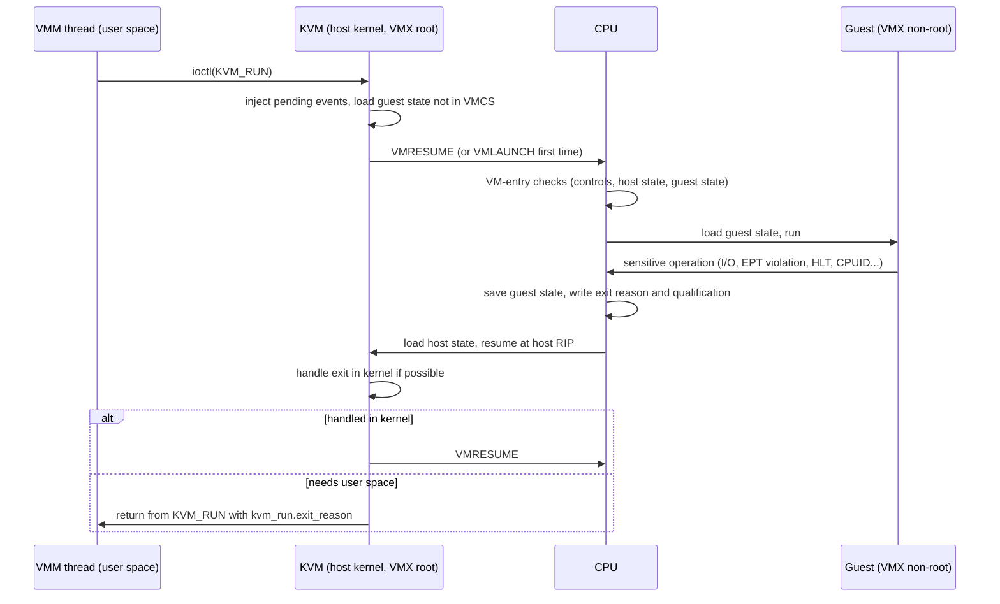
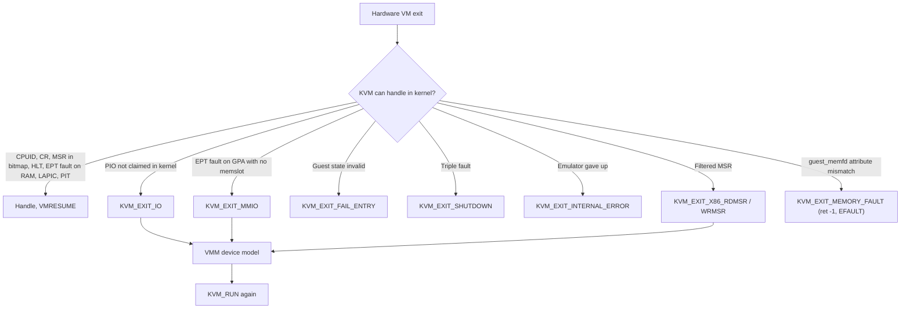

Purpose: explain how Intel VMX and AMD SVM actually run a guest (VMCS/VMCB, controls, entry, exit, bitmaps, TSC offsetting), which parts KVM hides, and which parts still leak through `KVM_RUN` into your VMM, with ARM EL2 and the RISC-V H extension as comparison points.

# Intel VT-x and AMD-V Hardware Virtualization

Related notes: [01 Virtualization Mental Model and History](/compendium/virtualization/virtualization-mental-model-and-history), [02 x86-64 Architecture for Hypervisor Authors](/compendium/virtualization/x86-64-architecture-for-hypervisor-authors), [04 KVM API and the vCPU Run Loop](/compendium/virtualization/kvm-api-and-the-vcpu-run-loop), [05 Memory Virtualization EPT NPT and Guest Memory](/compendium/virtualization/memory-virtualization-ept-npt-and-guest-memory), [06 Interrupts Timers and Interrupt Controller Virtualization](/compendium/virtualization/interrupts-timers-and-interrupt-controller-virtualization), [11 Device Passthrough VFIO IOMMU and Nested Virtualization](/compendium/virtualization/device-passthrough-vfio-iommu-and-nested-virtualization), [13 Security Isolation and Attack Surface](/compendium/virtualization/security-isolation-and-attack-surface), [14 Performance Observability and Debugging](/compendium/virtualization/performance-observability-and-debugging), [15 ARM64 Virtualization EL2 VHE and GIC](/compendium/virtualization/arm64-virtualization-el2-vhe-and-gic), [16 RISC-V Virtualization and the Hypervisor Extension](/compendium/virtualization/risc-v-virtualization-and-the-hypervisor-extension).

## The problem hardware virtualization solves

Classic x86 was not virtualizable in the Popek and Goldberg sense: several sensitive instructions (`popf`, `sgdt`, `smsw`, `push cs`, and others) behave differently in ring 0 and ring 3 without trapping. A deprivileged guest kernel would silently get wrong results. Before 2005 hypervisors worked around this with binary translation (VMware) or paravirtualization (Xen PV).

Intel VT-x (VMX, 2005) and AMD-V (SVM, 2006) fixed this by adding a new axis orthogonal to rings:

- Intel: VMX root operation (hypervisor) and VMX non-root operation (guest). The guest gets real rings 0 to 3 inside non-root.
- AMD: host mode and guest mode, entered with `VMRUN`.

In the guest mode, sensitive operations either execute natively against virtualized state or cause a VM exit, which transfers control to the hypervisor with a description of what happened. Which operations exit is controlled by the hypervisor through a per-vCPU control structure: the VMCS on Intel, the VMCB on AMD.

Why this matters for your VMM: you will never execute VMLAUNCH yourself. KVM does. But every `VcpuExit` variant you handle is a hardware VM exit that KVM chose not to handle in-kernel, and every "invalid state" error is a VM-entry check failure. Knowing the hardware model is how you read those errors.

## Intel VMX

### Enabling VMX

1. Check CPUID.1:ECX.VMX[bit 5].
2. Check `IA32_FEATURE_CONTROL` (MSR 0x3A): lock bit 0 set and "enable VMX outside SMX" bit 2 set. Firmware usually locks this; if locked with VMX disabled, VT-x is off in BIOS.
3. Set CR4.VMXE (bit 13), respecting `IA32_VMX_CR0_FIXED0/1` and `IA32_VMX_CR4_FIXED0/1`.
4. Allocate a 4 KiB aligned VMXON region, write the VMCS revision identifier from `IA32_VMX_BASIC` (MSR 0x480) bits 30:0 into its first dword.
5. Execute `VMXON` with the region's physical address. The logical CPU is now in VMX root operation.

KVM does this per host CPU when the module loads (or on first VM creation depending on kernel version and `enable_virt_at_load`).

### VMX instructions

| Instruction | Purpose |
|---|---|
| VMXON / VMXOFF | Enter / leave VMX operation |
| VMCLEAR | Flush a VMCS to memory and mark it clear (required before migrating it to another CPU) |
| VMPTRLD / VMPTRST | Make a VMCS current / store current VMCS pointer |
| VMREAD / VMWRITE | Access VMCS fields by encoding (the in-memory layout is undocumented and implementation-specific) |
| VMLAUNCH | First entry with a clear VMCS |
| VMRESUME | Subsequent entries with a launched VMCS |
| VMCALL | Guest-initiated exit (hypercall) |
| INVEPT / INVVPID | Invalidate EPT-derived or VPID-tagged TLB entries |
| VMFUNC | Guest-invokable VM functions (EPTP switching) |

The VMCS is opaque: you must use VMREAD/VMWRITE with field encodings. That opacity is why VMCS state cannot be snapshotted by copying memory, and why nested KVM needs `KVM_GET_NESTED_STATE`.

### VMCS layout

The SDM groups VMCS fields into six logical areas:

| Area | Contents |
|---|---|
| Guest-state area | CR0, CR3, CR4, DR7, RSP, RIP, RFLAGS; full segment registers (selector, base, limit, access rights) for CS, SS, DS, ES, FS, GS, LDTR, TR; GDTR, IDTR; MSRs such as IA32_DEBUGCTL, SYSENTER_*, EFER, PAT; activity state; interruptibility state; pending debug exceptions; VMCS link pointer; VMX-preemption timer value; PDPTEs for PAE |
| Host-state area | CR0, CR3, CR4, RSP, RIP, segment selectors, FS/GS/TR/GDTR/IDTR bases, SYSENTER MSRs, EFER, PAT, loaded on every VM exit |
| VM-execution control fields | Pin-based, primary and secondary (and tertiary) processor-based controls; exception bitmap; I/O bitmap addresses; TSC offset and multiplier; CR0/CR4 guest/host masks and read shadows; CR3-target values; APIC-access and virtual-APIC addresses; MSR bitmap address; EPTP; VPID; PLE gap/window; PML address |
| VM-exit control fields | Host address-space size (64-bit host), save/load EFER and PAT, acknowledge interrupt on exit, MSR-store and MSR-load lists |
| VM-entry control fields | IA-32e mode guest, load EFER/PAT, MSR-load list, event injection (interruption information, error code, instruction length) |
| VM-exit information fields | Exit reason, exit qualification, guest linear address, guest physical address, exit interruption info and error code, IDT-vectoring info, instruction length, instruction info |

### Capability MSRs and the allowed-0/allowed-1 rule

Each control field has a capability MSR whose low 32 bits are "allowed 0-settings" (if bit is 1, the control must be 1) and high 32 bits are "allowed 1-settings" (if bit is 0, the control must be 0). KVM computes `vmcs_config` by intersecting what it wants with what the CPU allows.

| MSR | Index | Reports |
|---|---|---|
| IA32_VMX_BASIC | 0x480 | VMCS revision, region size, memory type, TRUE_* support |
| IA32_VMX_PINBASED_CTLS | 0x481 | Pin-based controls |
| IA32_VMX_PROCBASED_CTLS | 0x482 | Primary processor-based controls |
| IA32_VMX_EXIT_CTLS | 0x483 | VM-exit controls |
| IA32_VMX_ENTRY_CTLS | 0x484 | VM-entry controls |
| IA32_VMX_MISC | 0x485 | Preemption-timer rate, CR3-target count, MSR-list limits |
| IA32_VMX_CR0_FIXED0/1 | 0x486/0x487 | CR0 bits fixed in VMX operation |
| IA32_VMX_CR4_FIXED0/1 | 0x488/0x489 | CR4 bits fixed in VMX operation |
| IA32_VMX_VMCS_ENUM | 0x48A | Highest VMCS field index |
| IA32_VMX_PROCBASED_CTLS2 | 0x48B | Secondary controls |
| IA32_VMX_EPT_VPID_CAP | 0x48C | EPT and VPID capabilities (4/5-level walk, 2 MiB/1 GiB pages, A/D, INVEPT types) |
| IA32_VMX_TRUE_* | 0x48D to 0x490 | Relaxed default-1 controls |
| IA32_VMX_VMFUNC | 0x491 | VM functions |
| IA32_VMX_PROCBASED_CTLS3 | 0x492 | Tertiary controls (IPI virtualization) |

On Linux, `/proc/cpuinfo` exposes a decoded "vmx flags" line built from these MSRs (`ept`, `vpid`, `unrestricted_guest`, `ept_ad`, `ept_5level`, `pml`, `tsc_scaling`, `posted_intr`, `apicv`, and so on). It is the fastest way to see what a host supports.

### Execution controls that matter

Pin-based controls:

| Bit | Control | Effect |
|---|---|---|
| 0 | External-interrupt exiting | Host interrupts cause exits (KVM always sets) |
| 3 | NMI exiting | NMIs cause exits |
| 5 | Virtual NMIs | Hardware tracks guest NMI blocking |
| 6 | Activate VMX-preemption timer | Timer counts down in non-root, exit 52 at zero |
| 7 | Process posted interrupts | Interrupts delivered into the guest without exit (APICv) |

Primary processor-based controls:

| Bit | Control | Effect |
|---|---|---|
| 2 | Interrupt-window exiting | Exit as soon as the guest can accept an interrupt |
| 3 | Use TSC offsetting | RDTSC returns host TSC plus offset |
| 7 | HLT exiting | HLT exits (KVM uses it to block the vCPU thread) |
| 9 | INVLPG exiting | Needed for shadow paging only |
| 10 | MWAIT exiting | |
| 12 | RDTSC exiting | Full trap on RDTSC, rarely used |
| 15/16 | CR3-load / CR3-store exiting | Needed for shadow paging only |
| 19/20 | CR8-load / CR8-store exiting | TPR access |
| 21 | Use TPR shadow | Virtual APIC page for TPR |
| 22 | NMI-window exiting | |
| 23 | MOV-DR exiting | |
| 24 | Unconditional I/O exiting | All IN/OUT exit |
| 25 | Use I/O bitmaps | Per-port exit decision |
| 27 | Monitor trap flag | Single-step: exit after each guest instruction |
| 28 | Use MSR bitmaps | Per-MSR exit decision |
| 30 | PAUSE exiting | |
| 31 | Activate secondary controls | |

Secondary processor-based controls:

| Bit | Control | Effect |
|---|---|---|
| 0 | Virtualize APIC accesses | APIC page accesses handled via APIC-access page |
| 1 | Enable EPT | Two-dimensional paging (note 05) |
| 2 | Descriptor-table exiting | LGDT/SGDT and friends exit |
| 3 | Enable RDTSCP | |
| 4 | Virtualize x2APIC mode | |
| 5 | Enable VPID | Tag TLB entries per vCPU, avoid flush on every entry/exit |
| 6 | WBINVD exiting | |
| 7 | Unrestricted guest | Real mode and unpaged protected mode run natively |
| 8 | APIC-register virtualization | |
| 9 | Virtual-interrupt delivery | |
| 10 | PAUSE-loop exiting | Exit spinning vCPUs (lock-holder preemption mitigation) |
| 12 | Enable INVPCID | |
| 13 | Enable VM functions | |
| 14 | VMCS shadowing | Nested: guest VMREAD/VMWRITE without exits |
| 17 | Enable PML | Page-modification logging for dirty tracking |
| 18 | EPT-violation #VE | Reflect selected EPT violations into the guest |
| 20 | Enable XSAVES/XRSTORS | |
| 25 | Use TSC scaling | TSC multiplier applied |
| 30 | Bus-lock detection | |
| 31 | Notify VM exiting | Exit when no event window opens for too long (DoS mitigation) |

The exception bitmap (32 bits, one per vector) decides which guest exceptions exit. KVM normally intercepts only a few (for example #UD for emulation, #AC for split-lock handling, #DB/#BP when debugging, #PF only with shadow paging).

### MSR bitmaps and I/O bitmaps

The MSR bitmap is one 4 KiB page split into four 1 KiB bitmaps:

| Offset | Covers |
|---|---|
| 0x000 | Reads of MSRs 0x0000_0000 to 0x0000_1FFF |
| 0x400 | Reads of MSRs 0xC000_0000 to 0xC000_1FFF |
| 0x800 | Writes of MSRs 0x0000_0000 to 0x0000_1FFF |
| 0xC00 | Writes of MSRs 0xC000_0000 to 0xC000_1FFF |

A set bit means "exit". MSRs outside both ranges always exit. KVM passes through hot MSRs that are safe to virtualize natively (FS_BASE, GS_BASE, KERNEL_GS_BASE, SYSENTER_*, sometimes SPEC_CTRL) and traps the rest.

I/O bitmaps A and B are two 4 KiB pages: A covers ports 0x0000 to 0x7FFF, B covers 0x8000 to 0xFFFF, one bit per port. KVM sets "unconditional I/O exiting" on VMX and handles port I/O in-kernel (PIT, PIC, i8042 bits it emulates) or forwards it as `KVM_EXIT_IO`.

### VM entry and exit flow



VM-entry checks happen in three groups (SDM Vol. 3C, "Checks on VMX Controls and Host-State Area" and "Checks on Guest State Area"):

1. Controls and host state. Failures make VMLAUNCH/VMRESUME fail as an instruction (VMfailValid with an error number), not a VM exit. KVM treats these as bugs.
2. Guest state. Failure produces a VM exit with exit reason 33 and bit 31 set ("VM-entry failure"). KVM reports this to user space as `KVM_EXIT_FAIL_ENTRY` with `hardware_entry_failure_reason` = the raw exit reason.
3. MSR loading. Failure is exit reason 34.

### Basic exit reasons

The exit reason field's low 16 bits are the basic reason. Bit 31 indicates VM-entry failure.

| Reason | Name | Who handles it under KVM |
|---|---|---|
| 0 | Exception or NMI | KVM (reflects into guest or handles #MC, #DB) |
| 1 | External interrupt | KVM (host IRQ arrived; re-enter after handling) |
| 2 | Triple fault | KVM, then `KVM_EXIT_SHUTDOWN` to user space |
| 3 / 4 | INIT / SIPI | KVM (AP bring-up with in-kernel LAPIC) |
| 7 | Interrupt window | KVM, or `KVM_EXIT_IRQ_WINDOW_OPEN` with user-space irqchip |
| 8 | NMI window | KVM |
| 10 | CPUID | KVM, answers from `KVM_SET_CPUID2` table |
| 12 | HLT | KVM blocks the vCPU; `KVM_EXIT_HLT` only without in-kernel LAPIC |
| 16 | RDTSC | KVM (only if RDTSC exiting enabled) |
| 18 | VMCALL | KVM hypercalls; `KVM_EXIT_HYPERCALL` for some (with `KVM_CAP_EXIT_HYPERCALL`) |
| 28 | Control-register access | KVM |
| 30 | I/O instruction | KVM for in-kernel devices, else `KVM_EXIT_IO` |
| 31 / 32 | RDMSR / WRMSR | KVM, or `KVM_EXIT_X86_RDMSR`/`WRMSR` with user-space MSR handling |
| 33 | VM-entry failure, invalid guest state | `KVM_EXIT_FAIL_ENTRY` (or KVM emulates if state is emulatable) |
| 34 | VM-entry failure, MSR loading | KVM bug path |
| 40 | PAUSE | KVM (PLE yields to another vCPU) |
| 44 | APIC access | KVM |
| 45 | Virtualized EOI | KVM (IOAPIC EOI broadcast) |
| 48 | EPT violation | KVM: fault in memory, or `KVM_EXIT_MMIO`, or `KVM_EXIT_MEMORY_FAULT` |
| 49 | EPT misconfiguration | KVM: used deliberately as the fast MMIO path |
| 52 | VMX-preemption timer expired | KVM (timer emulation, hrtimer offload) |
| 54 | WBINVD | KVM |
| 55 | XSETBV | KVM |
| 56 | APIC write | KVM |
| 62 | Page-modification log full | KVM (drains PML into dirty bitmap or ring) |
| 74 | Bus lock | KVM, or `KVM_EXIT_X86_BUS_LOCK` with `KVM_CAP_X86_BUS_LOCK_EXIT` |
| 75 | Notify | KVM, or `KVM_EXIT_NOTIFY` |

### Exit qualification examples

The exit qualification is a 64-bit field whose meaning depends on the exit reason.

I/O instruction (reason 30):

| Bits | Meaning |
|---|---|
| 2:0 | Access size minus 1 (0 = 1 byte, 1 = 2 bytes, 3 = 4 bytes) |
| 3 | Direction: 0 = OUT, 1 = IN |
| 4 | String instruction (INS/OUTS) |
| 5 | REP prefixed |
| 6 | Operand encoding: 0 = DX, 1 = immediate |
| 31:16 | Port number |

Control-register access (reason 28): bits 3:0 the CR number, bits 5:4 access type (MOV to CR, MOV from CR, CLTS, LMSW), bits 11:8 the GPR involved.

EPT violation (reason 48): bit 0 data read, bit 1 data write, bit 2 instruction fetch, bits 3 to 5 whether the guest-physical address was readable, writable, executable in the EPT, bit 7 whether the guest linear address field is valid, bit 8 whether the access was to the final translation (versus a guest page-walk). The guest-physical address is in a separate VM-exit information field.

You never decode these yourself under KVM, but `kvm_run.io` (`direction`, `size`, `port`, `count`, `data_offset`) and `kvm_run.mmio` (`phys_addr`, `data`, `len`, `is_write`) are straightforward translations of them.

### Event injection

To deliver an interrupt or exception to the guest on the next entry, the hypervisor writes the VM-entry interruption-information field (vector, type, error-code-valid, valid bit), plus error code and instruction length for software interrupts. If the guest is not interruptible (RFLAGS.IF = 0, interrupt shadow), the hypervisor sets interrupt-window exiting and retries later. IDT-vectoring information on exit reports an event whose delivery was interrupted by the exit, which must be re-injected. KVM does all of this; the user-space surface is `KVM_INTERRUPT` (user-space irqchip only), `KVM_NMI`, `KVM_SET_VCPU_EVENTS` (migration), and irqfd/MSI routing.

### VMX-preemption timer

A countdown in the VMCS that decrements at the TSC rate divided by 2 to the power `IA32_VMX_MISC[4:0]`. When it reaches zero, exit 52. KVM uses it to emulate the guest LAPIC timer deadline cheaply on the vCPU's own CPU instead of arming a host hrtimer.

## AMD SVM

### Enabling SVM

1. Check CPUID 0x8000_0001:ECX.SVM[bit 2].
2. Check `VM_CR` (MSR 0xC001_0114) bit SVMDIS is clear (firmware may lock it).
3. Set EFER.SVME (bit 12).
4. Write a 4 KiB host save area physical address to `VM_HSAVE_PA` (MSR 0xC001_0117).

### VMCB layout

The VMCB is a single 4 KiB page in normal memory, readable and writable directly (no VMREAD/VMWRITE), with two parts:

| Offset | Area | Contents |
|---|---|---|
| 0x000 | Control area | Intercept vectors (CR reads/writes, DR reads/writes, exceptions, instruction intercepts in two words), PAUSE filter count and threshold, IOPM_BASE_PA, MSRPM_BASE_PA, TSC_OFFSET, guest ASID, TLB_CONTROL, virtual interrupt fields (V_TPR, V_IRQ, V_INTR_PRIO, V_INTR_VECTOR, V_INTR_MASKING), interrupt shadow, EXITCODE, EXITINFO1, EXITINFO2, EXITINTINFO, NP_ENABLE and SEV bits, AVIC fields, EVENTINJ, N_CR3 (nested page table root), LBR virtualization, VMCB clean bits, nRIP (next RIP), guest instruction bytes (decode assists) |
| 0x400 | State save area | ES, CS, SS, DS, FS, GS, GDTR, LDTR, IDTR, TR (selector, attrib, limit, base), CPL, EFER, CR4, CR3, CR0, DR7, DR6, RFLAGS, RIP, RSP, RAX, STAR, LSTAR, CSTAR, SFMASK, KernelGSBase, SYSENTER_*, CR2, G_PAT, debug control and LBR MSRs |

Note what is absent: most general purpose registers. `VMRUN` saves and restores only RAX, RSP, RIP and the listed state; the hypervisor saves the rest in software. Also note that because the VMCB is plain memory, CPU caching of VMCB fields across VMRUNs is controlled by the "VMCB clean bits": the hypervisor clears a clean bit whenever it modifies the corresponding group.

### SVM instructions

| Instruction | Purpose |
|---|---|
| VMRUN | Enter guest using the VMCB at physical address in RAX |
| VMLOAD / VMSAVE | Load/save the "extra" state not handled by VMRUN: FS, GS, TR, LDTR (hidden parts), KernelGSBase, STAR, LSTAR, CSTAR, SFMASK, SYSENTER_* |
| VMMCALL | Guest hypercall |
| STGI / CLGI | Set / clear the global interrupt flag (GIF), which blocks all interrupts including NMI around world switches |
| INVLPGA | Invalidate a TLB entry for a given ASID |
| SKINIT | Secure init (late launch) |

### #VMEXIT

There is no separate entry-failure path: an invalid VMCB causes `#VMEXIT` with EXITCODE `VMEXIT_INVALID` (-1). Otherwise EXITCODE identifies the intercept and EXITINFO1/EXITINFO2 qualify it.

| EXITCODE | Name | EXITINFO1 / EXITINFO2 |
|---|---|---|
| 0x000 to 0x00F / 0x010 to 0x01F | CR read / write | CR number in code; decode assist gives GPR |
| 0x040 to 0x05F | Exception vector 0 to 31 | Error code / CR2 for #PF |
| 0x060 | INTR | Physical interrupt |
| 0x061 | NMI | |
| 0x064 | VINTR | Virtual interrupt window |
| 0x065 | CR0 selective write | |
| 0x072 | CPUID | |
| 0x077 | PAUSE | |
| 0x078 | HLT | |
| 0x07B | IOIO | Port, size, direction, string, rep in EXITINFO1; next RIP in EXITINFO2 |
| 0x07C | MSR | 0 = read, 1 = write in EXITINFO1 |
| 0x07F | SHUTDOWN | Triple fault |
| 0x080 | VMRUN | Nested |
| 0x081 | VMMCALL | |
| 0x08D | XSETBV | |
| 0x400 | NPF (nested page fault) | Page-fault error code / faulting guest physical address |
| 0x403 | VMGEXIT | SEV-ES guest-initiated exit through the GHCB |
| -1 | INVALID | VMCB state was invalid |

### MSR permission map and I/O permission map

- MSRPM: 8 KiB, two bits per MSR (read intercept, write intercept), covering three ranges: 0x0000_0000 to 0x0000_1FFF, 0xC000_0000 to 0xC000_1FFF, 0xC001_0000 to 0xC001_1FFF. MSRs outside these ranges always intercept.
- IOPM: 12 KiB, one bit per port for all 65536 ports (the extra bits handle multi-byte accesses crossing port 0xFFFF).

### Decode assists and nRIP

Older SVM required the hypervisor to fetch and decode the guest instruction to learn the GPR of a MOV CR or the length of an instruction. With NRIPS the CPU writes the next RIP into the VMCB on intercepted instructions; with decode assists it provides the instruction bytes and GPR numbers. KVM uses them when available; otherwise it falls back to its x86 instruction emulator.

## VMX and SVM side by side

| Aspect | Intel VMX | AMD SVM |
|---|---|---|
| Enable | CR4.VMXE + VMXON region | EFER.SVME + VM_HSAVE_PA |
| Control structure | VMCS, opaque, VMREAD/VMWRITE | VMCB, plain memory, clean bits |
| Enter | VMLAUNCH / VMRESUME | VMRUN (RAX = VMCB PA) |
| Extra state | Handled through VMCS or MSR load/store lists | VMLOAD / VMSAVE |
| Exit | VM exit with exit reason + qualification | #VMEXIT with EXITCODE + EXITINFO1/2 |
| Entry failure | VMfail or exit reason 33/34 with bit 31 | VMEXIT_INVALID |
| Hypercall | VMCALL | VMMCALL |
| Second-level paging | EPT (EPTP in VMCS) | NPT (N_CR3 in VMCB), same format as host page tables |
| TLB tagging | VPID (16-bit) | ASID |
| MSR intercept map | 4 KiB, 1 bit per MSR, two ranges | 8 KiB, 2 bits per MSR, three ranges |
| I/O intercept map | Two 4 KiB bitmaps | One 12 KiB map |
| Interrupt virtualization | APICv: virtual-APIC page, posted interrupts, IPI virtualization | AVIC, x2AVIC |
| Dirty tracking assist | PML | None historically (KVM write-protects) |
| Preemption timer | VMX-preemption timer | None (KVM uses hrtimers) |
| Spin detection | PAUSE-loop exiting | PAUSE filter |
| Confidential computing | TDX (separate SEAM module) | SEV, SEV-ES, SEV-SNP |

## TSC offsetting and scaling

The guest reads time through RDTSC/RDTSCP and through `IA32_TSC`. Both vendors let the hypervisor adjust it without trapping:

$$
\text{guest\_tsc} = \left\lfloor \frac{\text{host\_tsc} \times \text{multiplier}}{2^{\text{frac}}} \right\rfloor + \text{offset}
$$

- Offset: VMCS TSC-offset field (with "use TSC offsetting") or VMCB `TSC_OFFSET`.
- Multiplier: VMCS TSC multiplier with 48 fractional bits (with "use TSC scaling"), or AMD `TSC_RATIO` MSR (0xC000_0104, 8.32 fixed point).

Why your VMM cares:

- Migration and snapshot restore: the destination host's TSC differs. You restore the guest TSC by adjusting the offset. KVM exposes this through the vCPU device attribute group `KVM_VCPU_TSC_CTRL`, attribute `KVM_VCPU_TSC_OFFSET` (where `guest_tsc = host_tsc + KVM_VCPU_TSC_OFFSET`), and the kernel docs describe a full algorithm using `KVM_GET_CLOCK` on source and destination.
- Different host frequencies: `KVM_SET_TSC_KHZ` (kvm-ioctls `VcpuFd::set_tsc_khz`) programs scaling so the guest sees a stable frequency.
- Without invariant, synchronized TSC across vCPUs, Linux guests fall back from the TSC clocksource and timekeeping gets slow and jittery. See [06 Interrupts Timers and Interrupt Controller Virtualization](/compendium/virtualization/interrupts-timers-and-interrupt-controller-virtualization).

Note: in kvm-ioctls 0.25.1, `VcpuFd::set_device_attr` is compiled only for aarch64, so on x86 you issue `KVM_SET_DEVICE_ATTR` on the vCPU fd yourself (via `vmm_sys_util::ioctl::ioctl_with_ref`) for the TSC offset attribute.

## How KVM hides all of this

KVM is a VMX/SVM driver plus an x86 platform emulator. From your VMM's point of view:

| Hardware concept | KVM abstraction |
|---|---|
| VMXON / VM_HSAVE_PA per CPU | Done at module load or VM creation |
| VMCS / VMCB allocation | `KVM_CREATE_VCPU` |
| Guest-state area | `KVM_GET/SET_REGS`, `KVM_GET/SET_SREGS`, `KVM_GET/SET_MSRS`, `KVM_GET/SET_FPU`, `KVM_GET/SET_XSAVE`, `KVM_GET/SET_XCRS`, `KVM_GET/SET_DEBUGREGS`, `KVM_GET/SET_VCPU_EVENTS` |
| Execution controls | Chosen by KVM; influenced by `KVM_SET_CPUID2`, `KVM_ENABLE_CAP`, `KVM_SET_GUEST_DEBUG` |
| CPUID exits | Answered in-kernel from your CPUID table |
| MSR bitmap | KVM's own; extended by `KVM_X86_SET_MSR_FILTER` + `KVM_CAP_X86_USER_SPACE_MSR` |
| I/O exits | In-kernel PIT/PIC/IOAPIC or `KVM_EXIT_IO`; `KVM_IOEVENTFD` for doorbells |
| EPT/NPT | Built lazily from memslots (`KVM_SET_USER_MEMORY_REGION`) |
| EPT violation on unmapped GPA | `KVM_EXIT_MMIO` |
| Event injection | `KVM_IRQFD`, `KVM_SIGNAL_MSI`, `KVM_IRQ_LINE`, `KVM_NMI`, in-kernel LAPIC |
| Preemption timer, posted interrupts, PML, VPID | Internal, controlled by module parameters (`kvm_intel.ept`, `enable_apicv`, `pml`, `preemption_timer`) |
| TSC offset/scaling | `KVM_SET_TSC_KHZ`, `KVM_VCPU_TSC_OFFSET` |
| Nested virtualization | `KVM_GET/SET_NESTED_STATE` with `kvm_intel.nested=1` or `kvm_amd.nested=1` |



## What still leaks through KVM_RUN

Even with all of the above, your run loop sees hardware reality in a few places.

1. `KVM_EXIT_FAIL_ENTRY`: `hardware_entry_failure_reason` is the raw VMX exit reason (for example 0x8000_0021) or SVM error. You need the guest-state checks from note 02 to interpret it.
2. `KVM_EXIT_SHUTDOWN`: a triple fault. On real hardware it would reset the machine; you decide whether to reset or stop.
3. `KVM_EXIT_INTERNAL_ERROR` with suberror `KVM_INTERNAL_ERROR_EMULATION`: KVM's instruction emulator could not handle an instruction, typically an MMIO access with an exotic instruction (AVX to MMIO), or real-mode code on a host without unrestricted guest.
4. `KVM_EXIT_IO` with `count &gt; 1`: a `rep outs`/`rep ins` string I/O. The data buffer in `kvm_run` holds `count * size` bytes. kvm-ioctls gives you a slice of that full length.
5. `KVM_EXIT_MMIO`: whatever instruction the guest used, KVM decoded it into a `(phys_addr, len, data, is_write)` tuple. Width is 1, 2, 4 or 8 bytes.
6. CPUID and MSR content: everything you expose becomes the guest's reality and constrains migration.
7. Vendor differences: Intel and AMD hosts produce slightly different exit behavior (for example AMD's VMCB has no preemption timer, so timer exits look different in traces; nested state formats are vendor specific).
8. `immediate_exit` and signals: to kick a vCPU out of `KVM_RUN` you send a signal to its thread; KVM returns `EINTR`. Set `kvm_run.immediate_exit` (kvm-ioctls `set_kvm_immediate_exit`) to avoid a race between checking for work and entering the guest.

### Rust: run loop that surfaces the hardware

Checked against kvm-ioctls 0.25.1 (`VcpuExit` variants and `FailEntry(u64, u32)` from docs.rs and the crate source).

```rust
use kvm_ioctls::{VcpuExit, VcpuFd};

pub enum Stop {
    Halted,
    Shutdown,
    Fatal(String),
}

pub fn run_vcpu(vcpu: &mut VcpuFd, bus: &mut impl DeviceBus) -> Stop {
    loop {
        match vcpu.run() {
            Ok(VcpuExit::IoOut(port, data)) => bus.pio_write(port, data),
            Ok(VcpuExit::IoIn(port, data)) => bus.pio_read(port, data),
            Ok(VcpuExit::MmioWrite(addr, data)) => bus.mmio_write(addr, data),
            Ok(VcpuExit::MmioRead(addr, data)) => bus.mmio_read(addr, data),
            Ok(VcpuExit::Hlt) => return Stop::Halted,
            Ok(VcpuExit::Shutdown) => return Stop::Shutdown, // triple fault on x86
            Ok(VcpuExit::FailEntry(reason, cpu)) => {
                // VMX: bit 31 set + basic reason 33 means invalid guest state.
                let basic = reason & 0xffff;
                let entry_fail = reason & (1 << 31) != 0;
                return Stop::Fatal(format!(
                    "VM entry failed on host cpu {cpu}: reason {reason:#x} \
                     (basic {basic}, entry failure {entry_fail})"
                ));
            }
            Ok(VcpuExit::InternalError) => {
                let run = vcpu.get_kvm_run();
                // SAFETY: exit_reason is KVM_EXIT_INTERNAL_ERROR, so this union arm is valid.
                let suberror = unsafe { run.__bindgen_anon_1.internal.suberror };
                return Stop::Fatal(format!("KVM internal error, suberror {suberror}"));
            }
            Ok(VcpuExit::X86Rdmsr(exit)) => {
                *exit.data = 0;
                *exit.error = 1; // inject #GP for MSRs we do not model
            }
            Ok(VcpuExit::X86Wrmsr(exit)) => {
                *exit.error = 1;
            }
            Ok(other) => return Stop::Fatal(format!("unhandled exit: {other:?}")),
            Err(e) if e.errno() == libc::EINTR || e.errno() == libc::EAGAIN => continue,
            Err(e) => return Stop::Fatal(format!("KVM_RUN failed: {e}")),
        }
    }
}

pub trait DeviceBus {
    fn pio_write(&mut self, port: u16, data: &[u8]);
    fn pio_read(&mut self, port: u16, data: &mut [u8]);
    fn mmio_write(&mut self, addr: u64, data: &[u8]);
    fn mmio_read(&mut self, addr: u64, data: &mut [u8]);
}
```

The `Hlt` arm is only reached without an in-kernel LAPIC (`KVM_CREATE_IRQCHIP`); with it, KVM blocks the thread in the kernel. The MSR arms need `KVM_CAP_X86_USER_SPACE_MSR` enabled, and optionally a filter:

```rust
use kvm_bindings::{kvm_enable_cap, KVM_CAP_X86_USER_SPACE_MSR, KVM_MSR_EXIT_REASON_FILTER,
                   KVM_MSR_EXIT_REASON_UNKNOWN};
use kvm_ioctls::{MsrFilterDefaultAction, MsrFilterRange, MsrFilterRangeFlags, VmFd};

pub fn trap_unknown_msrs(vm: &VmFd) -> Result<(), kvm_ioctls::Error> {
    let mut cap = kvm_enable_cap { cap: KVM_CAP_X86_USER_SPACE_MSR, ..Default::default() };
    cap.args[0] = (KVM_MSR_EXIT_REASON_UNKNOWN | KVM_MSR_EXIT_REASON_FILTER) as u64;
    vm.enable_cap(&cap)?;

    // Deny (and therefore exit on) reads and writes of 0xC001_0000..0xC001_0020; allow everything else.
    let deny_bits = [0u8; 4]; // 0 bit = denied
    let range = MsrFilterRange {
        flags: MsrFilterRangeFlags::READ | MsrFilterRangeFlags::WRITE,
        base: 0xC001_0000,
        msr_count: 32,
        bitmap: &deny_bits,
    };
    vm.set_msr_filter(MsrFilterDefaultAction::ALLOW, &[range])
}
```

`set_msr_filter`, `MsrFilterRange` and `MsrFilterRangeFlags` were added in kvm-ioctls 0.25.0 (x86_64 only).

## ARM EL2 and RISC-V H extension compared

ARM and RISC-V took a different path: rather than bolting a new root/non-root axis onto the existing privilege levels, they define the hypervisor as an additional, more privileged level whose trap controls are ordinary system registers. There is no VMCS or VMCB; the hypervisor saves and restores guest EL1 or VS state in software.

| Aspect | Intel VMX | AMD SVM | ARM64 EL2 | RISC-V H extension |
|---|---|---|---|---|
| Hypervisor privilege | VMX root, ring 0 | Host mode, ring 0 | EL2 | HS-mode |
| Guest kernel privilege | Non-root ring 0 | Guest ring 0 | EL1 | VS-mode |
| Per-vCPU control structure | VMCS (opaque) | VMCB (memory) | None; HCR_EL2, VTTBR_EL2, VTCR_EL2, CPTR_EL2, MDCR_EL2, CNTHCTL_EL2 set per world switch | None; hstatus, hedeleg, hideleg, hgatp, hcounteren, henvcfg set per world switch |
| Guest register save | Hardware (VMCS guest area) | Partly hardware (VMCB), GPRs software | Software saves EL1 sysregs and GPRs | Software saves VS CSRs (vsstatus, vsepc, vsatp, ...) and GPRs |
| Enter guest | VMLAUNCH / VMRESUME | VMRUN | ERET to EL1 | SRET with hstatus.SPV = 1 |
| Exit cause | Exit reason + qualification | EXITCODE + EXITINFO1/2 | ESR_EL2 (EC + ISS), FAR_EL2, HPFAR_EL2 | scause, stval, htval (GPA &gt;&gt; 2), htinst |
| Trap selection | Exec controls, exception bitmap, MSR/IO bitmaps | Intercept vectors, MSRPM, IOPM | HCR_EL2 bits (TWI, TWE, TSC, TID3, TVM, TGE, ...), fine-grained traps (HFGRTR_EL2 etc.) | hedeleg/hideleg (what is delegated to VS), hstatus.VTW/VTSR/VTVM, virtual-instruction exception |
| Hypercall | VMCALL | VMMCALL | HVC (EC 0x16) | ecall from VS (SBI) |
| Second stage | EPT | NPT | Stage 2 (HCR_EL2.VM) | G-stage (hgatp) |
| TLB tag | VPID | ASID | VMID in VTTBR_EL2 | VMID in hgatp |
| Time offset | TSC offset + multiplier | TSC_OFFSET + TSC_RATIO | CNTVOFF_EL2 (and FEAT_ECV); KVM `KVM_ARM_SET_COUNTER_OFFSET` | htimedelta |
| Host kernel location | Ring 0 root | Ring 0 host | EL1 (nVHE) or EL2 (VHE, HCR_EL2.E2H) | HS-mode (host kernel is the hypervisor) |
| Interrupt virtualization | APICv, posted interrupts | AVIC | GICv3 list registers, GICv4 direct injection | AIA: IMSIC guest interrupt files, hgeie/hgeip, hvip |

Practical consequences for a multi-arch VMM:

- On x86 KVM exposes guest state through fixed structs (`kvm_regs`, `kvm_sregs`). On ARM64 and RISC-V it uses `KVM_GET_ONE_REG` / `KVM_SET_ONE_REG` with register IDs, and `KVM_GET_REG_LIST` to enumerate them. Your vCPU state abstraction must be a list of (id, value) pairs for the latter two.
- ARM64 requires `KVM_ARM_VCPU_INIT` (kvm-ioctls `vcpu_init`) after `get_preferred_target`, with feature bits such as PSCI 0.2 and PMUv3. RISC-V configures ISA extensions through ONE_REG.
- MMIO on ARM64 relies on the ESR syndrome being valid (ISV = 1). Load/store-pair or writeback instructions to MMIO give ISV = 0, and KVM cannot emulate them; with `KVM_CAP_ARM_NISV_TO_USER` you get `KVM_EXIT_ARM_NISV` instead of an error.
- RISC-V adds `KVM_EXIT_RISCV_SBI` for SBI calls KVM does not handle and `KVM_EXIT_RISCV_CSR` for selected CSR emulation.

Details in [15 ARM64 Virtualization EL2 VHE and GIC](/compendium/virtualization/arm64-virtualization-el2-vhe-and-gic) and [16 RISC-V Virtualization and the Hypervisor Extension](/compendium/virtualization/risc-v-virtualization-and-the-hypervisor-extension).

## Common pitfalls

- Treating `KVM_EXIT_FAIL_ENTRY` as a transient error and retrying. It is deterministic; the guest state is wrong.
- Ignoring `count` in `KVM_EXIT_IO`. String I/O delivers several elements in one exit.
- Assuming `VcpuExit::Hlt` will arrive. With an in-kernel irqchip HLT is handled in the kernel and never reaches user space.
- Enabling `KVM_CAP_X86_USER_SPACE_MSR` and then forgetting to fill `data` or `error`: the guest reads stale values.
- Exposing VMX or SVM in guest CPUID without enabling nested support in the host module, or without planning to save nested state for migration.
- Copying `/proc/cpuinfo` VMX feature expectations from one host generation to another. APICv, PML, TSC scaling and 5-level EPT vary.
- Restoring a snapshot without restoring the TSC offset. Guest time jumps or the clocksource is marked unstable.
- On x86, calling `VcpuFd::set_device_attr` from kvm-ioctls: it does not exist for x86_64 in 0.25.1.
- Expecting ARM64 MMIO to work with any instruction. Compilers can emit load-pair to device memory unless you use volatile accessors correctly in the guest.
- Leaving vCPU threads in `KVM_RUN` while tearing down memory. Kick them with a signal plus `immediate_exit` first.

## Review checklist

- [ ] Host capability checks: `/dev/kvm` exists, `KVM_GET_API_VERSION` is 12, required `KVM_CAP_*` are present.
- [ ] Run loop handles `IoIn`, `IoOut`, `MmioRead`, `MmioWrite`, `Shutdown`, `FailEntry`, `InternalError`, `SystemEvent`, and logs anything else with full register state.
- [ ] `FailEntry` handler decodes bit 31 and the basic exit reason.
- [ ] `InternalError` handler prints the suberror and, for emulation failures, the instruction bytes.
- [ ] vCPU kick path uses a signal plus `immediate_exit`, and `EINTR`/`EAGAIN` are retried.
- [ ] CPUID exposure of VMX/SVM is an explicit decision tied to nested support.
- [ ] User-space MSR handling, if enabled, always sets `error` or `data`.
- [ ] TSC frequency and offset are saved and restored for snapshots and migration.
- [ ] Multi-arch abstraction uses ONE_REG lists on ARM64 and RISC-V.
- [ ] ARM64 vCPUs are initialized with `vcpu_init` before any register access.

## Primary Sources

- [Intel 64 and IA-32 Architectures Software Developer's Manuals](https://www.intel.com/content/www/us/en/developer/articles/technical/intel-sdm.html) (Vol. 3C: VMX, VMCS, VM entries and exits, exit reasons, EPT)
- [AMD64 Architecture Programmer's Manual, Vol. 2 (pub. 24593)](https://www.amd.com/content/dam/amd/en/documents/processor-tech-docs/programmer-references/24593.pdf) (Secure Virtual Machine chapter, VMCB layout appendix)
- [KVM API documentation](https://docs.kernel.org/virt/kvm/api.html)
- [KVM vCPU device attributes (KVM_VCPU_TSC_OFFSET)](https://docs.kernel.org/virt/kvm/devices/vcpu.html)
- [Linux VMX exit reason definitions (uapi vmx.h)](https://github.com/torvalds/linux/blob/master/arch/x86/include/uapi/asm/vmx.h)
- [Linux SVM exit code definitions (uapi svm.h)](https://github.com/torvalds/linux/blob/master/arch/x86/include/uapi/asm/svm.h)
- [Linux VMX control definitions (vmx.h, vmxfeatures.h)](https://github.com/torvalds/linux/blob/master/arch/x86/include/asm/vmxfeatures.h)
- [Linux arm64 ESR definitions (esr.h)](https://github.com/torvalds/linux/blob/master/arch/arm64/include/asm/esr.h)
- [RISC-V ISA manual, hypervisor chapter](https://github.com/riscv/riscv-isa-manual/blob/main/src/priv/hypervisor.adoc)
- [kvm-ioctls source (vcpu.rs, vm.rs) and CHANGELOG](https://github.com/rust-vmm/kvm)
- [kvm-ioctls VcpuExit docs](https://docs.rs/kvm-ioctls/latest/kvm_ioctls/enum.VcpuExit.html)
