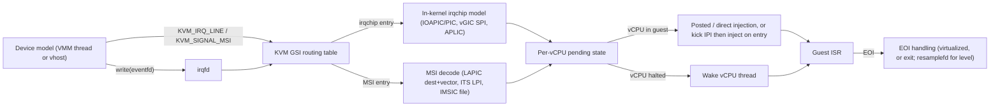
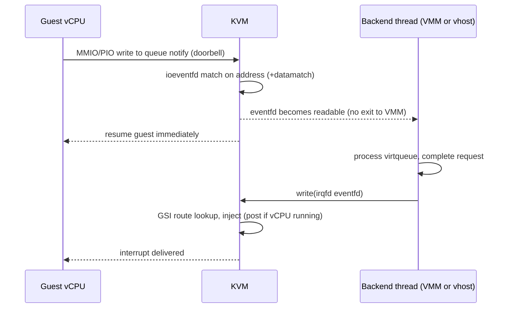

Purpose: explain how interrupts and timers reach a guest on x86-64 (PIC, IOAPIC, LAPIC, MSI, posted interrupts), ARM64 (GICv2/v3/v4, ITS, generic timer) and RISC-V (PLIC, AIA, SBI timer, Sstc), and how a KVM-based VMM wires devices to them with irqchips, GSI routing, irqfd and ioeventfd.

# Interrupts, Timers, and Interrupt Controller Virtualization

Related notes: [04 KVM API and the vCPU Run Loop](/compendium/virtualization/kvm-api-and-the-vcpu-run-loop), [02 x86-64 Architecture for Hypervisor Authors](/compendium/virtualization/x86-64-architecture-for-hypervisor-authors), [03 Intel VT-x and AMD-V Hardware Virtualization](/compendium/virtualization/intel-vt-x-and-amd-v-hardware-virtualization), [07 Device Emulation PIO MMIO and the Bus Model](/compendium/virtualization/device-emulation-pio-mmio-and-the-bus-model), [08 Virtio Devices Virtqueues and vhost](/compendium/virtualization/virtio-devices-virtqueues-and-vhost), [11 Device Passthrough VFIO IOMMU and Nested Virtualization](/compendium/virtualization/device-passthrough-vfio-iommu-and-nested-virtualization), [12 Snapshots Live Migration and Dirty Page Tracking](/compendium/virtualization/snapshots-live-migration-and-dirty-page-tracking), [14 Performance Observability and Debugging](/compendium/virtualization/performance-observability-and-debugging), [15 ARM64 Virtualization EL2 VHE and GIC](/compendium/virtualization/arm64-virtualization-el2-vhe-and-gic), [16 RISC-V Virtualization and the Hypervisor Extension](/compendium/virtualization/risc-v-virtualization-and-the-hypervisor-extension), [13 Kernel Architecture Modules Drivers and Device Model](/compendium/linux-systems-engineering/kernel-architecture-modules-drivers-and-device-model).

## Why interrupts are the hard part

Memory virtualization is mostly solved by hardware (EPT, NPT, stage-2). Interrupt delivery is where VMMs spend their exits and their bugs:

1. Every device completion must become a guest interrupt, at the right vector, on the right vCPU, with the right trigger semantics (edge or level).
2. A naive design costs several exits per interrupt: the injection itself, the guest's EOI write, its acknowledge read, and timer reprogramming.
3. Timer interrupts are the highest-frequency interrupt source in an idle guest. A guest timer that costs two exits per tick is a guest that burns host CPU doing nothing.
4. Level-triggered lines, EOI semantics, and pending state must survive snapshot and migration exactly.

The history of interrupt virtualization is a steady march of removing exits: in-kernel irqchips (no userspace exits), irqfd (no ioctl per interrupt), APICv and AVIC (no exit for EOI, TPR, self-IPI), posted interrupts (no exit to inject into a running vCPU), VT-d and GICv4 direct injection (no host involvement at all for passthrough devices).

Why it matters for your VMM: your choice of irqchip model (full in-kernel, split, or userspace) is made once at VM creation, before vCPUs exist, and shapes your whole device layer.

## The generic delivery pipeline



Terms used throughout:

| Term | Meaning |
|---|---|
| GSI | Global System Interrupt: KVM's flat interrupt number namespace for routing. On x86 it originates from ACPI; on arm64 and RISC-V it is just the routing table index. |
| Routing entry | Maps a GSI to an irqchip pin (`KVM_IRQ_ROUTING_IRQCHIP`) or an MSI message (`KVM_IRQ_ROUTING_MSI`); also Hyper-V SINT and Xen event channels on x86 |
| irqfd | eventfd bound to a GSI; a write injects the interrupt from kernel context without an ioctl |
| resamplefd | Second eventfd signalled when a level-triggered irqfd interrupt is EOIed, so the device can re-assert |
| ioeventfd | eventfd signalled by KVM when the guest writes a given PIO/MMIO address (optionally with a datamatch), without exiting to userspace |
| Injection | Making an interrupt pending in the virtual CPU interface so the guest takes it on next entry |
| Posting | Hardware-assisted injection into a running vCPU without a VM exit |

## x86-64 interrupt architecture

### The three controllers a PC guest expects

| Controller | Role | Guest-visible interface | KVM support |
|---|---|---|---|
| 8259A PIC (master + slave) | Legacy 15 IRQs, cascaded on IRQ2 | Ports `0x20/0x21`, `0xa0/0xa1`, ELCR `0x4d0/0x4d1` | In-kernel with `KVM_CREATE_IRQCHIP`, else userspace |
| IOAPIC | Routes external pins to LAPICs as messages, 24 pins in KVM | MMIO at `0xfec00000` (index/data window) | In-kernel with full irqchip; userspace with split irqchip |
| Local APIC (one per vCPU) | Accepts interrupts, priorities (TPR/PPR), EOI, IPIs, LAPIC timer | xAPIC MMIO at `0xfee00000`; x2APIC MSRs `0x800`-`0x8ff` | In-kernel with full or split irqchip |
| MSI / MSI-X | Devices write a message directly to the LAPIC address range | Memory write to `0xfeeXXXXX` | Routed via `KVM_SIGNAL_MSI` or MSI routes |

Modern guests (Linux with ACPI, Windows) use the IOAPIC for legacy pins and MSI/MSI-X for everything PCI. A virtio-mmio-only microVM (Firecracker) uses IOAPIC pins for every device, since virtio-mmio has no MSI on x86.

### MSI message format (x86)

A device signals an MSI by writing `data` to `address`:

| Field | Bits | Meaning |
|---|---|---|
| Address `[31:20]` | `0xfee` | Fixed: the LAPIC message window |
| Address `[19:12]` | Destination APIC ID (8 bits) | Target CPU or logical set |
| Address `[11:5]` | Extended destination ID (with `KVM_FEATURE_MSI_EXT_DEST_ID`) | Lets guests address APIC IDs above 255 without an IOMMU |
| Address bit 3 / bit 2 | Redirection hint / destination mode | Lowest-priority and logical addressing |
| Data `[7:0]` | Vector | IDT vector (32 to 255) |
| Data `[10:8]` | Delivery mode | Fixed, lowest priority, SMI, NMI, INIT, ExtINT |
| Data bit 14 / 15 | Level / trigger mode | Edge for normal MSIs |

KVM decodes this in kernel when you call `KVM_SIGNAL_MSI` or when an MSI routing entry fires. You never emulate MSI delivery to the LAPIC yourself in a modern VMM.

### Full in-kernel irqchip versus split irqchip

| Model | Created with | In kernel | In userspace | Users |
|---|---|---|---|---|
| Full | `KVM_CREATE_IRQCHIP` (+ `KVM_CREATE_PIT2`) | PIC, IOAPIC, LAPICs, optional PIT | nothing | Firecracker, kvmtool, older QEMU default |
| Split | `KVM_ENABLE_CAP(KVM_CAP_SPLIT_IRQCHIP, args[0] = IOAPIC routes)` | LAPICs only | PIC, IOAPIC, PIT | QEMU `kernel-irqchip=split` (required for intel-iommu interrupt remapping), Cloud Hypervisor |
| None | nothing | nothing | everything | Only for experiments, unusable for performance |

Split irqchip semantics from the KVM API documentation:

1. Only `KVM_IRQ_ROUTING_MSI` routes are allowed. The first `args[0]` MSI routes are reserved for the userspace IOAPIC's pins.
2. Your IOAPIC model turns a pin assertion into an MSI (using the redirection table entry the guest programmed) and injects it with `KVM_SIGNAL_MSI` or by updating the route behind an irqfd.
3. When the LAPIC receives an EOI for one of those reserved routes, KVM exits to userspace with `KVM_EXIT_IOAPIC_EOI` (vector in the payload) so your IOAPIC can clear Remote IRR and re-deliver a still-asserted level interrupt.
4. Must be enabled before any vCPU is created, and is mutually exclusive with `KVM_CREATE_IRQCHIP`.

Why choose split: it removes the PIC/IOAPIC/PIT emulation (historically a source of CVEs) from the kernel, gives you full control of interrupt remapping (required to emulate a virtual IOMMU with interrupt remapping), and costs little because modern guests use MSI. Why choose full: fewer moving parts and no userspace exit per level-triggered EOI, which matters for IOAPIC-pin-heavy virtio-mmio microVMs.

In both models, the APIC base page is special. With APICv or AVIC enabled (the default on supported hardware), KVM installs a private memory slot at `0xfee00000` when vCPUs are created. Your memory regions must not overlap it, or vCPU creation fails with `EEXIST`.

### Injecting interrupts from userspace

| Mechanism | Ioctl / API | `kvm-ioctls` | Use for |
|---|---|---|---|
| Pin level | `KVM_IRQ_LINE` (`struct kvm_irq_level { irq, level }`) | `VmFd::set_irq_line(irq, active)` | Legacy pins; edge interrupts need 1 then 0 |
| MSI message | `KVM_SIGNAL_MSI` (`struct kvm_msi`) | `VmFd::signal_msi(kvm_msi)` | One-off MSIs from the VMM |
| Routing table | `KVM_SET_GSI_ROUTING` (replaces the whole table) | `VmFd::set_gsi_routing(&KvmIrqRouting)` | MSI-X vectors behind irqfds |
| irqfd | `KVM_IRQFD` | `register_irqfd(&EventFd, gsi)`, `register_irqfd_with_resample(&EventFd, &EventFd, gsi)`, `unregister_irqfd` | Hot path for all devices |
| Per-vCPU | `KVM_INTERRUPT` | `VcpuFd` (x86 userspace irqchip only) | Not for new designs |

`KVM_IRQ_LINE` levels are always "1 = asserted" regardless of programmed polarity (see `KVM_CAP_X86_IOAPIC_POLARITY_IGNORED`). Never present interrupts as active-low unless that capability is present.

### irqfd and ioeventfd: the virtio fast path



With ioeventfd the vCPU thread does a lightweight exit handled entirely in kernel, and the notification lands on whatever thread polls the eventfd. With irqfd, the backend never calls an ioctl. Together, a virtio request costs zero exits to userspace. This is the single most important performance plumbing in a VMM.

Rust wiring with `kvm-ioctls` 0.25 and `vmm-sys-util` 0.15:

```rust
use kvm_ioctls::{IoEventAddress, NoDatamatch, VmFd};
use vmm_sys_util::eventfd::{EventFd, EFD_NONBLOCK};

pub struct VirtioMmioIrq {
    pub notify: EventFd, // guest -> backend doorbell
    pub irq: EventFd,    // backend -> guest interrupt
}

pub fn wire_virtio_mmio(vm: &VmFd, mmio_base: u64, gsi: u32) -> Result<VirtioMmioIrq, Box<dyn std::error::Error>> {
    let notify = EventFd::new(EFD_NONBLOCK)?;
    let irq = EventFd::new(EFD_NONBLOCK)?;
    // virtio-mmio QueueNotify register lives at offset 0x50.
    vm.register_ioevent(&notify, &IoEventAddress::Mmio(mmio_base + 0x50), NoDatamatch)?;
    vm.register_irqfd(&irq, gsi)?;
    Ok(VirtioMmioIrq { notify, irq })
}

// Backend side, after completing used-ring entries:
// irq.write(1)?;   // kernel injects GSI `gsi`
```

Datamatch matters for multi-queue devices: virtio-mmio writes the queue index to `QueueNotify`, so registering one ioeventfd per queue with `datamatch = queue_index` (a `u32`, the `T: Into&lt;u64&gt;` parameter) routes each queue to its own eventfd and worker.

### Level-triggered interrupts and resamplefd

Edge-triggered irqfds are fire-and-forget. Level-triggered lines (legacy INTx for PCI, IOAPIC pins configured level) need "assert until the device is serviced":

1. Register with `register_irqfd_with_resample(&irq_fd, &resample_fd, gsi)` (needs `KVM_CAP_IRQFD_RESAMPLE`).
2. Writing `irq_fd` asserts the GSI.
3. When the guest EOIs it, KVM de-asserts the GSI and signals `resample_fd`.
4. Your device checks its interrupt status register; if still pending, it writes `irq_fd` again.

Closing the resamplefd does not unregister the irqfd; deassign explicitly. With split irqchip, the equivalent path is `KVM_EXIT_IOAPIC_EOI` into your userspace IOAPIC.

### MSI-X and GSI routing

For PCI devices with MSI-X (virtio-pci, VFIO), each vector gets a GSI, an MSI routing entry, and an irqfd. When the guest reprograms the MSI-X table entry (address/data) or masks a vector, your PCI emulation updates the route with `KVM_SET_GSI_ROUTING`. That ioctl replaces the entire table, so a VMM keeps a master copy and pushes it whole.

```rust
use kvm_bindings::{kvm_irq_routing_entry, KvmIrqRouting, KVM_IRQ_ROUTING_MSI};

pub fn msi_route(gsi: u32, addr: u64, data: u32) -> kvm_irq_routing_entry {
    let mut e = kvm_irq_routing_entry { gsi, type_: KVM_IRQ_ROUTING_MSI, ..Default::default() };
    e.u.msi.address_lo = addr as u32; // writing a Copy union field is safe
    e.u.msi.address_hi = (addr >> 32) as u32;
    e.u.msi.data = data;
    e
}

pub fn push_routes(vm: &kvm_ioctls::VmFd, entries: &[kvm_irq_routing_entry])
    -> Result<(), Box<dyn std::error::Error>>
{
    let mut table = KvmIrqRouting::new(entries.len())?; // FamStructWrapper
    table.as_mut_slice().copy_from_slice(entries);
    vm.set_gsi_routing(&table)?;
    Ok(())
}
```

Masked MSI-X vectors: do not leave the irqfd firing into a stale route. Either keep a pending bit in your emulation and deassign the irqfd while masked, or keep the irqfd and record pending state from it (Cloud Hypervisor and QEMU differ here). On arm64, MSI routes carry a device id (`KVM_MSI_VALID_DEVID`) so the in-kernel ITS can translate them; set it only when the VM has an ITS.

### APICv, AVIC, and posted interrupts

Without hardware assistance, every LAPIC access by the guest (TPR writes, EOI writes, ICR writes for IPIs) is an exit handled by KVM's LAPIC emulation. That is still in kernel, but costs around a microsecond each.

| Feature | Vendor | What it removes |
|---|---|---|
| TPR shadow | Intel | Exits on CR8/TPR writes |
| APIC-register virtualization | Intel | Exits on most APIC register reads |
| Virtual-interrupt delivery | Intel | Exits on EOI for edge interrupts; the CPU evaluates pending virtual interrupts (RVI/SVI in the VMCS guest interrupt status) |
| Posted-interrupt processing | Intel | Exit (or wait for next entry) when injecting into a running vCPU |
| IPI virtualization (IPIv) | Intel, Sapphire Rapids and later | Exits on ICR writes for IPIs to running vCPUs |
| AVIC | AMD | Backing page per vCPU, physical and logical APIC ID tables, doorbell to running vCPU, no exits for most APIC accesses and IPIs between running vCPUs |
| x2AVIC | AMD Zen 4 and later | AVIC for x2APIC mode guests |

KVM module parameters: `kvm_intel.enable_apicv` and `kvm_amd.avic` (`/sys/module/kvm_intel/parameters/enable_apicv`). AVIC was historically off by default and is inhibited dynamically by some configurations (for example certain Hyper-V enlightenments, a userspace LAPIC, or when the guest uses features AVIC cannot handle); check `kvm:kvm_apicv_inhibit_changed` tracepoints if performance is mysteriously bad on AMD.

Posted interrupts on Intel, step by step:

1. Each vCPU has a 64-byte posted-interrupt descriptor: a 256-bit PIR (one bit per vector), an ON (outstanding notification) bit, SN (suppress notification), NV (notification vector) and NDST (destination physical CPU).
2. To inject vector V into a vCPU running on physical CPU P, KVM sets PIR bit V, sets ON, and sends an IPI with vector NV to P.
3. The CPU, in VMX non-root mode, recognizes NV as the posted-interrupt notification vector, merges PIR into the virtual APIC page's IRR, and delivers the interrupt to the guest. No VM exit.
4. If the vCPU is not running, KVM syncs PIR into the IRR on the next entry; if it is blocked in HLT, KVM uses a separate wakeup vector to wake the vCPU thread.

VT-d posted interrupts extend this to devices: the IOMMU's interrupt remapping table entry, in posted format, points directly at the vCPU's descriptor, so a passthrough NIC's MSI lands in the guest without any host CPU involvement. AMD's IOMMU has the equivalent "guest virtual APIC" mode. This is configured by KVM and VFIO when you use irqfd with a VFIO device (the irq bypass manager connects them). See [11 Device Passthrough VFIO IOMMU and Nested Virtualization](/compendium/virtualization/device-passthrough-vfio-iommu-and-nested-virtualization).

## x86 timers and timekeeping

### Guest-visible timer devices

| Device | Interface | Frequency | Where KVM VMMs emulate it |
|---|---|---|---|
| i8254 PIT | Ports `0x40`-`0x43` (and `0x61` speaker gate) | 1.193182 MHz | In kernel with `KVM_CREATE_PIT2` (only with full irqchip), else userspace |
| CMOS RTC (MC146818) | Ports `0x70/0x71`, IRQ 8 | 32.768 kHz base | Userspace (`vm-superio` has an RTC for arm64 PL031; on x86 you write your own or use QEMU's) |
| HPET | MMIO, conventionally `0xfed00000` | Typically 100 MHz in QEMU | Userspace only; KVM has no in-kernel HPET |
| ACPI PM timer | PIO in the ACPI PM block | 3.579545 MHz | Userspace |
| LAPIC timer | LVT timer register, initial/current count, divide | Bus clock (one-shot, periodic) or TSC (TSC-deadline mode) | In-kernel LAPIC, using host hrtimers |
| TSC-deadline | `IA32_TSC_DEADLINE` MSR `0x6e0`, CPUID.1:ECX bit 24 | TSC | In-kernel LAPIC; on Intel can use the VMX preemption timer to avoid hrtimer overhead |
| kvmclock | Paravirtual shared memory page | ns resolution | KVM + guest driver |

A Linux guest on a modern VMM uses TSC-deadline for its clockevent and the TSC (via kvmclock or directly) for its clocksource. Exposing a PIT or HPET mostly matters for firmware and calibration paths. Firecracker creates an in-kernel PIT (`KVM_CREATE_PIT2`) alongside its full irqchip; lighter designs rely on the LAPIC timer and kvmclock alone and accept that legacy calibration paths fall back to other sources.

The TSC-deadline path is cheap but not free: the guest writes `IA32_TSC_DEADLINE` (an MSR write exit handled in KVM), KVM arms an hrtimer or the preemption timer, and the expiry injects the LAPIC timer vector (posted if possible). Each timer reprogram is one exit, which is why tickless guests (`NO_HZ`) and fewer reprograms matter so much.

### TSC stability

The guest wants a TSC that is constant-rate, synchronized across vCPUs, and monotonic across migration.

| Concept | Detail |
|---|---|
| Invariant TSC | CPUID `0x80000007` EDX bit 8. Host TSC runs at constant rate across P/C-states. KVM only exposes it when you put it in CPUID; doing so tells the guest "use the TSC" and also makes migration to a different-frequency host your problem. |
| TSC offset | Per-vCPU `guest_tsc = host_tsc * ratio + offset`. KVM sets offsets so vCPUs start synchronized. Read and write via the vCPU device attribute `KVM_VCPU_TSC_CTRL` / `KVM_VCPU_TSC_OFFSET`. |
| TSC scaling | Intel TSC scaling and AMD TSC ratio let the guest TSC run at a frequency other than the host's. Set with `KVM_SET_TSC_KHZ` (`VcpuFd::set_tsc_khz`); query `KVM_GET_TSC_KHZ`. Needs `KVM_CAP_TSC_CONTROL`. |
| CPUID TSC frequency | Leaf `0x15` (crystal ratio) and leaf `0x16`; a VMM that wants guests to skip TSC calibration fills these consistently with the scaled frequency |

### kvmclock

kvmclock is a paravirtual clocksource. The guest registers a per-vCPU `pvclock_vcpu_time_info` structure by writing its guest-physical address to `MSR_KVM_SYSTEM_TIME_NEW` (`0x4b564d01`), and the wall clock base via `MSR_KVM_WALL_CLOCK_NEW` (`0x4b564d00`). The guest discovers it through `KVM_FEATURE_CLOCKSOURCE2` in CPUID leaf `0x40000001`.

KVM fills the structure with `version`, `tsc_timestamp`, `system_time`, `tsc_to_system_mul`, `tsc_shift` and `flags`, and the guest computes time from the TSC without exits:

```rust
/// Guest-side kvmclock read, as documented in Documentation/virt/kvm/x86/msr.rst.
/// `ti` is the shared pvclock_vcpu_time_info; retry while version is odd or changed.
fn kvmclock_ns(tsc_timestamp: u64, system_time: u64, mul: u32, shift: i8, tsc: u64) -> u64 {
    let mut delta = tsc.wrapping_sub(tsc_timestamp);
    delta = if shift >= 0 { delta << shift } else { delta >> (-shift) };
    let scaled = ((delta as u128 * mul as u128) >> 32) as u64;
    system_time + scaled
}
```

`PVCLOCK_TSC_STABLE_BIT` in `flags` tells the guest that all vCPUs share one consistent snapshot (KVM's "master clock" mode, used when the host clocksource is a stable TSC), so the guest can skip a global monotonicity fixup. If your host has an unstable TSC, the bit is off, guests serialize on a global atomic, and timekeeping gets slower.

For snapshot and migration:

1. `KVM_GET_CLOCK` returns `kvm_clock_data { clock, flags, realtime, host_tsc }`. Flags include `KVM_CLOCK_TSC_STABLE`, `KVM_CLOCK_REALTIME`, `KVM_CLOCK_HOST_TSC`.
2. On restore, `KVM_SET_CLOCK` with `KVM_CLOCK_REALTIME` lets KVM advance kvmclock by the real time that elapsed.
3. Then adjust each vCPU's `KVM_VCPU_TSC_OFFSET` so the guest TSC accounts for paused time and host TSC differences (the kernel's `devices/vcpu.rst` gives the exact algorithm). See [12 Snapshots Live Migration and Dirty Page Tracking](/compendium/virtualization/snapshots-live-migration-and-dirty-page-tracking).
4. `KVM_KVMCLOCK_CTRL` tells the guest it was paused, suppressing soft-lockup warnings after a long pause.

## ARM64: GIC and the generic timer

### GIC concepts

| Interrupt type | INTID range | Scope |
|---|---|---|
| SGI (software generated) | 0-15 | Per CPU, used for IPIs |
| PPI (private peripheral) | 16-31 | Per CPU (timers, PMU, maintenance) |
| SPI (shared peripheral) | 32-1019 | Global, wired devices |
| LPI (locality-specific) | 8192 and up | Message-based (MSI), GICv3+ with ITS |

| Version | Key components | Virtualization |
|---|---|---|
| GICv2 | Distributor (GICD), CPU interface (GICC) as MMIO | GICH (hypervisor control) and GICV (virtual CPU interface) MMIO; list registers hold injected interrupts |
| GICv3 | GICD, per-CPU redistributors (GICR, two 64 KiB frames each), CPU interface as system registers (`ICC_*_EL1`), optional ITS | `ICH_*_EL2` registers: list registers `ICH_LR&lt;n&gt;_EL2`, `ICH_HCR_EL2`, `ICH_VMCR_EL2`; guest uses `ICC_*` which are redirected to the virtual interface without traps |
| GICv4 / v4.1 | Adds virtual LPI direct injection; v4.1 adds direct vSGIs | ITS maps device events straight to a vPE's pending table; doorbells wake non-resident vPEs |

How the vGIC works in KVM (in-kernel, the only practical option):

1. KVM emulates the distributor and redistributors in software (MMIO accesses by the guest exit to KVM, not to your VMM).
2. Pending interrupts for a vCPU are written into list registers on entry. The guest acknowledges and EOIs via `ICC_IAR1_EL1` and `ICC_EOIR1_EL1` system registers that hit the virtual CPU interface directly, with no exit.
3. A maintenance interrupt (PPI 25 by convention) tells KVM when list registers need refilling or an EOI of a level interrupt needs processing.
4. With an ITS, MSI writes to `GITS_TRANSLATER` from emulated devices are injected as LPIs via `KVM_SIGNAL_MSI` or MSI routes with a device id; on GICv4 hardware, VFIO devices can deliver vLPIs directly.

The docs also mention in-kernel GICv5 support for the `KVM_IRQ_LINE` encoding on very recent kernels; GICv5 is a new architecture with different INTID spaces. Treat it as emerging and check your kernel's `Documentation/virt/kvm/devices/` before targeting it.

### Creating a GICv3 from a Rust VMM

Order: create all vCPUs and `KVM_ARM_VCPU_INIT` them, create the vGIC device, set distributor and redistributor addresses, set the number of IRQs, then `KVM_DEV_ARM_VGIC_CTRL_INIT`. Distributor is one 64 KiB region; redistributors are two 64 KiB frames per vCPU, contiguous.

```rust
use kvm_bindings::{
    kvm_create_device, kvm_device_attr, kvm_device_type_KVM_DEV_TYPE_ARM_VGIC_V3,
    KVM_DEV_ARM_VGIC_CTRL_INIT, KVM_DEV_ARM_VGIC_GRP_ADDR, KVM_DEV_ARM_VGIC_GRP_CTRL,
    KVM_DEV_ARM_VGIC_GRP_NR_IRQS, KVM_VGIC_V3_ADDR_TYPE_DIST, KVM_VGIC_V3_ADDR_TYPE_REDIST,
};
use kvm_ioctls::{DeviceFd, VmFd};

pub fn create_gicv3(vm: &VmFd, dist: u64, redist: u64, nr_irqs: u32) -> Result<DeviceFd, kvm_ioctls::Error> {
    let mut dev = kvm_create_device {
        type_: kvm_device_type_KVM_DEV_TYPE_ARM_VGIC_V3,
        fd: 0,
        flags: 0,
    };
    let gic = vm.create_device(&mut dev)?;

    let set = |group: u32, attr: u64, val: &u64| {
        let a = kvm_device_attr { flags: 0, group, attr, addr: val as *const u64 as u64 };
        gic.set_device_attr(&a)
    };
    set(KVM_DEV_ARM_VGIC_GRP_ADDR, KVM_VGIC_V3_ADDR_TYPE_DIST as u64, &dist)?;
    set(KVM_DEV_ARM_VGIC_GRP_ADDR, KVM_VGIC_V3_ADDR_TYPE_REDIST as u64, &redist)?;

    let n = nr_irqs; // must be a multiple of 32, includes the 32 private INTIDs
    let a = kvm_device_attr { flags: 0, group: KVM_DEV_ARM_VGIC_GRP_NR_IRQS, attr: 0, addr: &n as *const u32 as u64 };
    gic.set_device_attr(&a)?;

    let a = kvm_device_attr { flags: 0, group: KVM_DEV_ARM_VGIC_GRP_CTRL, attr: KVM_DEV_ARM_VGIC_CTRL_INIT as u64, addr: 0 };
    gic.set_device_attr(&a)?;
    Ok(gic)
}
```

Injection from devices then uses `KVM_IRQ_LINE` with the arm64 encoding (`irq_type` in bits 27..24: `KVM_ARM_IRQ_TYPE_SPI` with `irq_id` 32 to 1019, or `KVM_ARM_IRQ_TYPE_PPI` with a vCPU index), or irqfd where `irqchip.pin + 32` is the SPI number. Note the off-by-32: GSI routing on arm64 counts SPIs from 0. Centralize the conversion in one function.

The vGIC state (distributor, redistributor, CPU interface system registers via `KVM_DEV_ARM_VGIC_GRP_CPU_SYSREGS`, level info via `KVM_DEV_ARM_VGIC_GRP_LEVEL_INFO`) and ITS tables (`KVM_DEV_ARM_ITS_SAVE_TABLES` / `RESTORE_TABLES`, which write into guest RAM) are part of every snapshot.

### Generic timer

| Timer | Registers | Default PPI (KVM) |
|---|---|---|
| EL1 virtual timer | `CNTV_CTL_EL0`, `CNTV_CVAL_EL0`, counter `CNTVCT_EL0` | 27 |
| EL1 physical timer | `CNTP_CTL_EL0`, `CNTP_CVAL_EL0` | 30 |
| EL2 virtual timer (nested) | | 28 |
| EL2 physical timer (nested) | | 26 |

The guest reads `CNTVCT_EL0` without trapping; `CNTVOFF_EL2` offsets it from the physical counter. When the guest programs a timer, it writes system registers directly (no exit). When the vCPU is scheduled out, KVM moves the timer to a host hrtimer and injects the PPI on expiry. On hardware with FEAT_ECV, physical counter offsetting also avoids traps.

VMM responsibilities:

1. Describe the timer PPIs in the device tree or ACPI GTDT matching KVM's numbers (overridable through the `KVM_ARM_VCPU_TIMER_CTRL` vCPU attributes).
2. Save and restore `KVM_REG_ARM_TIMER_CNT`, `CVAL` and `CTL` via ONE_REG for snapshots, or use `KVM_ARM_SET_COUNTER_OFFSET` (`KVM_CAP_COUNTER_OFFSET`, a VM-wide offset) to keep all vCPUs consistent across migration.
3. Stolen time: `KVM_ARM_VCPU_PVTIME_CTRL` / `KVM_ARM_VCPU_PVTIME_IPA` gives the guest a paravirtual stolen-time page, the arm64 analog of x86 steal time.

## RISC-V: PLIC, AIA, and timers

### PLIC

The classic RISC-V platform-level interrupt controller: per-source priority and pending bits, per-context (hart and privilege mode) enable bits and threshold, and a claim/complete register. It is MMIO-only and has no MSI support.

KVM has no in-kernel PLIC. A VMM that offers a PLIC (QEMU `virt`, kvmtool) emulates it in userspace and drives the vCPU's virtual supervisor external interrupt with `KVM_INTERRUPT` (`KVM_INTERRUPT_SET` / `KVM_INTERRUPT_UNSET`). Every claim and complete is an MMIO exit to userspace, which is slow; use a PLIC only for simple microVMs or bring-up.

### AIA: APLIC and IMSIC

The Advanced Interrupt Architecture replaces the PLIC with two pieces:

| Component | Role |
|---|---|
| IMSIC (Incoming MSI Controller) | Per-hart MSI receiver, one 4 KiB MMIO page per interrupt file. Each hart has an M-level file, an S-level file, and with the H extension a number of guest interrupt files (VS-level), selected for the running guest by `hstatus.VGEIN`. Interrupt identities are enabled and pending in per-file bitmaps accessed through `siselect`/`sireg` (`vsiselect`/`vsireg` for guests). |
| APLIC (Advanced PLIC) | Handles wired interrupts. In MSI delivery mode it converts wire assertions into MSIs written to IMSICs; in direct mode it behaves like a PLIC with per-hart IDCs. |

The H extension lets a guest interrupt file be backed by real hardware: a device MSI written to that guest file's address is delivered to the guest without the hypervisor (`hgeie`/`hgeip` CSRs signal guest external interrupts to HS-mode for vCPUs not currently running). This is RISC-V's answer to posted interrupts and GICv4.

KVM implements an in-kernel AIA device (`KVM_DEV_TYPE_RISCV_AIA`):

| Attribute group | Purpose |
|---|---|
| `KVM_DEV_RISCV_AIA_GRP_CONFIG` | `MODE` (`EMUL`, `HWACCEL`, `AUTO`), `IDS` (number of MSI identities, between `KVM_DEV_RISCV_AIA_IDS_MIN` = 63 and `KVM_DEV_RISCV_AIA_IDS_MAX` = 2048 in the uapi header), `SRCS` (wired sources for the APLIC), group/hart/guest index bits for the IMSIC address layout |
| `KVM_DEV_RISCV_AIA_GRP_ADDR` | APLIC base (`KVM_DEV_RISCV_AIA_ADDR_APLIC`) and one IMSIC address per vCPU |
| `KVM_DEV_RISCV_AIA_GRP_CTRL` | `KVM_DEV_RISCV_AIA_CTRL_INIT` after configuration |
| `KVM_DEV_RISCV_AIA_GRP_APLIC`, `GRP_IMSIC` | State access for snapshots |

`MODE_EMUL` emulates IMSIC files in software (traps on access), `MODE_HWACCEL` maps hardware guest interrupt files into the guest, `MODE_AUTO` uses hardware files when available and falls back. The guest must see the `Ssaia` extension (ISA_EXT register) to use AIA CSRs. With the in-kernel AIA, `KVM_CAP_IRQCHIP` is reported, `KVM_IRQ_LINE` drives APLIC wired sources, and irqfd plus MSI routes work like on the other architectures.

### RISC-V timers

| Mechanism | How it works | Exits per timer program |
|---|---|---|
| SBI TIME extension (`sbi_set_timer`) | Guest makes an `ecall` to the SBI implementation in KVM; KVM arms an hrtimer and injects VS timer interrupt on expiry | One ecall exit (handled in kernel) |
| Sstc extension | Adds `stimecmp` and, for guests, `vstimecmp`; the guest writes its comparator directly and hardware raises the interrupt | Zero |

The guest's `time` CSR is the host time plus `htimedelta`, which KVM manages. Timer state is exposed through the `KVM_REG_RISCV_TIMER` ONE_REG group (`frequency`, `time`, `compare`, `state`) for snapshots. Enable Sstc in the guest's ISA_EXT registers whenever the host has it: it removes the dominant exit source in an idle RISC-V guest. The timebase frequency must also appear in the device tree (`timebase-frequency` under `/cpus`).

## Cross-architecture comparison

| Concern | x86-64 | ARM64 | RISC-V |
|---|---|---|---|
| Per-CPU controller | LAPIC (in KVM) | GIC redistributor + CPU interface (vGIC in KVM) | IMSIC file (in KVM AIA) or none (PLIC) |
| Wired-interrupt controller | IOAPIC + PIC (KVM or userspace) | GIC distributor SPIs (KVM) | APLIC (KVM AIA) or PLIC (userspace) |
| MSI target | LAPIC address window `0xfeeXXXXX` | ITS `GITS_TRANSLATER` (LPIs) | IMSIC interrupt file page |
| VM creation | `KVM_CREATE_IRQCHIP` or split cap, before vCPUs | `KVM_CREATE_DEVICE(VGIC_V3)` after vCPUs, then `CTRL_INIT` | `KVM_CREATE_DEVICE(RISCV_AIA)`, config, addresses, `CTRL_INIT` |
| No-exit EOI | APICv virtual-interrupt delivery, AVIC | GIC virtual CPU interface (system registers) | IMSIC guest file (`vstopei`) |
| Direct device injection | VT-d / AMD IOMMU posted interrupts | GICv4 vLPI | IMSIC guest interrupt files (HWACCEL) |
| Guest timer | LAPIC TSC-deadline (MSR write exit) | Generic timer (no exit to program) | SBI timer (ecall) or Sstc (no exit) |
| Paravirt clock | kvmclock | Generic counter is already virtualized; PV stolen time | `time` CSR with `htimedelta`; SBI STA steal time |
| IPI | ICR write (IPIv or AVIC removes exit) | SGI via `ICC_SGI1R_EL1` (trap to KVM; GICv4.1 vSGI avoids it) | IMSIC MSI write or SBI IPI ecall |

## Choosing an interrupt design for your VMM

| Decision | Recommendation | Rationale |
|---|---|---|
| x86 irqchip | Split irqchip if you emulate PCI with MSI-X and want a userspace IOAPIC; full irqchip for a virtio-mmio microVM | Split moves attack surface out of kernel; full avoids EOI exits for pin interrupts |
| Device interrupts | irqfd for every device, ioeventfd for every doorbell | Zero userspace exits on the data path |
| Level-triggered | resamplefd for every level source; prefer MSI/MSI-X (edge) devices where possible | Lost or storming interrupts otherwise |
| MSI-X | Master routing table in VMM, push whole on change | `KVM_SET_GSI_ROUTING` replaces everything |
| arm64 | vGICv3 with ITS when you need PCI MSI; no GICv2 for new designs | GICv2 limits to 8 vCPUs |
| RISC-V | In-kernel AIA, `MODE_AUTO`, Sstc on | PLIC in userspace exits on every claim/complete |
| Timers | Do not emulate HPET unless firmware needs it; prefer TSC-deadline, generic timer, Sstc | Each emulated timer device is exits and attack surface |

## Worked trace: one virtio-blk completion on x86 with full irqchip

Following a single request end to end shows where each mechanism earns its keep:

1. The guest driver adds a descriptor chain and writes the queue index to the virtio-mmio `QueueNotify` register.
2. The write causes an EPT misconfiguration exit; KVM matches the address against registered ioeventfds, signals the eventfd, and re-enters the guest. No userspace exit.
3. The VMM's block worker, blocked in `epoll_wait`, wakes, pops the chain, and submits the I/O (io_uring or `pread`).
4. On completion, the worker writes the used ring, checks `VIRTIO_F_EVENT_IDX` suppression, and if a notification is needed writes the device's irqfd.
5. KVM's irqfd wakeup path looks up the GSI route (IOAPIC pin), asserts the pin in the in-kernel IOAPIC, which sends the programmed vector to the target LAPIC.
6. If the target vCPU is in guest mode and APICv is active, KVM posts the vector; otherwise it sets IRR and kicks or wakes the vCPU (halt polling may catch it before it sleeps).
7. The guest ISR reads the virtio-mmio `InterruptStatus` register (an MMIO exit to userspace in this design, the one remaining heavyweight exit), acknowledges with `InterruptACK`, and EOIs the LAPIC (no exit with virtual-interrupt delivery).
8. For a level-triggered IOAPIC pin with resamplefd, the EOI also de-asserts the pin and signals the resamplefd so the device can re-assert if more completions are pending.

With virtio-pci and MSI-X instead of virtio-mmio, step 7 loses its register read (the vector itself identifies the queue) and step 8 disappears (MSI is edge), which is why PCI transports outperform virtio-mmio under high interrupt rates.

## Interrupt state in snapshots

| Arch | State to save | Interface |
|---|---|---|
| x86 full irqchip | PIC master/slave, IOAPIC | `KVM_GET_IRQCHIP` / `KVM_SET_IRQCHIP` with `chip_id` 0, 1, 2 |
| x86 | Per-vCPU LAPIC page | `KVM_GET_LAPIC` / `KVM_SET_LAPIC` |
| x86 | PIT | `KVM_GET_PIT2` / `KVM_SET_PIT2` |
| x86 | Pending exceptions, NMI, interrupt shadow | `KVM_GET_VCPU_EVENTS` / `KVM_SET_VCPU_EVENTS` |
| x86 | kvmclock, TSC offsets, TSC frequency | `KVM_GET_CLOCK`, `KVM_VCPU_TSC_OFFSET`, `KVM_GET_TSC_KHZ` |
| arm64 | Distributor, redistributors, CPU interface sysregs, line levels | vGIC device attribute groups (`DIST_REGS`, `REDIST_REGS`, `CPU_SYSREGS`, `LEVEL_INFO`) |
| arm64 | ITS tables | `KVM_DEV_ARM_ITS_SAVE_TABLES` (writes guest RAM, so save it after) and `RESTORE_TABLES` |
| arm64 | Timers | ONE_REG `KVM_REG_ARM_TIMER_CNT`, `CVAL`, `CTL`, or counter offset |
| RISC-V | APLIC and IMSIC state | AIA device groups `KVM_DEV_RISCV_AIA_GRP_APLIC`, `GRP_IMSIC` |
| RISC-V | Timer | ONE_REG `KVM_REG_RISCV_TIMER` group |
| All | Your userspace devices' interrupt status and pending bits, irqfd/resample pairing | Your own serialization |

Order on restore matters: restore irqchip state before vCPU registers that reference it (x86 LAPIC before `KVM_SET_VCPU_EVENTS`), restore ITS tables after guest RAM, and re-register irqfds before resuming vCPUs. See [12 Snapshots Live Migration and Dirty Page Tracking](/compendium/virtualization/snapshots-live-migration-and-dirty-page-tracking).

## Common pitfalls

- Creating the x86 irqchip (or enabling split irqchip) after vCPUs, or creating the arm64 vGIC before all vCPUs are created and initialized.
- Overlapping a memory slot with `0xfee00000` on x86 when APICv/AVIC is enabled: vCPU creation fails with `EEXIST`.
- Pulsing edge interrupts with only `set_irq_line(irq, true)` and never lowering the line: the next edge never happens.
- Using irqfd for a level-triggered source without resamplefd: either interrupt storms or lost interrupts after EOI.
- Calling `KVM_SET_GSI_ROUTING` with only the changed entry, wiping every other route.
- arm64 SPI numbering off by 32 between DT `interrupts` cells, `KVM_IRQ_LINE` and irqfd GSIs.
- Setting `KVM_MSI_VALID_DEVID` on a VM without an ITS (the ioctl may fail), or forgetting it with an ITS (LPIs never translate).
- Advertising invariant TSC (CPUID `0x80000007` EDX bit 8) and then migrating to a host with a different TSC frequency without TSC scaling.
- Restoring a snapshot without `KVM_SET_CLOCK` and TSC offset adjustment: guest clocks jump backward, watchdogs fire, TCP timers misbehave.
- Forgetting `KVM_KVMCLOCK_CTRL` after long pauses: soft lockup splats in the guest.
- Missing vGIC, ITS, LAPIC, IOAPIC/PIC/PIT or AIA state in snapshots: the guest resumes with interrupts permanently pending or lost.
- RISC-V: offering a userspace PLIC in production and wondering why idle guests burn CPU; not enabling Sstc.
- Disabling HLT exits (`KVM_X86_DISABLE_EXITS_HLT`) while also advertising `KVM_FEATURE_PV_UNHALT`, which the API docs explicitly forbid.
- Assuming AVIC is active on AMD because the module parameter is on; it can be inhibited at runtime.

## Review checklist

- [ ] Irqchip model chosen per architecture and created in the documented order relative to vCPU creation.
- [ ] x86 memory map leaves `0xfec00000` (IOAPIC) and `0xfee00000` (LAPIC) unoccupied by RAM slots.
- [ ] Every device uses irqfd for interrupts and ioeventfd (with datamatch where queues share a register) for doorbells.
- [ ] Level-triggered sources use resamplefd or a userspace IOAPIC EOI path.
- [ ] A single owner holds the GSI routing table and pushes it atomically; MSI-X mask/unmask updates routes or pending bits correctly.
- [ ] arm64: GICv3 distributor/redistributor addresses 64 KiB aligned, redistributor region sized at two frames per vCPU, `NR_IRQS` multiple of 32, `CTRL_INIT` called; ITS created when PCI MSI is used.
- [ ] RISC-V: AIA device configured (mode, IDs, sources, addresses), `Ssaia` and `Sstc` exposed in ISA_EXT when available, `timebase-frequency` in DT.
- [ ] Timer devices limited to what the guest needs; PIT and HPET justified.
- [ ] TSC: invariant TSC exposure is a deliberate policy; TSC frequency set (`KVM_SET_TSC_KHZ`) for migratable VMs; CPUID frequency leaves consistent.
- [ ] Snapshot includes irqchip state, kvmclock (`KVM_GET_CLOCK`), TSC offsets, arm64 timer registers or counter offset, RISC-V timer registers.
- [ ] APICv/AVIC status verified on the host (`/sys/module/kvm_intel/parameters/enable_apicv`, `kvm_amd/parameters/avic`) and inhibit tracepoints checked under load.
- [ ] Interrupt latency and exit counts measured with the tooling in [14 Performance Observability and Debugging](/compendium/virtualization/performance-observability-and-debugging).

## Primary Sources

- [Linux KVM API documentation](https://docs.kernel.org/virt/kvm/api.html) (`KVM_CREATE_IRQCHIP`, `KVM_IRQ_LINE`, `KVM_SET_GSI_ROUTING`, `KVM_IRQFD`, `KVM_IOEVENTFD`, `KVM_SIGNAL_MSI`, `KVM_CAP_SPLIT_IRQCHIP`, `KVM_GET_CLOCK`)
- [KVM x86 paravirtual MSRs (kvmclock)](https://docs.kernel.org/virt/kvm/x86/msr.html)
- [KVM x86 timekeeping virtualization](https://docs.kernel.org/virt/kvm/x86/timekeeping.html)
- [KVM vCPU device attributes (timer, PV time, TSC offset)](https://docs.kernel.org/virt/kvm/devices/vcpu.html)
- [KVM ARM vGICv3 device](https://docs.kernel.org/virt/kvm/devices/arm-vgic-v3.html)
- [KVM ARM vGIC ITS device](https://docs.kernel.org/virt/kvm/devices/arm-vgic-its.html)
- [KVM halt polling](https://docs.kernel.org/virt/kvm/halt-polling.html)
- [Linux RISC-V KVM uapi header (AIA device, ONE_REG groups)](https://github.com/torvalds/linux/blob/master/arch/riscv/include/uapi/asm/kvm.h)
- [Linux RISC-V KVM VM code (irq line and routing)](https://github.com/torvalds/linux/blob/master/arch/riscv/kvm/vm.c)
- [RISC-V Advanced Interrupt Architecture specification](https://github.com/riscv/riscv-aia)
- [RISC-V SBI specification](https://github.com/riscv-non-isa/riscv-sbi-doc)
- [Intel 64 and IA-32 Architectures SDM, Vol. 3C (APIC virtualization and posted interrupts)](https://www.intel.com/content/www/us/en/developer/articles/technical/intel-sdm.html)
- [AMD64 Architecture Programmer's Manual Vol. 2 (AVIC)](https://www.amd.com/en/search/documentation/hub.html)
- [Arm GICv3 and GICv4 Architecture Specification (IHI 0069)](https://developer.arm.com/documentation/ihi0069/latest)
- [kvm-ioctls `VmFd` documentation](https://docs.rs/kvm-ioctls/latest/kvm_ioctls/struct.VmFd.html)
- [rust-vmm/kvm repository (kvm-bindings structures)](https://github.com/rust-vmm/kvm)
