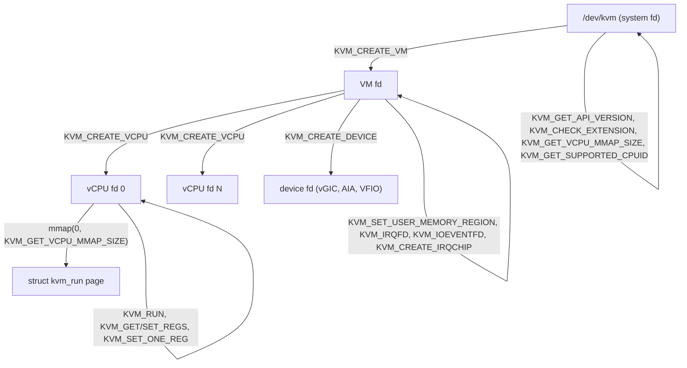
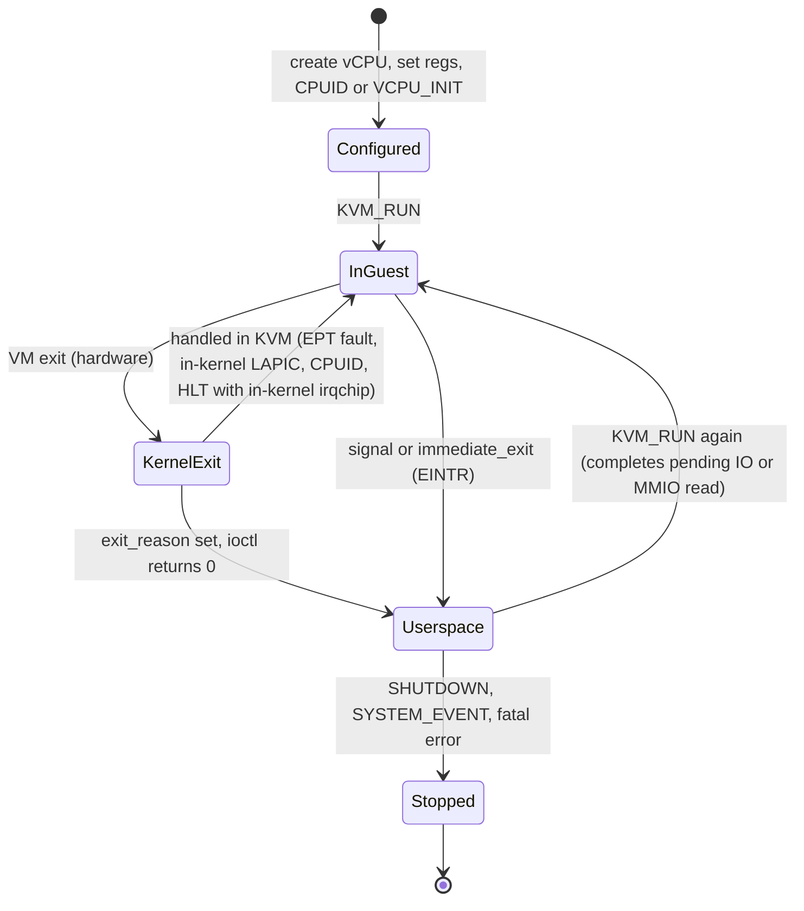
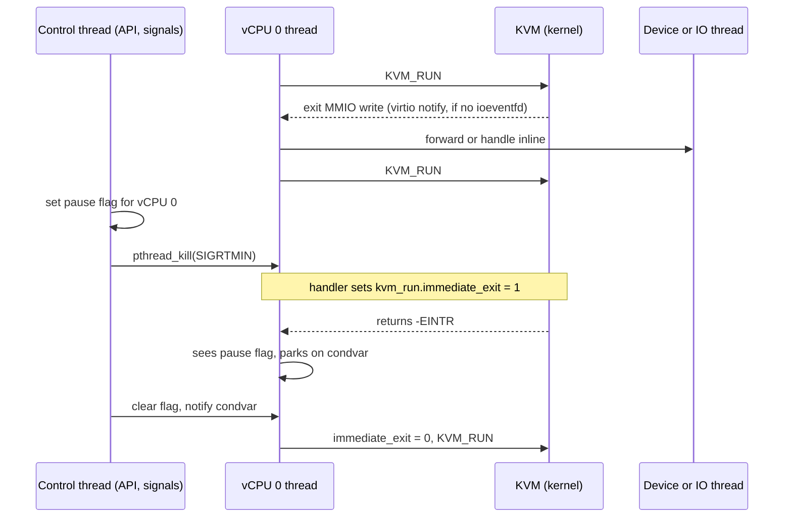

Purpose: teach the KVM userspace API from `/dev/kvm` down to the `KVM_RUN` loop, so you can build the core of a Rust VMM that creates VMs, configures vCPUs on x86-64, ARM64 and RISC-V, and dispatches every exit correctly.

# KVM API and the vCPU Run Loop

Related notes: [03 Intel VT-x and AMD-V Hardware Virtualization](/compendium/virtualization/intel-vt-x-and-amd-v-hardware-virtualization), [05 Memory Virtualization EPT NPT and Guest Memory](/compendium/virtualization/memory-virtualization-ept-npt-and-guest-memory), [06 Interrupts Timers and Interrupt Controller Virtualization](/compendium/virtualization/interrupts-timers-and-interrupt-controller-virtualization), [07 Device Emulation PIO MMIO and the Bus Model](/compendium/virtualization/device-emulation-pio-mmio-and-the-bus-model), [09 Booting Guests Firmware and the Linux Boot Protocol](/compendium/virtualization/booting-guests-firmware-and-the-linux-boot-protocol), [14 Performance Observability and Debugging](/compendium/virtualization/performance-observability-and-debugging), [15 ARM64 Virtualization EL2 VHE and GIC](/compendium/virtualization/arm64-virtualization-el2-vhe-and-gic), [16 RISC-V Virtualization and the Hypervisor Extension](/compendium/virtualization/risc-v-virtualization-and-the-hypervisor-extension), [18 Rust VMM Ecosystem and Project Templates](/compendium/virtualization/rust-vmm-ecosystem-and-project-templates), [06 System Calls ABI libc and User Kernel Boundaries](/compendium/linux-systems-engineering/system-calls-abi-libc-and-user-kernel-boundaries), [09 Unsafe Rust and the Rust Memory Model](/compendium/rust/unsafe-rust-and-the-rust-memory-model).

## The mental model

KVM turns the Linux kernel into the "hypervisor core": it owns the hardware virtualization extensions (VMX/SVM, EL2, the RISC-V H extension), the second-stage page tables, and the fast-path emulation of interrupt controllers and timers. Everything else is your VMM: guest memory layout, device models, boot protocol, machine topology, lifecycle and policy.

The contract between the two is a set of `ioctl`s on file descriptors plus one shared memory page per vCPU (`struct kvm_run`). Your VMM is an ordinary Linux process. Each vCPU is an ordinary thread that sits inside the `KVM_RUN` ioctl while the guest executes. When the guest does something KVM cannot (or is configured not to) handle in the kernel, `KVM_RUN` returns to userspace with an exit reason, your code handles it, and you call `KVM_RUN` again.

Why it matters for your VMM: almost every performance and correctness question in a KVM-based VMM reduces to "which exits reach userspace, how often, and what does my thread do while handling them". Get the run loop right first; everything else plugs into it.

| Layer | Owned by | Examples |
|---|---|---|
| Hardware virtualization mode switch | KVM (kernel) | VMLAUNCH/VMRESUME, VMRUN, ERET to EL1, `sret` with HS-mode |
| Second-stage translation | KVM | EPT, NPT, stage-2 tables, G-stage tables |
| In-kernel fast-path devices | KVM (optional) | LAPIC, IOAPIC, PIC, PIT, vGIC, AIA, arch timers |
| Exit dispatch and device models | VMM (userspace) | Serial, virtio-mmio, PCI config space, RTC |
| Machine policy | VMM | Memory map, CPUID, vCPU count, boot, snapshots |

## The file descriptor hierarchy

KVM exposes three levels of object, each a file descriptor. Ioctls are typed by which fd they target: a "system ioctl" goes to `/dev/kvm`, a "VM ioctl" to the VM fd, a "vCPU ioctl" to the vCPU fd, and a "device ioctl" to an fd from `KVM_CREATE_DEVICE`.



| fd | Created by | Typical ioctls | Lifetime notes |
|---|---|---|---|
| System (`/dev/kvm`) | `open("/dev/kvm", O_RDWR \| O_CLOEXEC)` | `KVM_GET_API_VERSION` (must return 12), `KVM_CHECK_EXTENSION`, `KVM_CREATE_VM`, `KVM_GET_VCPU_MMAP_SIZE`, `KVM_GET_SUPPORTED_CPUID`, `KVM_GET_MSR_INDEX_LIST` | Can be closed once VMs exist |
| VM | `KVM_CREATE_VM` (argument is a machine type, 0 on x86; IPA size on arm64) | memory slots, irqchip, irqfd, ioeventfd, GSI routing, `KVM_ENABLE_CAP`, `KVM_GET_DIRTY_LOG`, clock | The VM lives while any fd referencing it is open (VM fd, vCPU fds, device fds) |
| vCPU | `KVM_CREATE_VCPU` with a vCPU id | `KVM_RUN`, register get/set, `KVM_SET_CPUID2`, `KVM_ARM_VCPU_INIT`, `KVM_SET_GUEST_DEBUG`, `KVM_GET_ONE_REG` | Must be used from one thread at a time; `KVM_RUN` should always run on the same thread |
| Device | `KVM_CREATE_DEVICE` | `KVM_SET_DEVICE_ATTR`, `KVM_GET_DEVICE_ATTR`, `KVM_HAS_DEVICE_ATTR` | Used for vGIC v2/v3, ITS, RISC-V AIA, VFIO KVM device |

Rules the kernel documentation spells out that bite VMM authors:

1. A VM is tied to the `mm` of the process that created it. VM ioctls from a different process (for example after `fork`) fail. Do not fork a VMM after creating the VM unless you `exec` immediately.
2. vCPU ioctls should be issued from the thread that created or runs the vCPU. KVM tolerates other threads for some calls, but `KVM_RUN` from multiple threads on one vCPU serializes on a mutex and destroys latency.
3. Some calls are ordering-sensitive: on x86 `KVM_CREATE_IRQCHIP` and `KVM_CAP_SPLIT_IRQCHIP` must precede vCPU creation; on arm64 all vCPUs should be created before `KVM_ARM_VCPU_INIT` because some registers (MPIDR) reflect topology, and the vGIC must be initialized after vCPUs exist.

## Capabilities and feature discovery

KVM grows by capabilities, not by API versions. `KVM_GET_API_VERSION` has returned 12 since 2.6.22; everything newer is probed with `KVM_CHECK_EXTENSION`, which returns 0 for "absent" and a positive value that sometimes carries data (for example `KVM_CAP_NR_VCPUS`, `KVM_CAP_MAX_VCPUS`, `KVM_CAP_NR_MEMSLOTS`, `KVM_CAP_ARM_VM_IPA_SIZE`).

Checking on the VM fd rather than the system fd is preferred when `KVM_CAP_CHECK_EXTENSION_VM` exists, because answers can differ per VM type (protected VMs, different IPA sizes, TDX or SEV-SNP VM types on x86).

Some capabilities are only advertised; others must be enabled with `KVM_ENABLE_CAP` on the VM or vCPU fd (for example `KVM_CAP_SPLIT_IRQCHIP`, `KVM_CAP_X86_DISABLE_EXITS`, `KVM_CAP_HALT_POLL`, `KVM_CAP_X86_USER_SPACE_MSR`, `KVM_CAP_ARM_NISV_TO_USER`).

| Capability | Meaning | Why your VMM cares |
|---|---|---|
| `KVM_CAP_IMMEDIATE_EXIT` | `kvm_run.immediate_exit` is honored | Race-free vCPU kicking without signal masks |
| `KVM_CAP_USER_MEMORY` | `KVM_SET_USER_MEMORY_REGION` exists | Baseline; always present on modern kernels |
| `KVM_CAP_IRQCHIP` | In-kernel irqchip available | Needed for LAPIC/IOAPIC, vGIC, AIA in kernel |
| `KVM_CAP_IRQFD`, `KVM_CAP_IOEVENTFD` | eventfd-based interrupt and doorbell plumbing | Removes userspace from virtio fast paths |
| `KVM_CAP_ONE_REG` | `KVM_GET_ONE_REG`/`KVM_SET_ONE_REG` | The register API on arm64 and RISC-V |
| `KVM_CAP_SET_GUEST_DEBUG` | Debug exits and breakpoints | gdbstub support |
| `KVM_CAP_COALESCED_MMIO` | Batch writes to designated MMIO ranges in a ring | Cheap emulation of write-only registers |
| `KVM_CAP_STATS_BINARY_FD` | `KVM_GET_STATS_FD` | Per-VM and per-vCPU counters without debugfs |
| `KVM_CAP_MAX_VCPUS` / `KVM_CAP_NR_VCPUS` | Hard and recommended vCPU limits | Topology validation |
| `KVM_CAP_ARM_PSCI_0_2`, `KVM_CAP_ARM_PMU_V3` | arm64 vCPU features | Required feature bits in `KVM_ARM_VCPU_INIT` |

In `kvm-ioctls` these map to the `Cap` enum (`Cap::ImmediateExit`, `Cap::Irqfd`, `Cap::SplitIrqchip`, `Cap::OneReg`, `Cap::SetGuestDebug`, and so on) and `Kvm::check_extension(Cap) -&gt; bool`, `Kvm::check_extension_int(Cap) -&gt; i32`, plus `check_extension_raw` for capabilities the enum does not yet name.

A production VMM should fail fast at startup with a clear message when a required capability is missing, not later when the first device tries to register an irqfd.

## Creating a VM and its memory

`KVM_CREATE_VM` returns a VM fd. Guest RAM is plain host virtual memory (usually `mmap(MAP_SHARED | MAP_ANONYMOUS)` or a memfd) registered with `KVM_SET_USER_MEMORY_REGION`:

```c
struct kvm_userspace_memory_region {
    __u32 slot;
    __u32 flags;            /* KVM_MEM_LOG_DIRTY_PAGES, KVM_MEM_READONLY */
    __u64 guest_phys_addr;
    __u64 memory_size;      /* bytes */
    __u64 userspace_addr;   /* start of the userspace allocated memory */
};
```

Any guest physical address not covered by a slot is, from KVM's perspective, MMIO: a guest access traps and exits to userspace as `KVM_EXIT_MMIO`. That is the whole device model on arm64 and RISC-V, and half of it on x86 (the other half is port I/O).

Memory slots, `KVM_SET_USER_MEMORY_REGION2` with guest_memfd, dirty logging and hugepages belong to [05 Memory Virtualization EPT NPT and Guest Memory](/compendium/virtualization/memory-virtualization-ept-npt-and-guest-memory). For this note, the important rule is: register memory before running vCPUs, and treat slot changes at runtime as expensive and serializing.

x86-only VM setup quirks on Intel (still set by Firecracker and QEMU for safety):

| Ioctl | Purpose |
|---|---|
| `KVM_SET_TSS_ADDR` | Three-page region below 4 GiB that KVM uses to emulate real mode on CPUs without "unrestricted guest". Must not overlap memory slots or MMIO. Firecracker uses `0xfffbd000`. |
| `KVM_SET_IDENTITY_MAP_ADDR` | One-page identity map table below 4 GiB (default `0xfffbc000`), must be set before creating vCPUs if you move it |
| `KVM_CREATE_IRQCHIP` or `KVM_ENABLE_CAP(KVM_CAP_SPLIT_IRQCHIP)` | Create in-kernel LAPIC (and PIC/IOAPIC unless split). Before vCPUs. |
| `KVM_CREATE_PIT2` | In-kernel i8254 PIT, only if your guest needs it |

## Creating vCPUs and mapping kvm_run

`KVM_CREATE_VCPU` takes a vCPU id. On x86 the id is the initial APIC ID; on arm64 it is an index, and MPIDR is derived from it (it can be overridden through `KVM_SET_ONE_REG` before first run); on RISC-V it is the hart index.

Each vCPU fd must be `mmap`ed at offset 0 with size `KVM_GET_VCPU_MMAP_SIZE` (a system ioctl). The mapping contains:

1. `struct kvm_run` at offset 0, the shared control and exit-information block.
2. The PIO data page: for `KVM_EXIT_IO`, the data is at `kvm_run + io.data_offset`, inside this mapping.
3. On x86 with `KVM_CAP_COALESCED_MMIO`, the coalesced MMIO ring page at `KVM_COALESCED_MMIO_PAGE_OFFSET * PAGE_SIZE` (included in the mmap size for historical reasons).
4. With `KVM_CAP_DIRTY_LOG_RING`, dirty ring pages at a separate offset.

`kvm-ioctls` does the mmap inside `VmFd::create_vcpu` and exposes the page through `VcpuFd::get_kvm_run(&mut self) -&gt; &mut kvm_run`.

### Important kvm_run fields

| Field | Direction | Meaning |
|---|---|---|
| `request_interrupt_window` | in | Ask KVM to exit when the guest can accept an injected interrupt (userspace irqchip only) |
| `immediate_exit` | in | If non-zero when `KVM_RUN` starts, return `-EINTR` immediately |
| `exit_reason` | out | `KVM_EXIT_*` value, valid when `KVM_RUN` returned 0 |
| `ready_for_interrupt_injection`, `if_flag`, `cr8`, `apic_base` | in/out | Only meaningful without in-kernel LAPIC |
| `flags` | out | x86: `KVM_RUN_X86_SMM`, `KVM_RUN_X86_BUS_LOCK`, `KVM_RUN_X86_GUEST_MODE`; arm64: `KVM_DEBUG_ARCH_HSR_HIGH_VALID` |
| union (`io`, `mmio`, `fail_entry`, `system_event`, `internal`, ...) | out | Per-exit payload |
| `kvm_valid_regs`, `kvm_dirty_regs`, `s.regs` | in/out | Optional "sync regs" area (x86, s390) to avoid separate get/set ioctls |

## The vCPU state API

Before first run you must put each vCPU into an architecturally sane state. The API differs a lot per architecture.

### x86-64

| Ioctl | `kvm-ioctls` method | Contents |
|---|---|---|
| `KVM_GET_REGS` / `KVM_SET_REGS` | `get_regs()`, `set_regs(&kvm_regs)` | GPRs, `rip`, `rflags` |
| `KVM_GET_SREGS` / `KVM_SET_SREGS` | `get_sregs()`, `set_sregs(&kvm_sregs)` | Segment registers with hidden parts (base, limit, attributes), CR0/2/3/4/8, EFER, GDT/IDT, APIC base, pending interrupt bitmap |
| `KVM_GET_SREGS2` / `KVM_SET_SREGS2` | not wrapped everywhere | Same plus PDPTRs for PAE paging |
| `KVM_GET_FPU` / `KVM_SET_FPU` | `get_fpu()`, `set_fpu(&kvm_fpu)` | x87, MXCSR, XMM |
| `KVM_GET_XSAVE` / `KVM_SET_XSAVE`, `KVM_GET_XCRS` | `get_xsave`, `set_xsave`, `get_xcrs` | AVX and later state; use for snapshots |
| `KVM_GET_MSRS` / `KVM_SET_MSRS` | `get_msrs(&mut Msrs) -&gt; usize`, `set_msrs(&Msrs) -&gt; usize` | Returns the number of MSRs actually processed; check it |
| `KVM_SET_CPUID2` | `set_cpuid2(&CpuId)` | The CPUID table the guest will see |
| `KVM_GET_LAPIC` / `KVM_SET_LAPIC` | `get_lapic`, `set_lapic` | 1 KiB register page of the in-kernel LAPIC |
| `KVM_GET_MP_STATE` / `KVM_SET_MP_STATE` | `get_mp_state`, `set_mp_state` | RUNNABLE, UNINITIALIZED, INIT_RECEIVED, HALTED, SIPI_RECEIVED |
| `KVM_GET_VCPU_EVENTS` / `KVM_SET_VCPU_EVENTS` | `get_vcpu_events`, `set_vcpu_events` | Pending exceptions, NMI, interrupt shadow, SMM; mandatory for correct snapshots |

CPUID setup is the classic x86 trap. The normal flow:

1. `Kvm::get_supported_cpuid(KVM_MAX_CPUID_ENTRIES)` returns what KVM plus hardware can virtualize.
2. Filter and patch: set the APIC ID in leaf 1 EBX and leaf 0xB/0x1F per vCPU, set the hypervisor bit (leaf 1 ECX bit 31), add KVM paravirt leaves (0x40000000 signature "KVMKVMKVM", 0x40000001 features), hide features you do not want to migrate, fix cache topology leaves (4, 0x8000001D) and core counts.
3. `set_cpuid2` on every vCPU before first `KVM_RUN`. Changing CPUID after the vCPU has run is rejected on recent kernels unless the table is identical.

x86 vCPUs start in real mode at the reset vector (`CS.base = 0xffff0000`, `RIP = 0xfff0`). A VMM booting Linux directly sets long mode itself: page tables in guest memory, `CR0.PE|PG`, `CR4.PAE`, `EFER.LME|LMA`, 64-bit code segment, and `RIP` at the kernel entry (see [09 Booting Guests Firmware and the Linux Boot Protocol](/compendium/virtualization/booting-guests-firmware-and-the-linux-boot-protocol)).

### ARM64

arm64 has almost no struct-based register ioctls. Instead:

1. `KVM_ARM_PREFERRED_TARGET` (VM ioctl) fills a `kvm_vcpu_init` with the best target for this host (`KVM_ARM_TARGET_GENERIC_V8` on current kernels). `kvm-ioctls`: `VmFd::get_preferred_target(&mut kvm_vcpu_init)`.
2. You set feature bits in `kvi.features[0]`: `KVM_ARM_VCPU_POWER_OFF` (secondary CPUs start powered off and are started via PSCI `CPU_ON`), `KVM_ARM_VCPU_PSCI_0_2`, `KVM_ARM_VCPU_PMU_V3`, `KVM_ARM_VCPU_SVE`, `KVM_ARM_VCPU_PTRAUTH_ADDRESS` and `KVM_ARM_VCPU_PTRAUTH_GENERIC` (must be set together), `KVM_ARM_VCPU_HAS_EL2` for nested virtualization.
3. `KVM_ARM_VCPU_INIT` (vCPU ioctl, `VcpuFd::vcpu_init(&kvm_vcpu_init)`) resets the vCPU to EL1h with D, A, I, F masked, GPRs and PC zero, system registers at warm-reset values. Without it, `KVM_RUN` returns `ENOEXEC`. Later calls must use the same target and features; calling it again is how you reset a vCPU.
4. For SVE, after init you configure vector lengths via the `KVM_REG_ARM64_SVE_VLS` pseudo register, then call `KVM_ARM_VCPU_FINALIZE` with `KVM_ARM_VCPU_SVE` (`VcpuFd::vcpu_finalize`). Register access before finalization fails with `EPERM`.
5. Registers are accessed one at a time with `KVM_GET_ONE_REG`/`KVM_SET_ONE_REG`. `KVM_GET_REG_LIST` (`VcpuFd::get_reg_list(&mut RegList)`) enumerates every id the vCPU has, which is exactly what you iterate for snapshot and migration.

Core register ids are `0x6030_0000_0010_0000 | (offset_in_kvm_regs / 4)`: X0 is `...0000`, X1 `...0002`, SP `...003e`, PC `...0040`, PSTATE `...0042`. System registers use the `KVM_REG_ARM64_SYSREG` encoding of (op0, op1, CRn, CRm, op2). To boot Linux on arm64 you set PC to the kernel image, X0 to the DTB address, and PSTATE to EL1h with interrupts masked (the reset value already is). See [15 ARM64 Virtualization EL2 VHE and GIC](/compendium/virtualization/arm64-virtualization-el2-vhe-and-gic).

### RISC-V

RISC-V KVM has no `vcpu_init` step; a vCPU is runnable after creation. All state goes through ONE_REG with register groups encoded in bits 31..24 of the id (64-bit host ids start `0x8030_0000_`):

| Group | Id prefix (rv64) | Contents |
|---|---|---|
| `KVM_REG_RISCV_CONFIG` | `0x8030_0000_01..` | `isa` bitmap, `zicbom_block_size`, `mvendorid`, `marchid`, `mimpid`, `satp_mode` |
| `KVM_REG_RISCV_CORE` | `0x8030_0000_02..` | `regs.pc`, `ra`, `sp`, ... `a0`..`a7` (index into `kvm_riscv_core`), `mode` |
| `KVM_REG_RISCV_CSR` | `0x8030_0000_03..` | Virtual supervisor CSRs (`sstatus`, `sie`, `stvec`, `satp`, ...); subgroups for AIA and Smstateen CSRs |
| `KVM_REG_RISCV_TIMER` | `0x8030_0000_04..` | `frequency` (read-only), `time`, `compare`, `state` |
| `KVM_REG_RISCV_FP_F` / `FP_D` | `05` / `06` | Floating point |
| `KVM_REG_RISCV_ISA_EXT` | `07` | One register per ISA extension (`KVM_RISCV_ISA_EXT_SSTC`, `SSAIA`, `V`, `SVPBMT`, `ZICBOM`, `H`, ...), value 1 enabled, 0 disabled |
| `KVM_REG_RISCV_SBI_EXT` | `08` | Enable or disable SBI extensions KVM implements (so you can handle some in userspace) |
| `KVM_REG_RISCV_VECTOR` | `09` | Vector state |

The ISA extension registers are how you build a stable, migratable CPU model on RISC-V: read them all, disable what you do not want the guest to see, and do it before the vCPU first runs (writes after first run fail with `EBUSY`). To boot Linux you set `pc` to the kernel, `a0` to the hart id, `a1` to the DTB address. See [16 RISC-V Virtualization and the Hypervisor Extension](/compendium/virtualization/risc-v-virtualization-and-the-hypervisor-extension).

### Cross-architecture summary

| Concern | x86-64 | ARM64 | RISC-V |
|---|---|---|---|
| Mandatory pre-run init | `KVM_SET_CPUID2`, sregs/regs | `KVM_ARM_VCPU_INIT` (plus finalize for SVE) | none (set regs) |
| CPU model control | CPUID table, MSRs | Feature bits, ID registers via ONE_REG (writable subset on newer kernels) | `isa` config reg, ISA_EXT and SBI_EXT regs |
| Register API | Structs (`kvm_regs`, `kvm_sregs`, ...), ONE_REG only for few regs | ONE_REG + `KVM_GET_REG_LIST` | ONE_REG + `KVM_GET_REG_LIST` |
| Initial execution state | Real mode at reset vector | EL1h, all masked, PC=0 | S-mode (VS), PC=0 |
| Secondary CPU bring-up | INIT-SIPI-SIPI through in-kernel LAPIC | PSCI `CPU_ON` (in-kernel PSCI with `KVM_ARM_VCPU_PSCI_0_2`) | SBI HSM `hart_start` (in-kernel SBI) |
| Port I/O | Yes (`KVM_EXIT_IO`) | No | No |

## The KVM_RUN loop

`KVM_RUN` takes no argument; inputs and outputs travel through the mmapped `kvm_run`. Return values:

| Return | Meaning | Action |
|---|---|---|
| `0` | Normal exit, read `exit_reason` | Dispatch |
| `-1, errno = EINTR` | A signal was pending or `immediate_exit` was set | Check your control flags (pause, stop, snapshot), then loop |
| `-1, errno = EAGAIN` | Transient (for example vCPU not yet runnable on some arches) | Retry |
| `-1, errno = ENOEXEC` | arm64 vCPU not initialized | Bug in setup |
| `-1, errno = EFAULT` with `KVM_EXIT_MEMORY_FAULT` | Memory fault userspace must resolve (guest_memfd private/shared conversion) | See memory note |
| other | Fatal | Dump state and stop the VM |



### Exit reasons you must handle

| `exit_reason` | `kvm-ioctls` variant | Payload | Typical handling |
|---|---|---|---|
| `KVM_EXIT_IO` (x86) | `IoIn(port, &mut [u8])`, `IoOut(port, &[u8])` | `direction`, `size`, `port`, `count`, `data_offset` | Dispatch to the PIO bus. For `in`, fill the slice; KVM copies it into the guest register on the next `KVM_RUN`. `count` greater than 1 means string I/O (`rep outsb`), data is a packed array. |
| `KVM_EXIT_MMIO` | `MmioRead(gpa, &mut [u8])`, `MmioWrite(gpa, &[u8])` | `phys_addr`, `data[8]`, `len`, `is_write` | Dispatch to the MMIO bus. Data is in guest byte order as a direct load or store of `len` bytes would see it. |
| `KVM_EXIT_HLT` | `Hlt` | none | Only seen without an in-kernel LAPIC (or with `KVM_X86_DISABLE_EXITS_HLT` off and userspace LAPIC). With an in-kernel irqchip, HLT blocks inside KVM and never reaches you. |
| `KVM_EXIT_SHUTDOWN` (x86) | `Shutdown` | none | Triple fault or guest shutdown condition. Treat as reset or power-off per policy. |
| `KVM_EXIT_SYSTEM_EVENT` | `SystemEvent(type, &[u64])` | `type`, `ndata`, `data[16]` | `KVM_SYSTEM_EVENT_SHUTDOWN` (1), `RESET` (2), `CRASH` (3), `WAKEUP` (4), `SUSPEND` (5), `SEV_TERM` (6), `TDX_FATAL` (7). On arm64 these come from PSCI `SYSTEM_OFF`/`SYSTEM_RESET`; on RISC-V from SBI SRST, and `data[0]` carries the SBI reset reason. |
| `KVM_EXIT_FAIL_ENTRY` | `FailEntry(reason, cpu)` | `hardware_entry_failure_reason`, `cpu` | VM entry failed: invalid guest state. On Intel this is the VMX exit reason with bit 31 set (for example 33 = invalid guest state). Almost always a bug in your sregs/CPUID setup. |
| `KVM_EXIT_INTERNAL_ERROR` | `InternalError` | `suberror`, `ndata`, `data[]` | `KVM_INTERNAL_ERROR_EMULATION` (1, instruction emulator failed), `SIMUL_EX` (2), `DELIVERY_EV` (3, exit during event delivery, often a broken IDT or page tables), `UNEXPECTED_EXIT_REASON` (4). |
| `KVM_EXIT_UNKNOWN` | `Unknown` | `hardware_exit_reason` | Log and stop |
| `KVM_EXIT_DEBUG` | `Debug(kvm_debug_exit_arch)` | arch debug info | Breakpoint or single-step, see [14 Performance Observability and Debugging](/compendium/virtualization/performance-observability-and-debugging) |
| `KVM_EXIT_IRQ_WINDOW_OPEN` | `IrqWindowOpen` | none | Userspace irqchip: inject now via `KVM_INTERRUPT` |
| `KVM_EXIT_IOAPIC_EOI` (x86 split irqchip) | `IoapicEoi(vector)` | vector | Userspace IOAPIC: deassert or re-raise level interrupts |
| `KVM_EXIT_X86_RDMSR` / `WRMSR` | `X86Rdmsr`, `X86Wrmsr` | index, data, error flag | Only with `KVM_CAP_X86_USER_SPACE_MSR` and an MSR filter |
| `KVM_EXIT_HYPERCALL` | `Hypercall(...)` | `nr`, `args[6]`, `ret` | Only for hypercalls KVM forwards (for example SEV page state changes) |
| `KVM_EXIT_RISCV_SBI` | `Unsupported(u32)` in `kvm-ioctls` 0.25 | `extension_id`, `function_id`, `args[6]`, `ret[2]` | SBI calls KVM does not implement (or that you disabled through SBI_EXT regs), for example the SBI debug console |
| `KVM_EXIT_ARM_NISV` | via raw `exit_reason` | `esr_iss`, `fault_ipa` | arm64 data abort without valid syndrome (for example `ldp` to MMIO); only with `KVM_CAP_ARM_NISV_TO_USER` |
| `KVM_EXIT_MEMORY_FAULT` | `MemoryFault { flags, gpa, size }` | `flags`, `gpa`, `size` | Returned together with `EFAULT`/`EHWPOISON`, guest_memfd conversions |

Note on `kvm-ioctls`: `VcpuExit` has 34 variants in 0.25.1 (x86 build); exit codes the crate does not decode come back as `VcpuExit::Unsupported(exit_reason)`, and you can still read the raw union through `get_kvm_run()`.

### The "operation completes on re-entry" rule

For `KVM_EXIT_IO`, `KVM_EXIT_MMIO`, `KVM_EXIT_HYPERCALL`, `KVM_EXIT_X86_RDMSR/WRMSR`, `KVM_EXIT_RISCV_SBI`-style exits and a few others, the instruction is only complete after you call `KVM_RUN` again. KVM first finishes the pending operation (copies your read data into the guest register, advances RIP or PC), then checks for pending signals.

Consequences:

1. Never snapshot or migrate a vCPU that is in the middle of an I/O exit. Re-enter with `immediate_exit = 1` first: KVM completes the operation and returns `EINTR` without executing another guest instruction.
2. For MMIO reads, the data you write into the `kvm_run` buffer is consumed on the next `KVM_RUN`. Do not reuse the buffer for anything else in between.
3. The `kvm-ioctls` `IoIn`/`MmioRead` slices borrow the `kvm_run` page mutably, which enforces "fill it before you call `run` again" at the type level.

## Minimal example: a guest that writes to a serial port

Crates checked: `kvm-ioctls` 0.25.1 (docs.rs and rust-vmm/kvm master), `kvm-bindings` 0.14.x, `libc` 0.2. This is an x86-64 example; the arm64 and RISC-V variants follow below. It runs 16-bit real-mode code that prints `Hi` to port `0x3f8` (COM1 data register) and halts. No in-kernel irqchip is created, so `HLT` exits to userspace.

```toml
[dependencies]
kvm-ioctls = "0.25"
kvm-bindings = "0.14"
libc = "0.2"
```

```rust
use kvm_bindings::kvm_userspace_memory_region;
use kvm_ioctls::{Cap, Kvm, VcpuExit};
use std::io::Write;

const GUEST_PHYS: u64 = 0x1000;
const MEM_SIZE: usize = 0x4000;

fn main() -> Result<(), Box<dyn std::error::Error>> {
    // Real-mode code at GPA 0x1000:
    //   mov dx, 0x3f8 ; mov al, 'H' ; out dx, al
    //   mov al, 'i'   ; out dx, al  ; mov al, 0x0a ; out dx, al ; hlt
    let code: &[u8] = &[
        0xba, 0xf8, 0x03, // mov dx, 0x3f8
        0xb0, b'H', 0xee, // mov al, 'H'; out dx, al
        0xb0, b'i', 0xee, // mov al, 'i'; out dx, al
        0xb0, b'\n', 0xee, // mov al, '\n'; out dx, al
        0xf4, // hlt
    ];

    // 1. System fd and capability checks.
    let kvm = Kvm::new()?; // opens /dev/kvm, verifies API version 12
    assert!(kvm.check_extension(Cap::UserMemory));
    assert!(kvm.check_extension(Cap::ImmediateExit));

    // 2. VM fd. On Intel without unrestricted guest, KVM needs a TSS area for real mode.
    let vm = kvm.create_vm()?;
    vm.set_tss_address(0xfffb_d000)?;

    // 3. Guest RAM: anonymous shared mapping registered as slot 0.
    // SAFETY: fresh anonymous mapping, checked for MAP_FAILED below.
    let host = unsafe {
        libc::mmap(
            std::ptr::null_mut(),
            MEM_SIZE,
            libc::PROT_READ | libc::PROT_WRITE,
            libc::MAP_SHARED | libc::MAP_ANONYMOUS | libc::MAP_NORESERVE,
            -1,
            0,
        )
    };
    assert_ne!(host, libc::MAP_FAILED);
    let region = kvm_userspace_memory_region {
        slot: 0,
        flags: 0,
        guest_phys_addr: GUEST_PHYS,
        memory_size: MEM_SIZE as u64,
        userspace_addr: host as u64,
    };
    // SAFETY: the mapping outlives the VM (we never unmap in this example)
    // and is not registered in any other slot.
    unsafe { vm.set_user_memory_region(region)? };
    // SAFETY: host points to MEM_SIZE writable bytes; code fits.
    let mem = unsafe { std::slice::from_raw_parts_mut(host as *mut u8, MEM_SIZE) };
    mem[..code.len()].copy_from_slice(code);

    // 4. vCPU fd; kvm-ioctls mmaps kvm_run for us.
    let mut vcpu = vm.create_vcpu(0)?;

    // 5. CPUID: hand the guest what KVM supports (real VMMs filter this).
    let cpuid = kvm.get_supported_cpuid(kvm_bindings::KVM_MAX_CPUID_ENTRIES)?;
    vcpu.set_cpuid2(&cpuid)?;

    // 6. Registers: flat real mode, CS base 0, IP at our code.
    let mut sregs = vcpu.get_sregs()?;
    sregs.cs.base = 0;
    sregs.cs.selector = 0;
    vcpu.set_sregs(&sregs)?;
    let mut regs = vcpu.get_regs()?;
    regs.rip = GUEST_PHYS;
    regs.rflags = 0x2; // bit 1 is reserved and must be 1
    vcpu.set_regs(&regs)?;

    // 7. Run loop.
    let stdout = std::io::stdout();
    loop {
        match vcpu.run() {
            Ok(VcpuExit::IoOut(0x3f8, data)) => {
                stdout.lock().write_all(data)?;
            }
            Ok(VcpuExit::IoOut(port, data)) => eprintln!("unhandled out {port:#x} {data:?}"),
            Ok(VcpuExit::IoIn(_port, data)) => data.fill(0xff), // floating bus
            Ok(VcpuExit::MmioRead(_gpa, data)) => data.fill(0),
            Ok(VcpuExit::MmioWrite(gpa, data)) => eprintln!("mmio write {gpa:#x} {data:?}"),
            Ok(VcpuExit::Hlt) => break,
            Ok(VcpuExit::Shutdown) => return Err("triple fault".into()),
            Ok(VcpuExit::FailEntry(reason, cpu)) => {
                return Err(format!("entry failed: reason {reason:#x} on cpu {cpu}").into())
            }
            Ok(VcpuExit::InternalError) => {
                let run = vcpu.get_kvm_run();
                // SAFETY: exit_reason is KVM_EXIT_INTERNAL_ERROR, so `internal` is the live union member.
                let suberror = unsafe { run.__bindgen_anon_1.internal.suberror };
                return Err(format!("KVM internal error, suberror {suberror}").into());
            }
            Ok(other) => return Err(format!("unexpected exit {other:?}").into()),
            Err(e) if e.errno() == libc::EINTR => continue,
            Err(e) => return Err(e.into()),
        }
    }
    Ok(())
}
```

What it teaches:

1. `run()` returns borrowed data (`&[u8]` into `kvm_run`), so you cannot hold the slice across the next `run()`. This is a feature.
2. `KVM_EXIT_IO` reports one `out` per exit. Three characters cost three round-trips into userspace, each in the low microseconds. Real serial emulation is still PIO, which is why early boot console logging is visibly slow in microVMs, and why virtio-console exists.
3. `HLT` reached userspace only because we did not create an in-kernel irqchip. Add `vm.create_irq_chip()` before `create_vcpu` and the loop will block forever inside `KVM_RUN` on `hlt` (with interrupts disabled), because KVM now emulates halt in kernel.
4. `FailEntry` and `InternalError` are how bad state setup shows up. Print `get_regs`, `get_sregs` and the reason before exiting; you will need them.

### arm64 and RISC-V variants of the same idea

arm64 and RISC-V have no port I/O, so the guest writes to an MMIO address outside any memory slot instead (this mirrors the `kvm-ioctls` crate-level example).

```rust
#[cfg(target_arch = "aarch64")]
fn setup_vcpu(vm: &kvm_ioctls::VmFd, vcpu: &kvm_ioctls::VcpuFd, entry: u64, mmio: u64)
    -> Result<(), kvm_ioctls::Error>
{
    let mut kvi = kvm_bindings::kvm_vcpu_init::default();
    vm.get_preferred_target(&mut kvi)?;
    kvi.features[0] |= 1 << kvm_bindings::KVM_ARM_VCPU_PSCI_0_2;
    vcpu.vcpu_init(&kvi)?;
    const CORE: u64 = 0x6030_0000_0010_0000; // KVM_REG_ARM64 | KVM_REG_SIZE_U64 | KVM_REG_ARM_CORE
    vcpu.set_one_reg(CORE + 2 * 32, &entry.to_le_bytes())?; // PC (regs.pc is u64 index 32)
    vcpu.set_one_reg(CORE, &mmio.to_le_bytes())?; // X0
    Ok(())
}

#[cfg(target_arch = "riscv64")]
fn setup_vcpu(vcpu: &kvm_ioctls::VcpuFd, entry: u64, mmio: u64) -> Result<(), kvm_ioctls::Error> {
    const CORE: u64 = 0x8030_0000_0200_0000; // KVM_REG_RISCV | U64 | KVM_REG_RISCV_CORE
    vcpu.set_one_reg(CORE, &entry.to_le_bytes())?; // regs.pc (index 0)
    vcpu.set_one_reg(CORE + 10, &mmio.to_le_bytes())?; // regs.a0 (index 10)
    Ok(())
}
```

Guest code (arm64): `str w2, [x0]` traps as `MmioWrite(mmio, data)` because `x0` points past the end of the memory slot. On arm64, an MMIO access exits to userspace only if the data abort has a valid instruction syndrome (ISV=1); load/store pair or writeback forms do not, which is why Linux uses simple `ldr`/`str` accessors for MMIO. Without `KVM_CAP_ARM_NISV_TO_USER` KVM injects an external abort or fails the run.

## Threading model: one thread per vCPU

Every serious KVM VMM (QEMU, Firecracker, Cloud Hypervisor, crosvm, kvmtool) runs one OS thread per vCPU that loops on `KVM_RUN`, plus separate threads (or an event loop) for device I/O, the API server, and migration.

Why one thread per vCPU:

1. `KVM_RUN` blocks for as long as the guest runs. A thread cannot multiplex vCPUs without returning to userspace constantly.
2. The host scheduler then schedules vCPUs like any thread, so cgroups, CPU affinity, `SCHED_FIFO`, and isolation all apply directly.
3. `KVM_RUN` loads guest state onto the physical CPU (`vcpu_load`); bouncing a vCPU between threads defeats this caching.



### Kicking a vCPU out of KVM_RUN

You need to interrupt a running vCPU for pause, snapshot, shutdown, CPU hotplug, or to deliver an interrupt when using a userspace irqchip. The mechanism is a signal to the vCPU thread: any unblocked signal makes `KVM_RUN` return `-EINTR`.

The race: the control thread sets a flag and sends the signal, but the vCPU thread is in userspace just before calling `KVM_RUN`. The signal handler runs, then the thread enters `KVM_RUN` and runs the guest indefinitely, missing the request.

Two fixes:

| Approach | How | Cost |
|---|---|---|
| `KVM_SET_SIGNAL_MASK` | Block the kick signal in the thread; pass an unblocked mask to KVM so it is unblocked only while inside `KVM_RUN`. A pending signal makes `KVM_RUN` return immediately. | Signal mask swap on every entry; documented as worse scalability |
| `immediate_exit` (preferred, `KVM_CAP_IMMEDIATE_EXIT`) | Signal handler writes `kvm_run.immediate_exit = 1`. `KVM_RUN` checks it once on entry and returns `-EINTR`. The vCPU thread clears it after handling. | One store |

Firecracker and Cloud Hypervisor use the `immediate_exit` pattern with a real-time signal (`SIGRTMIN` plus an offset) and a thread-local pointer to the vCPU's `kvm_run`, so the async-signal-safe handler can do a single volatile store.

```rust
use std::cell::Cell;
use std::sync::atomic::{fence, Ordering};
use vmm_sys_util::signal::{register_signal_handler, SIGRTMIN};

thread_local! {
    // Raw pointer to this thread's kvm_run page; null when no vCPU runs here.
    static KVM_RUN_PTR: Cell<*mut kvm_bindings::kvm_run> = const { Cell::new(std::ptr::null_mut()) };
}

extern "C" fn kick_handler(_: libc::c_int, _: *mut libc::siginfo_t, _: *mut libc::c_void) {
    // Async-signal-safe: one TLS read and one volatile store, no allocation, no locks.
    KVM_RUN_PTR.with(|p| {
        let run = p.get();
        if !run.is_null() {
            // SAFETY: pointer set by this thread to its own mmapped kvm_run, valid while the vCPU lives.
            unsafe { std::ptr::addr_of_mut!((*run).immediate_exit).write_volatile(1) };
            fence(Ordering::Release);
        }
    });
}

pub fn install_kick_signal() -> vmm_sys_util::errno::Result<libc::c_int> {
    let sig = SIGRTMIN() + 0;
    register_signal_handler(sig, kick_handler)?;
    Ok(sig)
}

// In the vCPU thread, once, after creating the VcpuFd:
//   KVM_RUN_PTR.with(|p| p.set(vcpu.get_kvm_run() as *mut _));
// After handling an EINTR:
//   vcpu.set_kvm_immediate_exit(0);
// From the control thread (JoinHandle implements vmm_sys_util::signal::Killable):
//   handle.kill(sig)?;
```

Loop structure in the vCPU thread:

1. Check the shared control state (atomic or mutex-protected): `Run`, `Pause`, `Stop`.
2. If not `Run`, acknowledge to the controller and park on a condvar or a `std::thread::park`.
3. Call `run()`. On `EINTR`, clear `immediate_exit` and go back to step 1.
4. On a device exit, dispatch to the bus and go back to step 1 (cheap, one atomic load).

Rules:

1. Use a real-time signal (between `SIGRTMIN()` and `SIGRTMAX()`), never `SIGUSR1`, which libraries may already use. `Killable::kill` in `vmm-sys-util` validates the range.
2. Install the handler without `SA_RESTART` semantics for this purpose; `register_signal_handler` uses `SA_SIGINFO`. `KVM_RUN` returns `EINTR` regardless.
3. Clear `immediate_exit` only in the vCPU thread, after observing the control state, otherwise you can lose a kick.
4. A kick is a hint, like a waker in async Rust: always re-check state after `EINTR` (compare [08 Async Rust Futures Tokio and Runtimes](/compendium/rust/async-rust-futures-tokio-and-runtimes)).

## Interrupt-related run-loop inputs

With an in-kernel irqchip (the normal case), you never inject interrupts through `kvm_run`; devices use `KVM_IRQ_LINE`, `KVM_SIGNAL_MSI` or irqfd from any thread, and KVM wakes or kicks the target vCPU itself (via IPI if it is in guest mode). See [06 Interrupts Timers and Interrupt Controller Virtualization](/compendium/virtualization/interrupts-timers-and-interrupt-controller-virtualization).

Only with a fully userspace irqchip on x86 do you use `request_interrupt_window`, `ready_for_interrupt_injection`, `if_flag` and `KVM_INTERRUPT` from the vCPU thread. Nobody should build a new VMM that way.

## Exit dispatch architecture in a real VMM

A run loop that matches on every port by hand stops scaling at two devices. The standard rust-vmm shape:

| Component | Responsibility | Crate |
|---|---|---|
| `Vcpu` struct | Owns `VcpuFd`, arch setup, the loop | `kvm-ioctls` |
| PIO bus and MMIO bus | Range map from address to `Arc&lt;Mutex&lt;dyn BusDevice&gt;&gt;` | `vm-device` or your own (`BTreeMap` keyed by base) |
| Device models | `read(offset, &mut [u8])`, `write(offset, &[u8])` | `vm-superio` (serial, i8042, RTC), `virtio-*` |
| Event loop | ioeventfd, irqfd, tap, block backends | `event-manager`, `vmm-sys-util::eventfd` |
| Control plane | Pause, resume, snapshot via kicks | your code |

Hot-path rules:

1. Resolve the device with a range lookup (`BTreeMap::range(..=addr).next_back()`), not a linear scan.
2. Keep per-device locks short; a vCPU holding a device mutex while another vCPU's MMIO exit waits on it serializes the guest.
3. Move doorbells to ioeventfd so they never become exits to userspace (see [07 Device Emulation PIO MMIO and the Bus Model](/compendium/virtualization/device-emulation-pio-mmio-and-the-bus-model) and [08 Virtio Devices Virtqueues and vhost](/compendium/virtualization/virtio-devices-virtqueues-and-vhost)).
4. Treat unknown PIO reads as all-ones and unknown MMIO as reads-as-zero/writes-ignored, and rate-limit the log line: guests probe a lot.

## Lifecycle: reset, shutdown, and teardown

| Event | x86 | arm64 | RISC-V |
|---|---|---|---|
| Guest power off | ACPI PM1 write (a PIO or MMIO exit you emulate), or `KVM_EXIT_SHUTDOWN` on triple fault | PSCI `SYSTEM_OFF` gives `KVM_EXIT_SYSTEM_EVENT` / `SHUTDOWN` | SBI SRST gives `KVM_EXIT_SYSTEM_EVENT` / `SHUTDOWN` |
| Guest reboot | Port `0xcf9`, keyboard controller `0x64` reset, ACPI reset register, triple fault | PSCI `SYSTEM_RESET` gives `SYSTEM_EVENT` / `RESET` | SBI SRST reboot gives `SYSTEM_EVENT` / `RESET` |
| vCPU reset | Recreate VM, or rewrite all state (regs, sregs, MSRs, LAPIC, events) | `KVM_ARM_VCPU_INIT` again | Write regs, `KVM_SET_MP_STATE`; with `KVM_CAP_RISCV_MP_STATE_RESET` KVM can reset on `SBI_HSM` |
| Teardown | Close vCPU fds, then VM fd, then unmap guest memory | same | same |

Many microVMs (Firecracker) implement reboot as "exit the VMM process" and let the orchestrator restart it. That is a legitimate simplification; resetting every piece of device and vCPU state correctly is hard.

Unmapping guest memory while the VM fd is still open is a bug: KVM keeps references to the userspace mapping through the memslot, and freeing it can let the guest observe whatever gets mapped there next.

## Common pitfalls

- Calling `KVM_CREATE_IRQCHIP` or enabling split irqchip after creating vCPUs: it fails with `EINVAL`, and the default (no in-kernel LAPIC) changes HLT and interrupt behavior completely.
- Forgetting `KVM_SET_CPUID2` on x86. The guest sees an empty CPUID, Linux panics early or runs without features, and you blame the kernel image.
- Setting identical CPUID on every vCPU, including the APIC ID fields. Topology leaves must differ per vCPU.
- Forgetting `rflags` bit 1, or leaving CS base at `0xffff0000` while setting `rip` to a low address: classic `FailEntry` or instant triple fault.
- arm64: not calling `KVM_ARM_VCPU_INIT` (`ENOEXEC`), calling it before all vCPUs exist (wrong MPIDR topology), or using different feature bits on different vCPUs.
- arm64: SVE enabled but `KVM_ARM_VCPU_FINALIZE` not called, so ONE_REG accesses fail with `EPERM`.
- RISC-V: trying to change `isa` or ISA_EXT registers after the vCPU has run (`EBUSY`).
- Holding the `IoIn`/`MmioRead` data slice logic wrong: answering a read on the next exit instead of before re-entry.
- Snapshotting a vCPU in the middle of an I/O exit without a final `immediate_exit` re-entry; the restored guest re-executes or loses the access.
- Using `SIGUSR1`/`SIGUSR2` or a non-RT signal for kicks, or doing anything non-async-signal-safe in the handler (allocation, logging, locks).
- Clearing `immediate_exit` from the control thread, losing a kick.
- Treating `EINTR` as an error and tearing down the VM.
- Running `KVM_RUN` for one vCPU from different threads over time (for example from a thread pool). Pin one thread per vCPU.
- Assuming every exit code is decoded by your crate version; log `Unsupported(n)` with the number.
- Forking after VM creation; VM ioctls in the child fail because the VM belongs to the parent's `mm`.

## Review checklist

- [ ] `/dev/kvm` opened with `O_CLOEXEC`; API version checked; every required capability probed up front with a clear error.
- [ ] VM-wide setup (TSS/identity map on Intel, irqchip or split irqchip, PIT, vGIC/AIA device creation) happens in the documented order relative to vCPU creation.
- [ ] Guest memory registered before any vCPU runs, and outlives the VM fd.
- [ ] x86: per-vCPU CPUID with correct APIC IDs and topology; MSRs set and the returned count checked; LAPIC, MP state and vCPU events part of the state model.
- [ ] arm64: preferred target, explicit feature bits, `KVM_ARM_VCPU_INIT` after all vCPUs exist, finalize for SVE, register list enumerated for snapshots.
- [ ] RISC-V: ISA_EXT and SBI_EXT registers set deliberately before first run; boot regs (`pc`, `a0` hart id, `a1` DTB) set.
- [ ] Run loop handles IO, MMIO, HLT, SHUTDOWN, SYSTEM_EVENT, FAIL_ENTRY, INTERNAL_ERROR, DEBUG, and logs unknown exits with the numeric reason.
- [ ] `EINTR` handled as a control-plane wakeup, not an error.
- [ ] One thread per vCPU, never migrated between threads; vCPU threads named (`vcpu0`, `vcpu1`) for `perf` and `top`.
- [ ] Kicks use a real-time signal plus `immediate_exit`; handler is async-signal-safe; flag cleared only by the vCPU thread.
- [ ] Pause and snapshot paths re-enter with `immediate_exit = 1` to complete pending I/O before reading state.
- [ ] Bus lookups are range-based and device locks are short.
- [ ] Teardown order: stop vCPU threads, close vCPU fds, close VM fd, unmap memory.

## Primary Sources

- [Linux KVM API documentation (docs.kernel.org/virt/kvm/api.html)](https://docs.kernel.org/virt/kvm/api.html)
- [KVM API source text, Documentation/virt/kvm/api.rst](https://github.com/torvalds/linux/blob/master/Documentation/virt/kvm/api.rst)
- [kvm-ioctls on docs.rs (0.25.1)](https://docs.rs/kvm-ioctls/latest/kvm_ioctls/)
- [kvm-ioctls `VcpuExit` enum](https://docs.rs/kvm-ioctls/latest/kvm_ioctls/enum.VcpuExit.html)
- [kvm-ioctls `VmFd`](https://docs.rs/kvm-ioctls/latest/kvm_ioctls/struct.VmFd.html)
- [kvm-ioctls `VcpuFd`](https://docs.rs/kvm-ioctls/latest/kvm_ioctls/struct.VcpuFd.html)
- [rust-vmm/kvm repository (kvm-ioctls and kvm-bindings sources)](https://github.com/rust-vmm/kvm)
- [rust-vmm/vmm-sys-util (signal and eventfd helpers)](https://github.com/rust-vmm/vmm-sys-util)
- [LWN: Using the KVM API](https://lwn.net/Articles/658511/)
- [Firecracker vCPU implementation](https://github.com/firecracker-microvm/firecracker/tree/main/src/vmm/src/vstate)
- [Cloud Hypervisor repository](https://github.com/cloud-hypervisor/cloud-hypervisor)
