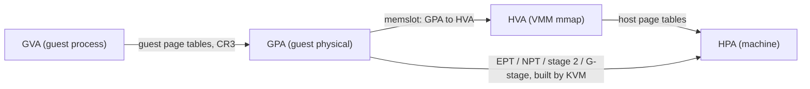
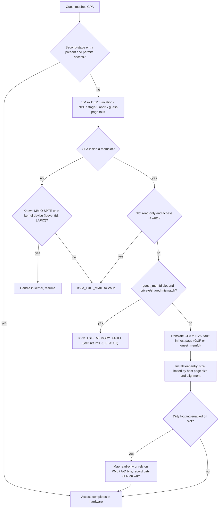
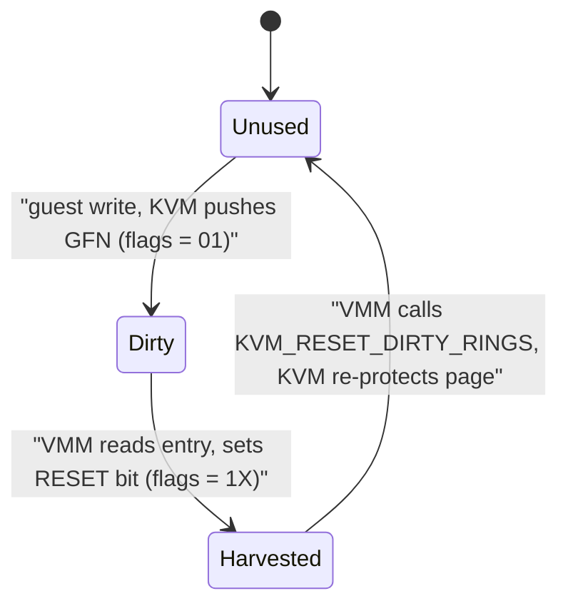

Purpose: explain how guest memory is translated (GVA to GPA to HPA), how KVM builds second-stage page tables from memslots, and how a Rust VMM allocates, maps, tracks and reclaims guest RAM on x86-64, ARM64 and RISC-V.

# Memory Virtualization: EPT, NPT, and Guest Memory

Related notes: [02 x86-64 Architecture for Hypervisor Authors](/compendium/virtualization/x86-64-architecture-for-hypervisor-authors), [03 Intel VT-x and AMD-V Hardware Virtualization](/compendium/virtualization/intel-vt-x-and-amd-v-hardware-virtualization), [04 KVM API and the vCPU Run Loop](/compendium/virtualization/kvm-api-and-the-vcpu-run-loop), [07 Device Emulation PIO MMIO and the Bus Model](/compendium/virtualization/device-emulation-pio-mmio-and-the-bus-model), [08 Virtio Devices Virtqueues and vhost](/compendium/virtualization/virtio-devices-virtqueues-and-vhost), [11 Device Passthrough VFIO IOMMU and Nested Virtualization](/compendium/virtualization/device-passthrough-vfio-iommu-and-nested-virtualization), [12 Snapshots Live Migration and Dirty Page Tracking](/compendium/virtualization/snapshots-live-migration-and-dirty-page-tracking), [13 Security Isolation and Attack Surface](/compendium/virtualization/security-isolation-and-attack-surface), [15 ARM64 Virtualization EL2 VHE and GIC](/compendium/virtualization/arm64-virtualization-el2-vhe-and-gic), [16 RISC-V Virtualization and the Hypervisor Extension](/compendium/virtualization/risc-v-virtualization-and-the-hypervisor-extension), [03 Memory Virtual Memory Paging Allocators and OOM](/compendium/linux-systems-engineering/memory-virtual-memory-paging-allocators-and-oom), [09 Unsafe Rust and the Rust Memory Model](/compendium/rust/unsafe-rust-and-the-rust-memory-model).

## The three address spaces

A guest has its own page tables and believes it controls physical memory. The host owns real physical memory. A VMM sits in between as an ordinary Linux process with its own virtual address space. That gives four names for one byte:

| Name | Abbreviation | Owner | Translated by |
|---|---|---|---|
| Guest virtual address | GVA | Guest processes and kernel | Guest page tables (CR3 / TTBR / satp) |
| Guest physical address | GPA (ARM: IPA) | The VM's "hardware" | Second stage: EPT, NPT, stage 2, G-stage |
| Host virtual address | HVA | The VMM process | Host page tables (the VMM's mm) |
| Host physical address | HPA | The machine | none |

KVM's key design decision: guest RAM is a range of the VMM's own virtual memory. You `mmap` it, you tell KVM "GPA range X is backed by HVA range Y" (a memslot), and KVM builds second-stage page tables mapping GPA to the HPA that currently backs Y. The VMM can read and write guest RAM with ordinary pointers, which is how device emulation, kernel loading and virtio work.



The hardware walks GVA to GPA to HPA directly through the two page table trees. The HVA step exists only in KVM's bookkeeping: on a second-stage fault KVM converts GPA to HVA through the memslot, then asks the host mm for the page (faulting it in if needed), then installs a GPA to HPA entry.

## Shadow paging: the pre-EPT approach

Before EPT (Intel Nehalem, 2008) and NPT (AMD Barcelona, 2007), the CPU had one page table root. The hypervisor gave the hardware a shadow page table mapping GVA directly to HPA, built by combining the guest's table with its own GPA to HPA map.

How it works:

1. Trap guest writes to CR3 (CR3-load exiting) and switch to the matching shadow root.
2. Write-protect the guest's page table pages so modifications trap; update the shadow entry on each trapped write.
3. Trap INVLPG to invalidate shadow entries.
4. Intercept #PF: either a real guest fault (reflect it) or a "hidden" fault because the shadow is not populated yet (fill it, resume).

Costs: lots of exits during process creation, fork, and context switches; memory for shadow tables per guest address space; complex code. Benefits: TLB misses walk only one level of tables.

KVM still contains a shadow MMU. It is used on hosts without TDP, and for nested virtualization, where L0 shadows L1's EPT tables for L2 ("shadow EPT"). See [11 Device Passthrough VFIO IOMMU and Nested Virtualization](/compendium/virtualization/device-passthrough-vfio-iommu-and-nested-virtualization).

## EPT and NPT: two-dimensional paging

With EPT (Intel) or NPT (AMD, also called RVI), the CPU holds two roots: the guest's CR3 (GVA to GPA) and the EPTP or nCR3 (GPA to HPA). On a TLB miss the page walker translates every guest page table pointer through the second-stage table.

Walk cost: with an n-level guest table and an m-level second-stage table, a worst-case miss takes

$$
n \times m + n + m
$$

memory references. For 4-level over 4-level that is 24, versus 4 natively. For 5-level over 5-level it is 35. Paging-structure caches and large pages hide most of this, which is why huge pages matter more in VMs than on bare metal.

The guest owns its CR3, its page tables, INVLPG and #PF handling with no exits. The hypervisor only sees faults in the second stage.

### EPT structures

EPTP (VMCS field) format:

| Bits | Meaning |
|---|---|
| 2:0 | Paging-structure memory type (6 = write-back) |
| 5:3 | Page-walk length minus 1 (3 = 4-level, 4 = 5-level) |
| 6 | Enable accessed and dirty flags |
| 7 | Enforce access rights for supervisor shadow-stack pages |
| N-1:12 | Physical address of the EPT PML4 (or PML5) |

EPT entries are not x86 page table entries. Key bits:

| Bit | Meaning |
|---|---|
| 0 | Read access |
| 1 | Write access |
| 2 | Execute access (supervisor execute with mode-based execute control) |
| 5:3 | EPT memory type (leaf only) |
| 6 | Ignore PAT (leaf only) |
| 7 | Large page (in PDPTE for 1 GiB, PDE for 2 MiB) |
| 8 | Accessed (if enabled in EPTP) |
| 9 | Dirty (leaf, if enabled) |
| 10 | User-mode execute (mode-based execute control) |
| 63 | Suppress #VE |

Note the absence of a "present" bit: an entry with R = W = X = 0 is not present.

### EPT violation versus EPT misconfiguration

| Exit | Reason | Cause | KVM's use |
|---|---|---|---|
| EPT violation | 48 | Access not permitted by the entry (not present, or write to a read-only entry, or fetch from non-executable) | Normal demand fault, dirty logging write-protect faults, MMIO on unmapped GPAs, guest_memfd attribute mismatches |
| EPT misconfiguration | 49 | Entry is malformed: write without read, reserved bits set, invalid memory type | KVM deliberately installs misconfigured "MMIO SPTEs" for GPAs it knows are MMIO, so repeat accesses take a fast path without walking memslots |

On AMD, the equivalent of both is a single nested page fault (`#VMEXIT` code 0x400, NPF) with a page-fault-style error code in EXITINFO1 and the GPA in EXITINFO2. KVM's MMIO SPTE trick on AMD uses reserved bits, which raises an NPF with the RSVD error-code bit.

### TLB tagging

Without tagging, every VM entry and exit would flush the TLB. VPID (Intel) and ASID (AMD) tag entries per vCPU address space; INVEPT and INVVPID (or the VMCB TLB_CONTROL field) invalidate selectively. KVM manages this; the user-visible effect is that heavy memslot churn (adding and removing slots) causes global flushes and is slow.

## KVM's MMU in one page



Important properties:

- Lazy population. Creating a memslot does not populate the second stage. Pages are mapped on first touch. `KVM_PRE_FAULT_MEMORY` exists to prepopulate.
- MMU notifiers. When the host mm changes a page under a memslot (swap, KSM merge, THP collapse, page migration, `madvise(MADV_DONTNEED)`, `munmap`), KVM zaps the corresponding second-stage entries. Your VMM can therefore free guest memory with `madvise` and KVM stays coherent.
- Huge mappings. KVM maps a 2 MiB or 1 GiB second-stage page only if the host backing is a huge page of at least that size and the GPA and HVA are equally aligned within the slot. The KVM API docs recommend that the lower 21 bits of `guest_phys_addr` and `userspace_addr` be identical for this reason.
- x86 uses the "TDP MMU" by default for EPT/NPT, which allows parallel faults under a read lock.

## Memslots

### KVM_SET_USER_MEMORY_REGION

```c
struct kvm_userspace_memory_region {
    __u32 slot;
    __u32 flags;
    __u64 guest_phys_addr;
    __u64 memory_size;     /* bytes */
    __u64 userspace_addr;  /* start of the userspace allocated memory */
};

#define KVM_MEM_LOG_DIRTY_PAGES (1UL << 0)
#define KVM_MEM_READONLY        (1UL << 1)
#define KVM_MEM_GUEST_MEMFD     (1UL << 2)  /* region2 only */
```

Rules from the KVM API documentation:

- Bits 0 to 15 of `slot` are the slot id. With `KVM_CAP_MULTI_ADDRESS_SPACE` (x86 uses it for SMM), bits 16 to 31 select the address space.
- The maximum number of slots is reported by `KVM_CAP_NR_MEMSLOTS` (`Kvm::get_nr_memslots()`).
- Slots may not overlap in guest physical address space.
- Setting `memory_size` to 0 deletes a slot. A slot may be moved (change `guest_phys_addr`) or have its flags changed, but it may not be resized.
- `KVM_MEM_READONLY` (with `KVM_CAP_READONLY_MEM`): guest writes exit as `KVM_EXIT_MMIO`. Use it for ROM and flash images.
- `KVM_MEM_LOG_DIRTY_PAGES`: enable dirty tracking for the slot.
- Changing `userspace_addr` mappings in the VMM (for example `mmap` with `MAP_FIXED` over guest RAM) is reflected automatically through MMU notifiers, but the slot still points at the same HVA range.

### KVM_SET_USER_MEMORY_REGION2

`KVM_CAP_USER_MEMORY2` adds `struct kvm_userspace_memory_region2`, which extends the original with guest_memfd binding:

```c
struct kvm_userspace_memory_region2 {
    __u32 slot;
    __u32 flags;
    __u64 guest_phys_addr;
    __u64 memory_size;
    __u64 userspace_addr;
    __u64 guest_memfd_offset;
    __u32 guest_memfd;
    __u32 pad1;
    __u64 pad2[14];
};
```

With `KVM_MEM_GUEST_MEMFD` in `flags`, the slot is bound to `[guest_memfd_offset, guest_memfd_offset + memory_size)` of a guest_memfd created on the same VM. `userspace_addr` must still be a legal user address for the shared view, but it need not be populated at the time of the call.

### Rust: allocating and registering guest RAM

Checked against vm-memory 0.18.0 and kvm-ioctls 0.25.1. In vm-memory 0.18 the region lookup methods (`iter`, `find_region`, `get_host_address`) live on the `GuestMemoryBackend` trait; `GuestMemory` is a newer IOMMU-aware layer with a blanket impl for every backend. Byte access (`read_obj`, `write_obj`, `write_slice`) comes from `Bytes&lt;GuestAddress&gt;`.

```rust
use kvm_bindings::{kvm_userspace_memory_region, KVM_MEM_LOG_DIRTY_PAGES};
use kvm_ioctls::VmFd;
use vm_memory::{
    Bytes, GuestAddress, GuestMemoryBackend, GuestMemoryMmap, GuestMemoryRegion,
};

const MIB: u64 = 1 << 20;
const GIB: u64 = 1 << 30;
const MMIO_HOLE_START: u64 = 3 * GIB; // 32-bit device window 3 GiB..4 GiB
const FOUR_GIB: u64 = 4 * GIB;

/// Split RAM around the 32-bit MMIO hole, x86 style.
pub fn ram_layout(ram: u64) -> Vec<(GuestAddress, usize)> {
    if ram <= MMIO_HOLE_START {
        vec![(GuestAddress(0), ram as usize)]
    } else {
        vec![
            (GuestAddress(0), MMIO_HOLE_START as usize),
            (GuestAddress(FOUR_GIB), (ram - MMIO_HOLE_START) as usize),
        ]
    }
}

pub fn create_guest_memory(vm: &VmFd, ram: u64, track_dirty: bool) -> anyhow::Result<GuestMemoryMmap> {
    // Anonymous, private mappings. One mmap per range.
    let mem = GuestMemoryMmap::from_ranges(&ram_layout(ram))?;

    for (slot, region) in mem.iter().enumerate() {
        let host = mem.get_host_address(region.start_addr())?;
        let mr = kvm_userspace_memory_region {
            slot: slot as u32,
            flags: if track_dirty { KVM_MEM_LOG_DIRTY_PAGES } else { 0 },
            guest_phys_addr: region.start_addr().0,
            memory_size: region.len(),
            userspace_addr: host as u64,
        };
        // SAFETY: the mapping is owned by `mem`, which must outlive the VM's use of the slot.
        unsafe { vm.set_user_memory_region(mr)? };
    }

    // The VMM can now write guest RAM directly, e.g. to load a kernel or a GDT.
    mem.write_obj(0xdead_beef_u32, GuestAddress(MIB))?;
    Ok(mem)
}
```

Why `set_user_memory_region` is `unsafe`: KVM will let the guest read and write that HVA range from now on. If you unmap or reuse it while the slot exists, the guest corrupts unrelated VMM memory. The usual invariant is "`GuestMemoryMmap` lives at least as long as the `VmFd`", often enforced by storing both in the same struct and dropping the VM first. See [09 Unsafe Rust and the Rust Memory Model](/compendium/rust/unsafe-rust-and-the-rust-memory-model).

Concurrency note: vCPUs and device threads write guest memory concurrently with the VMM. vm-memory exposes guest memory through `VolatileSlice` and volatile reads/writes rather than `&[u8]`, because creating Rust references to memory another agent mutates is undefined behavior. Do not convert guest memory to `&mut [u8]` for convenience.

## Guest RAM backing choices

| Backing | How | Pros | Cons |
|---|---|---|---|
| Anonymous private (`MAP_PRIVATE` plus `MAP_ANONYMOUS`) | `GuestMemoryMmap::from_ranges` | Simple, THP-eligible, zero-fill on demand | Cannot be shared with another process (vhost-user), snapshot needs copying |
| memfd shared (`memfd_create` + `MAP_SHARED`) | `from_ranges_with_files` with a `FileOffset` | Shareable with vhost-user backends and other processes by fd; can be sealed | THP for shmem requires `shmem_enabled` policy |
| hugetlbfs / `memfd_create(MFD_HUGETLB)` | file in hugetlbfs, or `MAP_HUGETLB` | Guaranteed 2 MiB / 1 GiB pages, no THP compaction jitter | Must reserve pages up front, no swap, inflexible |
| File-backed (`MAP_SHARED` on a regular file) | `from_ranges_with_files` | Snapshot memory file can be mapped directly (Firecracker snapshot load uses `MAP_PRIVATE` on the memory file) | Page cache writeback cost |
| guest_memfd | `KVM_CREATE_GUEST_MEMFD` | Unmappable by default, required for confidential guests (SEV-SNP, TDX, pKVM, CCA) | Newer API, limited host access by design |

### Hugepages

Transparent huge pages: `madvise(addr, len, MADV_HUGEPAGE)` on the guest RAM mapping, and align the mapping to 2 MiB. Without alignment THP cannot form huge pages at the edges, and KVM cannot install 2 MiB second-stage entries.

hugetlbfs: deterministic but needs a reserved pool (`/proc/sys/vm/nr_hugepages` or per-node sysfs). 1 GiB pages must usually be reserved at boot.

Interaction with dirty logging: when you set `KVM_MEM_LOG_DIRTY_PAGES`, KVM must track 4 KiB granularity, so it splits huge second-stage mappings (eagerly on recent kernels). Performance drops during migration; this is expected.

### NUMA

On a multi-socket host, place each guest NUMA node's RAM on one host node and pin that node's vCPU threads to the same host node's CPUs.

1. Create one guest memory range per guest NUMA node.
2. `mbind(addr, len, MPOL_BIND, nodemask, ...)` on each mapping before first touch (or use `set_mempolicy` on the thread that faults it in).
3. Pin vCPU threads with `sched_setaffinity`.
4. Describe the topology to the guest: ACPI SRAT/SLIT on x86 and ARM64 with ACPI, `numa-node-id` and `distance-map` in the device tree on ARM64 and RISC-V.

Cloud Hypervisor models this as "memory zones" with a `host_numa_node` field. Without it, Linux's default first-touch policy places pages wherever the vCPU happened to run at fault time.

### Ballooning and memory reclamation

| Mechanism | How it works | VMM work |
|---|---|---|
| virtio-balloon (device ID 5) | Guest driver allocates pages and reports their PFNs on the inflate queue; host frees them | `madvise(MADV_DONTNEED)` for anonymous private memory, `fallocate(FALLOC_FL_PUNCH_HOLE)` for shared/memfd/hugetlbfs |
| Free page reporting (`VIRTIO_BALLOON_F_REPORTING`) | Guest reports free pages in chunks without the host asking | Same discard, continuously |
| virtio-mem (device ID 24) | Guest-cooperative hotplug/unplug of memory blocks in a dedicated GPA region | Plug/unplug blocks, discard unplugged ranges |
| Memory hotplug (ACPI DIMM) | Add a new memslot and notify guest via ACPI | New memslot; unplug is fragile |
| KSM | Host merges identical pages (`MADV_MERGEABLE`) | Opt in; side-channel risk, see [13 Security Isolation and Attack Surface](/compendium/virtualization/security-isolation-and-attack-surface) |

Ballooning is cooperative: a malicious or broken guest can ignore it. Never use it as a security boundary. Details on the device side in [08 Virtio Devices Virtqueues and vhost](/compendium/virtualization/virtio-devices-virtqueues-and-vhost).

## MMIO holes and physical memory maps

GPA ranges without a memslot are MMIO. Any guest access there exits to KVM, which either handles it in-kernel (LAPIC, IOAPIC, ioeventfd) or returns `KVM_EXIT_MMIO` to you. Your memory map must leave holes for every device window and for firmware conventions.

### x86-64

| GPA range | Use |
|---|---|
| 0x0000_0000 to 0x0009_FFFF | Low RAM (real-mode IVT, BDA, zero page, boot page tables) |
| 0x000A_0000 to 0x000B_FFFF | Legacy VGA window |
| 0x000C_0000 to 0x000F_FFFF | Option ROMs, BIOS area, ACPI RSDP search area (Firecracker puts the RSDP at 0xE_0000) |
| 0x0010_0000 upward | Kernel load (1 MiB, "HIMEM") |
| below 4 GiB, e.g. 0xC000_0000 to 0xFFFF_FFFF | 32-bit MMIO hole: PCI BARs, PCIe ECAM (MMCONFIG), IOAPIC at 0xFEC0_0000, LAPIC at 0xFEE0_0000, firmware flash ending at 4 GiB |
| 4 GiB upward | RAM above the hole |
| high (e.g. 256 GiB) | 64-bit MMIO window for large BARs |

Also reserve the three pages for `KVM_SET_TSS_ADDR` and one for `KVM_SET_IDENTITY_MAP_ADDR` inside the hole (Firecracker uses `0xfffb_d000` for the TSS). The e820 map you hand the guest in boot_params must match the memslots exactly (see [09 Booting Guests Firmware and the Linux Boot Protocol](/compendium/virtualization/booting-guests-firmware-and-the-linux-boot-protocol)).

### ARM64 and RISC-V

There is no legacy hole; the platform defines where DRAM starts and devices live below it. Common choices:

| Platform | DRAM base | Devices |
|---|---|---|
| QEMU `virt` (ARM64) | 0x4000_0000 | GIC, UART, virtio-mmio, PCIe below 1 GiB, high PCIe above RAM |
| Firecracker (ARM64) | 0x8000_0000 | MMIO devices and GIC below 2 GiB |
| QEMU `virt` (RISC-V) | 0x8000_0000 | CLINT/ACLINT, PLIC or APLIC/IMSIC, UART, virtio-mmio below 2 GiB |

Whatever you choose, the device tree `memory` node and device `reg` properties must agree with your memslots.

## Dirty page tracking

Dirty tracking answers "which guest pages changed since I last looked?" It underpins live migration, incremental snapshots and some balloon accounting. See [12 Snapshots Live Migration and Dirty Page Tracking](/compendium/virtualization/snapshots-live-migration-and-dirty-page-tracking) for the migration algorithm; this section covers the KVM mechanisms.

### Mechanisms inside KVM

| Mechanism | Hardware | How |
|---|---|---|
| Write protection | All | Second-stage entries mapped read-only; first write faults, KVM marks dirty and makes writable |
| EPT A/D bits | Intel | Hardware sets dirty bit in EPT entry; KVM scans |
| PML (page-modification logging) | Intel | Hardware logs GPAs of writes into a 512-entry buffer; exit 62 when full; KVM drains into the dirty bitmap or ring |
| Stage-2 DBM | ARM (FEAT_HAFDBS) | Hardware dirty-bit management for stage 2, where supported by KVM |

### Bitmap interface: KVM_GET_DIRTY_LOG and KVM_CLEAR_DIRTY_LOG

1. Register the slot with `KVM_MEM_LOG_DIRTY_PAGES`.
2. Periodically call `KVM_GET_DIRTY_LOG(slot)`: one bit per 4 KiB page in the slot. By default the bits are cleared and the pages re-write-protected before the ioctl returns.
3. With `KVM_CAP_MANUAL_DIRTY_LOG_PROTECT2` enabled with `KVM_DIRTY_LOG_MANUAL_PROTECT_ENABLE`, `KVM_GET_DIRTY_LOG` no longer clears or re-protects. You call `KVM_CLEAR_DIRTY_LOG(slot, first_page, num_pages, bitmap)` for the pages you are about to copy. `first_page` must be a multiple of 64. This splits a long write-protect pass into small chunks and avoids holding the MMU lock across huge slots. `KVM_DIRTY_LOG_INITIALLY_SET` makes all bits start as 1, so KVM does not have to write-protect everything up front.

```rust
use kvm_ioctls::VmFd;
use vm_memory::{GuestMemoryBackend, GuestMemoryMmap, GuestMemoryRegion};

const PAGE: u64 = 4096;

/// Returns dirty GPAs for every slot, assuming slot index == region index.
pub fn harvest_dirty(vm: &VmFd, mem: &GuestMemoryMmap) -> Result<Vec<u64>, kvm_ioctls::Error> {
    let mut dirty = Vec::new();
    for (slot, region) in mem.iter().enumerate() {
        let bitmap = vm.get_dirty_log(slot as u32, region.len() as usize)?;
        for (word_idx, word) in bitmap.iter().enumerate() {
            let mut w = *word;
            while w != 0 {
                let bit = w.trailing_zeros() as u64;
                let page = word_idx as u64 * 64 + bit;
                dirty.push(region.start_addr().0 + page * PAGE);
                w &= w - 1;
            }
        }
    }
    Ok(dirty)
}
```

KVM only sees writes made by vCPUs through the second stage. Writes made by the VMM itself (device emulation, virtio used rings, block reads into guest buffers) and by vhost or vhost-user backends are invisible to KVM's log. vm-memory provides a VMM-side bitmap (`vm_memory::bitmap`, `AtomicBitmap` with the `backend-bitmap` feature; use `GuestMemoryMmap&lt;AtomicBitmap&gt;`) that marks pages dirtied through its `Bytes` API, and vhost has its own log. Migration must OR all three sources.

### Dirty ring: KVM_CAP_DIRTY_LOG_RING

The bitmap interface scans whole slots even when few pages changed. The dirty ring gives each vCPU a ring of dirty GFNs instead.

```c
struct kvm_dirty_gfn {
    __u32 flags;
    __u32 slot;    /* as_id | slot_id */
    __u64 offset;  /* page offset within the slot */
};

#define KVM_DIRTY_GFN_F_DIRTY  BIT(0)
#define KVM_DIRTY_GFN_F_RESET  BIT(1)
```

Protocol (KVM API docs, section 7.36):

1. Right after `KVM_CREATE_VM` and before creating any vCPU, `KVM_ENABLE_CAP(KVM_CAP_DIRTY_LOG_RING_ACQ_REL or KVM_CAP_DIRTY_LOG_RING, args[0] = ring size in bytes)`. Size is a power of two; at least 64 KiB (4096 entries) is recommended.
2. Each vCPU fd exposes its ring by `mmap` at offset `KVM_DIRTY_LOG_PAGE_OFFSET * PAGE_SIZE` (the arch header defines the offset as 64 on x86, arm64 and riscv).
3. Slots still need `KVM_MEM_LOG_DIRTY_PAGES`.
4. Harvest entries in order: if `flags & DIRTY` and not `RESET`, record `(slot, offset)`, then set the `RESET` bit (state 01 to 1X). Stop at the first entry without the DIRTY bit. On weakly ordered architectures (ARM64, RISC-V) use load-acquire on `flags` and store-release when marking harvested; this is what the `ACQ_REL` capability promises. x86 may expose both.
5. Call `KVM_RESET_DIRTY_RINGS` on the VM fd so KVM re-protects the harvested pages. Do this before reading page contents to copy.
6. If a ring fills, `KVM_RUN` returns with `KVM_EXIT_DIRTY_RING_FULL`; harvest, reset, re-enter.
7. To ensure all dirty GFNs are flushed (for the final migration pass), kick vCPUs out of `KVM_RUN` with a signal.

On ARM64 some pages can be dirtied outside vCPU context (for example by the in-kernel ITS saving tables), so `KVM_CAP_DIRTY_LOG_RING_WITH_BITMAP` keeps a backup bitmap you collect with `KVM_GET_DIRTY_LOG`.

kvm-ioctls 0.25 exposes `Cap::DirtyLogRing` for capability checks but no ring helper; you `mmap` the vCPU fd and drive the ring yourself. kvm-ioctls maps an unrecognized exit like `KVM_EXIT_DIRTY_RING_FULL` (31) to `VcpuExit::Unsupported(31)`.



| Aspect | Bitmap | Ring |
|---|---|---|
| Cost to collect | Proportional to slot size | Proportional to dirty pages |
| Granularity of control | Per slot | Per vCPU |
| Blocking vCPUs | No | vCPU exits when its ring is full (natural throttling) |
| Writes outside vCPU context | Captured | Need WITH_BITMAP backup |
| Enable time | Any time per slot | Before vCPU creation |

## guest_memfd and confidential memory

A traditional memslot lets the host read every guest page through the HVA. Confidential computing (AMD SEV-SNP, Intel TDX, ARM CCA, pKVM) needs memory the host cannot map. guest_memfd is KVM's answer.

- `KVM_CREATE_GUEST_MEMFD` (struct `kvm_create_guest_memfd { size, flags, reserved[6] }`) returns an fd for an anonymous RAM-backed file bound to that VM. It cannot be resized; it supports `fallocate(PUNCH_HOLE)`.
- By default it cannot be mapped, read or written by user space. Newer kernels add `KVM_CAP_GUEST_MEMFD_FLAGS` with `GUEST_MEMFD_FLAG_MMAP` (allow `mmap`) and `GUEST_MEMFD_FLAG_INIT_SHARED` (start all memory shared). This lets non-confidential VMs use guest_memfd as the only backing, so guest memory never appears in the VMM's normal address space unless explicitly mapped.
- Bind it with `KVM_SET_USER_MEMORY_REGION2` and `KVM_MEM_GUEST_MEMFD`. A given guest_memfd range may be bound to at most one slot.
- `KVM_SET_MEMORY_ATTRIBUTES` (x86, `KVM_CAP_MEMORY_ATTRIBUTES`) sets `KVM_MEMORY_ATTRIBUTE_PRIVATE` on GPA ranges. There is no "get" ioctl; the VMM tracks state itself. Current upstream documentation also describes `KVM_SET_MEMORY_ATTRIBUTES2`, an ioctl on the guest_memfd itself for in-place shared/private conversion; check your target kernel's `api.rst` before relying on it.
- When the guest accesses a GPA as private but it is shared (or the reverse), `KVM_RUN` returns -1 with errno `EFAULT` (or `EHWPOISON`) and `exit_reason = KVM_EXIT_MEMORY_FAULT`, with `memory_fault.gpa`, `.size`, and `.flags` (`KVM_MEMORY_EXIT_FLAG_PRIVATE`). The VMM converts the range and retries. kvm-ioctls turns this into `VcpuExit::MemoryFault { flags, gpa, size }`.

```rust
use kvm_bindings::{kvm_create_guest_memfd, kvm_userspace_memory_region2, KVM_MEM_GUEST_MEMFD};
use kvm_ioctls::VmFd;

/// Bind `size` bytes of a fresh guest_memfd at `gpa`. `shared_hva` is the
/// host mapping used for the shared view (may be lazily populated).
pub fn add_gmem_slot(
    vm: &VmFd,
    slot: u32,
    gpa: u64,
    size: u64,
    shared_hva: u64,
) -> Result<std::os::fd::RawFd, kvm_ioctls::Error> {
    let gmem = kvm_create_guest_memfd { size, flags: 0, ..Default::default() };
    let fd = vm.create_guest_memfd(gmem)?;

    let region = kvm_userspace_memory_region2 {
        slot,
        flags: KVM_MEM_GUEST_MEMFD,
        guest_phys_addr: gpa,
        memory_size: size,
        userspace_addr: shared_hva,
        guest_memfd_offset: 0,
        guest_memfd: fd as u32,
        ..Default::default()
    };
    // SAFETY: shared_hva must stay a valid mapping for the lifetime of the slot.
    unsafe { vm.set_user_memory_region2(region)? };
    Ok(fd)
}
```

Availability: guest_memfd arrived in Linux 6.8 for x86 confidential VM types; mmap support and broader architecture support landed later. Check `KVM_CAP_GUEST_MEMFD` and `KVM_CAP_GUEST_MEMFD_FLAGS` at runtime rather than assuming.

## The vm-memory crate in practice

| Type / trait | Role |
|---|---|
| `GuestAddress` | Newtype over `u64` GPA; arithmetic via `Address` trait (`checked_add`, `unchecked_add`, `raw_value`) |
| `GuestUsize` | Length type (`u64`) |
| `MemoryRegionAddress` | Offset inside one region |
| `GuestMemoryRegion` | One contiguous region: `start_addr`, `len`, `last_addr`, `get_host_address`, `file_offset`, `is_hugetlbfs`, `bitmap` |
| `GuestMemoryBackend` | Collection of regions: `iter`, `num_regions`, `find_region`, `to_region_addr`, `check_range`, `get_host_address`, `get_slice` |
| `GuestMemory` | IOMMU-aware access layer added in 0.17/0.18, blanket-implemented for every backend |
| `Bytes&lt;GuestAddress&gt;` | `read_obj`, `write_obj`, `read_slice`, `write_slice`, `read_volatile_from`, `write_volatile_to` |
| `ByteValued` | Marker for plain-old-data types safe to read from guest memory |
| `GuestMemoryMmap&lt;B&gt;` | `GuestRegionCollection&lt;GuestRegionMmap&lt;B&gt;&gt;`; `from_ranges`, `from_ranges_with_files` (feature `backend-mmap`) |
| `GuestMemoryAtomic` | Swappable memory map for hotplug (feature `backend-atomic`) |
| `VolatileSlice` | Bounds-checked, volatile view used for zero-copy I/O |

Rules for using it correctly:

- Every GPA from the guest is untrusted. Use `checked_offset`, `check_range`, and `Bytes` methods that return errors; never compute raw pointers from guest-supplied addresses.
- Objects read with `read_obj` must be `ByteValued` (no padding-sensitive invariants, no pointers, no enums with invalid bit patterns).
- A read spanning two regions is handled by `Bytes` methods, but `get_host_address` and `get_slice` work on one region. Do not assume physical contiguity across region boundaries.
- Keep the version pinned and consistent across crates: virtio-queue, linux-loader and vhost all depend on vm-memory, and mixed versions produce confusing trait errors.

## ARM64 stage-2 translation

ARM calls the guest physical address the intermediate physical address (IPA). Stage 1 (guest, controlled by TTBR0_EL1/TTBR1_EL1/TCR_EL1) maps VA to IPA; stage 2 (hypervisor, EL2) maps IPA to PA.

| Element | Register / detail |
|---|---|
| Enable stage 2 | HCR_EL2.VM = 1 |
| Root and VMID | VTTBR_EL2: base address of the stage-2 table and VMID (8 or 16 bits) |
| Geometry | VTCR_EL2: T0SZ (IPA size), SL0 (starting level), TG0 (granule 4/16/64 KiB), PS (output PA size) |
| Concatenated tables | Stage 2 may start with up to 16 concatenated tables at the first level, reducing walk depth |
| Fault reporting | Data/instruction abort from lower EL (ESR_EL2 EC 0x24 / 0x20); HPFAR_EL2 holds the faulting IPA page; FAR_EL2 holds the VA |
| Syndrome for MMIO | ISS.ISV = 1 gives access size, register, sign extension, direction; KVM uses it to build `KVM_EXIT_MMIO` |
| Memory attributes | Stage-2 attributes combine with stage-1; FEAT_S2FWB lets stage 2 force write-back |
| Dirty tracking | Write-protect faults; FEAT_HAFDBS for hardware dirty state |

KVM specifics:

- IPA size is chosen at VM creation: `KVM_CREATE_VM` with a type encoding the IPA bits (kvm-ioctls `create_vm_with_ipa_size`), bounded by `KVM_CAP_ARM_VM_IPA_SIZE` (`Kvm::get_host_ipa_limit()`). The default is 40 bits (1 TiB). If you place RAM or high PCIe windows above that, slot creation fails.
- Guests boot with the MMU and caches off, so early guest accesses are non-cacheable while the VMM wrote the kernel through cacheable mappings. KVM performs the necessary cache maintenance when it maps pages into stage 2; a VMM should not assume x86-style coherence for memory it writes after the guest is running with caches off.
- ISV = 0 accesses (load/store pair, writeback addressing) to MMIO cannot be emulated; see note 03.

## RISC-V G-stage translation

The H extension adds two-stage translation: VS-stage (guest, `vsatp`) maps guest virtual to guest physical; G-stage (hypervisor, `hgatp`) maps guest physical to supervisor physical.

| Element | Detail |
|---|---|
| Root register | `hgatp`: MODE, VMID, PPN. RV64 layout: MODE bits 63:60, VMID bits 57:44, PPN bits 43:0 |
| Modes | 0 = Bare, 8 = Sv39x4, 9 = Sv48x4, 10 = Sv57x4 (RV32: 1 = Sv32x4) |
| "x4" | Guest physical addresses are 2 bits wider than the matching Sv mode: 41 bits for Sv39x4, 50 for Sv48x4, 59 for Sv57x4 |
| Root table | 16 KiB (four times a normal page) and 16 KiB aligned, so PPN bits 1:0 read as zero |
| VMID | VMIDLEN implementation-defined, up to 14 bits on RV64; may be zero |
| Leaf permissions | G-stage accesses are treated as U-mode accesses, so leaf PTEs must have U = 1 |
| Fault causes | Instruction guest-page fault (20), load guest-page fault (21), store/AMO guest-page fault (23) |
| Fault address | `htval` holds the faulting guest physical address shifted right by 2; `stval` the guest virtual address (hstatus.GVA = 1 when it is one) |
| Instruction info | `htinst` may hold a transformed form of the trapping instruction, which helps MMIO emulation |
| Fences | `HFENCE.GVMA` (G-stage, by VMID and GPA) and `HFENCE.VVMA` (VS-stage) |

KVM on RISC-V uses the same memslot API; the VMM sees `KVM_EXIT_MMIO` for accesses outside memslots and supports the dirty ring (`KVM_CAP_DIRTY_LOG_RING_ACQ_REL`, since RISC-V is weakly ordered).

## Architecture comparison

| Concern | x86-64 (Intel / AMD) | ARM64 | RISC-V |
|---|---|---|---|
| Second-stage name | EPT / NPT (RVI) | Stage 2 | G-stage |
| Root register | EPTP (VMCS) / nCR3 (VMCB) | VTTBR_EL2 | hgatp |
| Geometry control | EPTP walk length, 4 or 5 levels | VTCR_EL2 T0SZ, SL0, TG0 | hgatp MODE (Sv39x4 / Sv48x4 / Sv57x4) |
| Entry format | EPT: custom R/W/X format; NPT: same as host x86 PTEs | VMSAv8-64 stage-2 descriptors (S2AP, MemAttr) | Sv PTEs, U = 1 required |
| Fault exit | EPT violation (48) / NPF (0x400) | Abort from lower EL, HPFAR_EL2 | Guest-page fault 20/21/23, htval |
| Fast MMIO trick | EPT misconfig / reserved bits | N/A (stage-2 fault + ISV syndrome) | N/A (fault + htinst) |
| TLB tag | VPID / ASID | VMID | VMID |
| Hardware dirty assist | PML (Intel), EPT A/D | FEAT_HAFDBS | Svadu for A/D (implementation dependent) |
| KVM guest PA limit | Host MAXPHYADDR | IPA size chosen at VM creation | hgatp mode chosen by KVM |
| Dirty ring capability | `DIRTY_LOG_RING` and `_ACQ_REL` | `_ACQ_REL` (+ WITH_BITMAP) | `_ACQ_REL` |

## Common pitfalls

- Freeing or remapping the guest RAM mapping while a memslot still points at it. The guest will write into whatever is there now.
- Misaligned memslots: GPA and HVA not congruent modulo 2 MiB, so KVM never installs huge second-stage pages and TLB pressure explodes.
- Forgetting the 32-bit MMIO hole on x86 and placing RAM across 0xFEC0_0000/0xFEE0_0000. The guest's LAPIC and IOAPIC accesses hit RAM instead of the in-kernel devices.
- e820 or device tree memory map that disagrees with memslots. The guest touches GPAs with no slot and gets `KVM_EXIT_MMIO` storms or crashes.
- Treating guest memory as `&mut [u8]` in Rust. Use `VolatileSlice` and `Bytes`; the guest can change bytes under you.
- Trusting guest-provided addresses or lengths (virtio descriptors, boot protocol pointers) without `checked_offset` / `check_range`.
- Relying on KVM's dirty log alone for migration while device emulation or vhost writes guest memory.
- Enabling the dirty ring after creating vCPUs (KVM refuses), or forgetting `KVM_RESET_DIRTY_RINGS` (ring fills, vCPU stalls on `KVM_EXIT_DIRTY_RING_FULL`).
- Using plain loads and stores on dirty ring `flags` on ARM64 or RISC-V instead of acquire/release.
- Expecting `madvise(MADV_DONTNEED)` to free hugetlbfs or shared memory. Use `fallocate(PUNCH_HOLE)` for those.
- Putting ARM64 RAM or PCIe windows above the VM's IPA limit.
- Assuming guest_memfd mmap support exists on your kernel without checking `KVM_CAP_GUEST_MEMFD_FLAGS`.
- Handling `KVM_EXIT_MEMORY_FAULT` as an ordinary error: it is returned with `-1`/`EFAULT` and requires converting memory attributes, not aborting.

## Review checklist

- [ ] Guest RAM layout leaves architecture-specific MMIO holes and matches e820 / device tree exactly.
- [ ] Every memslot has GPA and HVA aligned to at least 2 MiB (1 GiB if using gigantic pages).
- [ ] Huge page strategy chosen and verified (`MADV_HUGEPAGE` with THP, or hugetlbfs pool sized).
- [ ] NUMA placement: per-node ranges bound with `mbind`, vCPUs pinned, SRAT/DT topology generated.
- [ ] `GuestMemoryMmap` outlives the `VmFd`; slot removal precedes unmapping.
- [ ] All guest-controlled addresses go through vm-memory checked APIs.
- [ ] Dirty tracking combines KVM log (bitmap or ring), VMM-side `AtomicBitmap`, and vhost logs.
- [ ] If using `KVM_CAP_MANUAL_DIRTY_LOG_PROTECT2`, `KVM_CLEAR_DIRTY_LOG` ranges are 64-page aligned.
- [ ] If using the dirty ring: enabled before vCPU creation, harvested in order with acquire/release, reset after each harvest, `DIRTY_RING_FULL` handled.
- [ ] Balloon/virtio-mem discards use the right primitive for the backing type.
- [ ] Read-only slots used for ROM/flash, with write exits handled.
- [ ] guest_memfd paths check capabilities and handle `MemoryFault` exits by converting attributes.
- [ ] ARM64 VMs choose an IPA size that covers RAM and all device windows.
- [ ] RISC-V memory map places RAM at the platform's DRAM base and devices below it.

## Primary Sources

- [KVM API documentation](https://docs.kernel.org/virt/kvm/api.html) (KVM_SET_USER_MEMORY_REGION, KVM_SET_USER_MEMORY_REGION2, KVM_CREATE_GUEST_MEMFD, KVM_SET_MEMORY_ATTRIBUTES, KVM_GET_DIRTY_LOG, KVM_CLEAR_DIRTY_LOG, KVM_CAP_DIRTY_LOG_RING, KVM_EXIT_MEMORY_FAULT)
- [KVM API documentation source (api.rst, upstream master)](https://github.com/torvalds/linux/blob/master/Documentation/virt/kvm/api.rst)
- [Linux KVM uapi header (kvm.h)](https://github.com/torvalds/linux/blob/master/include/uapi/linux/kvm.h)
- [Linux x86 KVM uapi header (KVM_DIRTY_LOG_PAGE_OFFSET)](https://github.com/torvalds/linux/blob/master/arch/x86/include/uapi/asm/kvm.h)
- [Linux VMX definitions (EPT bits)](https://github.com/torvalds/linux/blob/master/arch/x86/include/asm/vmx.h)
- [Intel 64 and IA-32 Architectures Software Developer's Manuals](https://www.intel.com/content/www/us/en/developer/articles/technical/intel-sdm.html) (Vol. 3C: EPT, PML)
- [AMD64 Architecture Programmer's Manual, Vol. 2 (pub. 24593)](https://www.amd.com/content/dam/amd/en/documents/processor-tech-docs/programmer-references/24593.pdf) (Nested paging)
- [RISC-V ISA manual, hypervisor chapter](https://github.com/riscv/riscv-isa-manual/blob/main/src/priv/hypervisor.adoc) (hgatp, G-stage, htval)
- [vm-memory docs](https://docs.rs/vm-memory/latest/vm_memory/)
- [vm-memory GuestMemoryBackend trait](https://docs.rs/vm-memory/latest/vm_memory/guest_memory/trait.GuestMemoryBackend.html)
- [kvm-ioctls VmFd docs](https://docs.rs/kvm-ioctls/latest/kvm_ioctls/struct.VmFd.html)
- [kvm-ioctls source and CHANGELOG](https://github.com/rust-vmm/kvm)
- [Firecracker x86_64 memory layout (layout.rs)](https://github.com/firecracker-microvm/firecracker/blob/main/src/vmm/src/arch/x86_64/layout.rs)
