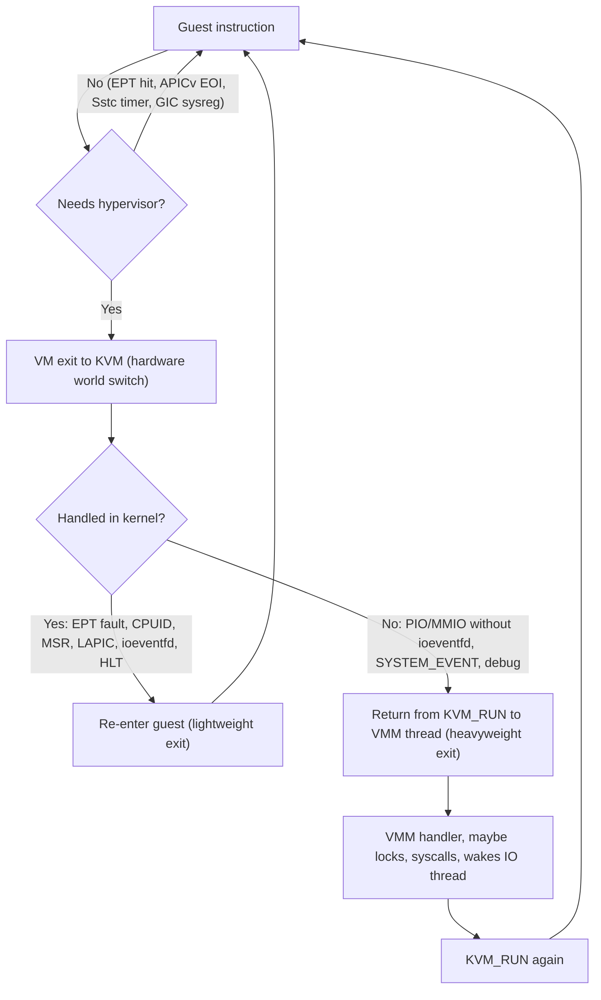
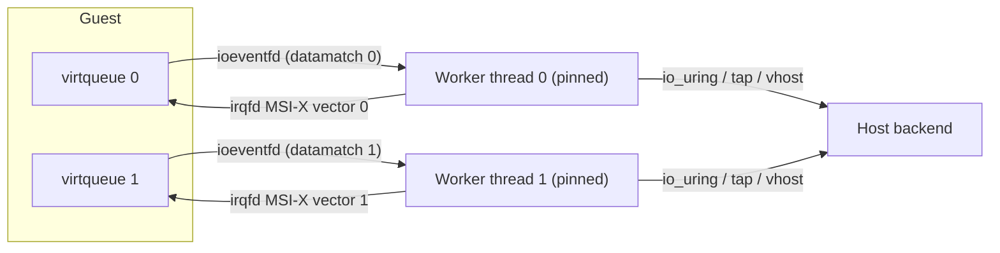
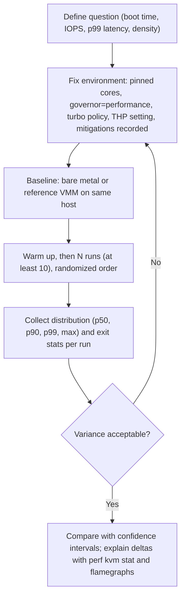

Purpose: show how to measure, explain and reduce the cost of a KVM-based VMM (VM exits, halt polling, pinning, hugepages, I/O threading), how to observe it with perf, tracepoints and KVM statistics, and how to debug guests and the VMM itself on x86-64, ARM64 and RISC-V.

# Performance, Observability, and Debugging

Related notes: [04 KVM API and the vCPU Run Loop](/compendium/virtualization/kvm-api-and-the-vcpu-run-loop), [05 Memory Virtualization EPT NPT and Guest Memory](/compendium/virtualization/memory-virtualization-ept-npt-and-guest-memory), [06 Interrupts Timers and Interrupt Controller Virtualization](/compendium/virtualization/interrupts-timers-and-interrupt-controller-virtualization), [08 Virtio Devices Virtqueues and vhost](/compendium/virtualization/virtio-devices-virtqueues-and-vhost), [10 Storage and Network Backends](/compendium/virtualization/storage-and-network-backends), [12 Snapshots Live Migration and Dirty Page Tracking](/compendium/virtualization/snapshots-live-migration-and-dirty-page-tracking), [15 ARM64 Virtualization EL2 VHE and GIC](/compendium/virtualization/arm64-virtualization-el2-vhe-and-gic), [16 RISC-V Virtualization and the Hypervisor Extension](/compendium/virtualization/risc-v-virtualization-and-the-hypervisor-extension), [11 Performance Engineering perf Flamegraphs and Capacity](/compendium/linux-systems-engineering/performance-engineering-perf-flamegraphs-and-capacity), [14 eBPF Fundamentals Verifier Maps Programs and Helpers](/compendium/linux-systems-engineering/ebpf-fundamentals-verifier-maps-programs-and-helpers), [07 Concurrency Parallelism and Synchronization](/compendium/rust/concurrency-parallelism-and-synchronization).

## The performance model of a KVM guest

A guest runs at native speed until it exits. VMM performance work is therefore mostly about four questions:

1. How many exits happen per unit of useful guest work?
2. Where is each exit handled: in hardware (no exit), in KVM (lightweight exit), or in your VMM (heavyweight exit to userspace)?
3. What does the host do while a vCPU is idle: halt, poll, or get preempted?
4. How much does the guest pay for memory translation (two-dimensional page walks, TLB reach) and for I/O data movement?



### Order-of-magnitude costs

These are rough figures to reason with, not specifications; they vary by CPU generation, microcode, speculative execution mitigations, and kernel config. Always measure on your target hardware.

| Event | Rough cost | Notes |
|---|---|---|
| Guest instruction with no exit | native | The goal |
| Hardware VM exit + entry round trip (VMX, SVM) | hundreds of ns to about 1 us | Includes state save/restore in VMCS/VMCB; mitigations (IBPB, L1D flush, RSB stuffing, MDS clears) can add significantly |
| Lightweight exit handled in KVM | about 1 to 2 us | CPUID, MSR, in-kernel LAPIC, EPT violation fix-up, ioeventfd signal |
| Heavyweight exit to userspace | several us | Adds return to user mode, your dispatch, and re-entry through the ioctl path; the context switch also evicts caches |
| Exit that wakes another thread | tens of us worst case | Cross-thread wakeup latency, scheduler involvement |
| EPT/NPT violation needing page allocation | several us to ms | First touch, swap-in, THP collapse, userfaultfd |

Implication: 100k exits per second per vCPU at about 5 us each is 50 percent of a CPU. Exit rate, not exit type alone, determines whether something matters.

### Where exits come from

| Source | x86-64 | ARM64 | RISC-V | Fix |
|---|---|---|---|---|
| Timer programming | TSC-deadline MSR write | none (sysreg direct) | SBI `set_timer` ecall | Sstc on RISC-V; tickless guests; preemption timer on Intel |
| Idle | HLT | WFI / WFE | WFI | Halt polling, or disable HLT exits on dedicated CPUs |
| Interrupt EOI and IPIs | LAPIC writes | SGI sysreg trap | IMSIC / SBI IPI | APICv, AVIC, IPIv, GICv4.1 vSGI, AIA HWACCEL |
| Device doorbells | PIO/MMIO | MMIO | MMIO | ioeventfd; virtio notification suppression (event idx) |
| Device register reads | PIO/MMIO | MMIO | MMIO | Avoid read-heavy register protocols; use virtio |
| Page faults | EPT/NPT violations | Stage-2 aborts | G-stage faults | Hugepages, prefaulting, `KVM_PRE_FAULT_MEMORY` |
| Spinlocks | PAUSE loop exits | WFE | `wrs` (Zawrs) | PLE window tuning, PV spinlocks, dedicated CPUs |
| Privileged instructions | CPUID, RDTSC (if trapped), XSETBV | Some sysreg traps | CSR traps (`csr_exit_*`) | Avoid trapping RDTSC; cache CPUID in the guest |

## Measuring exits

### perf kvm stat

`perf kvm stat` turns the `kvm:kvm_exit` / `kvm:kvm_entry` tracepoints into a per-exit-reason histogram with time spent. The kernel's perf tree has `kvm-stat` backends for x86, arm64 and riscv (and s390, powerpc).

```bash
# Live view for one VMM process (Ctrl-C to stop)
sudo perf kvm stat live -p 12345

# Record 10 seconds, then report exit reasons sorted by time
sudo perf kvm stat record -p 12345 -- sleep 10
sudo perf kvm stat report --event=vmexit --key=time

# Only vCPU 2, and inspect PIO or MMIO exits specifically (x86)
sudo perf kvm stat report --event=vmexit --vcpu=2
sudo perf kvm stat report --event=ioport
sudo perf kvm stat report --event=mmio
```

The output columns are sample count, percentage of samples, percentage of time, min/max/avg time per exit. Read it as: "which exit reason dominates time", then "is it expected for this workload". An idle Linux guest on x86 should be dominated by `HLT` and `MSR_WRITE` (TSC-deadline), with low rates. A storm of `EPT_MISCONFIG` means MMIO-heavy I/O through the slow path; `IO_INSTRUCTION` means PIO devices (serial, PIT, PCI config space through `0xcf8/0xcfc`).

### KVM tracepoints

All tracepoints live under the `kvm` subsystem. Useful ones:

| Tracepoint | Arch | What it shows |
|---|---|---|
| `kvm:kvm_entry`, `kvm:kvm_exit` | all (x86, arm64, riscv) | Every world switch; exit reason and guest PC |
| `kvm:kvm_userspace_exit` | generic | Exits that return to your VMM, with reason |
| `kvm:kvm_pio`, `kvm:kvm_mmio` | x86 / generic | Port and MMIO accesses with address and value |
| `kvm:kvm_mmio_emulate` | arm64, riscv | MMIO emulation |
| `kvm:kvm_msr`, `kvm:kvm_cpuid`, `kvm:kvm_cr` | x86 | Privileged instruction emulation |
| `kvm:kvm_page_fault`, `kvm:kvm_guest_fault` | x86 / arm64 | Second-stage faults |
| `kvm:kvm_set_irq`, `kvm:kvm_msi_set_irq`, `kvm:kvm_inj_virq`, `kvm:kvm_apic_accept_irq` | generic / x86 | Interrupt injection path |
| `kvm:kvm_irq_line`, `kvm:kvm_timer_update_irq`, `kvm:kvm_timer_hrtimer_expire` | arm64 | vGIC lines and arch timer |
| `kvm:kvm_vcpu_irq`, `kvm:kvm_vcpu_exit` | riscv | Interrupt and exit events |
| `kvm:kvm_vcpu_wakeup`, `kvm:kvm_halt_poll_ns` | generic | Halt-polling effectiveness |
| `kvm:kvm_apicv_inhibit_changed`, `kvm:kvm_avic_*` | x86 | Why APICv/AVIC got disabled at runtime |
| `kvm:kvm_fpu` | generic | FPU load/put churn |

```bash
# Count exits by reason system-wide for 5 s using perf
sudo perf stat -e 'kvm:kvm_exit' -e 'kvm:kvm_userspace_exit' -a -- sleep 5

# Trace MMIO accesses from one VMM with trace-cmd
sudo trace-cmd record -e kvm:kvm_mmio -e kvm:kvm_userspace_exit -P 12345 -- sleep 5
trace-cmd report | head

# bpftrace histogram of time between exit and next entry per vCPU thread
sudo bpftrace -e 'tracepoint:kvm:kvm_exit { @s[tid] = nsecs; }
  tracepoint:kvm:kvm_entry /@s[tid]/ { @ns = hist(nsecs - @s[tid]); delete(@s[tid]); }'
```

The bpftrace example measures the full time outside the guest per exit, including userspace handling, which is exactly what you want to minimize. See [14 eBPF Fundamentals Verifier Maps Programs and Helpers](/compendium/linux-systems-engineering/ebpf-fundamentals-verifier-maps-programs-and-helpers) for the mechanics.

### KVM statistics: debugfs and the binary stats fd

KVM keeps per-VM and per-vCPU counters. Two interfaces expose them:

| Interface | Where | Pros | Cons |
|---|---|---|---|
| debugfs | `/sys/kernel/debug/kvm/` (global sums) and `/sys/kernel/debug/kvm/PID-FD/vcpuN/` per VM | Easy to `cat`, used by `kvm_stat` | Needs root and debugfs mounted; not available in hardened or containerized hosts |
| Binary stats fd | `KVM_GET_STATS_FD` on a VM or vCPU fd (`KVM_CAP_STATS_BINARY_FD`) | Your VMM reads its own counters cheaply via `pread`, no root, self-describing schema | You write a small parser |

Generic vCPU counters (every architecture): `halt_successful_poll`, `halt_attempted_poll`, `halt_poll_invalid`, `halt_wakeup`, `halt_poll_success_ns`, `halt_poll_fail_ns`, `halt_wait_ns`, `blocking`, plus histograms of poll and wait times.

Architecture-specific vCPU counters (from the current kernel sources):

| Arch | Counters |
|---|---|
| x86 | `exits`, `io_exits`, `mmio_exits`, `signal_exits`, `irq_window_exits`, `nmi_window_exits`, `halt_exits`, `irq_exits`, `request_irq_exits`, `host_state_reload`, `fpu_reload`, `insn_emulation`, `insn_emulation_fail`, `hypercalls`, `irq_injections`, `nmi_injections`, `pf_taken`, `pf_fixed`, `pf_emulate`, `pf_spurious`, `pf_fast`, `pf_guest`, `tlb_flush`, `l1d_flush`, `directed_yield_attempted`, `directed_yield_successful`, `preemption_reported`, `guest_mode`, `notify_window_exits` |
| arm64 | `exits`, `hvc_exit_stat`, `wfe_exit_stat`, `wfi_exit_stat`, `mmio_exit_user`, `mmio_exit_kernel`, `signal_exits` |
| riscv | `exits`, `ecall_exit_stat`, `wfi_exit_stat`, `wrs_exit_stat`, `mmio_exit_user`, `mmio_exit_kernel`, `csr_exit_user`, `csr_exit_kernel`, `signal_exits`, `instr_illegal_exits`, `load_misaligned_exits`, `store_misaligned_exits`, `load_access_exits`, `store_access_exits` |

`kvm-ioctls` 0.25 does not wrap `KVM_GET_STATS_FD`, so issue it with the `vmm-sys-util` ioctl helpers. The file layout is: a header (`flags`, `name_size`, `num_desc`, `id_offset`, `desc_offset`, `data_offset`, all `u32`), an id string, descriptors (16 bytes each followed by a `name_size` name), and a data block of `u64` values. Only the data block changes; read descriptors once and `pread` the data block repeatedly.

```rust
use std::fs::File;
use std::os::fd::{AsRawFd, FromRawFd};
use std::os::unix::fs::FileExt;
use vmm_sys_util::ioctl::ioctl;
use vmm_sys_util::{ioctl_io_nr, ioctl_ioc_nr};

const KVMIO: u32 = 0xAE;
ioctl_io_nr!(KVM_GET_STATS_FD, KVMIO, 0xce);

pub struct Stat { pub name: String, pub offset: u64, pub size: u16 }

/// Open the binary stats fd of a VM or vCPU fd and return (file, descriptors, data_offset).
pub fn open_stats(fd: &impl AsRawFd) -> std::io::Result<(File, Vec<Stat>, u64)> {
    // SAFETY: KVM_GET_STATS_FD takes no argument and returns a new fd or -1.
    let raw = unsafe { ioctl(fd, KVM_GET_STATS_FD()) };
    if raw < 0 { return Err(std::io::Error::last_os_error()); }
    // SAFETY: raw is a fresh fd we own.
    let f = unsafe { File::from_raw_fd(raw) };

    let mut hdr = [0u8; 24];
    f.read_exact_at(&mut hdr, 0)?;
    let u = |i: usize| u32::from_ne_bytes(hdr[i * 4..i * 4 + 4].try_into().unwrap()) as u64;
    let (name_size, num_desc, desc_off, data_off) = (u(1), u(2), u(4), u(5));

    let stride = 16 + name_size;
    let mut buf = vec![0u8; (stride * num_desc) as usize];
    f.read_exact_at(&mut buf, desc_off)?;
    let stats = buf.chunks(stride as usize).map(|d| {
        let size = u16::from_ne_bytes([d[6], d[7]]);
        let offset = u32::from_ne_bytes(d[8..12].try_into().unwrap()) as u64;
        let name = String::from_utf8_lossy(&d[16..]).trim_end_matches('\0').to_string();
        Stat { name, offset, size }
    }).collect();
    Ok((f, stats, data_off))
}

/// Read the first u64 of one stat (cumulative and instant stats have size 1).
pub fn read_stat(f: &File, data_off: u64, s: &Stat) -> std::io::Result<u64> {
    let mut v = [0u8; 8];
    f.read_exact_at(&mut v, data_off + s.offset)?;
    Ok(u64::from_ne_bytes(v))
}
```

Export these as Prometheus counters per vCPU (labels `vm`, `vcpu`, `stat`). Exit-rate dashboards per VM are the first thing you want in production, and the stats fd makes them free.

The `kvm_stat` script in the kernel tree (`tools/kvm/kvm_stat`) gives a `top`-like view over debugfs or tracepoints; it is the fastest way to eyeball a host.

### Instrumenting your own VMM

KVM sees only its side. Count exits in your run loop as well, keyed by exit kind and device, and measure handler time:

| Metric | Why |
|---|---|
| Userspace exits per second per vCPU, by kind (PIO port, MMIO device) | Finds devices missing ioeventfd or using slow register protocols |
| Handler latency histogram per device | Finds lock contention and syscalls on the vCPU thread |
| Time vCPU thread spends outside `KVM_RUN` | The total userspace overhead |
| Kick count and pause latency | Control-plane health (snapshot, migration) |
| I/O thread queue depth and wakeups | Batching effectiveness |

Keep the hot path allocation-free: use per-vCPU atomics or a thread-local counter array flushed periodically, not a `tracing` span per exit. A `tracing` span per exit at 100k exits/s is measurable overhead. Use spans for control-plane operations (boot phases, snapshot, migration, device hotplug) where they shine.

## Halt polling

When a vCPU executes HLT (x86), WFI (arm64, RISC-V) or equivalent with an in-kernel irqchip, KVM would normally block the vCPU thread and schedule something else. If an interrupt arrives microseconds later, the wakeup latency (scheduler, IPI, cache refill) dominates. Halt polling makes KVM spin for a while before blocking, betting that a wakeup event is imminent.

| Parameter | Default | Meaning |
|---|---|---|
| `kvm.halt_poll_ns` | `KVM_HALT_POLL_NS_DEFAULT`: 200000 on x86, 500000 on arm64 and riscv | Global maximum poll time |
| `kvm.halt_poll_ns_grow` | 2 | Multiplier when a poll would have succeeded with a longer window |
| `kvm.halt_poll_ns_grow_start` | 10000 | Initial window when growing from 0 |
| `kvm.halt_poll_ns_shrink` | 2 in current docs | Divisor when polling fails |
| `KVM_CAP_HALT_POLL` | per VM | Overrides `halt_poll_ns` for one VM; can be changed at any time |

The per-vCPU window adapts: successful polls grow it toward the max, wasted polls shrink it. Polling time is accounted to the vCPU thread, so a polling guest looks busy in host `top` even when idle.

Trade-off:

| Goal | Setting |
|---|---|
| Lowest interrupt latency (network, storage, real time) | Keep or raise halt polling; consider guest-side haltpoll (`cpuidle-haltpoll` driver in Linux guests, enabled by `KVM_FEATURE_POLL_CONTROL`) |
| Density and power (many small VMs, overcommitted hosts) | Lower or disable with `KVM_CAP_HALT_POLL = 0` per VM |
| Dedicated pinned CPUs | Disable HLT exits entirely (`KVM_CAP_X86_DISABLE_EXITS` with `KVM_X86_DISABLE_EXITS_HLT`); the guest's idle loop then halts the physical CPU directly |

Observe it with the `halt_successful_poll`, `halt_attempted_poll`, `halt_poll_invalid`, `halt_poll_success_ns` and `halt_poll_fail_ns` counters and the `kvm:kvm_halt_poll_ns` tracepoint. If success ratio is low and fail time is high, polling is wasting CPU.

## CPU placement: pinning, isolation, and scheduling

vCPU threads are ordinary threads. The host scheduler can migrate them, preempt them, and co-schedule noisy neighbors on sibling hyperthreads.

| Technique | Mechanism | Effect |
|---|---|---|
| vCPU pinning | `sched_setaffinity` on each vCPU thread (`pthread_setaffinity_np`) | Stable caches, stable TSC-deadline host timers, predictable latency |
| Isolation | `isolcpus=`, `nohz_full=`, `rcu_nocbs=` on the host kernel command line, or cgroup v2 cpusets with exclusive partitions | Removes host housekeeping from vCPU cores |
| SMT awareness | Pin sibling vCPUs to sibling hyperthreads, and expose that topology in CPUID / DT | Guest scheduler makes correct decisions; avoids cross-VM SMT sharing for security |
| NUMA | Pin vCPUs and bind guest memory (`mbind` with `MPOL_BIND`) to the same node; expose guest NUMA (SRAT/ACPI or DT `numa-node-id`) | Avoids remote memory latency |
| Real-time priority | `SCHED_FIFO` for vCPU threads on isolated cores | Lowest jitter, but a spinning guest can starve host threads on that core |
| I/O thread placement | Pin I/O threads to housekeeping cores or a dedicated core per VM | Keeps backend work off vCPU cores |

Pinning in Rust (vCPU thread pins itself before entering the run loop):

```rust
pub fn pin_current_thread(cpu: usize) -> std::io::Result<()> {
    // SAFETY: cpu_set_t is plain data; CPU_ZERO/CPU_SET only touch the local set.
    unsafe {
        let mut set: libc::cpu_set_t = std::mem::zeroed();
        libc::CPU_ZERO(&mut set);
        libc::CPU_SET(cpu, &mut set);
        if libc::sched_setaffinity(0, std::mem::size_of::<libc::cpu_set_t>(), &set) != 0 {
            return Err(std::io::Error::last_os_error());
        }
    }
    Ok(())
}
```

Name your threads (`std::thread::Builder::new().name(format!("vcpu{id}"))`): `perf`, `top -H`, and `ps -L` then show `vcpu0` instead of anonymous TIDs. That alone saves hours.

In overcommitted hosts, the guest suffers from lock-holder preemption: a vCPU holding a spinlock is descheduled while others spin. Mitigations are pause-loop exiting on x86 (KVM yields to a sibling vCPU, counted in `directed_yield_*`), PV spinlocks with `KVM_FEATURE_PV_UNHALT`, and steal-time reporting (`MSR_KVM_STEAL_TIME` on x86, PV time on arm64, SBI STA on RISC-V) so the guest scheduler knows it lost time.

## Memory performance

Details live in [05 Memory Virtualization EPT NPT and Guest Memory](/compendium/virtualization/memory-virtualization-ept-npt-and-guest-memory); the performance-relevant points:

| Technique | Why | How |
|---|---|---|
| Hugepages for guest RAM | Two-dimensional page walks cost up to 24 memory references with 4 KiB pages on both levels (4-level guest x 4-level host); large pages at the host level cut walks and TLB misses dramatically | `MAP_HUGETLB` from a hugetlbfs pool (2 MiB or 1 GiB), or THP via `madvise(MADV_HUGEPAGE)` on the anonymous mapping |
| Alignment | Host large pages only map guest large pages if guest-physical and host-virtual addresses share alignment | Align memory regions to 2 MiB or 1 GiB in both spaces |
| Prefaulting | Avoids EPT violation storms at boot or first use | `MAP_POPULATE`, `madvise(MADV_POPULATE_WRITE)`, or `KVM_PRE_FAULT_MEMORY` to also build stage-2 entries |
| NUMA binding | Remote memory adds latency to every miss | `mbind`, and pin vCPUs on the same node |
| Dirty logging cost | Write-protect faults during migration | Dirty ring, PML on Intel, manual protect with `KVM_CLEAR_DIRTY_LOG` (see [12 Snapshots Live Migration and Dirty Page Tracking](/compendium/virtualization/snapshots-live-migration-and-dirty-page-tracking)) |

Trade-off: hugetlbfs pools are reserved and not overcommittable; THP is flexible but can fragment and collapse at awkward times. MicroVM platforms that prize density and fast boot often use 4 KiB pages plus THP; latency-critical VMs use 1 GiB hugetlbfs.

## I/O thread models

Where device work runs determines both throughput and latency.

| Model | Description | Pros | Cons | Used by |
|---|---|---|---|---|
| Inline on vCPU thread | MMIO exit handler does the I/O directly | Simple, no cross-thread wakeup | vCPU blocked during I/O; no batching; exits per request | Simple devices (serial, RTC) |
| Single event loop thread | One epoll thread handles all ioeventfds and backends | Simple, predictable | One core of throughput for all devices; head-of-line blocking | Firecracker (one VMM thread with `event-manager`) |
| Thread per device or per queue | Each virtio queue has a worker | Scales with queues and vCPUs | More threads to pin and manage | Cloud Hypervisor, crosvm |
| vhost-net / vhost-scsi (kernel) | Data plane in host kernel threads | No userspace copy or wakeups for the data path | Kernel attack surface, less flexibility | QEMU, Cloud Hypervisor |
| vhost-user | Data plane in another process (DPDK, SPDK, virtiofsd) | Process isolation, polling-mode backends | Shared memory setup, another process to operate | Cloud Hypervisor, QEMU |
| io_uring backends | Async submission from worker threads | Batching, fewer syscalls | Kernel version dependency, seccomp complexity | Cloud Hypervisor block, crosvm |

Throughput levers for virtio regardless of thread model: notification suppression (`VIRTIO_F_EVENT_IDX`) so the guest skips doorbell writes while the backend is busy, interrupt coalescing in the backend, multi-queue with one queue per vCPU, and batching used-ring updates before signalling the irqfd. See [08 Virtio Devices Virtqueues and vhost](/compendium/virtualization/virtio-devices-virtqueues-and-vhost) and [10 Storage and Network Backends](/compendium/virtualization/storage-and-network-backends).



## Debugging guests

### KVM_SET_GUEST_DEBUG

KVM can trap guest debug events and return them as `KVM_EXIT_DEBUG`:

| `control` flag | Meaning | Arch |
|---|---|---|
| `KVM_GUESTDBG_ENABLE` | Enable guest debugging | all supporting arches |
| `KVM_GUESTDBG_SINGLESTEP` | Exit after each guest instruction | x86, arm64, s390, ppc |
| `KVM_GUESTDBG_USE_SW_BP` | Trap software breakpoints (`int3` on x86, `brk` on arm64) instead of delivering them to the guest | x86, arm64 |
| `KVM_GUESTDBG_USE_HW_BP` | Load hardware breakpoint registers from `arch.debugreg` | x86, s390 |
| `KVM_GUESTDBG_USE_HW` | Hardware breakpoints and watchpoints via `arch.dbg_bcr/bvr/wcr/wvr` | arm64 |
| `KVM_GUESTDBG_INJECT_DB`, `INJECT_BP` | Inject #DB / #BP into the guest | x86 |
| `KVM_GUESTDBG_BLOCKIRQ` | Do not inject interrupts while single-stepping, so steps do not land in interrupt handlers | x86 |

`kvm-ioctls` exposes `VcpuFd::set_guest_debug(&kvm_guest_debug)` and the exit as `VcpuExit::Debug(kvm_debug_exit_arch)`. On x86 the exit carries `exception` (1 for #DB, 3 for #BP), `pc`, and `dr6`/`dr7`; on arm64 it carries the ESR (`hsr`, with `hsr_high` valid when `KVM_DEBUG_ARCH_HSR_HIGH_VALID` is set in `kvm_run.flags`) and `far`.

RISC-V: the kernel reports `KVM_CAP_SET_GUEST_DEBUG` on riscv, but the documented control flags and the arch structure are thin compared to x86 and arm64; expect software breakpoints (`ebreak`) to be the primary mechanism and verify behavior on your kernel version before building on it.

Software breakpoints in practice:

1. Debugger asks to set a breakpoint at guest virtual address V.
2. VMM translates V to a guest physical address (walk the guest page tables from the vCPU's CR3 / TTBR / satp, or use `KVM_TRANSLATE` on x86), saves the original bytes, and writes the breakpoint instruction into guest memory.
3. Enable `KVM_GUESTDBG_ENABLE | KVM_GUESTDBG_USE_SW_BP` on every vCPU.
4. On `KVM_EXIT_DEBUG`, pause all vCPUs (kicks), report the stop to the debugger.
5. To continue: restore the original instruction, single-step that vCPU, re-insert the breakpoint, resume all.

Hardware breakpoints avoid modifying guest memory and work on read-only or not-yet-loaded code, but are limited to 4 on x86 (DR0 to DR3) and a CPU-specific number on arm64.

### gdbstub integration

The `gdbstub` crate (0.7.10, with `gdbstub_arch` 0.3.3 for register layouts) implements the GDB Remote Serial Protocol. Cloud Hypervisor and Firecracker both integrate it for guest kernel debugging. The shape:

| Piece | Your implementation |
|---|---|
| Connection | A `TcpStream` or Unix socket, accepted before the guest starts or on demand |
| `Target` impl | `type Arch = gdbstub_arch::x86::X86_64_SSE` (or `aarch64::AArch64`), `type Error`, `base_ops()` returning `BaseOps::MultiThread` |
| `MultiThreadBase` | `read_registers` / `write_registers` (map from `kvm_regs`/`kvm_sregs` or ONE_REG), `read_addrs` / `write_addrs` (translate GVA to GPA, then guest memory), `list_active_threads` (one GDB thread per vCPU, `Tid` = vCPU index + 1) |
| Resume | `support_resume()` returning `MultiThreadResumeOps`, mapping continue and single-step to `KVM_SET_GUEST_DEBUG` and unpausing vCPUs |
| Breakpoints | `SwBreakpoint` and `HwBreakpoint` extension traits |
| Event loop | `GdbStub::new(conn).run_blocking::&lt;YourEventLoop&gt;(&mut target)`, or the non-blocking `run_state_machine` integrated into your control thread |

```rust
// Shape only: the debug thread owns the gdbstub state machine and talks to
// vCPU threads through a channel; vCPU threads report KVM_EXIT_DEBUG back.
use gdbstub::common::Tid;
use gdbstub::target::{Target, TargetResult};
use gdbstub::target::ext::base::BaseOps;
use gdbstub::target::ext::base::multithread::MultiThreadBase;

struct GuestDebug { /* channels to vCPU threads, guest memory handle, vCPU count */ }

impl Target for GuestDebug {
    type Arch = gdbstub_arch::x86::X86_64_SSE;
    type Error = String;
    fn base_ops(&mut self) -> BaseOps<'_, Self::Arch, Self::Error> {
        BaseOps::MultiThread(self)
    }
}

impl MultiThreadBase for GuestDebug {
    fn read_registers(&mut self, regs: &mut <Self::Arch as gdbstub::arch::Arch>::Registers, tid: Tid) -> TargetResult<(), Self> {
        // Ask vCPU (tid - 1) for get_regs()/get_sregs(), fill regs.regs[..], regs.rip, regs.eflags, segments.
        let _ = (regs, tid);
        Ok(())
    }
    fn write_registers(&mut self, regs: &<Self::Arch as gdbstub::arch::Arch>::Registers, tid: Tid) -> TargetResult<(), Self> {
        let _ = (regs, tid);
        Ok(())
    }
    fn read_addrs(&mut self, start: u64, data: &mut [u8], tid: Tid) -> TargetResult<usize, Self> {
        // Translate GVA -> GPA with the vCPU's page tables, then read guest memory.
        let _ = (start, tid);
        Ok(data.len())
    }
    fn write_addrs(&mut self, start: u64, data: &[u8], tid: Tid) -> TargetResult<(), Self> {
        let _ = (start, data, tid);
        Ok(())
    }
    fn list_active_threads(&mut self, thread_is_active: &mut dyn FnMut(Tid)) -> Result<(), Self::Error> {
        thread_is_active(Tid::new(1).unwrap()); // one entry per vCPU
        Ok(())
    }
}
```

Practical guest-kernel debugging tips:

1. Boot the guest kernel with `nokaslr` so symbol addresses match `vmlinux`.
2. Build the guest kernel with `CONFIG_DEBUG_INFO` and `CONFIG_GDB_SCRIPTS`; `lx-dmesg`, `lx-ps` and friends then work over your stub.
3. Pause all vCPUs on any stop; GDB's all-stop mode expects it.
4. Disable the guest's watchdogs (`nowatchdog`) or the long pauses will trigger them.

### Debugging without a debugger

| Symptom | First look |
|---|---|
| Guest hangs with no output | `perf kvm stat live`: is the vCPU exiting at all? Dump regs on a kick (signal handler sets a flag; vCPU thread prints `get_regs`) |
| `KVM_EXIT_FAIL_ENTRY` | `hardware_entry_failure_reason`; on Intel, check the VMX "invalid guest state" rules against your sregs (Intel SDM Vol. 3C, checks on guest state area) |
| `KVM_EXIT_INTERNAL_ERROR`, suberror 1 | Emulation failure: an instruction touching MMIO that KVM cannot emulate (for example an AVX store to a device). Fix the guest driver or map the region as RAM |
| `KVM_EXIT_SHUTDOWN` on x86 | Triple fault: bad GDT/IDT/page tables during early boot. Single-step with guest debug or inspect regs at exit |
| Guest stuck in early boot on arm64 | MMIO to an unmapped address with no handler; ISV=0 aborts (check `KVM_CAP_ARM_NISV_TO_USER`); wrong DTB address in X0 |
| Guest stuck in early boot on RISC-V | Wrong `a0`/`a1`, missing `timebase-frequency`, SBI extension disabled through SBI_EXT registers |
| Guest clock jumps | kvmclock / TSC handling, see [06 Interrupts Timers and Interrupt Controller Virtualization](/compendium/virtualization/interrupts-timers-and-interrupt-controller-virtualization) |

Useful guest-side tools: an early console on your emulated serial (`earlycon=uart8250,io,0x3f8` on x86, `earlycon=pl011,0x...` or `uart8250,mmio,...` on arm64 and RISC-V), `ignore_loglevel`, `initcall_debug` to time boot, and the paravirt `kvm` features listed in `/sys/kernel/debug` of the guest.

## Tracing and profiling the VMM itself

| Tool | Use |
|---|---|
| `perf record -g -p VMM_PID` + flamegraph | CPU time in your device emulation, locks, allocation |
| `perf trace -p VMM_PID` / `strace -f -c` | Syscalls per exit; anything beyond `ioctl(KVM_RUN)` on a vCPU thread is suspect |
| `perf sched` / `offcputime` (BCC) | Wakeup latency between vCPU and I/O threads |
| `perf kvm --guest record` | Sample guest kernel code from the host (needs guest `kallsyms` and modules copied to host) |
| bpftrace on `kvm:*` tracepoints and uprobes in your VMM | Correlate exits with userspace handlers |
| `tokio-console` | Only if the control plane uses Tokio; never put Tokio on vCPU threads |
| seccomp audit mode | Discover the syscall set before enforcing filters (see [13 Security Isolation and Attack Surface](/compendium/virtualization/security-isolation-and-attack-surface)) |

`perf kvm --host --guest` can attribute samples to guest or host context in one profile. For guest symbols, copy the guest's `/proc/kallsyms` and `/proc/modules` and pass `--guestkallsyms` and `--guestmodules`. See [11 Performance Engineering perf Flamegraphs and Capacity](/compendium/linux-systems-engineering/performance-engineering-perf-flamegraphs-and-capacity) for flamegraph practice.

## Benchmarking methodology

Benchmarks for VMMs go wrong more often than they go right. The usual failure: measuring the host's page cache, the CPU governor, or a noisy neighbor instead of the VMM.



### Boot time

Define the phases precisely and timestamp each:

| Phase | Start | End | Measured by |
|---|---|---|---|
| VMM startup | `exec` of VMM | First `KVM_RUN` | VMM log with monotonic timestamps |
| Firmware / loader | First `KVM_RUN` | Kernel entry | Port write or MMIO marker from firmware |
| Kernel boot | Kernel entry | `init` starts | Guest `dmesg` timestamps, or a write to a magic port |
| Userspace ready | `init` | Application ready | Guest writes a marker (Firecracker uses a magic MMIO/PIO "boot time" device write) |

A "boot timer" device is cheap and precise: a PIO port or MMIO address that, when written by the guest, makes the VMM log the elapsed time since process start. Firecracker's boot-time device follows this pattern. Report p50 and p99 over many runs, with and without page cache warm, and state kernel config (an `initramfs` and a minimal config dominate results).

### Block I/O

1. Use `fio` in the guest with `direct=1` to bypass the guest page cache, and a backing file opened with `O_DIRECT` (or a raw device) on the host to bypass the host page cache; otherwise you benchmark RAM.
2. Test a matrix: 4 KiB random read/write at queue depth 1 (latency) and 32 to 128 (IOPS), 128 KiB to 1 MiB sequential (throughput), with 1 job and with jobs equal to vCPUs.
3. Compare against the same `fio` job on the host against the same backing store; report overhead as a ratio.
4. Record exit counts per I/O: with ioeventfd, notification suppression and batching, a busy queue should approach far fewer than one exit per request.

### Network

1. `iperf3` for throughput (single and multi stream, both directions), `netperf TCP_RR` or `sockperf` for request/response latency, and pps tests with small packets (64 bytes) for per-packet overhead.
2. Pin the guest vCPUs, the VMM I/O threads and the host-side `iperf3` peer to separate cores; record IRQ affinity of the host NIC.
3. Measure guest-to-host (tap) and guest-to-guest separately; vhost-net, tap multiqueue and offloads (TSO, checksum, `VIRTIO_NET_F_MRG_RXBUF`) change results by large factors, so record them.
4. Watch exits and interrupt rates per packet; coalescing improves throughput and worsens latency, so report both.

### Density and overhead

For microVM platforms, measure memory overhead per VM (RSS of the VMM minus guest-touched memory), VMM CPU usage when the guest is idle (halt polling shows up here), and maximum VMs per host before p99 latency degrades.

### Rules that keep benchmarks honest

| Rule | Reason |
|---|---|
| Same host, same kernel, same microcode for A/B | Mitigations and microcode change exit cost |
| CPU frequency governor fixed, turbo policy recorded | Frequency scaling dominates small deltas |
| Report distributions, not single numbers | Tail latency is what users feel |
| Collect `perf kvm stat` alongside results | Every regression needs an explanation in exits |
| Automate in CI on dedicated hardware | Performance regressions are caught when introduced, not months later |

## Architecture notes

### ARM64

| Topic | Note |
|---|---|
| Exit cost | With VHE (ARMv8.1+), the host kernel runs at EL2 and exits avoid a full EL1 context switch, making lightweight exits cheap. Without VHE (nVHE), every exit bounces through a small EL2 stub. Check `dmesg` for "VHE mode initialized" on the host. |
| Idle | WFI exits by default; KVM can also trap WFE (`wfe_exit_stat`). Halt polling defaults to 500 us. Newer kernels can let WFI/WFE not trap when a vCPU has a dedicated CPU (check for `KVM_ARM_` WFx related capabilities on your kernel before relying on it). |
| Timers | Guest programs the generic timer without exits, so idle exit rates are lower than x86 with TSC-deadline. |
| Interrupts | vGICv3 EOI and acknowledge without exit; SGIs (IPIs) trap unless GICv4.1 vSGIs are used. |
| MMIO | Accesses without valid syndrome (ISV=0) cannot be emulated by KVM; they show up as errors, not slow paths. |
| perf | `perf kvm stat` supports arm64; exit reasons are ESR exception classes (for example `DABT_LOW` for stage-2 data aborts, `WFx`, `HVC64`, `SYS64` for sysreg traps). |
| Debug | `KVM_GUESTDBG_USE_SW_BP` traps `brk`; `KVM_GUESTDBG_USE_HW` loads breakpoint and watchpoint registers. |

### RISC-V

| Topic | Note |
|---|---|
| Exit cost | Hardware is young; exit costs vary widely between implementations and many boards lack hardware features. Measure on the actual SoC. |
| Timers | Without Sstc every timer program is an SBI ecall exit (`ecall_exit_stat`). Enabling Sstc is the single largest win for idle guests. |
| Interrupts | Userspace PLIC means MMIO exits for every claim/complete; in-kernel AIA, and HWACCEL IMSIC guest files where available, remove them. |
| Idle | WFI exits (`wfi_exit_stat`); `wrs_exit_stat` counts Zawrs wait-on-reservation-set exits. Halt polling defaults to 500 us. |
| CSR traps | `csr_exit_user` / `csr_exit_kernel` reveal CSRs the guest touches that are not virtualized; a high `csr_exit_user` rate means your VMM is in a hot path it should not be. |
| Misaligned accesses | `load_misaligned_exits` / `store_misaligned_exits` count traps for misaligned accesses that hardware does not support; very costly when hot. |
| perf | `perf kvm stat` has a riscv backend; `kvm:kvm_entry`/`kvm_exit` tracepoints exist. |
| Debug | Software breakpoints with `ebreak`; hardware trigger (Sdtrig) virtualization support is limited, verify on your kernel. |

## Common pitfalls

- Optimizing exit handler code before measuring exit rates; the fix is usually removing the exit (ioeventfd, APICv, Sstc), not making it faster.
- Benchmarking I/O through host and guest page caches and reporting memory bandwidth as disk performance.
- Leaving halt polling at defaults on dense, overcommitted hosts: idle VMs burn CPU and look busy in host monitoring.
- Disabling HLT exits on shared CPUs: idle guests then hold physical CPUs.
- Pinning vCPUs but leaving I/O threads and host IRQs floating onto the same cores.
- Ignoring SMT: two VMs on sibling hyperthreads interfere with each other and with side-channel isolation.
- Using 2 MiB hugepages without aligning guest-physical and host-virtual addresses, so the guest never actually gets large mappings.
- A `tracing` span or `log` call per exit on the vCPU hot path.
- Taking a global VMM mutex in every MMIO handler, serializing all vCPUs.
- Leaving software breakpoints in guest memory after the debugger disconnects, or snapshotting with breakpoints inserted.
- Debugging a KASLR guest kernel with a non-KASLR symbol file.
- Reading debugfs paths as a stable API; use the binary stats fd from the VMM.
- Comparing runs across different microcode or mitigation settings and attributing the delta to code changes.

## Review checklist

- [ ] Exit counts per vCPU exported from the VMM (binary stats fd) and from the run loop (userspace exit kinds), with dashboards per VM.
- [ ] Every device doorbell uses ioeventfd; every interrupt uses irqfd; remaining userspace exits are justified.
- [ ] `perf kvm stat` profile captured for idle, boot, block I/O and network workloads and checked into the repo as a baseline.
- [ ] Halt-polling policy set per VM class (`KVM_CAP_HALT_POLL`), HLT exits disabled only on dedicated CPUs.
- [ ] vCPU threads named, pinned when the deployment calls for it, and placed with NUMA-local memory; I/O threads placed deliberately.
- [ ] Guest memory backed by aligned hugepages where latency matters; prefaulting decision documented.
- [ ] Thread model per device documented (inline, event loop, per-queue, vhost, vhost-user) with its scaling limit.
- [ ] Guest debug: `KVM_SET_GUEST_DEBUG` path tested on x86 and arm64; gdbstub pauses all vCPUs and restores breakpoints on detach.
- [ ] Fatal exits (`FAIL_ENTRY`, `INTERNAL_ERROR`, `SHUTDOWN`) dump full vCPU state before teardown.
- [ ] Boot-time marker device and phase timestamps exist; boot p50/p99 tracked in CI.
- [ ] Block and network benchmarks bypass page caches, report distributions, and include host baselines.
- [ ] Benchmark environment (kernel, microcode, governor, THP, mitigations, pinning) recorded with every result.
- [ ] ARM64: VHE status known; RISC-V: Sstc and AIA status known per host.

## Primary Sources

- [Linux KVM API documentation (KVM_GET_STATS_FD, KVM_SET_GUEST_DEBUG, KVM_CAP_HALT_POLL, KVM_CAP_X86_DISABLE_EXITS)](https://docs.kernel.org/virt/kvm/api.html)
- [KVM halt polling documentation](https://docs.kernel.org/virt/kvm/halt-polling.html)
- [Linux uapi kvm.h (KVM_GET_STATS_FD ioctl number, stats structures)](https://github.com/torvalds/linux/blob/master/include/uapi/linux/kvm.h)
- [Generic KVM tracepoints, include/trace/events/kvm.h](https://github.com/torvalds/linux/blob/master/include/trace/events/kvm.h)
- [x86 KVM tracepoints, arch/x86/kvm/trace.h](https://github.com/torvalds/linux/blob/master/arch/x86/kvm/trace.h)
- [arm64 KVM tracepoints, arch/arm64/kvm/trace_arm.h](https://github.com/torvalds/linux/blob/master/arch/arm64/kvm/trace_arm.h)
- [RISC-V KVM tracepoints, arch/riscv/kvm/trace.h](https://github.com/torvalds/linux/blob/master/arch/riscv/kvm/trace.h)
- [x86 vCPU stats descriptors, arch/x86/kvm/x86.c](https://github.com/torvalds/linux/blob/master/arch/x86/kvm/x86.c)
- [arm64 vCPU stats descriptors, arch/arm64/kvm/guest.c](https://github.com/torvalds/linux/blob/master/arch/arm64/kvm/guest.c)
- [RISC-V vCPU stats descriptors, arch/riscv/kvm/vcpu.c](https://github.com/torvalds/linux/blob/master/arch/riscv/kvm/vcpu.c)
- [perf kvm-stat architecture backends (x86, arm64, riscv)](https://github.com/torvalds/linux/tree/master/tools/perf/util/kvm-stat-arch)
- [perf-kvm man page](https://man7.org/linux/man-pages/man1/perf-kvm.1.html)
- [kvm_stat tool](https://github.com/torvalds/linux/tree/master/tools/kvm/kvm_stat)
- [gdbstub crate 0.7.10](https://docs.rs/gdbstub/0.7.10/gdbstub/)
- [gdbstub `MultiThreadBase` trait](https://docs.rs/gdbstub/0.7.10/gdbstub/target/ext/base/multithread/trait.MultiThreadBase.html)
- [vmm-sys-util (ioctl macros, signal helpers)](https://github.com/rust-vmm/vmm-sys-util)
- [kvm-ioctls `VcpuFd` (set_guest_debug)](https://docs.rs/kvm-ioctls/latest/kvm_ioctls/struct.VcpuFd.html)
- [Firecracker repository (boot timer device, gdb support, vCPU threading)](https://github.com/firecracker-microvm/firecracker)
- [Cloud Hypervisor repository (gdbstub integration, per-queue workers)](https://github.com/cloud-hypervisor/cloud-hypervisor)
