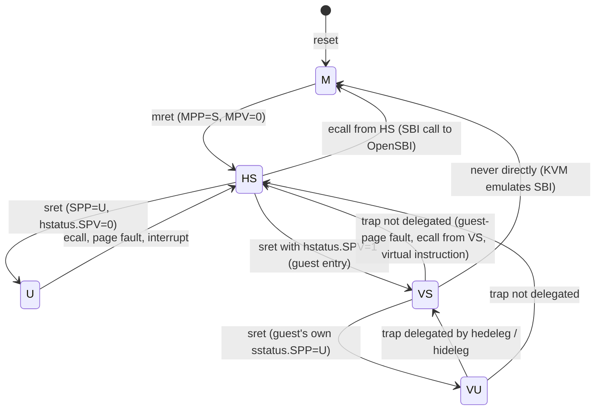
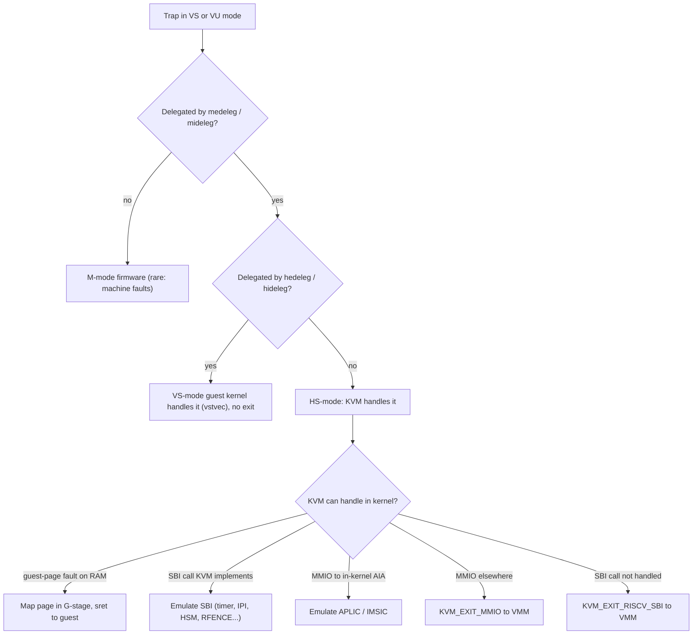
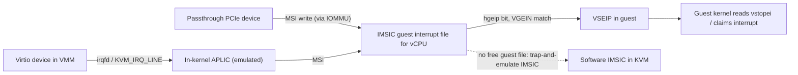

Purpose: explain how the RISC-V Hypervisor (H) extension virtualizes privilege modes, memory, traps, interrupts and timers, how KVM RISC-V exposes it, and how to build and test a RISC-V target for your Rust VMM without owning hardware.

# RISC-V Virtualization and the Hypervisor Extension

Related notes: [02 x86-64 Architecture for Hypervisor Authors](/compendium/virtualization/x86-64-architecture-for-hypervisor-authors), [03 Intel VT-x and AMD-V Hardware Virtualization](/compendium/virtualization/intel-vt-x-and-amd-v-hardware-virtualization), [04 KVM API and the vCPU Run Loop](/compendium/virtualization/kvm-api-and-the-vcpu-run-loop), [05 Memory Virtualization EPT NPT and Guest Memory](/compendium/virtualization/memory-virtualization-ept-npt-and-guest-memory), [06 Interrupts Timers and Interrupt Controller Virtualization](/compendium/virtualization/interrupts-timers-and-interrupt-controller-virtualization), [09 Booting Guests Firmware and the Linux Boot Protocol](/compendium/virtualization/booting-guests-firmware-and-the-linux-boot-protocol), [13 Security Isolation and Attack Surface](/compendium/virtualization/security-isolation-and-attack-surface), [15 ARM64 Virtualization EL2 VHE and GIC](/compendium/virtualization/arm64-virtualization-el2-vhe-and-gic), [17 Hypervisor Architectures Compared](/compendium/virtualization/hypervisor-architectures-compared), [18 Rust VMM Ecosystem and Project Templates](/compendium/virtualization/rust-vmm-ecosystem-and-project-templates).

## Why RISC-V virtualization is worth learning now

RISC-V is the only major ISA whose hypervisor support was designed after x86 and Arm had shipped theirs, and it shows: the H extension is small, orthogonal and classically virtualizable. It is also the least mature ecosystem: hardware with the H extension is only now becoming common (RVA23, ratified October 2024, makes H mandatory for application processors), and parts of the interrupt and confidential-computing stacks are still settling.

Why it matters for your VMM: supporting RISC-V forces a clean architecture abstraction. The register API, interrupt controller, firmware interface and boot protocol all differ from x86 and arm64; if your VMM supports all three, its core (memory, virtio, event loop) is genuinely portable.

## Privilege modes and the virtualization mode bit

Base RISC-V has three privilege levels: Machine (M), Supervisor (S), User (U). The H extension adds a virtualization mode bit V that is orthogonal to the privilege level.

| Mode | V | Privilege | Runs | Analogue |
|---|---|---|---|---|
| M | 0 | Machine | Firmware (OpenSBI), platform runtime | Arm EL3, x86 SMM-ish firmware |
| HS | 0 | Hypervisor-extended supervisor | Host kernel plus KVM (like Arm VHE: the host OS is the hypervisor) | Arm EL2 with VHE, x86 VMX root ring 0 |
| U (host) | 0 | User | Host userspace, your VMM | Host ring 3 / EL0 |
| VS | 1 | Virtual supervisor | Guest kernel | x86 VMX non-root ring 0, Arm EL1 |
| VU | 1 | Virtual user | Guest userspace | Guest ring 3, Arm EL0 |

Key design choices:

- **HS-mode is S-mode with extra CSRs.** An S-mode kernel runs unmodified in HS-mode; the hypervisor-specific state lives in new `h*` CSRs. This is like Arm VHE from day one: there is no nVHE split.
- **VS-mode sees "normal" S-mode CSR names.** When V=1, accesses to `sstatus`, `stvec`, `satp` and friends are transparently redirected to the `vs*` copies. The guest kernel needs no paravirtualization.
- **The architecture is classically virtualizable** in the Popek-Goldberg sense: every sensitive instruction traps when executed in VS/VU mode (or is redirected), so trap-and-emulate works without binary translation.



## The H extension CSRs

### HS-level hypervisor CSRs

| CSR | Purpose |
|---|---|
| `hstatus` | Hypervisor status: where the last trap came from, guest config (see field table) |
| `hedeleg` | Which synchronous exceptions from VS/VU are delegated to VS-mode (guest handles them directly) |
| `hideleg` | Which interrupts are delegated to VS-mode |
| `hie`, `hip` | Hypervisor-level interrupt enable / pending (VS interrupts, SGEI) |
| `hvip` | Hypervisor injects virtual interrupts into VS (VSSIP, VSTIP, VSEIP bits) |
| `hgatp` | G-stage (guest physical to host physical) translation root, mode and VMID |
| `htval` | Faulting guest physical address shifted right by 2 on guest-page faults |
| `htinst` | Transformed (decoded and normalized) trapping instruction, so the hypervisor need not read guest memory to decode it |
| `hcounteren` | Which counters VS-mode may read |
| `htimedelta` (`htimedeltah` on RV32) | Offset added to `time` when read in VS/VU mode |
| `hgeie`, `hgeip` | Guest external interrupt enable / pending, one bit per guest interrupt file (AIA) |
| `henvcfg` | Environment config for VS-mode (cache-block ops, Svpbmt, Sstc enable via `STCE`, etc.) |
| `hvictl`, `hvien`, `hviprio1/2` | AIA virtual interrupt control and priorities (with Ssaia) |

### VS-level CSRs (the guest's supervisor state)

| CSR | Substitutes for when V=1 |
|---|---|
| `vsstatus` | `sstatus` |
| `vsie`, `vsip` | `sie`, `sip` |
| `vstvec` | `stvec` |
| `vsscratch` | `sscratch` |
| `vsepc` | `sepc` |
| `vscause` | `scause` |
| `vstval` | `stval` |
| `vsatp` | `satp` (VS-stage page table root) |
| `vstimecmp` (Sstc) | `stimecmp` |
| `vsiselect`, `vsireg`, `vstopei`, `vstopi` (AIA) | `siselect`, `sireg`, `stopei`, `stopi` |

On a world switch KVM saves and restores the `vs*` CSRs; while the guest runs, its kernel's `csrr sstatus` actually reads `vsstatus`.

### hstatus fields (RV64)

| Field | Bits | Meaning |
|---|---|---|
| VSBE | 5 | VS-mode big-endian data accesses |
| GVA | 6 | `stval` holds a guest virtual address on this trap |
| SPV | 7 | Previous virtualization mode: 1 if the trap came from VS/VU. `sret` with SPV=1 enters the guest |
| SPVP | 8 | Privilege of the guest at trap time (VS or VU), used by HLV/HSV |
| HU | 9 | Allow HLV/HSV hypervisor load/store instructions from U-mode |
| VGEIN | 17:12 | Selects which guest external interrupt file (IMSIC) is wired to VSEIP |
| VTVM | 20 | Trap VS-mode `satp` accesses and `SFENCE.VMA` |
| VTW | 21 | Trap VS-mode `WFI` after a timeout (KVM uses it to deschedule idle vCPUs) |
| VTSR | 22 | Trap VS-mode `SRET` |
| VSXL | 33:32 | VS-mode XLEN (RV64 or RV32 guest) |

M-mode also gains fields relevant to hypervisors: `mstatus.MPV` and `mstatus.GVA`, plus `mtval2` and `mtinst` mirroring `htval` and `htinst` when traps go to M-mode.

### New exception and interrupt codes

| Code | Type | Meaning |
|---|---|---|
| 10 | Exception | Environment call from VS-mode (guest SBI call) |
| 20 | Exception | Instruction guest-page fault |
| 21 | Exception | Load guest-page fault |
| 22 | Exception | Virtual instruction (a privileged instruction that is legal in HS but not allowed in VS/VU given current config) |
| 23 | Exception | Store/AMO guest-page fault |
| 2 | Interrupt | Virtual supervisor software interrupt (VSSI) |
| 6 | Interrupt | Virtual supervisor timer interrupt (VSTI) |
| 10 | Interrupt | Virtual supervisor external interrupt (VSEI) |
| 12 | Interrupt | Supervisor guest external interrupt (SGEI, AIA guest file signalled) |

The "virtual instruction" exception is a RISC-V specialty: it distinguishes "illegal in any mode" (illegal instruction, delegated to guest) from "legal, but the hypervisor must emulate it in this configuration" (virtual instruction, goes to HS).

### Hypervisor instructions

| Instruction | Use |
|---|---|
| `HFENCE.VVMA` | Flush VS-stage TLB entries (guest virtual), optionally by ASID |
| `HFENCE.GVMA` | Flush G-stage entries, optionally by VMID and guest physical address |
| `HLV.*`, `HLVX.*`, `HSV.*` | Load/store from HS (or U with `hstatus.HU`) using the guest's two-stage translation, as if executed by the guest. Used to read the trapping instruction or guest memory by guest virtual address |

## Trap delegation: who handles what

RISC-V uses explicit delegation registers at each level. Traps go to M by default; M delegates to HS (`medeleg`, `mideleg`); HS delegates to VS (`hedeleg`, `hideleg`).



What KVM typically delegates to the guest (so they never cause exits): instruction/load/store misaligned, breakpoints, ecall from VU (guest syscalls), and ordinary (VS-stage) page faults. What it keeps: ecall from VS (SBI), guest-page faults (G-stage), virtual instruction exceptions, and interrupts not targeted at the guest.

Compare with x86, where exception bitmap and VM-exit controls in the VMCS serve the same purpose, and Arm, where `HCR_EL2` trap bits do.

## G-stage translation

RISC-V calls the second stage of address translation the G-stage (guest physical to supervisor physical). The guest's own page tables (`vsatp`) are the VS-stage.

| Property | Detail |
|---|---|
| Root register | `hgatp` with fields MODE, VMID, PPN |
| Modes (RV64) | Bare (0), Sv39x4 (8), Sv48x4 (9), Sv57x4 (10) |
| Mode (RV32) | Sv32x4 |
| "x4" meaning | Guest physical address is 2 bits wider than the corresponding Sv mode (Sv39x4 covers a 41-bit GPA). The root table is 16 KiB (four contiguous pages) and must be 16 KiB aligned |
| Leaf PTE requirements | G-stage PTEs must have the U bit set (all guest accesses are treated as user accesses at G-stage) |
| Tag | VMID (up to 14 bits on RV64; implementations may support fewer, discoverable by writing all ones) |
| Fault reporting | Guest-page fault codes 20, 21, 23; `htval` = GPA &gt;&gt; 2; `stval` = guest virtual address when `hstatus.GVA` = 1; `htinst` = transformed instruction or a pseudo-instruction for implicit VS-stage page table accesses |
| TLB maintenance | `HFENCE.GVMA` by VMID and/or GPA |

KVM exposes the G-stage mode to userspace through the `satp_mode` config register for the guest's VS-stage and sizes the G-stage from host capabilities; your VMM's guest memory map must fit the guest physical width KVM supports on the host.

### MMIO decoding

On a load or store guest-page fault to an address without a memslot, KVM needs to know the access width and register. It uses `htinst` when the hardware provides a transformed instruction; otherwise it reads the faulting instruction from guest memory with `HLVX`. Either way, the result reaching your VMM is a normal `KVM_EXIT_MMIO` with address, length and data, same as on x86 and arm64. There is no RISC-V equivalent of Arm's ISV restriction for ordinary loads and stores, though compressed and misaligned accesses add corner cases KVM handles.

## SBI: the hypervisor-guest interface

The Supervisor Binary Interface (SBI) is how S-mode software calls into the next more-privileged layer. On bare metal, the host kernel calls OpenSBI in M-mode. In a VM, the guest kernel calls SBI with `ecall` from VS-mode, which traps to HS-mode, and KVM plays the role of the SBI implementation.

Calling convention: extension ID (EID) in `a7`, function ID (FID) in `a6`, arguments in `a0` to `a5`; returns an error code in `a0` and a value in `a1`.

| Extension | EID | Purpose | Handled by |
|---|---|---|---|
| Base | 0x10 | Probe extensions, spec and implementation version, `mvendorid`/`marchid`/`mimpid` | KVM (values configurable via config regs) |
| Legacy v0.1 | 0x00 to 0x0F | Old console putchar/getchar, timer, IPI | KVM; console calls forwarded to userspace |
| TIME | 0x54494D45 | `sbi_set_timer` | KVM (or unused by guest when Sstc present) |
| IPI (sPI) | 0x735049 | Send IPI to hart mask | KVM |
| RFENCE | 0x52464E43 | Remote fence.i, sfence.vma, hfence | KVM |
| HSM | 0x48534D | Hart start, stop, suspend, status: SMP bring-up | KVM |
| SRST | 0x53525354 | System reset / shutdown | KVM converts to `KVM_EXIT_SYSTEM_EVENT` |
| PMU | 0x504D55 | Performance counters | KVM, backed by host perf |
| DBCN | 0x4442434E | Debug console read/write buffers | Forwarded to userspace (`KVM_EXIT_RISCV_SBI`) when enabled |
| SUSP | 0x53555350 | System suspend | KVM / userspace |
| STA | 0x535441 | Steal-time accounting shared memory | KVM |
| FWFT | 0x46574654 | Firmware features (misaligned delegation, pointer masking, landing pads, shadow stack) | KVM |
| SSE, MPXY, DBTR | (SBI v3.0) | Software events, message proxy, debug triggers | Partially; check `KVM_RISCV_SBI_EXT_*` for your kernel |
| Experimental / vendor ranges | 0x08000000 and up / 0x09000000 and up | Custom | Forwarded to userspace |

SBI v2.0 was ratified in early 2024 and SBI v3.0 on 2025-07-16 (adding SSE, MPXY, DBTR, FWFT). KVM exposes the set of SBI extensions as one-reg registers (`KVM_REG_RISCV_SBI_EXT`), so your VMM can disable extensions it does not want the guest to see, and must save that configuration for migration.

### Handling an unhandled SBI call in the VMM

kvm-ioctls 0.25 has no dedicated `VcpuExit` variant for RISC-V SBI; it reports `VcpuExit::Unsupported(KVM_EXIT_RISCV_SBI)` and you read the `riscv_sbi` member of `kvm_run` yourself.

```rust
use kvm_bindings::KVM_EXIT_RISCV_SBI;
use kvm_ioctls::{VcpuExit, VcpuFd};

const SBI_EXT_DBCN: u64 = 0x4442_434E;
const SBI_EXT_0_1_CONSOLE_PUTCHAR: u64 = 0x01;
const SBI_SUCCESS: u64 = 0;
const SBI_ERR_NOT_SUPPORTED: u64 = (-2i64) as u64;

pub fn run_once(vcpu: &mut VcpuFd, console: &mut impl std::io::Write) {
    let reason = match vcpu.run() {
        Ok(VcpuExit::Unsupported(r)) => r,
        Ok(_other) => return, // MMIO, SystemEvent and others handled elsewhere
        Err(e) => panic!("KVM_RUN: {e}"),
    };
    if reason != KVM_EXIT_RISCV_SBI {
        panic!("unexpected exit {reason}");
    }
    let run = vcpu.get_kvm_run();
    // SAFETY: exit_reason is KVM_EXIT_RISCV_SBI, so riscv_sbi is the active union member.
    let sbi = unsafe { &mut run.__bindgen_anon_1.riscv_sbi };
    match sbi.extension_id {
        SBI_EXT_0_1_CONSOLE_PUTCHAR => {
            let _ = console.write_all(&[sbi.args[0] as u8]);
            sbi.ret[0] = SBI_SUCCESS;
        }
        SBI_EXT_DBCN => {
            // Function 0 is console_write(num_bytes, base_lo, base_hi): read from guest memory,
            // validating the range exactly as for any guest-supplied buffer.
            sbi.ret[0] = SBI_ERR_NOT_SUPPORTED;
            sbi.ret[1] = 0;
        }
        _ => {
            sbi.ret[0] = SBI_ERR_NOT_SUPPORTED;
            sbi.ret[1] = 0;
        }
    }
}
```

Treat every SBI argument as hostile input (see [13 Security Isolation and Attack Surface](/compendium/virtualization/security-isolation-and-attack-surface)): DBCN passes guest physical buffer addresses and lengths.

## KVM RISC-V from the VMM's point of view

KVM RISC-V was merged in Linux 5.16 (late 2021). It follows the arm64 style: no `KVM_GET_REGS`/`KVM_SET_SREGS` structs (they are empty on RISC-V), everything goes through one-reg.

### Register ID encoding

From the KVM API documentation and `arch/riscv/include/uapi/asm/kvm.h`: IDs are `0x8030 0000 TT SS IIII` on 64-bit hosts (`0x8020...` on 32-bit), where `TT` is the group type in bits 31:24, `SS` an optional subtype in bits 23:16, and the low bits an index (usually `offsetof(struct, field) / sizeof(unsigned long)`).

| Type | Group | Contents |
|---|---|---|
| 0x01 | `KVM_REG_RISCV_CONFIG` | `isa` (legacy bitmap), `zicbom_block_size`, `mvendorid`, `marchid`, `mimpid`, `zicboz_block_size`, `satp_mode`, `zicbop_block_size` |
| 0x02 | `KVM_REG_RISCV_CORE` | `struct user_regs_struct` (pc, ra, sp, gp, tp, t0 to t2, s0, s1, a0 to a7, s2 to s11, t3 to t6) plus `mode` (S or U) |
| 0x03 | `KVM_REG_RISCV_CSR` | Subtypes: general (`sstatus`, `sie`, `stvec`, `sscratch`, `sepc`, `scause`, `stval`, `sip`, `satp`, `scounteren`, `senvcfg`), AIA, Smstateen, Zicfiss |
| 0x04 | `KVM_REG_RISCV_TIMER` | `frequency` (read-only), `time`, `compare`, `state` (on/off) |
| 0x05, 0x06 | `KVM_REG_RISCV_FP_F`, `_FP_D` | F and D register files plus `fcsr` |
| 0x07 | `KVM_REG_RISCV_ISA_EXT` | One register per ISA extension (`KVM_RISCV_ISA_EXT_*`): 1 enabled, 0 disabled; plus multi-register bitmaps |
| 0x08 | `KVM_REG_RISCV_SBI_EXT` | One register per SBI extension (`KVM_RISCV_SBI_EXT_*`) |
| 0x09 | `KVM_REG_RISCV_VECTOR` | V registers |
| 0x0a | `KVM_REG_RISCV_SBI_STATE` | SBI extension state (STA shared memory, FWFT features) |

Examples from the kvm-ioctls test suite: core base `0x8030_0000_0200_0000` is `pc`, `a0` is `0x8030_0000_0200_000a`.

ISA extensions use KVM's own stable numbering (not the host's internal one): `A`=0, `C`=1, `D`=2, `F`=3, `H`=4, `I`=5, `M`=6, `SVPBMT`=7, `SSTC`=8, `SVINVAL`=9, `ZIHINTPAUSE`=10, `ZICBOM`=11, `ZICBOZ`=12, `ZBB`=13, `SSAIA`=14, `V`=15, and onward (the enum keeps growing; read it from the header for your kernel). Changing ISA or SBI extension registers is only allowed before the vCPU first runs (`EBUSY` afterwards).

### Rust: configuring and booting a RISC-V vCPU

Checked against kvm-ioctls 0.25.x (`set_one_reg(u64, &[u8])`, `get_one_reg(u64, &mut [u8])`, `get_reg_list(&mut RegList)` available on `riscv64`).

```rust
use kvm_ioctls::VcpuFd;

const KVM_REG_RISCV: u64 = 0x8000_0000_0000_0000;
const KVM_REG_SIZE_U64: u64 = 0x0030_0000_0000_0000;
const TYPE_SHIFT: u64 = 24;

const fn reg(ty: u64, idx: u64) -> u64 {
    KVM_REG_RISCV | KVM_REG_SIZE_U64 | (ty << TYPE_SHIFT) | idx
}
const CONFIG: u64 = 0x01;
const CORE: u64 = 0x02;
const ISA_EXT: u64 = 0x07;

// Indices into struct user_regs_struct.
const PC: u64 = reg(CORE, 0);
const A0: u64 = reg(CORE, 10);
const A1: u64 = reg(CORE, 11);
// Index into struct kvm_riscv_config.
const SATP_MODE: u64 = reg(CONFIG, 6);
// KVM_RISCV_ISA_EXT_* numbering from the uapi header.
const ISA_EXT_V: u64 = reg(ISA_EXT, 15);

fn set(vcpu: &VcpuFd, id: u64, val: u64) {
    vcpu.set_one_reg(id, &val.to_le_bytes()).expect("set_one_reg");
}

fn get(vcpu: &VcpuFd, id: u64) -> u64 {
    let mut b = [0u8; 8];
    vcpu.get_one_reg(id, &mut b).expect("get_one_reg");
    u64::from_le_bytes(b)
}

/// Linux RISC-V boot protocol: a0 = hart ID, a1 = DTB physical address, MMU off, S-mode.
pub fn setup_boot_hart(vcpu: &VcpuFd, hart_id: u64, kernel_entry: u64, dtb: u64) {
    // Hide V from the guest (example of shaping the CPU model); must happen before first run.
    let _ = vcpu.set_one_reg(ISA_EXT_V, &0u64.to_le_bytes());
    set(vcpu, PC, kernel_entry);
    set(vcpu, A0, hart_id);
    set(vcpu, A1, dtb);
    let satp_mode = get(vcpu, SATP_MODE); // put the matching "mmu-type" in the DT
    let _ = satp_mode;
}
```

SMP: KVM keeps every vCPU except the one with index 0 powered off after creation; the guest starts secondaries with SBI HSM `hart_start`, which KVM implements. You only set registers on the boot hart.

### The device tree must match KVM's view of the CPU

RISC-V guests discover ISA extensions from the device tree (`riscv,isa-base` and `riscv,isa-extensions`, or the older `riscv,isa` string) and the MMU type from `mmu-type` (`riscv,sv39`, `riscv,sv48`, `riscv,sv57`). Build those properties from the one-reg values you read back (ISA_EXT registers, `satp_mode`), not from the host's `/proc/cpuinfo`. If they disagree, the guest may execute an instruction KVM hid, which traps as illegal instruction inside the guest.

Minimum DT for a Linux guest on RISC-V:

| Node | Key properties |
|---|---|
| `/cpus` | `timebase-frequency` (read `KVM_REG_RISCV_TIMER` `frequency`) |
| `/cpus/cpu@N` | `device_type = "cpu"`, `compatible = "riscv"`, `reg = &lt;hart id&gt;`, `riscv,isa-base`, `riscv,isa-extensions`, `mmu-type`, child `interrupt-controller` with `compatible = "riscv,cpu-intc"`, `#interrupt-cells = 1` |
| `/memory@...` | RAM base and size |
| Interrupt controller | PLIC (`sifive,plic-1.0.0`) or AIA: APLIC (`riscv,aplic`) and IMSIC (`riscv,imsics`) |
| `/chosen` | `bootargs`, `stdout-path`, initrd range |
| UART, virtio-mmio | As on arm64, interrupt specifiers per the chosen interrupt controller |
| `/soc` or root | `#address-cells = 2`, `#size-cells = 2` |

The kernel `Image` for RISC-V has a 64-byte header like arm64; load it 2 MiB aligned on RV64. See [09 Booting Guests Firmware and the Linux Boot Protocol](/compendium/virtualization/booting-guests-firmware-and-the-linux-boot-protocol).

## Interrupts: PLIC, AIA, IMSIC and APLIC

RISC-V has two interrupt architectures, and which one you use defines your VMM's interrupt plumbing.

| Component | Role | Virtualization story |
|---|---|---|
| CLINT / ACLINT | Per-hart timer and software interrupts (M-level) | Replaced in VMs by SBI TIME/IPI or Sstc and AIA |
| PLIC | Legacy wired interrupt controller | Not virtualized in hardware; emulate in VMM, inject with `KVM_INTERRUPT` |
| AIA IMSIC | Per-hart MSI controller with interrupt files: one M-level, one S-level, and N guest (VS-level) files | Guest files map directly to vCPUs: devices write MSIs straight to a guest file; `hstatus.VGEIN` selects which file drives VSEIP |
| AIA APLIC | Wired interrupt controller that can forward wired interrupts as MSIs to IMSICs (MSI mode) or deliver directly (direct mode) | KVM emulates the APLIC in kernel, converting wired lines to MSIs into guest IMSIC files |



### KVM AIA device

KVM implements AIA as a device: `KVM_CREATE_DEVICE` with `KVM_DEV_TYPE_RISCV_AIA`, configured with `KVM_SET_DEVICE_ATTR`:

| Group | Attribute | Meaning |
|---|---|---|
| `KVM_DEV_RISCV_AIA_GRP_CONFIG` (0) | `MODE` | `EMUL` (0: trap-and-emulate IMSIC), `HWACCEL` (1: use hardware guest files), `AUTO` (2: hardware when available, otherwise emulate) |
| | `IDS` | Number of MSI identities, bounded by `KVM_DEV_RISCV_AIA_IDS_MIN` (63) and `_IDS_MAX` (2048) |
| | `SRCS` | Number of wired sources on the APLIC (up to 1024) |
| | `GROUP_BITS`, `GROUP_SHIFT`, `HART_BITS`, `GUEST_BITS` | IMSIC address layout |
| `KVM_DEV_RISCV_AIA_GRP_ADDR` (1) | `ADDR_APLIC` (0), `ADDR_IMSIC(vcpu)` (1 + vcpu) | Guest physical base of APLIC (16 KiB, 4 KiB aligned) and each vCPU's IMSIC page (4 KiB) |
| `KVM_DEV_RISCV_AIA_GRP_CTRL` (2) | `CTRL_INIT` | Finalize after all vCPUs exist |
| `KVM_DEV_RISCV_AIA_GRP_APLIC` (3) | APLIC register offset | Save/restore APLIC state |
| `KVM_DEV_RISCV_AIA_GRP_IMSIC` (4) | `(vcpu &lt;&lt; 12) | iselect` | Save/restore IMSIC state |

With the AIA device in place, wired device interrupts are injected with `KVM_IRQ_LINE` or irqfd (routed to APLIC sources) and MSIs with `KVM_SIGNAL_MSI` or MSI routes, the same shapes you use on x86 and arm64. Without AIA (older hosts, or `aia=none` in QEMU), you emulate a PLIC in userspace and raise or lower the guest's external interrupt with `KVM_INTERRUPT` (`KVM_INTERRUPT_SET` / `KVM_INTERRUPT_UNSET`), which costs an exit per claim/complete.

Hardware guest files are a finite resource: each hart's IMSIC has a fixed number of VS-level files (QEMU's `aia-guests=N`). When vCPUs outnumber them on a host CPU, KVM falls back to software emulation (`AUTO` mode) or fails to run (`HWACCEL`), which you see as a `KVM_EXIT_FAIL_ENTRY` with the `KVM_EXIT_FAIL_ENTRY_NO_VSFILE` reason.

## Timers: SBI TIME vs Sstc

| Approach | Guest action | Cost |
|---|---|---|
| SBI TIME | Guest calls `sbi_set_timer(deadline)` with `ecall` | Exit to KVM for every timer program; KVM arms an hrtimer and injects VSTIP via `hvip` |
| Sstc (ratified 2021, mandatory in RVA23) | Guest writes `stimecmp`, which maps to `vstimecmp` in VS-mode | No exit; hardware raises VSTIP when `time + htimedelta &gt;= vstimecmp` |

`htimedelta` provides the per-VM time offset, so guest time can start at zero and survive migration. For snapshots, save and restore the `KVM_REG_RISCV_TIMER` registers (`time`, `compare`, `state`); `frequency` is read-only and comes from the host timebase, so migration between hosts with different timebase frequencies is not transparent (the same issue as arm64's `CNTFRQ_EL0`).

Hide or expose Sstc deliberately via `KVM_RISCV_ISA_EXT_SSTC`. Guests detect Sstc from the device tree ISA extensions and stop using SBI TIME, so the DT must reflect the one-reg configuration.

## Testing without hardware: QEMU with the H extension

You can develop the whole RISC-V path on an x86 or arm64 laptop with nested emulation: QEMU TCG emulates a RISC-V machine with the H extension; inside it a Linux host loads KVM; inside that your VMM runs a guest. It is slow (tens to hundreds of times slower than native) but fully functional and deterministic enough for CI.

QEMU's `virt` machine enables the hypervisor extension on its default CPU and supports AIA with `aia=aplic-imsic` and `aia-guests=N` (number of VS-level IMSIC files per hart).

```bash
# Outer: emulated RISC-V host with H extension and AIA guest files.
qemu-system-riscv64 \
  -machine virt,aia=aplic-imsic,aia-guests=4 \
  -cpu rv64,h=true,sstc=true \
  -smp 4 -m 8G -nographic \
  -bios default \
  -kernel host-Image \
  -append "root=/dev/vda rw console=ttyS0" \
  -drive file=host-rootfs.img,format=raw,if=none,id=hd0 \
  -device virtio-blk-device,drive=hd0 \
  -netdev user,id=n0,hostfwd=tcp::2222-:22 -device virtio-net-device,netdev=n0
```

Inside the emulated host:

```bash
ls -l /dev/kvm                       # KVM RISC-V available?
dmesg | grep -i kvm                  # look for "hypervisor extension available" and AIA mode
grep -m1 isa /proc/cpuinfo           # confirm 'h' and extensions such as sstc, ssaia
./my-vmm --kernel guest-Image --cmdline "console=ttyS0 earlycon=sbi" --mem 512M
```

Workflow tips:

| Tip | Why |
|---|---|
| Cross-compile the VMM with target `riscv64gc-unknown-linux-gnu` (or musl) and copy it in | Native compile under TCG is very slow |
| Use `earlycon=sbi` in the guest command line | Guest prints via SBI legacy console or DBCN, which you handle before your UART works |
| Run KVM selftests (`tools/testing/selftests/kvm`) in the emulated host first | Separates host KVM problems from VMM bugs |
| Use kvmtool or QEMU-with-KVM inside as a reference VMM | Compare DT and register setup when your guest hangs |
| Attach gdb to the outer QEMU (`-s -S`) to inspect the host kernel, and to your VMM with gdbserver | Two-level debugging |
| Test both `aia=none` (PLIC path) and `aia=aplic-imsic` | Real hardware will vary |
| Spike (the ISA reference simulator) for instruction-level questions about H-extension semantics | Golden model, not a system for running KVM workloads comfortably |

## Ecosystem maturity (late 2026)

| Layer | Status |
|---|---|
| H extension specification | Ratified (Privileged spec 1.12, 2021) |
| RVA23 profile | Ratified 2024; H (via the Sha bundle) and Sstc mandatory for RVA23S64; AIA not mandated by the profile itself |
| AIA specification | Ratified 2023 |
| SBI | v2.0 (2024) and v3.0 (2025-07-16) ratified |
| RISC-V IOMMU specification | Ratified 2023; QEMU `iommu-sys` device and Linux driver exist; little hardware yet |
| KVM RISC-V | Upstream since Linux 5.16; one-reg ISA and SBI extension control, AIA device, Sstc, SBI PMU, steal time |
| QEMU | TCG emulation of H, AIA, IOMMU; KVM accelerator for RISC-V hosts |
| kvmtool | Supports RISC-V KVM guests |
| rust-vmm `kvm-ioctls` / `kvm-bindings` | `riscv64` supported (one-reg, reg list, device attrs); no RISC-V-specific `VcpuExit` variants for SBI |
| `seccompiler` | `riscv64` target supported |
| Cloud Hypervisor | Experimental riscv64 support (verify current release notes) |
| Firecracker | No RISC-V support |
| Hardware with H | Emerging: early boards advertise H; RVA23-class SoCs (for example SpacemiT K3, with Linux enablement posted in late 2025) are the first broad wave. Check the device tree ISA string and AIA presence before buying |
| Confidential computing (CoVE, Supervisor Domains, Smmtt) | Specifications in progress plus research implementations; no stable KVM UAPI |

Expect bugs and missing features in the host stack. Pin known-good host kernel and QEMU versions in your CI and record them in your repo.

## Comparison with x86-64 and arm64

| Concern | x86-64 | arm64 | RISC-V |
|---|---|---|---|
| Hypervisor privilege | VMX root / SVM host mode, orthogonal to rings | EL2 (VHE runs host kernel there) | HS-mode (S-mode plus H CSRs), V bit selects guest |
| Guest state container | VMCS / VMCB in memory | System registers switched by KVM | `vs*` CSRs switched by KVM |
| Second stage | EPT / NPT | Stage-2, `VTTBR_EL2` | G-stage, `hgatp` (Sv39x4 and friends) |
| Trap configuration | VMCS controls, exception bitmap | `HCR_EL2` and friends | `hedeleg`, `hideleg`, `hstatus` bits |
| MMIO decode help | Instruction emulator in KVM | ESR ISS (ISV) | `htinst` or `HLVX` read |
| Firmware ABI | ACPI, CPUID, MSRs, hypercalls | PSCI / SMCCC via HVC | SBI via ecall |
| KVM register API | Struct ioctls (`REGS`, `SREGS`, `MSRS`) | One-reg only | One-reg only |
| CPU model shaping | `KVM_SET_CPUID2` | Feature bits plus writable ID regs | ISA_EXT and SBI_EXT one-reg, config regs |
| Interrupt controller | LAPIC/IOAPIC in kernel, posted interrupts | vGICv3/v4 device | AIA device (APLIC plus IMSIC guest files) or userspace PLIC |
| Timer | LAPIC, TSC deadline, kvmclock | Generic timer, `CNTVOFF_EL2` | SBI TIME or Sstc, `htimedelta` |
| SMP bring-up | INIT/SIPI | PSCI `CPU_ON` | SBI HSM `hart_start` |
| Hardware availability | Universal | Universal | Emerging |

## Common pitfalls

| Pitfall | Symptom | Fix |
|---|---|---|
| Device tree ISA string built from host `/proc/cpuinfo` | Guest uses an extension KVM disabled: illegal instruction in guest | Build DT from ISA_EXT one-reg values |
| Setting ISA_EXT or SBI_EXT registers after first `KVM_RUN` | `EBUSY` | Configure everything before running any vCPU |
| Missing `timebase-frequency` or wrong value | Guest clock runs at wrong speed, RCU stalls | Read `KVM_REG_RISCV_TIMER` frequency |
| Starting secondaries yourself | Double-started harts, crashes | Leave them powered off; guest uses SBI HSM |
| Ignoring `KVM_EXIT_RISCV_SBI` | Guest hangs on early console or custom SBI call | Handle or return `SBI_ERR_NOT_SUPPORTED` |
| Using `aia=aplic-imsic` with too few guest files in QEMU | `KVM_EXIT_FAIL_ENTRY` with no VS file | Increase `aia-guests` or use `AUTO` mode |
| Assuming PLIC exists on AIA platforms | No external interrupts | Detect and support both PLIC and AIA paths |
| G-stage size assumptions from x86 | Memslots above the supported GPA fail | Keep guest memory map under the host's G-stage limit |
| Testing only under TCG | Timing-dependent bugs hidden by slowness | Add real hardware to CI when available; use fault injection |
| Forgetting SBI extension state in snapshots | Restored guest loses steal-time area or FWFT settings | Save all IDs from `KVM_GET_REG_LIST`, including SBI state |
| Assuming `mode` register is optional | Guest restarted in U-mode after restore | Save and restore `KVM_REG_RISCV_CORE` `mode` |

## Review checklist

- [ ] VMM queries `KVM_GET_REG_LIST` and saves every register for snapshots.
- [ ] ISA and SBI extension registers set deliberately before first run; DT generated from the read-back values.
- [ ] Boot hart has `pc`, `a0` = hart ID, `a1` = DTB address; secondaries left to SBI HSM.
- [ ] `timebase-frequency` and `mmu-type` match KVM's timer frequency and `satp_mode`.
- [ ] Both interrupt paths considered: AIA device (APLIC plus IMSIC) and userspace PLIC with `KVM_INTERRUPT`.
- [ ] AIA mode chosen consciously (`AUTO` for portability); IMSIC and APLIC addresses do not overlap other MMIO.
- [ ] `KVM_EXIT_RISCV_SBI` handled with validated arguments; unknown extensions return `SBI_ERR_NOT_SUPPORTED`.
- [ ] Timer registers saved and restored; Sstc exposure consistent with DT.
- [ ] CI runs the RISC-V path under QEMU TCG with H and AIA, using pinned QEMU and host kernel versions.
- [ ] seccomp filters built for the `riscv64` syscall table (generic table, no legacy `open`).

## Primary Sources

- [RISC-V Privileged Architecture specification (H extension chapter)](https://github.com/riscv/riscv-isa-manual)
- [RISC-V Advanced Interrupt Architecture specification](https://github.com/riscv/riscv-aia)
- [RISC-V SBI specification v3.0](https://docs.riscv.org/reference/sbi/v3.0/index.html)
- [RVA23 profiles v1.0](https://docs.riscv.org/reference/rva23/v1.0/rva23-profiles.html)
- [Linux KVM API documentation (one-reg RISC-V encodings, KVM_EXIT_RISCV_SBI)](https://docs.kernel.org/virt/kvm/api.html)
- [RISC-V KVM uapi header](https://github.com/torvalds/linux/blob/master/arch/riscv/include/uapi/asm/kvm.h)
- [Linux RISC-V boot requirements](https://docs.kernel.org/arch/riscv/boot.html)
- [QEMU RISC-V virt machine documentation](https://www.qemu.org/docs/master/system/riscv/virt.html)
- [rust-vmm kvm-ioctls source (RISC-V tests and one-reg)](https://github.com/rust-vmm/kvm)
- [seccompiler crate documentation](https://docs.rs/seccompiler/latest/seccompiler/)
- [OpenSBI](https://github.com/riscv-software-src/opensbi)
- [kvmtool](https://git.kernel.org/pub/scm/linux/kernel/git/will/kvmtool.git)
- [Linux SpacemiT K3 device tree submission (RVA23 discussion)](https://lists.infradead.org/pipermail/linux-riscv/2025-December/082329.html)
- [LPC 2024: RISC-V Supervisor Domains and CoVE update](https://lpc.events/event/18/contributions/1865/attachments/1649/3405/09-LPC2024_RVI_SD_CoVE_update.pdf)
