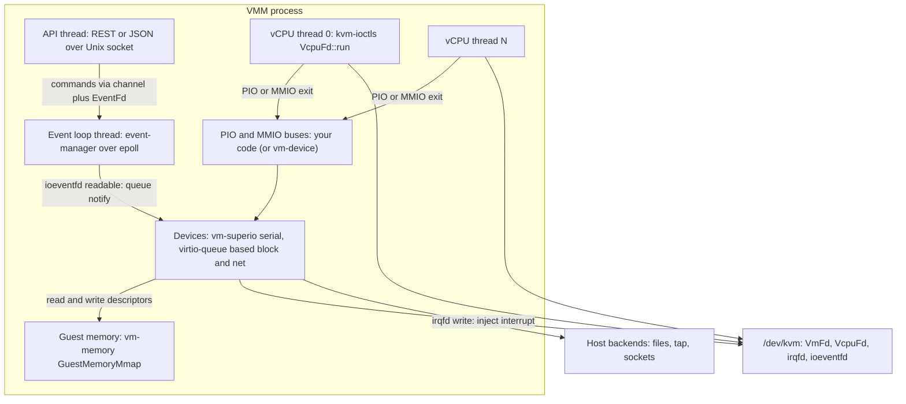
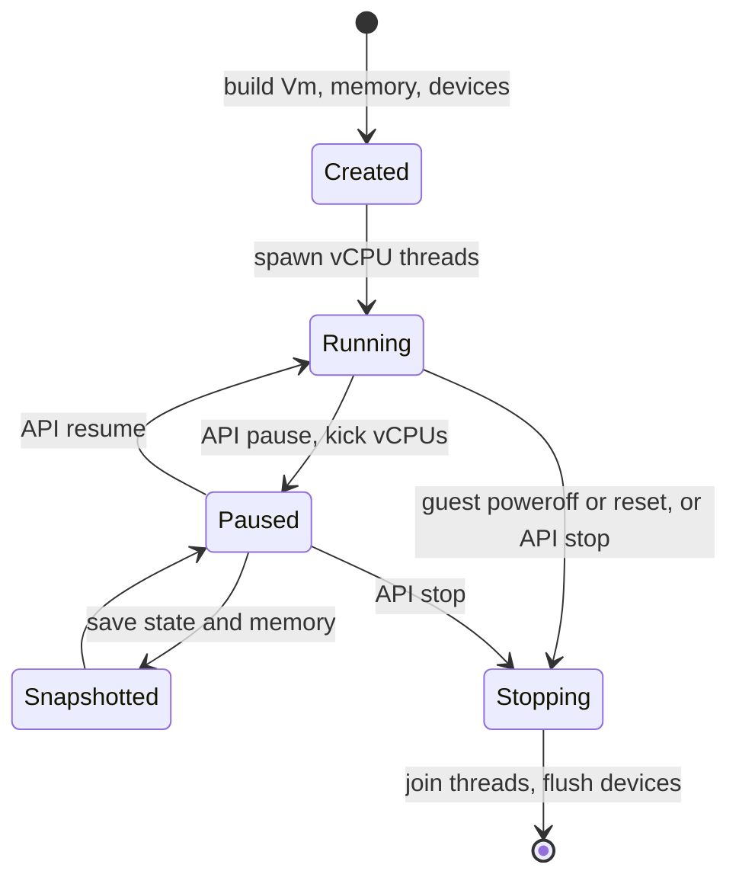

Purpose: Map the rust-vmm crates to the responsibilities of a VMM, show how Firecracker and Cloud Hypervisor compose them, and give a workspace layout, event-loop design, testing strategy and starter skeleton for building your own Rust VMM on KVM across x86-64, ARM64 and RISC-V.

# Rust VMM Ecosystem and Project Templates

Related notes: [00 Virtualization Mastery Roadmap](/compendium/virtualization/virtualization-mastery-roadmap), [04 KVM API and the vCPU Run Loop](/compendium/virtualization/kvm-api-and-the-vcpu-run-loop), [05 Memory Virtualization EPT NPT and Guest Memory](/compendium/virtualization/memory-virtualization-ept-npt-and-guest-memory), [07 Device Emulation PIO MMIO and the Bus Model](/compendium/virtualization/device-emulation-pio-mmio-and-the-bus-model), [08 Virtio Devices Virtqueues and vhost](/compendium/virtualization/virtio-devices-virtqueues-and-vhost), [09 Booting Guests Firmware and the Linux Boot Protocol](/compendium/virtualization/booting-guests-firmware-and-the-linux-boot-protocol), [13 Security Isolation and Attack Surface](/compendium/virtualization/security-isolation-and-attack-surface), [17 Hypervisor Architectures Compared](/compendium/virtualization/hypervisor-architectures-compared), [09 Unsafe Rust and the Rust Memory Model](/compendium/rust/unsafe-rust-and-the-rust-memory-model), [07 Concurrency Parallelism and Synchronization](/compendium/rust/concurrency-parallelism-and-synchronization), [13 Systems Programming Networking and IO](/compendium/rust/systems-programming-networking-and-io).

rust-vmm is a community of crates extracted from Firecracker and crosvm (and later Cloud Hypervisor and others) so that VMMs stop rewriting the same KVM wrappers, guest-memory abstractions, loaders and virtio queues. It is not a VMM. It is a box of parts with an opinionated shape. Your VMM is the glue: platform definition, device wiring, threading, lifecycle and policy.

Versions checked for this note (crates.io and docs.rs, 2026-11-02): kvm-ioctls 0.25.1, kvm-bindings 0.14.2, vm-memory 0.18.0, linux-loader 0.14.0, vm-superio 0.8.2, virtio-queue 0.18.0, vmm-sys-util 0.15.0, event-manager 0.4.2, vm-allocator 0.1.4, vhost 0.18.0, vm-fdt 0.3.0, seccompiler 0.5.0, virtio-bindings 0.2.7, vm-device 0.1.0. Pre-1.0 crates break APIs between minor versions (vm-memory recently split a `GuestMemoryBackend` trait out of `GuestMemory`), so pin exact versions and upgrade them together.

## The crate map

| Crate | What it owns | What it does not own | Arch notes |
|---|---|---|---|
| `kvm-bindings` | bindgen-generated `#[repr(C)]` structs and constants from the kernel's KVM UAPI headers (`kvm_regs`, `kvm_sregs`, `kvm_userspace_memory_region`, `kvm_irq_routing`, `KVM_MEM_LOG_DIRTY_PAGES`, ...). Optional serde support. | Any behavior. | Separate generated modules per arch (x86_64, arm64, riscv64). |
| `kvm-ioctls` | Safe(ish) wrappers over `/dev/kvm`, VM fd, vCPU fd and device fd ioctls: `Kvm`, `VmFd`, `VcpuFd`, `DeviceFd`, `VcpuExit`, `Cap`. Maps the shared `kvm_run` page and decodes exits. | Memory management, device models, threading. | `get_regs/set_regs/get_sregs` and CPUID on x86; `vcpu_init`, `get_preferred_target`, `set_one_reg/get_one_reg` on ARM64 and RISC-V. |
| `vm-memory` | Guest physical memory abstraction: `GuestAddress`, `GuestMemoryMmap` (feature `backend-mmap`), regions, `Bytes` trait (`read_obj`, `write_obj`, `read_slice`, `write_slice`), volatile access, dirty bitmap tracking, atomic memory snapshots via `GuestMemoryAtomic`. | Registering memory with KVM (you call `set_user_memory_region`). | Arch independent. |
| `linux-loader` | Kernel loaders (`Elf`, `BzImage` on x86; PE Image on aarch64), `Cmdline` builder, boot configurators (`LinuxBootConfigurator` for the zero page, `PvhBootConfigurator`, `FdtBootConfigurator`), `bootparam` structs. | Building the FDT itself, setting registers. | x86 gets the most; check docs for RISC-V Image support in your version. |
| `vm-fdt` | Flattened Device Tree writer (`FdtWriter`): begin/end node, properties, phandles. | Knowing which nodes Linux expects. | Used on ARM64 and RISC-V; x86 uses ACPI or the zero page instead. |
| `acpi_tables` | ACPI table generation (RSDP, XSDT, FADT, MADT, DSDT/AML). | Deciding your platform's ACPI layout. | x86 and ARM64 (ACPI on ARM64 servers). |
| `vm-superio` | Legacy device emulation as pure state machines: 16550A `Serial`, `I8042Device`, `Rtc` (PL031). You feed register reads/writes; it calls a `Trigger` to raise an interrupt. | Bus dispatch, interrupt routing. | Serial at PIO 0x3f8 on x86, or MMIO on ARM64/RISC-V; PL031 RTC for ARM64. |
| `virtio-queue` | Split virtqueue implementation: descriptor chain walking with bounds checks, available/used ring handling, `Queue` and `QueueT`, `DescriptorChain`, event suppression. | Device semantics, transport registers. | Arch independent. |
| `virtio-bindings` | Constants and structs from Linux virtio headers (feature bits, device IDs, `virtio_net_hdr`, `virtio_blk_outhdr`). | Behavior. | |
| `virtio-vsock` | Packet parsing for virtio-vsock. | The connection-handling backend. | |
| `vhost` | vhost (kernel) and vhost-user (frontend and backend) protocol implementations: set memory table, set vring addresses, kick and call fds. | Device logic. | |
| `vhost-user-backend` | Framework to write a vhost-user device daemon: a backend trait plus an epoll handler and memory mapping. | The device logic you implement in the trait. | Used by `vhost-device` workspace. |
| `vm-allocator` | Allocators for guest resources: address ranges (`AddressAllocator` for MMIO windows) and IDs (`IdAllocator` for GSIs, slots). | Policy about which ranges exist. | |
| `vm-device` | Device model abstractions: bus, `MutDeviceMmio`/`MutDevicePio` style traits, interrupt traits, device manager. | Concrete devices. Old (0.1.0) and less adopted; many VMMs roll their own bus. | |
| `vmm-sys-util` | Linux utilities: `EventFd`, `Epoll`, `ioctl` macros, `signal` helpers (`register_signal_handler`, `Killable`), `TempFile`, `terminal`, `seek_hole`, aligned memory, errno handling. | | Linux and some macOS/Windows bits. |
| `event-manager` | An epoll-based event loop: `EventManager&lt;S&gt;`, `MutEventSubscriber` / `EventSubscriber` traits with `init` and `process`, `EventOps` to add/modify/remove fds. | Threading policy. | |
| `seccompiler` | Build seccomp-BPF filters from Rust or JSON, compile and install per thread. | Choosing which syscalls each thread needs. | x86-64 and aarch64 targets (check riscv64 support for your version). |
| `vfio-ioctls` / `vfio-bindings` | VFIO container, group and device wrappers for passthrough. | PCI config emulation of the passed device. | |
| `mshv-ioctls` / `mshv-bindings` | Microsoft Hypervisor equivalents of the KVM crates. | | Used by Cloud Hypervisor. |

There is also `rust-vmm/vmm-reference`: a reference VMM built only from rust-vmm crates and minimal glue. Read it before writing yours; it is small enough to understand in an afternoon.

## How the pieces fit at runtime



The flow for one virtio-blk request:

1. Guest driver fills descriptors and writes the queue index to the notify register.
2. Because the VMM registered an ioeventfd for that address (`VmFd::register_ioevent`), KVM completes the write in the kernel and signals an `EventFd`; the vCPU does not exit to user space.
3. The event loop wakes; the block device's subscriber pops descriptor chains with `virtio-queue`, reading guest memory through `vm-memory`.
4. The device performs the I/O on the backing file, writes status bytes, adds used entries.
5. The device writes to an irqfd `EventFd` registered with `VmFd::register_irqfd`; KVM injects the interrupt (GSI routed to IOAPIC/MSI on x86, SPI on the vGIC on ARM64, an AIA/APLIC wire or MSI on RISC-V).

## How Firecracker composes the crates

Firecracker is a single workspace (`src/`) with a few crates (`firecracker` binary, `vmm` library, `jailer`, `seccompiler` (its own copy evolved into the rust-vmm one), `utils`, `cpu-template-helper`, `rebase-snap`, `snapshot-editor`, and so on). Inside `vmm`:

| Concern | Firecracker approach | rust-vmm crates used |
|---|---|---|
| KVM | `vstate` module wraps `Kvm`, `VmFd`, `VcpuFd` with arch submodules | `kvm-ioctls`, `kvm-bindings` |
| Guest memory | Its own wrappers around `GuestMemoryMmap`, memfd or anonymous, optional hugepages, dirty tracking for diff snapshots | `vm-memory` |
| Boot | `arch` module per architecture: x86 zero page, MP tables / ACPI, GDT, page tables; aarch64 FDT, GIC, register setup | `linux-loader`, `vm-fdt` (aarch64), `acpi_tables` (x86) |
| Legacy devices | Serial and i8042 (x86), RTC (aarch64) wrapped in bus adapters | `vm-superio` |
| Virtio | Own device implementations (net, block with sync and io_uring engines, vsock, balloon, rng, pmem) over own MMIO transport, and an emerging PCI transport | `virtio-queue` style logic (Firecracker carries its own queue implementation tuned for its needs) |
| Event loop | One VMM thread running `event-manager`; each device is a subscriber | `event-manager`, `vmm-sys-util` |
| Rate limiting | Own token-bucket implementation | |
| Security | `jailer` binary, per-thread seccomp | `seccompiler` |
| Snapshot | Versioned serialization of VMM and device state | `vm-memory` (dirty bitmaps) |

Takeaway: Firecracker uses rust-vmm where crates match its needs exactly and keeps its own code where it wants tighter control (its own queue and transports). That is normal and healthy.

## How Cloud Hypervisor composes the crates

Cloud Hypervisor is a larger workspace with many crates, roughly:

| Crate | Role |
|---|---|
| `cloud-hypervisor` | Binary, CLI parsing |
| `vmm` | VM lifecycle, API server, device manager, memory manager, CPU manager, migration |
| `hypervisor` | Trait abstraction over KVM and MSHV (`Hypervisor`, `Vm`, `Vcpu` traits), arch-specific register types |
| `arch` | Per-arch platform setup: x86_64 (zero page, PVH, MP tables, CPUID), aarch64 (FDT, GIC), riscv64 |
| `devices` | Legacy and platform devices (serial, RTC, GPIO, IOAPIC model, ACPI devices) |
| `pci` | PCI bus, config space, BARs, MSI-X |
| `virtio-devices` | virtio-net, block, fs (vhost-user frontend), pmem, rng, vsock, iommu, mem, balloon, watchdog |
| `vm-virtio` | Shared virtio helpers |
| `net_util`, `block` | Backends (tap, qcow2, raw, io_uring, async I/O) |
| `vhost_user_block`, `vhost_user_net` | Standalone vhost-user backend daemons |
| `vm-device`, `vm-allocator`, `vm-migration` | Interrupt manager, resource allocation, migration traits |
| `rate_limiter`, `option_parser`, `event_monitor` | Utilities |

It depends on upstream `kvm-ioctls`, `mshv-ioctls`, `vm-memory`, `linux-loader`, `virtio-queue`, `vhost`, `vfio-ioctls`, `vm-fdt`, `acpi_tables`, `seccompiler`, `vmm-sys-util`, `event-manager`-style epoll handling (Cloud Hypervisor uses its own epoll loops per device thread rather than one shared event manager).

Takeaway: once you have PCI, hotplug, migration and two hypervisor backends, a richer crate split pays for itself. Before that, it is overhead.

## Recommended workspace layout for a new VMM

Start small but leave seams where you know they will be needed. A layout that scales from "real-mode hello world" to "boots Linux with virtio on three architectures":

```text
myvmm/
  Cargo.toml                 # [workspace], [workspace.dependencies] with pinned rust-vmm versions
  rust-toolchain.toml
  deny.toml                  # cargo-deny: licenses, advisories, duplicate crates
  crates/
    vmm/                     # library: Vm, Vcpu threads, lifecycle, config, wiring
      src/lib.rs
      src/config.rs          # validated VmConfig (memory, vcpus, kernel, cmdline, devices)
      src/memory.rs          # GuestMemoryMmap creation and KVM slot registration
      src/vcpu.rs            # vCPU thread, run loop, exit dispatch, kick via signal
      src/bus.rs             # PIO and MMIO bus: range map to Arc<Mutex<dyn BusDevice>>
      src/event_loop.rs      # event-manager setup, control channel
      src/snapshot.rs        # later
    arch/                    # per-arch platform: memory map, boot, registers, irqchip
      src/lib.rs
      src/x86_64/{mod.rs, regs.rs, cpuid.rs, layout.rs, boot.rs, mptable.rs}
      src/aarch64/{mod.rs, regs.rs, layout.rs, fdt.rs, gic.rs}
      src/riscv64/{mod.rs, regs.rs, layout.rs, fdt.rs, aia.rs}
    devices/                 # device models with no KVM dependency
      src/lib.rs
      src/legacy/serial.rs   # wraps vm_superio::Serial
      src/virtio/{mmio.rs, block.rs, net.rs, rng.rs}
      src/interrupt.rs       # trait Interrupt { fn trigger(&self) }, impl via irqfd EventFd
    api/                     # optional: HTTP or JSON-RPC server, request types
    jailer/                  # separate binary: chroot, namespaces, cgroups, uid drop, exec
  src/main.rs                # thin CLI: parse args, build VmConfig, run
  tests/
    boot_smoke.rs            # boots a tiny kernel, waits for serial marker
  resources/
    kernels/                 # scripts to build minimal guest kernels per arch, not binaries
    rootfs/
```

Rules that keep this healthy:

- `devices` must not depend on `kvm-ioctls`. Devices talk to memory through `vm-memory` traits and raise interrupts through your own small trait. This makes them unit-testable without `/dev/kvm` and portable to MSHV or HVF later.
- `arch` owns every `#[cfg(target_arch = ...)]`. Other crates call `arch::configure_vcpu`, `arch::layout::MMIO_START`, `arch::setup_boot` and stay arch-neutral.
- `vmm` owns `unsafe` around `set_user_memory_region` and the signal handler. Keep a `// SAFETY:` comment on each block. See [09 Unsafe Rust and the Rust Memory Model](/compendium/rust/unsafe-rust-and-the-rust-memory-model).
- Pin all rust-vmm crates in `[workspace.dependencies]` and bump them together; they share `vm-memory` and `vmm-sys-util` types, and a version skew produces confusing trait-mismatch errors.

Example root `Cargo.toml`:

```toml
[workspace]
resolver = "2"
members = ["crates/*"]

[workspace.package]
edition = "2021"
license = "Apache-2.0 OR MIT"

[workspace.dependencies]
kvm-ioctls = "=0.25.1"
kvm-bindings = { version = "=0.14.2", features = ["fam-wrappers"] }
vm-memory = { version = "=0.18.0", features = ["backend-mmap", "backend-bitmap"] }
linux-loader = { version = "=0.14.0", features = ["bzimage", "elf", "pe"] }
vm-superio = "=0.8.2"
virtio-queue = "=0.18.0"
vmm-sys-util = "=0.15.0"
event-manager = "=0.4.2"
vm-allocator = "=0.1.4"
vm-fdt = "=0.3.0"
seccompiler = "=0.5.0"
libc = "0.2"
thiserror = "2"
log = "0.4"
```

Feature names are as published on docs.rs for these versions at the time of writing; re-check them when you bump.

## Event loop design

A VMM has three kinds of activity with different latency and blocking properties:

| Activity | Blocking behavior | Where it runs |
|---|---|---|
| Guest execution | `KVM_RUN` blocks until an exit | One dedicated OS thread per vCPU |
| Synchronous device register access (PIO/MMIO exits) | Must be fast; the vCPU is stalled | On the vCPU thread, through the bus, under a short lock |
| Asynchronous device work (queue notifications, backend I/O completions, serial input, timers, API commands) | Waits on fds | Event-loop thread(s) via epoll |

Design rules:

1. Never block a vCPU thread on I/O. An MMIO handler that does a synchronous disk read stalls the guest CPU. Handle register accesses inline, defer work to the event loop via ioeventfd or an `EventFd`.
2. Use ioeventfd for virtqueue notify registers and irqfd for interrupts. These two kernel features remove most user-space exits from the data path.
3. One event-loop thread is enough for a first VMM (Firecracker scale). Move hot devices to their own thread (Cloud Hypervisor style) or out of process (vhost-user) only after measuring.
4. Pausing and stopping vCPUs needs a kick: a vCPU blocked in `KVM_RUN` only returns on an exit. Install a signal handler for a real-time signal (`SIGRTMIN + n`), set `immediate_exit` in the `kvm_run` structure (`VcpuFd::set_kvm_immediate_exit`), and send the signal with `pthread_kill` (vmm-sys-util's `Killable` trait). `KVM_RUN` then returns `EINTR`.
5. Control flows into the event loop through a channel plus an `EventFd` so epoll wakes up. Responses go back on a per-request channel.
6. Shutdown is an explicit state machine: guest requests reset or poweroff (x86 i8042 reset, `KVM_EXIT_SHUTDOWN` on triple fault, `KVM_EXIT_SYSTEM_EVENT` from PSCI on ARM64 or SBI SRST on RISC-V), vCPU thread reports to the VMM, VMM kicks other vCPUs, joins threads, flushes devices.
7. Avoid an async runtime in the vCPU and device path at first. Tokio is fine for the API thread; the core loop is simpler with epoll. See [08 Async Rust Futures Tokio and Runtimes](/compendium/rust/async-rust-futures-tokio-and-runtimes) for when that changes.



## Starter skeleton

This is the minimal shape that boots a few instructions and handles PIO on x86-64, with the ARM64 and RISC-V MMIO equivalent noted. It follows the kvm-ioctls 0.25.1 crate example, restructured around vm-memory. It is "compilable in spirit": signatures were checked on docs.rs, but you should expect small adjustments on version bumps.

```rust
// crates/vmm/src/memory.rs
use kvm_bindings::kvm_userspace_memory_region;
use kvm_ioctls::VmFd;
use vm_memory::{GuestAddress, GuestMemory, GuestMemoryMmap, GuestMemoryRegion};

pub fn create_guest_memory(ranges: &[(GuestAddress, usize)]) -> GuestMemoryMmap {
    GuestMemoryMmap::from_ranges(ranges).expect("guest memory allocation")
}

pub fn register_with_kvm(vm: &VmFd, mem: &GuestMemoryMmap) -> Result<(), kvm_ioctls::Error> {
    for (slot, region) in mem.iter().enumerate() {
        let r = kvm_userspace_memory_region {
            slot: slot as u32,
            guest_phys_addr: region.start_addr().0,
            memory_size: region.len(),
            userspace_addr: region.as_ptr() as u64,
            flags: 0,
        };
        // SAFETY: the mapping is owned by `mem`, which the caller keeps alive
        // for as long as the VM exists; slots do not overlap.
        unsafe { vm.set_user_memory_region(r)? };
    }
    Ok(())
}
```

```rust
// crates/vmm/src/bus.rs
use std::collections::BTreeMap;
use std::sync::{Arc, Mutex};

// Defined in the devices crate so devices never depend on vmm:
//   pub trait BusDevice: Send {
//       fn read(&mut self, offset: u64, data: &mut [u8]);
//       fn write(&mut self, offset: u64, data: &[u8]);
//   }
use devices::BusDevice;

#[derive(Default, Clone)]
pub struct Bus {
    // key: base address, value: (len, device)
    ranges: BTreeMap<u64, (u64, Arc<Mutex<dyn BusDevice>>)>,
}

impl Bus {
    pub fn insert(&mut self, base: u64, len: u64, dev: Arc<Mutex<dyn BusDevice>>) {
        // shortcut: no overlap check, add one before accepting user-defined layouts
        self.ranges.insert(base, (len, dev));
    }

    fn find(&self, addr: u64) -> Option<(u64, &Arc<Mutex<dyn BusDevice>>)> {
        let (base, (len, dev)) = self.ranges.range(..=addr).next_back()?;
        (addr < base + len).then(|| (addr - base, dev))
    }

    pub fn read(&self, addr: u64, data: &mut [u8]) -> bool {
        self.find(addr)
            .map(|(off, d)| d.lock().unwrap().read(off, data))
            .is_some()
    }

    pub fn write(&self, addr: u64, data: &[u8]) -> bool {
        self.find(addr)
            .map(|(off, d)| d.lock().unwrap().write(off, data))
            .is_some()
    }
}
```

```rust
// crates/devices/src/legacy/serial.rs
use std::io::Write;
use vm_superio::{Serial, Trigger};
use vmm_sys_util::eventfd::EventFd;

pub struct IrqFdTrigger(pub EventFd);

impl Trigger for IrqFdTrigger {
    type E = std::io::Error;
    fn trigger(&self) -> Result<(), Self::E> {
        self.0.write(1)
    }
}

pub struct SerialDevice<W: Write + Send> {
    inner: Serial<IrqFdTrigger, vm_superio::serial::NoEvents, W>,
}

impl<W: Write + Send> SerialDevice<W> {
    pub fn new(irq: EventFd, out: W) -> Self {
        Self { inner: Serial::new(IrqFdTrigger(irq), out) }
    }
}

impl<W: Write + Send> crate::BusDevice for SerialDevice<W> {
    fn read(&mut self, offset: u64, data: &mut [u8]) {
        if data.len() == 1 {
            data[0] = self.inner.read(offset as u8);
        }
    }
    fn write(&mut self, offset: u64, data: &[u8]) {
        if data.len() == 1 {
            let _ = self.inner.write(offset as u8, data[0]);
        }
    }
}
```

(`BusDevice` lives in the `devices` crate so that `vmm::bus` depends on `devices`, not the reverse.)

```rust
// crates/vmm/src/vcpu.rs
use kvm_ioctls::{VcpuExit, VcpuFd};
use std::sync::Arc;

pub enum VcpuStop {
    Halt,
    Shutdown,
    SystemEvent(u32),
}

pub fn run_vcpu(mut vcpu: VcpuFd, pio: Arc<crate::bus::Bus>, mmio: Arc<crate::bus::Bus>) -> VcpuStop {
    loop {
        match vcpu.run() {
            Ok(VcpuExit::IoOut(port, data)) => {
                if !pio.write(port as u64, data) {
                    log::debug!("unhandled PIO write {port:#x}");
                }
            }
            Ok(VcpuExit::IoIn(port, data)) => {
                if !pio.read(port as u64, data) {
                    data.fill(0xff); // floating bus
                }
            }
            Ok(VcpuExit::MmioWrite(addr, data)) => {
                mmio.write(addr, data);
            }
            Ok(VcpuExit::MmioRead(addr, data)) => {
                if !mmio.read(addr, data) {
                    data.fill(0);
                }
            }
            Ok(VcpuExit::Hlt) => return VcpuStop::Halt,
            Ok(VcpuExit::Shutdown) => return VcpuStop::Shutdown,
            Ok(VcpuExit::SystemEvent(kind, _flags)) => return VcpuStop::SystemEvent(kind),
            Ok(other) => panic!("unexpected exit: {other:?}"),
            Err(e) if e.errno() == libc::EINTR => {
                vcpu.set_kvm_immediate_exit(0);
                // check a pause or stop flag here
            }
            Err(e) if e.errno() == libc::EAGAIN => continue,
            Err(e) => panic!("KVM_RUN failed: {e}"),
        }
    }
}
```

Notes on the skeleton:

- `VcpuExit` borrows the `kvm_run` page, so the match arm data is only valid until the next `run()`. Do not stash the slices.
- `SystemEvent`'s payload shape has changed across kvm-ioctls versions (older versions carried only a type and flags). Check the variant on docs.rs for your pinned version.
- `Hlt` exits only happen without an in-kernel irqchip on x86. With `KVM_CREATE_IRQCHIP` KVM handles HLT itself and blocks the vCPU in the kernel.
- On ARM64 and RISC-V there is no PIO: every device access is `MmioRead`/`MmioWrite`, and the first-stage example is "store to an unmapped address, observe `MmioWrite`".

Per-architecture vCPU setup in `arch`:

```rust
// crates/arch/src/x86_64/regs.rs (real-mode hello world)
pub fn setup_real_mode(vcpu: &kvm_ioctls::VcpuFd, entry: u64) -> Result<(), kvm_ioctls::Error> {
    let mut sregs = vcpu.get_sregs()?;
    sregs.cs.base = 0;
    sregs.cs.selector = 0;
    vcpu.set_sregs(&sregs)?;

    let mut regs = vcpu.get_regs()?;
    regs.rip = entry;
    regs.rflags = 0x2; // bit 1 is reserved and must be set
    vcpu.set_regs(&regs)
}
```

```rust
// crates/arch/src/aarch64/regs.rs
pub fn init_vcpu(vm: &kvm_ioctls::VmFd, vcpu: &kvm_ioctls::VcpuFd, pc: u64, x0: u64)
    -> Result<(), kvm_ioctls::Error>
{
    let mut kvi = kvm_bindings::kvm_vcpu_init::default();
    vm.get_preferred_target(&mut kvi)?;
    // For SMP, set KVM_ARM_VCPU_POWER_OFF on secondaries and enable PSCI.
    vcpu.vcpu_init(&kvi)?;
    // Core register IDs as used in the kvm-ioctls example; derive them from
    // kvm-bindings constants (KVM_REG_ARM64 | KVM_REG_SIZE_U64 | KVM_REG_ARM_CORE | offset)
    // in real code rather than hard-coding.
    let core_reg_base: u64 = 0x6030_0000_0010_0000;
    vcpu.set_one_reg(core_reg_base + 2 * 32, &pc.to_le_bytes())?; // PC
    vcpu.set_one_reg(core_reg_base, &x0.to_le_bytes())?; // X0 (DTB address for Linux)
    Ok(())
}
```

```rust
// crates/arch/src/riscv64/regs.rs
pub fn init_vcpu(vcpu: &kvm_ioctls::VcpuFd, pc: u64, hartid: u64, fdt: u64)
    -> Result<(), kvm_ioctls::Error>
{
    // Core register IDs as used in the kvm-ioctls example (PC at index 0,
    // A0 at index 10, A1 at 11). Derive from kvm-bindings in real code.
    let core_reg_base: u64 = 0x8030_0000_0200_0000;
    vcpu.set_one_reg(core_reg_base, &pc.to_le_bytes())?;
    vcpu.set_one_reg(core_reg_base + 10, &hartid.to_le_bytes())?; // a0 = hart id
    vcpu.set_one_reg(core_reg_base + 11, &fdt.to_le_bytes())?; // a1 = DTB address
    Ok(())
}
```

The `set_one_reg` signature (`&[u8]` value, returning a size or unit) has changed between kvm-ioctls releases; confirm against the version you pin. Boot register conventions (x0 = DTB on ARM64, a0 = hartid and a1 = DTB on RISC-V, rsi = boot params on x86 64-bit entry) are covered in [09 Booting Guests Firmware and the Linux Boot Protocol](/compendium/virtualization/booting-guests-firmware-and-the-linux-boot-protocol).

Wiring it together in `main`:

```rust
use std::sync::{Arc, Mutex};
use vm_memory::{Bytes, GuestAddress};

fn main() {
    let kvm = kvm_ioctls::Kvm::new().expect("open /dev/kvm");
    let vm = kvm.create_vm().expect("create VM");

    let mem = vmm::memory::create_guest_memory(&[(GuestAddress(0), 0x10_0000)]);
    vmm::memory::register_with_kvm(&vm, &mem).expect("register memory");

    // x86 real-mode payload: mov dx,0x3f8; mov al,'H'; out dx,al; hlt
    let code = [0xba, 0xf8, 0x03, 0xb0, b'H', 0xee, 0xf4];
    mem.write_slice(&code, GuestAddress(0x1000)).expect("write code");

    let irq = vmm_sys_util::eventfd::EventFd::new(libc::EFD_NONBLOCK).unwrap();
    let serial = devices::legacy::serial::SerialDevice::new(irq, std::io::stdout());

    let mut pio = vmm::bus::Bus::default();
    pio.insert(0x3f8, 8, Arc::new(Mutex::new(serial)));

    let vcpu = vm.create_vcpu(0).expect("create vCPU");
    arch::x86_64::regs::setup_real_mode(&vcpu, 0x1000).unwrap();

    let stop = vmm::vcpu::run_vcpu(vcpu, Arc::new(pio), Arc::new(vmm::bus::Bus::default()));
    if matches!(stop, vmm::vcpu::VcpuStop::Halt) {
        println!("\nguest halted");
    }
}
```

Expected output: `H` on stdout (written by the emulated 16550 THR) followed by "guest halted". That one program exercises KVM setup, guest memory, a PIO exit, a vm-superio device and the bus.

## Testing strategy

| Layer | What to test | How | Needs `/dev/kvm` |
|---|---|---|---|
| Pure device logic | Register semantics, virtqueue processing, error paths on malformed descriptors | Unit tests with `GuestMemoryMmap` built in the test, fake `Interrupt` impl that counts triggers | No |
| Parsers and guest-controlled input | Descriptor chains, virtio-net headers, block request headers, FDT/ACPI generation | `cargo fuzz` targets feeding arbitrary guest memory and queue state; property tests for round trips | No |
| Arch setup | Page tables, GDT, zero page fields, FDT node contents | Unit tests that build structures into guest memory and decode them; golden FDT compared with `dtc -I dtb -O dts` output | No |
| KVM integration | vCPU register setup, PIO/MMIO exits, dirty log, irqfd delivery | Tiny hand-assembled guest payloads per arch; assert on exits | Yes |
| Boot smoke | A real Linux kernel reaches init and prints a marker on serial | Integration test spawns the binary, waits for marker with a timeout | Yes |
| Device end to end | virtio-blk read/write, virtio-net ping, vsock echo | Guest rootfs with a test init script; host checks results | Yes |
| Cross-arch | ARM64 and RISC-V boots | Run on native hardware or CI runners with KVM (Graviton for ARM64); for RISC-V, nested inside QEMU TCG with the H extension (slow but functional) | Yes |
| Security | seccomp filters do not kill legitimate paths; jailer drops privileges | Run integration tests under the jailer; audit syscalls with `strace -f -c` | Yes |
| Performance | Boot time, exit counts, throughput | `perf kvm stat`, KVM tracepoints, timestamps on serial markers; see [14 Performance Observability and Debugging](/compendium/virtualization/performance-observability-and-debugging) | Yes |

Practical tips:

- Keep devices KVM-free so 80 percent of tests run anywhere, including macOS laptops and CI without nested virtualization.
- Gate KVM tests behind a feature or an environment check (`std::path::Path::new("/dev/kvm").exists()`) and skip with a clear message.
- Build guest kernels reproducibly from a pinned config in `resources/`, per architecture. Do not commit binaries.
- Write a differential test: boot the same kernel and rootfs on QEMU and on your VMM and compare guest-visible facts (`/proc/cpuinfo`, `lspci` or `/sys/bus/virtio`, `dmesg` warnings).
- Fuzz the virtqueue path from day one. rust-vmm crates ship their own fuzz targets; copy that structure.

## Choosing what to adopt vs write

| Component | Adopt the crate | Write your own |
|---|---|---|
| KVM ioctls | Always (`kvm-ioctls`) | Only to learn; raw `ioctl` in a scratch project is a great exercise |
| Guest memory | Always (`vm-memory`) | Never in production; volatile access and bounds checks are subtle |
| Kernel loading | `linux-loader` for ELF, bzImage, PE | Writing a bzImage loader once is educational (see [09 Booting Guests Firmware and the Linux Boot Protocol](/compendium/virtualization/booting-guests-firmware-and-the-linux-boot-protocol)) |
| FDT | `vm-fdt` | No |
| Serial, RTC, i8042 | `vm-superio` | No |
| Virtqueue | `virtio-queue` | Only if, like Firecracker, you need a tuned variant and have fuzzing |
| Virtio devices and transport | Write your own (the ecosystem has fewer reusable device crates) | Yes, using `virtio-queue` and `virtio-bindings` |
| Event loop | `event-manager` for a first VMM | Hand-rolled epoll per device thread when you outgrow it |
| Bus and device manager | Write your own (small) | `vm-device` exists but is not widely adopted |
| Seccomp | `seccompiler` | No |
| Snapshot serialization | serde with explicit versioning | Avoid inventing a format without versioning |

## Common pitfalls

- Mixing versions of rust-vmm crates that each pull a different `vm-memory` or `vmm-sys-util`; traits from two versions do not unify. Pin and bump together, run `cargo tree -d`.
- Putting `kvm_ioctls` types into device structs, which welds devices to KVM and makes them untestable without `/dev/kvm`.
- Doing blocking I/O in MMIO or PIO handlers on the vCPU thread.
- Forgetting the vCPU kick mechanism, so pause and shutdown hang forever with a vCPU in `KVM_RUN`.
- Holding the `VcpuExit` borrowed data across the next `run()` call (the borrow checker usually catches this, but `unsafe` copies do not).
- Registering guest memory and then dropping the `GuestMemoryMmap`, leaving KVM pointing at unmapped host memory. Tie memory lifetime to the VM object.
- Copy-pasting magic register IDs (`0x6030_...`) instead of deriving them from `kvm-bindings` constants.
- Using the crate examples' `MAP_SHARED` / `MAP_NORESERVE` choices without thinking about snapshots, hugepages and overcommit.
- Starting with PCI, multiple device threads and a hypervisor abstraction before a single kernel has booted.
- Ignoring architecture: x86-only `IoIn`/`IoOut` paths and `get_sregs` calls compiled unconditionally break the ARM64 and RISC-V builds; build all three targets in CI from day one (`cargo check --target aarch64-unknown-linux-gnu --target riscv64gc-unknown-linux-gnu`).

## Review checklist

- [ ] I can say which rust-vmm crate owns KVM ioctls, guest memory, kernel loading, FDT, legacy devices, virtqueues, vhost, event loop, seccomp and resource allocation.
- [ ] My workspace pins all rust-vmm crates in `[workspace.dependencies]` and `cargo tree -d` shows no duplicate `vm-memory`.
- [ ] My `devices` crate has no dependency on `kvm-ioctls`.
- [ ] All `cfg(target_arch)` code lives in `arch`, and CI checks x86_64, aarch64 and riscv64 targets.
- [ ] vCPU threads never block on I/O; queue notifications use ioeventfd and interrupts use irqfd.
- [ ] I have a working vCPU kick (signal plus `immediate_exit`) and a tested shutdown path.
- [ ] Every `unsafe` block has a `SAFETY:` comment explaining the lifetime or aliasing invariant.
- [ ] I have unit tests for devices without KVM, fuzz targets for guest-controlled parsing, and a boot smoke test with KVM.
- [ ] I read `vmm-reference` and can explain how my design differs and why.

## Primary Sources

- [rust-vmm community repository (crate list and history)](https://github.com/rust-vmm/community)
- [kvm-ioctls docs.rs (0.25.1, crate example with x86_64, aarch64 and riscv64 paths)](https://docs.rs/kvm-ioctls/latest/kvm_ioctls/)
- [kvm-bindings docs.rs](https://docs.rs/kvm-bindings/latest/kvm_bindings/)
- [vm-memory docs.rs](https://docs.rs/vm-memory/latest/vm_memory/)
- [vm-memory GuestMemoryMmap](https://docs.rs/vm-memory/latest/vm_memory/mmap/type.GuestMemoryMmap.html)
- [vm-memory Bytes trait](https://docs.rs/vm-memory/latest/vm_memory/bytes/trait.Bytes.html)
- [linux-loader docs.rs](https://docs.rs/linux-loader/latest/linux_loader/)
- [linux-loader KernelLoader trait](https://docs.rs/linux-loader/latest/linux_loader/loader/trait.KernelLoader.html)
- [vm-superio Serial](https://docs.rs/vm-superio/latest/vm_superio/serial/struct.Serial.html)
- [event-manager docs.rs](https://docs.rs/event-manager/latest/event_manager/)
- [virtio-queue repository (rust-vmm/vm-virtio)](https://github.com/rust-vmm/vm-virtio)
- [vmm-reference](https://github.com/rust-vmm/vmm-reference)
- [Firecracker source](https://github.com/firecracker-microvm/firecracker)
- [Cloud Hypervisor source](https://github.com/cloud-hypervisor/cloud-hypervisor)
- [crosvm source](https://github.com/google/crosvm)
- [Linux KVM API documentation](https://docs.kernel.org/virt/kvm/api.html)
- [crates.io API (version checks)](https://crates.io/)
