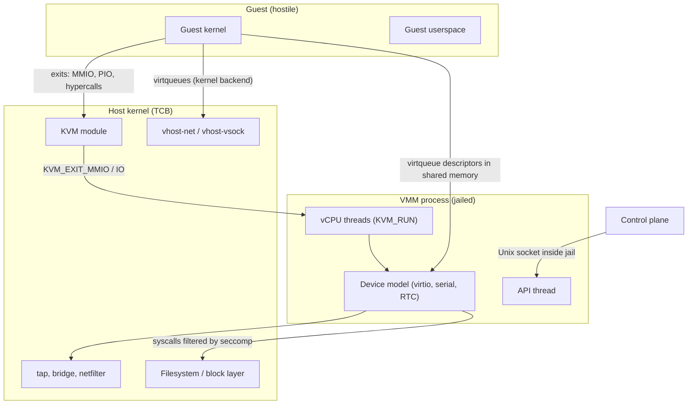
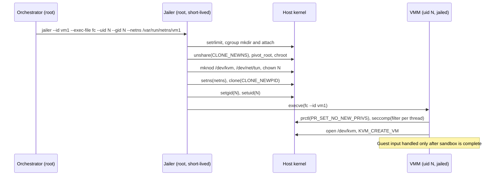
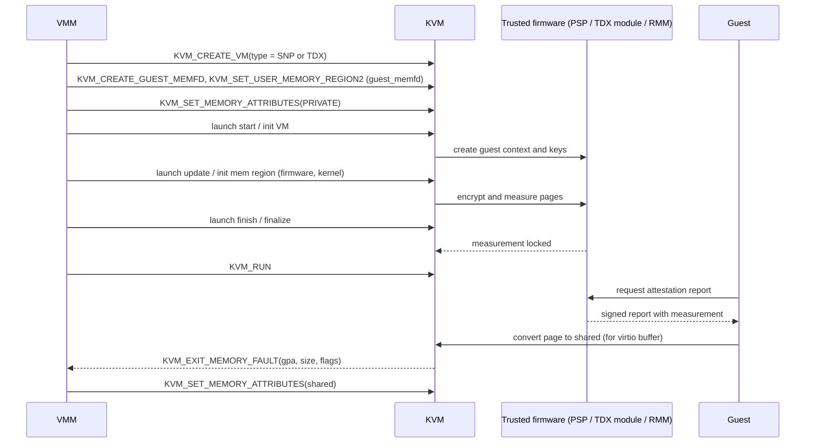

Purpose: teach how to design a VMM that survives a hostile guest, from threat model and device attack surface to jailing, seccomp, fuzzing, speculative side channels, and confidential computing, so security is a property of your architecture instead of a patch list.

# Security, Isolation, and Attack Surface

Related notes: [04 KVM API and the vCPU Run Loop](/compendium/virtualization/kvm-api-and-the-vcpu-run-loop), [07 Device Emulation PIO MMIO and the Bus Model](/compendium/virtualization/device-emulation-pio-mmio-and-the-bus-model), [08 Virtio Devices Virtqueues and vhost](/compendium/virtualization/virtio-devices-virtqueues-and-vhost), [05 Memory Virtualization EPT NPT and Guest Memory](/compendium/virtualization/memory-virtualization-ept-npt-and-guest-memory), [11 Device Passthrough VFIO IOMMU and Nested Virtualization](/compendium/virtualization/device-passthrough-vfio-iommu-and-nested-virtualization), [12 Snapshots Live Migration and Dirty Page Tracking](/compendium/virtualization/snapshots-live-migration-and-dirty-page-tracking), [17 Hypervisor Architectures Compared](/compendium/virtualization/hypervisor-architectures-compared), [18 Rust VMM Ecosystem and Project Templates](/compendium/virtualization/rust-vmm-ecosystem-and-project-templates), [09 cgroups Namespaces Containers and Runtime Isolation](/compendium/linux-systems-engineering/cgroups-namespaces-containers-and-runtime-isolation), [06 System Calls ABI libc and User Kernel Boundaries](/compendium/linux-systems-engineering/system-calls-abi-libc-and-user-kernel-boundaries), [09 Unsafe Rust and the Rust Memory Model](/compendium/rust/unsafe-rust-and-the-rust-memory-model).

## Threat model: assume the guest is the attacker

A VMM exists to run code you do not trust. The default threat model used by Firecracker, Cloud Hypervisor, crosvm and every public cloud is:

| Actor | Trust level | Capabilities |
|---|---|---|
| Guest kernel and guest userspace | Fully malicious | Arbitrary ring 0 / EL1 / VS-mode code, arbitrary values in every register, every guest page, every virtqueue descriptor, every MMIO and PIO write, any timing |
| VMM process (your Rust binary) | Trusted but assumed compromisable | Runs on the host with access to `/dev/kvm`, tap devices, disk images, sockets |
| Host kernel including KVM | Trusted computing base (TCB) | Full machine control |
| Control plane (API client, orchestrator) | Trusted, authenticated | Configures VMs; must not be reachable from the guest |
| Other tenants on the same host | Mutually distrusting | Share CPU caches, branch predictors, memory bus, disk and NIC bandwidth |
| Hardware and firmware | Trusted (unless you use confidential computing) | Microcode, SMM, PSP, TDX module, RMM |

The security goal is layered:

1. The guest must not execute code in, or read memory of, the VMM process.
2. If step 1 fails, the compromised VMM must not reach the host kernel, other VMs, or the control plane.
3. If step 2 fails, the host kernel (KVM, vhost, the network stack) is the last line, so its exposed surface must be as small as possible.
4. Across all layers, the guest must not infer secrets from other tenants through microarchitectural side channels.
5. With confidential computing, the threat model inverts partially: the guest also distrusts the host and the VMM.

Why it matters for your VMM: every design decision (which devices to implement, which thread handles which fd, whether you parse a descriptor once or twice) is a security decision. A "toy" VMM that trusts the guest is a guest-to-host remote code execution waiting for a guest kernel module to exploit it.



### Trust boundaries you own

| Boundary | Data crossing it | Your obligation |
|---|---|---|
| Guest memory to device model | Virtqueue rings, descriptor tables, buffers, config structures | Validate every index, length, address; read each field exactly once |
| KVM exit to device model | MMIO/PIO address, size, data | Bounds-check offset within device window; handle every access width |
| Hypercall / SBI / PSCI to VMM | Function IDs and arguments | Reject unknown IDs; never pass guest values to syscalls unvalidated |
| Device model to host OS | File offsets, packet sizes, socket writes | Clamp to backing size; never let guest choose host paths |
| API socket to VMM | JSON config | Authenticate by filesystem permissions; parse with size limits |
| Snapshot file to VMM | Serialized device and vCPU state | Treat as untrusted input on restore (it may have been tampered) |
| Migration stream to VMM | Same as snapshot, over the network | Authenticate and integrity-protect the channel; validate state |

## The attack surface inventory

The attack surface is everything the guest can reach. Write it down for your VMM and keep it in the repo.

| Surface | Who implements it | Typical bug classes | Reduction strategy |
|---|---|---|---|
| CPU virtualization (VMX/SVM, EL2, H-ext) | Hardware plus KVM | Nested virtualization state confusion, MSR/sysreg emulation bugs, instruction emulator bugs | Disable nested virtualization unless needed; minimize emulated MSRs |
| KVM instruction emulator (x86) | Host kernel | Decoder bugs, privilege checks | Prefer virtio over emulated legacy devices to reduce MMIO emulation of complex instructions |
| In-kernel irqchip, timers | KVM | Index overflow, races on IRQ routing | Use upstream defaults; keep host kernel patched |
| vhost-net, vhost-vsock, vhost-scsi | Host kernel | Descriptor length bugs (CVE-2019-14835), log buffer overflow | Use only when the performance is needed; consider vhost-user in a sandboxed process |
| Userspace device model | Your VMM | OOB read/write, integer overflow, TOCTOU on guest memory, infinite loops, DMA reentrancy | Minimal device set, Rust, single-fetch parsing, fuzzing |
| Legacy device emulation (floppy, IDE, USB, sound) | QEMU-style VMMs | VENOM and friends | Do not implement them |
| Network backend (slirp/user networking) | Userspace library | Heap overflows in packet reassembly (CVE-2019-6778, CVE-2019-14378) | Use tap plus host firewall instead of userspace TCP stacks |
| Host filesystem access (virtio-fs, 9p) | virtiofsd, VMM | Path traversal, symlink races, fd leaks | Run file server in its own sandbox with a dedicated mount namespace |
| GPU, display, audio | Large C/C++ libraries | Shader compiler and parser bugs | Out-of-process, heavily sandboxed (crosvm model) |
| Passthrough devices (VFIO) | Hardware and IOMMU | DMA to arbitrary host memory without IOMMU, device firmware persistence | Require IOMMU, interrupt remapping; reset devices between tenants |
| Shared CPU microarchitecture | Silicon | Spectre, L1TF, MDS, Retbleed, SRSO, VMScape | Microcode, kernel mitigations, SMT policy, core scheduling |
| Control API | Your VMM | Unauthenticated access, request smuggling | Unix socket in jail, owned by jailer uid, strict schema |
| Snapshot and migration | Your VMM | Deserialization bugs, state confusion | Version and validate state; never trust restored indices |

## Real VM escape bug classes

Studying real escapes is the fastest way to learn what to defend. The pattern repeats: a guest-controlled integer is trusted as an index or length.

| Bug | Component | Class | Lesson for your VMM |
|---|---|---|---|
| VENOM, CVE-2015-3456 | QEMU floppy disk controller | FIFO buffer index not reset or bounds-checked, guest writes past buffer | Do not emulate legacy devices; state machines must bound every buffer index |
| CVE-2019-6778 | QEMU slirp `tcp_emu` | Heap overflow from guest-controlled packet data | Userspace network stacks are huge attack surface; prefer tap |
| CVE-2019-14378 | QEMU slirp IP reassembly | Heap overflow on fragment reassembly length | Length arithmetic on reassembly must use checked math |
| CVE-2019-14835 | Linux vhost-net | Guest-controlled descriptor length overflowed the dirty log buffer during live migration | Rarely exercised paths (migration) are where bugs hide; fuzz them |
| CVE-2019-18960 | Firecracker vsock (v0.18.0, v0.19.0) | Missing bounds check allowed reads and writes just past a guest memory region | Even Rust VMMs ship memory-safety bugs where unsafe or raw pointer arithmetic touches guest memory |
| CVE-2020-14364 | QEMU USB emulation | Out-of-bounds read/write via setup packet length | Every guest-supplied length is an attack vector |
| CVE-2021-3750 | QEMU EHCI | DMA reentrancy: device DMA targeted its own MMIO region, re-entering the device mid-operation | Device handlers must be reentrancy-safe or forbid DMA to MMIO |
| CVE-2021-29657 | KVM nested SVM (AMD) | Double fetch (TOCTOU) of a VMCB field from guest memory | Read guest memory once, validate the copy, use the copy |
| CVE-2018-3646 (L1TF VMM) | Intel CPUs | Speculative read of L1D via non-present EPT/PTE | Microarchitectural isolation is part of the VMM threat model |
| CVE-2025-40300 (VMScape) | AMD Zen and some Intel CPUs | Guest trains branch predictor to steer speculation in host userspace VMM | Userspace VMM is a speculation target too, not just the kernel |

### The five recurring root causes

1. **Unchecked index or length from guest memory.** A descriptor `len`, ring `idx`, or register value is used without validating against the actual buffer or queue size.
2. **Double fetch (time-of-check to time-of-use).** The VMM reads a guest field, validates it, then reads it again for use. The guest changes it between reads from another vCPU.
3. **Integer overflow in address arithmetic.** `addr + len` wraps, passes a bounds check, and then indexes outside the region.
4. **Reentrancy.** A device operation triggers a DMA or interrupt that calls back into the same device while its state is inconsistent.
5. **Unbounded work.** A descriptor chain loop (`next` points backwards) or a huge indirect table pins a VMM thread at 100 percent CPU: a denial of service against the host.

### Guest memory discipline in Rust

Rust removes use-after-free and most out-of-bounds bugs in safe code, but guest memory is shared with a concurrent hostile writer. `vm-memory` models guest memory as volatile memory for this reason: you cannot hold a `&T` into guest RAM because the guest can change it under you, which would violate Rust aliasing rules.

Rules:

| Rule | Why |
|---|---|
| Copy guest structures into host-owned values with `read_obj` before validating | Prevents double-fetch TOCTOU |
| Never create `&[u8]` or `&T` references into guest memory | Guest can mutate concurrently; it is UB in Rust and a TOCTOU in practice |
| Use `checked_add` for every `GuestAddress` plus length | Prevents wraparound passing bounds checks |
| Bound chain length by queue size, and indirect tables by their own size | Prevents descriptor loops |
| Validate that device MMIO/PIO offset plus access size fits the register window | Prevents OOB on device register arrays |
| Treat `Err` from guest memory access as a guest error, not a VMM panic | A panic is a host-side denial of service, and with `panic = abort` it kills all vCPUs |

Example (vm-memory 0.18 API shape, checked against the rust-vmm repository; `GuestMemoryMmap` requires the `backend-mmap` feature):

```rust
use vm_memory::{ByteValued, Bytes, GuestAddress, GuestMemory, GuestMemoryMmap};

#[derive(Clone, Copy, Default)]
#[repr(C)]
struct BlkReqHeader {
    req_type: u32,
    reserved: u32,
    sector: u64,
}
// SAFETY: plain old data, every bit pattern is valid.
unsafe impl ByteValued for BlkReqHeader {}

#[derive(Debug)]
enum GuestError {
    BadAddress,
    TooLarge,
}

const MAX_SECTORS: u64 = 1 << 32;

fn parse_header(
    mem: &GuestMemoryMmap,
    addr: GuestAddress,
    desc_len: u32,
    disk_sectors: u64,
) -> Result<BlkReqHeader, GuestError> {
    if (desc_len as usize) < std::mem::size_of::<BlkReqHeader>() {
        return Err(GuestError::TooLarge);
    }
    // Single fetch: copy once into host memory, validate the copy, use the copy.
    let hdr: BlkReqHeader = mem.read_obj(addr).map_err(|_| GuestError::BadAddress)?;
    if hdr.sector >= disk_sectors.min(MAX_SECTORS) {
        return Err(GuestError::TooLarge);
    }
    Ok(hdr)
}

fn data_range_ok(mem: &GuestMemoryMmap, addr: GuestAddress, len: u64) -> bool {
    // checked_add on the raw value prevents wraparound past u64::MAX.
    match addr.0.checked_add(len) {
        Some(end) if len > 0 => mem.address_in_range(GuestAddress(end - 1)),
        _ => false,
    }
}
```

The `virtio-queue` crate already implements descriptor chain iteration with loop and size limits. Reuse it instead of hand-rolling ring parsing; your job is to validate what the descriptors point at.

## Defense in depth: the layered architecture

No single mechanism is enough. Production VMMs stack independent layers so that a single bug requires a chain of further bugs to become a host compromise.

| Layer | Mechanism | What it stops |
|---|---|---|
| Language | Rust, minimal `unsafe`, `vm-memory` volatile access | Most memory corruption in the device model |
| Device set | Only virtio-mmio or virtio-pci devices plus a serial port and RTC | Removes whole classes of legacy emulation bugs |
| Process split | One VMM per VM; optional per-device processes (crosvm), vhost-user backends | Contains a compromise to one VM or one device |
| Syscall filter | seccomp-BPF per thread category | Limits what code execution in the VMM can do to the kernel |
| Filesystem view | chroot / pivot_root, mount namespace, only needed device nodes | Hides host files, other VMs' disks and sockets |
| Identity | Unique unprivileged uid/gid per VM, no capabilities, `no_new_privs` | Prevents interacting with other VMs' processes and files |
| Resource limits | cgroups v2 (cpu, memory, pids, io), rlimits | Bounds denial of service |
| Network | Per-VM network namespace, tap device, host firewall and rate limiters | Prevents guest from reaching control plane or other tenants |
| LSM | Landlock, SELinux/AppArmor profiles | Second filesystem and network policy independent of DAC |
| Host kernel | Patched KVM, minimal modules, mitigations on | Last line |

## Minimal devices: the cheapest security control

Firecracker's design is the reference for minimalism: virtio-net, virtio-block, virtio-vsock, virtio-balloon, a serial console, an i8042 keyboard controller stub used only for guest reset on x86, and an RTC on ARM. No PCI in the original design (later releases added optional PCI support), no USB, no graphics, no BIOS: the kernel is loaded directly.

Decision table:

| Want | Minimal choice | Avoid |
|---|---|---|
| Disk | virtio-blk with raw file backend | IDE, AHCI, emulated SCSI, complex image formats parsed in VMM |
| Network | virtio-net plus tap, or vhost-user-net in a sandbox | slirp, emulated e1000 |
| Host-guest channel | virtio-vsock | Shared folders unless required |
| Console | 16550 UART (`vm-superio`) or virtio-console | VGA text console |
| Time | KVM clock / arch timer, RTC (PL031 on ARM, CMOS on x86 only if needed) | HPET, PIT emulation in userspace |
| Boot | Direct kernel boot via `linux-loader` | Full firmware unless you need UEFI guests |
| Shared files | virtio-fs with sandboxed virtiofsd | 9p in the VMM process |

Every device you do not implement is a CVE you cannot have. Every device you implement needs a fuzz target.

## Process architecture choices

| Model | Example | Isolation | Cost |
|---|---|---|---|
| Monolithic VMM per VM | Firecracker, Cloud Hypervisor | Device bug compromises the whole VMM process, contained by jail | Simplest, fastest |
| Per-device processes | crosvm (each device in a minijail-ed process) | Device bug compromises only that device's sandbox | IPC overhead, complexity |
| vhost-user backends | virtiofsd, vhost-user-net/blk daemons | Backend can have a tighter, different sandbox | Shared-memory protocol to secure, more processes |
| In-kernel backends (vhost) | vhost-net, vhost-vsock | Bug is a host kernel bug | Fastest, but expands kernel TCB |
| Library OS / unikernel VMM | Solo5, Hyperlight style | Very small surface | Narrow guest support |

Why it matters for your VMM: start monolithic with a strong jail, but design the device model behind a trait boundary (see [07 Device Emulation PIO MMIO and the Bus Model](/compendium/virtualization/device-emulation-pio-mmio-and-the-bus-model)) so moving a device out of process later is a transport change, not a rewrite.

## The Firecracker jailer, step by step

The jailer is a separate, small privileged binary that prepares the sandbox and then execs the VMM as an unprivileged process. Splitting "set up privileges" from "handle guest input" means the code handling guest input never holds root.

Sequence (from Firecracker `docs/jailer.md`):

1. Validate arguments (`--id`, `--exec-file`, `--uid`, `--gid`), close inherited file descriptors, clear the environment.
2. Create the chroot at `&lt;chroot-base-dir&gt;/&lt;exec_file_name&gt;/&lt;id&gt;/root` (default base `/srv/jailer`) and copy the VMM binary into it, so the new process does not share text pages with other VMM instances.
3. Apply `--resource-limit` values with `setrlimit` (`fsize`, `no-file`; `no-file` defaults to 2048).
4. Create and join cgroups: `--cgroup-version 1|2`, `--cgroup &lt;file&gt;=&lt;value&gt;`, `--parent-cgroup`.
5. Unshare a mount namespace, make mounts private, bind-mount the jail root onto itself, `pivot_root`, detach-unmount the old root, `chroot`.
6. `mknod` `/dev/kvm` and `/dev/net/tun` inside the jail and `chown` them to the target uid/gid.
7. Optionally join a network namespace (`--netns`, via `setns`), daemonize (`--daemonize`: `setsid`, stdio to `/dev/null`), and spawn in a new PID namespace (`--new-pid-ns`, `clone` with `CLONE_NEWPID`).
8. Drop privileges to the given uid/gid and `exec` the VMM, which creates its API socket inside the jail.
9. The VMM then installs its seccomp filters before handling any guest input.



### Writing your own jailer in Rust

You do not need Firecracker's jailer to get its properties. A minimal version uses `nix` or `libc` and runs before any VM state exists. Order matters: everything that needs privilege (mounts, cgroups, mknod, opening `/dev/kvm` if you prefer to pass an fd) must happen before `setuid`; `no_new_privs` and seccomp must happen after the last `execve` you control.

| Step | Syscall | Pitfall |
|---|---|---|
| Close fds | `close_range(3, ~0, 0)` | Leaked fds (another VM's disk) defeat the chroot |
| New mount ns | `unshare(CLONE_NEWNS)` | Forgetting `MS_PRIVATE` propagation leaks mounts back to host |
| Root switch | `pivot_root` then `umount2(old, MNT_DETACH)` | `chroot` alone is escapable by a process that keeps root |
| Device nodes | `mknod` with exact major/minor | Do not bind-mount all of `/dev` |
| Network | `setns(netns_fd, CLONE_NEWNET)` | Must happen before dropping `CAP_SYS_ADMIN` |
| User/group | `setgroups(&[])`, `setresgid`, `setresuid` | Drop supplementary groups first, or the process keeps group access |
| Capabilities | Ensure bounding and ambient sets are empty | `setuid` from root to non-root clears effective caps only if `SECBIT_KEEP_CAPS` is unset |
| `no_new_privs` | `prctl(PR_SET_NO_NEW_PRIVS, 1)` | Required for unprivileged seccomp installation |

Passing a pre-opened `/dev/kvm` fd and pre-opened tap fds into the jailed process (fd inheritance or `SCM_RIGHTS`) lets you avoid device nodes in the jail entirely, which further shrinks the filesystem view. Cloud Hypervisor and crosvm both support receiving tap fds.

## Namespaces, cgroups, and rlimits

See [09 cgroups Namespaces Containers and Runtime Isolation](/compendium/linux-systems-engineering/cgroups-namespaces-containers-and-runtime-isolation) for the kernel mechanics; here is what a VMM needs.

| Namespace | Use for a VMM |
|---|---|
| Mount | Mandatory: private root with only the kernel image, rootfs image, sockets |
| Network | One per VM; holds the tap device; host side connects through veth or routing |
| PID | Hides other processes; VMM becomes PID 1 of its namespace (must reap children if it forks) |
| IPC | Cheap, isolates SysV IPC |
| UTS | Cosmetic |
| User | Lets an unprivileged orchestrator build the jail; adds kernel attack surface (user namespaces have a history of privilege escalation bugs), many hardened hosts disable unprivileged user namespaces |
| Cgroup | Hides host cgroup hierarchy |

cgroup v2 controllers to set per VM:

| Controller | Setting | Reason |
|---|---|---|
| `memory.max` | Guest RAM plus VMM overhead plus margin | Prevent host OOM from a balloon or device bug |
| `memory.swap.max` | 0 for latency-sensitive or secret-holding VMs | Guest memory on swap persists secrets to disk |
| `cpu.max` | Quota per VM | Noisy neighbor control |
| `cpuset.cpus` | Pin vCPU threads to dedicated cores | Reduces cross-tenant side-channel exposure and jitter |
| `pids.max` | Small number | Fork bombs after code execution |
| `io.max` | Disk bandwidth and IOPS | Storage DoS |

## Privilege dropping and capabilities

The VMM needs exactly these privileges at runtime: read/write on `/dev/kvm`, read/write on its tap fds, access to its disk image files and sockets. It needs no Linux capabilities. If you find you need `CAP_NET_ADMIN` at runtime (for example to configure tap offloads), move that operation into the jailer or the orchestrator.

Checks to automate in an integration test: read `/proc/&lt;pid&gt;/status` for the jailed VMM and assert `CapEff`, `CapPrm`, `CapBnd`, `CapAmb` are all zero, `NoNewPrivs: 1`, `Seccomp: 2`, and `Uid` is the unprivileged id on all four fields.

## Seccomp: the most valuable post-exploitation control

Seccomp-BPF filters every syscall against a classic BPF program. For a VMM, filters are the difference between "attacker controls a thread" and "attacker owns the host".

### Per-thread filtering

Seccomp filters are per thread, inherited across `clone`. VMM threads do very different work, so give them different filters:

| Thread category | Needs | Must not have |
|---|---|---|
| vCPU threads | `ioctl(KVM_RUN)` and a few vCPU ioctls, `read`/`write` on eventfds, `futex`, `exit`, signal handling, MMIO handler syscalls | `open`, `socket`, `execve`, `mmap` with `PROT_EXEC` |
| VMM / device event loop | `epoll_*`, `read`/`write`/`readv`/`writev`/`pread64`/`pwrite64` on disk and tap fds, `fsync`, `timerfd_*`, `eventfd2` | `KVM_CREATE_VM`, `execve`, `ptrace`, `socket` (unless vsock/unix needed) |
| API thread | `accept4`, `recvfrom`/`sendto` on the API socket, `epoll_*` | KVM ioctls, disk access |

Firecracker ships one JSON filter per architecture with categories `vmm`, `api` and `vcpu`, compiled at build time into BPF by `seccompiler`. Argument filtering matters: allowing `ioctl` is meaningless unless you also restrict the request number (`KVM_RUN`, `KVM_SET_REGS` and so on) via an argument condition on index 1.

Default action choice:

| Action | Effect | Use |
|---|---|---|
| `Allow` | Syscall proceeds | Allowlist entries |
| `Trap` | `SIGSYS` delivered, handler can log | Development and production with a logging handler that then aborts |
| `KillProcess` | Whole process killed immediately | Production default for unknown syscalls |
| `KillThread` | Only the thread dies | Dangerous: leaves VMM in an inconsistent state |
| `Errno(n)` | Syscall fails with errno | Probing syscalls you want to fail gracefully (rare) |
| `Log` | Allowed but logged | Building an allowlist from observed behavior |

### seccompiler in Rust

Example using `seccompiler` 0.5.0 (checked on docs.rs). The API builds a `SeccompFilter` from a map of syscall numbers to rule lists, a mismatch action, a match action and a target arch, then converts it into a `BpfProgram`.

```rust
use seccompiler::{
    apply_filter, BpfProgram, SeccompAction, SeccompCmpArgLen, SeccompCmpOp,
    SeccompCondition, SeccompFilter, SeccompRule,
};
use std::convert::TryInto;

// KVM_RUN = _IO(KVMIO, 0x80) = 0xAE80. Verify against kvm-bindings for your arch.
const KVM_RUN: u64 = 0xAE80;

fn ioctl_eq(req: u64) -> SeccompRule {
    SeccompRule::new(vec![SeccompCondition::new(
        1,                       // argument index: ioctl request
        SeccompCmpArgLen::Dword, // request numbers fit in 32 bits
        SeccompCmpOp::Eq,
        req,
    )
    .expect("valid condition")])
    .expect("valid rule")
}

pub fn vcpu_filter() -> BpfProgram {
    let rules = vec![
        (libc::SYS_ioctl, vec![ioctl_eq(KVM_RUN)]),
        (libc::SYS_futex, vec![]),
        (libc::SYS_read, vec![]),
        (libc::SYS_write, vec![]),
        (libc::SYS_rt_sigreturn, vec![]),
        (libc::SYS_exit, vec![]),
    ];
    SeccompFilter::new(
        rules.into_iter().collect(),
        SeccompAction::KillProcess, // mismatch: anything not allowlisted
        SeccompAction::Allow,       // match: allowlisted syscall and args
        std::env::consts::ARCH.try_into().expect("supported arch"),
    )
    .expect("valid filter")
    .try_into()
    .expect("compiles to BPF")
}

pub fn enter_vcpu_sandbox() {
    // apply_filter requires no_new_privs or CAP_SYS_ADMIN.
    unsafe { libc::prctl(libc::PR_SET_NO_NEW_PRIVS, 1, 0, 0, 0) };
    apply_filter(&vcpu_filter()).expect("seccomp install");
}
```

Notes:

- `seccompiler` supports `x86_64`, `aarch64` and `riscv64` targets. Syscall numbers differ per architecture (aarch64 and riscv64 use the generic syscall table with no `open`, only `openat`), so filters are per-arch artifacts.
- `apply_filter_all_threads` uses `SECCOMP_FILTER_FLAG_TSYNC` to install on every thread. Prefer installing on each thread at its start so the vCPU filter can be stricter than the event-loop filter.
- The JSON frontend (`compile_from_json`, feature `json`) produces a `BpfMap` keyed by thread category, which is how Firecracker keeps filters reviewable as data.
- Your allowlist depends on your allocator, your logging crate, and the libc. musl and glibc issue different syscalls for the same Rust code (for example `mmap` vs `mmap2` is not an issue on 64-bit, but `clone3` vs `clone`, `newfstatat` vs `statx` are). Build filters against the libc you ship, then run the full integration suite with `Log` before switching to `KillProcess`.
- Remember signals: `rt_sigreturn` must be allowed if you use signals to kick vCPUs out of `KVM_RUN`.

### Testing seccomp filters

1. Run integration tests with the filter in `Log` mode and collect audit logs (`SECCOMP` records in the kernel audit log) to find missing syscalls.
2. Add negative tests: from inside a jailed test VMM, attempt `execve`, `socket(AF_INET)`, `open("/etc/passwd")`, and `ioctl(kvm_fd, KVM_CREATE_VM)` from a vCPU thread; assert the process dies with `SIGSYS`.
3. Fail CI if the filter grows without review (diff the JSON).

## Landlock and LSMs

Landlock lets an unprivileged process restrict its own filesystem access (and, in newer ABIs, TCP bind/connect). Cloud Hypervisor exposes it as a `--landlock` option. It is complementary to the chroot: even if the chroot is misconfigured, Landlock rules still deny paths not explicitly granted. SELinux (sVirt in libvirt) labels each VM's process and disk images with a unique category so that one VM's process cannot open another VM's disk even under the same uid.

## Host kernel surface from the VMM

A compromised VMM can still call into KVM. Reduce what it can reach:

| Control | How |
|---|---|
| Restrict KVM ioctls per thread | seccomp argument filters (vCPU threads: only vCPU ioctls on vCPU fds) |
| Do not leave `/dev/kvm` openable | Open once, pass fd, remove the node from the jail after opening |
| Disable nested virtualization | `kvm_intel.nested=0` / `kvm_amd.nested=0` unless required; on arm64 do not set `KVM_ARM_VCPU_HAS_EL2` |
| Avoid optional in-kernel devices you do not use | No vhost if not needed, no KVM PIT if the guest does not need it |
| Keep the host kernel current | Most guest-reachable bugs are fixed in stable kernels first |
| Disable unneeded host modules | Reduce what a VMM-level attacker can autoload (`modules_disabled` after boot on dedicated hosts) |

## Fuzzing the device model

Fuzzing is the only scalable way to find the bug classes in the table above. Two families matter:

| Approach | Target | Tooling |
|---|---|---|
| Unit-level, in-process fuzzing | Virtqueue parsing, device request parsing, MMIO register handlers, snapshot deserialization | `cargo-fuzz` (libFuzzer), `arbitrary` for structure-aware input, ASan for `unsafe` code |
| Whole-VMM fuzzing | Sequence of MMIO/PIO writes plus guest memory contents driving real device code | QEMU `generic-fuzz` target, custom harness that runs the VMM device bus without KVM |
| Kernel-side fuzzing | KVM ioctls and guest-triggered exits | syzkaller (has KVM descriptions), selftests |
| Hypervisor-level guest fuzzing | Guest kernel that issues random hypercalls / instructions | Research tools; also KVM unit tests as a starting corpus |

Cloud Hypervisor keeps a `fuzz/` directory with cargo-fuzz targets (block, net, virtio queue, console and more) and is in OSS-Fuzz; rust-vmm crates like `virtio-queue` and `vm-virtio` carry fuzz targets too. Copy the pattern.

Design your device model so it can be fuzzed without KVM: the device should take a `GuestMemory` implementation and a register access, not a vCPU fd.

```rust
#![no_main]
use libfuzzer_sys::fuzz_target;
use vm_memory::{Bytes, GuestAddress, GuestMemoryMmap};

// Your device under test: MMIO register writes plus a queue notify.
use my_vmm::devices::virtio_blk::BlkDevice;

fuzz_target!(|data: &[u8]| {
    if data.len() < 16 {
        return;
    }
    let (ops, ram) = data.split_at(data.len() / 4);
    let mem: GuestMemoryMmap =
        GuestMemoryMmap::from_ranges(&[(GuestAddress(0), 0x10_0000)]).unwrap();
    // Guest memory contents are fully attacker-controlled.
    let _ = mem.write_slice(&ram[..ram.len().min(0x10_0000)], GuestAddress(0));

    let mut dev = BlkDevice::new_for_fuzzing(mem.clone());
    for chunk in ops.chunks_exact(8) {
        let offset = u32::from_le_bytes(chunk[0..4].try_into().unwrap()) as u64 % 0x200;
        let value = &chunk[4..8];
        dev.mmio_write(offset, value); // must never panic or hang
    }
    dev.process_queues(); // must terminate in bounded time
});
```

What the harness must catch:

- Panics (in a VMM a panic is a guest-triggerable DoS).
- Hangs: run libFuzzer with `-timeout=` and keep per-request work bounded.
- Memory errors in `unsafe` blocks: build with `-Zsanitizer=address` on nightly.
- Logic invariants: add `debug_assert!` that used ring index never passes available ring index, and that you never write outside the descriptor's writable buffers.

Seed corpora from real traffic: record MMIO sequences and descriptor chains while booting Linux, then let the fuzzer mutate them.

## Speculative execution and microarchitectural side channels

The VMM threat model includes hardware. A guest can attempt to read host or other-guest data through transient execution, even when the architectural isolation is perfect. Mitigations live mostly in the host kernel and microcode, but VMM authors must understand them because they drive host configuration, CPU pinning, SMT policy and performance.

### x86 vulnerability map for hypervisors

| Issue | Year | Guest-relevant risk | Primary mitigation |
|---|---|---|---|
| Spectre v1 (bounds check bypass) | 2018 | Gadgets in KVM or VMM indexed by guest values | `array_index_nospec`-style masking in kernel; in Rust VMM, avoid secret-dependent speculative loads (rarely practical; rely on process isolation) |
| Spectre v2 (BTI) | 2018 | Guest poisons indirect branch predictor to steer host | Retpoline or eIBRS, IBPB on switch between guests, RSB stuffing on VM exit |
| L1TF / Foreshadow-NG (CVE-2018-3646) | 2018 | Guest reads any host L1D data via terminal EPT faults | L1D flush on VM entry (`kvm-intel.vmentry_l1d_flush`), disable SMT or core scheduling |
| MDS family (MSBDS, MFBDS, MLPDS, MDSUM) | 2019 | Leakage from CPU fill buffers and store buffers | `VERW` buffer clearing on VM entry, SMT considerations |
| TAA (CVE-2019-11135) | 2019 | TSX async abort leakage | Disable TSX or `VERW` clearing |
| SRBDS, MMIO stale data | 2020, 2022 | Leakage via special register buffers, MMIO | Microcode, `VERW`, restrict passthrough MMIO |
| Retbleed | 2022 | Return instructions use BTB | IBRS / untrained return thunks, IBPB |
| Downfall / GDS (CVE-2022-40982) | 2023 | Gather instructions leak vector register data | Microcode |
| Inception / SRSO (CVE-2023-20569, AMD) | 2023 | Phantom speculation poisons return predictions | Safe RET, IBPB on VM exit |
| RFDS, BHI | 2024 | Register file stale data, branch history injection | Microcode, BHI clearing sequence |
| VMScape (CVE-2025-40300) | 2025 | Guest poisons BTB to attack host userspace VMM (QEMU) | Conditional IBPB before returning to userspace after VM exit (`vmscape=` kernel parameter) |

Inspect host status at `/sys/devices/system/cpu/vulnerabilities/*` and record it in your VMM's startup log; it is invaluable when debugging performance differences between hosts.

### Why VMScape matters specifically to userspace VMMs

Before VMScape, the mental model was "the host kernel is protected on VM exit". VMScape showed that a guest can train the branch predictor and influence speculation in the host userspace process that handles its exits, i.e. your VMM. The Linux mitigation issues an IBPB before the first return to userspace after a VM exit, and only when userspace actually runs between exits. Implication: exits that are handled entirely in kernel (in-kernel irqchip, ioeventfd, KVM clock) are cheaper under this mitigation than exits bounced to your VMM, which is one more reason to keep the hot path in kernel and use ioeventfd/irqfd.

### SMT and core scheduling

Many leaks (L1TF, MDS) work across sibling hyperthreads. Options:

| Policy | Security | Cost |
|---|---|---|
| SMT disabled (`nosmt`) | Strongest | Up to roughly a third of throughput lost on some workloads |
| Core scheduling (`prctl(PR_SCHED_CORE, ...)`) | Siblings only run tasks with the same cookie (same VM) | Scheduler overhead, idle siblings |
| Static pinning: each VM gets whole cores | Equivalent isolation if host threads also avoid sibling | Capacity planning burden |
| Ignore | Weakest | None |

A VMM can set a core-scheduling cookie on all its threads at startup so siblings never mix this VM with another VM or the host. Firecracker's production host setup guide recommends disabling SMT for multi-tenant hosts.

### ARM64 side-channel notes

- Spectre v2 / BHB on Arm is mitigated by firmware workarounds exposed through SMCCC (`SMCCC_ARCH_WORKAROUND_1`, `_2`, `_3`). KVM exposes their availability to guests through firmware pseudo-registers (`KVM_REG_ARM_SMCCC_ARCH_WORKAROUND_1/2/3`), which your VMM must save and restore for migration. See [15 ARM64 Virtualization EL2 VHE and GIC](/compendium/virtualization/arm64-virtualization-el2-vhe-and-gic).
- Speculative Store Bypass (Spectre v4) is controlled per context via `SMCCC_ARCH_WORKAROUND_2` or the `SSBS` bit.
- Cores without SMT (most Arm server and phone cores) avoid the sibling-thread class entirely.

### RISC-V side-channel notes

Out-of-order RISC-V cores are subject to the same Spectre principles, but the ecosystem has far fewer published hardware-specific mitigations and no standardized speculation barrier comparable to Arm's `SB` in widely shipped hardware. Notable 2024 findings (for example the "GhostWrite" architectural bug in T-Head C910 vector instructions) were architectural, not transient, and show that early silicon errata are a bigger risk than speculation today. Treat RISC-V hosts as "less studied", not "safe". See [16 RISC-V Virtualization and the Hypervisor Extension](/compendium/virtualization/risc-v-virtualization-and-the-hypervisor-extension).

## Confidential computing: when the guest distrusts the host

Confidential VMs (CVMs) add hardware that protects guest memory and register state from the host kernel, the hypervisor and the VMM. The threat model changes:

| Classic VM | Confidential VM |
|---|---|
| Host protects itself from the guest | Host still protects itself, and hardware protects guest from host |
| VMM reads and writes guest memory freely | VMM can only access memory the guest explicitly shares |
| VMM sets vCPU registers at will | Register state is encrypted or owned by a trusted module; VMM sees only what the guest exposes |
| Guest trusts the VMM's device emulation | Guest must treat all devices and shared buffers as hostile (hardening the guest drivers) |
| Boot is unmeasured or measured by host | Initial memory and state are measured by hardware; guest proves it via remote attestation |

### Technology comparison

| Technology | Vendor | Trusted component | Memory protection | Register protection | Integrity | Linux KVM host status |
|---|---|---|---|---|---|---|
| SEV | AMD | AMD Secure Processor (PSP) firmware | Per-VM AES key selected by ASID | No | No | Upstream (old) |
| SEV-ES | AMD | PSP | As SEV | Encrypted VMSA; guest uses GHCB to share selected registers on #VC | No | Upstream |
| SEV-SNP | AMD | PSP, Reverse Map Table (RMP) | As SEV | As SEV-ES | RMP enforces page ownership and prevents remapping/replay; VMPLs | Host support merged in Linux 6.11 |
| TDX | Intel | TDX module running in SEAM mode, signed by Intel | Multi-key TME with per-TD keys | TD vCPU state in TDX-module-managed memory | Secure EPT managed by TDX module | KVM host support merged in Linux 6.16 |
| CCA (Realms) | Arm | Realm Management Monitor (RMM) at R-EL2, EL3 monitor | Granule Protection Tables (GPT) via RME; four physical address spaces | Realm state owned by RMM | GPT checks on every access | Host KVM series still under review as of late 2026 (v17 posted 2026-09) |
| CoVE | RISC-V (non-ISA spec) | TEE Security Manager (TSM), e.g. Salus | Smmtt memory tracking table (Supervisor Domains) | TSM owned | Smmtt | Specs and prototypes; RFC patches, not upstream |

### What changes in your VMM

KVM unifies the x86 CVM flavors behind VM types and guest_memfd.

1. **VM type.** Create the VM with `KVM_CREATE_VM` and a type: `KVM_X86_SW_PROTECTED_VM` (1, a software test vehicle), `KVM_X86_SEV_VM` (2), `KVM_X86_SEV_ES_VM` (3), `KVM_X86_SNP_VM` (4), `KVM_X86_TDX_VM` (5).
2. **Private memory via guest_memfd.** Private guest memory is not mapped into your process. You create it with `KVM_CREATE_GUEST_MEMFD` and register memslots with the `KVM_MEM_GUEST_MEMFD` flag, giving both a shared `userspace_addr` and a `guest_memfd` fd plus offset. This was introduced around Linux 6.8 (verify for your kernel).
3. **Shared vs private conversion.** `KVM_SET_MEMORY_ATTRIBUTES` with `KVM_MEMORY_ATTRIBUTE_PRIVATE` marks GPA ranges private. When the guest accesses a range in the "wrong" state (for example it converts a page to shared for a virtio buffer), KVM exits with `KVM_EXIT_MEMORY_FAULT` (note: it arrives with `KVM_RUN` returning -1 and `errno` EFAULT or EHWPOISON) carrying `gpa`, `size`, and `KVM_MEMORY_EXIT_FLAG_PRIVATE`. Your VMM updates attributes and resumes.
4. **Launch sequence through `KVM_MEMORY_ENCRYPT_OP`.** SNP: `KVM_SEV_INIT2`, `KVM_SEV_SNP_LAUNCH_START`, `KVM_SEV_SNP_LAUNCH_UPDATE` (per region, with page types normal, zero, unmeasured, secrets, CPUID), `KVM_SEV_SNP_LAUNCH_FINISH`. TDX: `KVM_TDX_CAPABILITIES`, `KVM_TDX_INIT_VM`, `KVM_TDX_INIT_VCPU`, `KVM_TDX_INIT_MEM_REGION`, `KVM_TDX_FINALIZE_VM`.
5. **No register poking.** After launch you cannot `KVM_SET_REGS` to fix up a vCPU. Boot state must be part of the measured image (firmware such as OVMF or a measured direct-boot shim).
6. **Devices must use shared bounce buffers.** virtio drivers in the guest use `swiotlb` bounce buffers in shared memory; the VMM device model is unchanged in principle, but performance changes and the guest must harden its drivers against a malicious VMM.
7. **Attestation.** The guest requests a hardware-signed report (SNP via the PSP guest messaging, TDX via TDREPORT converted to a quote). The VMM may need to provide certificate chains (`KVM_SEV_SNP_ENABLE_REQ_CERTS`) and forward quote requests.
8. **Termination events.** `KVM_EXIT_SYSTEM_EVENT` can carry `KVM_SYSTEM_EVENT_SEV_TERM` or `KVM_SYSTEM_EVENT_TDX_FATAL`.



### Arm CCA and RISC-V CoVE from a VMM author's view

- **Arm CCA.** The Realm Management Extension (RME) adds Realm and Root physical address spaces enforced by Granule Protection Tables. The normal-world KVM asks the RMM (via the Realm Management Interface, RMI) to create Realms, delegate granules, and populate measured memory. The VMM flow looks similar to SNP/TDX: a realm VM type, populate-and-measure calls, then run. Guest support (Linux running inside a realm) is upstream; host KVM support is a long-running patch series targeting RMM v2.0 that was still not merged as of the latest postings found (v17, September 2026). Plan for API churn.
- **RISC-V CoVE.** CoVE defines an ABI between an untrusted host (HS-mode KVM) and a TEE Security Manager (TSM) that manages confidential VMs, building on the Supervisor Domains and Smmtt (memory tracking table) ISA work. Status is specification plus research implementations (Salus in Rust, ACE) and RFC kernel patches; there is no stable KVM UAPI yet.

### Known attacks against CVMs

Confidential computing reduces, but does not eliminate, host power over the guest. Published classes include interrupt and exception injection attacks against SEV-ES/SNP guests (for example the Heckler family), single-stepping attacks (SEV-Step, SGX-Step lineage), cache-line manipulation (CacheWarp, CVE-2023-20592), and DRAM aliasing (BadRAM, 2024). A CVM VMM is still an untrusted party from the guest's view; the guest's own hardening is what provides security.

## Architecture comparison: isolation primitives

| Concern | x86-64 | ARM64 | RISC-V |
|---|---|---|---|
| Guest memory isolation | EPT / NPT | Stage-2 translation (VTTBR_EL2) | G-stage translation (`hgatp`) |
| Tagging to avoid flushes | VPID / ASID | VMID (8 or 16 bit) | VMID in `hgatp` |
| DMA isolation | VT-d / AMD-Vi with interrupt remapping | SMMUv3 | RISC-V IOMMU specification (ratified 2023), early hardware |
| Firmware call surface exposed to guest | Hypercalls (`VMCALL`/`VMMCALL`), MSRs, CPUID | SMCCC (PSCI, TRNG, vendor), sysregs | SBI extensions, CSRs |
| Confidential computing | SEV-SNP, TDX (upstream) | CCA (host under review) | CoVE (specification stage) |
| Speculation hardening breadth | Very large, many mitigations | Moderate, SMCCC workarounds | Limited published data |
| SMT side channels | Major concern | Rare (few SMT Arm server cores) | Rare today |

## Operational hardening checklist for hosts

- Host kernel and microcode current; mitigations not disabled (`mitigations=off` forbidden).
- SMT disabled or core scheduling enforced for multi-tenant hosts.
- KSM (kernel same-page merging) disabled across tenants: page deduplication enables timing side channels and Rowhammer-assisted attacks.
- Swap disabled or encrypted for guest memory.
- Unprivileged user namespaces disabled unless your jailer depends on them.
- `/dev/kvm` group restricted; only the jailer can hand it out.
- Disk images owned by per-VM uid, mode 0600; read-only base images opened `O_RDONLY`.
- Control plane sockets outside every VM's network namespace.
- Logs and metrics from the VMM rate-limited (a guest can trigger log floods by misbehaving).

## Common pitfalls

| Pitfall | Consequence | Fix |
|---|---|---|
| Reading a descriptor field twice (validate, then use) | TOCTOU escape via a second vCPU | Copy once with `read_obj`, use the copy |
| `addr + len` without `checked_add` | Wraparound passes bounds check | Checked arithmetic everywhere guest values flow |
| `panic!` or `unwrap()` on guest-controlled data | Guest can kill the VMM (DoS) | Return an error, mark the device `NEEDS_RESET`, log rate-limited |
| Seccomp filter installed after the API server starts | Window where guest input is processed unfiltered | Install filters before the first `KVM_RUN` and before accepting API calls that touch guest data |
| Allowing `ioctl` without argument filter | Compromised thread can create VMs, map memory | Filter on request number per thread category |
| `KillThread` default action | Half-dead VMM keeps running with corrupted state | `KillProcess` |
| Running the VMM as root "for now" | Every bug is a root bug | Jailer from day one |
| Emulating a legacy device to boot an old OS | Imports decades of attack surface | Isolate in a separate process or refuse the use case |
| Trusting snapshot files | Crafted snapshot gives arbitrary state | Validate all restored indices and sizes; sign snapshots |
| Forgetting migration paths in fuzzing | Bugs like CVE-2019-14835 live there | Fuzz save/restore and dirty-log code |
| Assuming Rust means no memory bugs | `unsafe` mmap and raw pointer code (CVE-2019-18960) | Audit every `unsafe`, run Miri/ASan on unit tests, fuzz |
| Leaking fds into the jail | Access to other VMs' disks | `close_range` and `O_CLOEXEC` everywhere |
| Assuming confidential VMs remove the need to harden the VMM | Host still must be protected from the guest | Both directions remain in scope |

## Review checklist

- [ ] Threat model document exists and lists every guest-reachable interface.
- [ ] Device set is minimal; every implemented device has a fuzz target.
- [ ] All guest memory access goes through `vm-memory`; no references into guest RAM.
- [ ] Every guest-supplied index, length and address uses checked arithmetic and is validated against real sizes.
- [ ] Each guest structure is read exactly once before validation and use.
- [ ] Descriptor chain processing is bounded by queue size and indirect table size.
- [ ] Device MMIO/PIO handlers reject out-of-window offsets and unexpected access widths.
- [ ] No `unwrap`/`expect`/`panic!` on guest-controlled paths.
- [ ] VMM runs under a unique unprivileged uid/gid with zero capabilities and `no_new_privs`.
- [ ] Jail uses mount namespace plus `pivot_root`, minimal device nodes, closed inherited fds.
- [ ] Per-thread seccomp filters with ioctl argument filtering; default `KillProcess`; negative tests in CI.
- [ ] cgroup v2 limits for memory, CPU, pids and IO per VM.
- [ ] Network namespace per VM; control plane unreachable from guest.
- [ ] Host mitigations verified via `/sys/devices/system/cpu/vulnerabilities`; SMT or core scheduling policy decided.
- [ ] Nested virtualization disabled unless required.
- [ ] Snapshot and migration inputs validated as untrusted.
- [ ] Confidential VM support, if any, uses guest_memfd and handles `KVM_EXIT_MEMORY_FAULT`.

## Primary Sources

- [Firecracker jailer documentation](https://github.com/firecracker-microvm/firecracker/blob/main/docs/jailer.md)
- [Firecracker design and threat model](https://github.com/firecracker-microvm/firecracker/blob/main/docs/design.md)
- [Firecracker production host setup](https://github.com/firecracker-microvm/firecracker/blob/main/docs/prod-host-setup.md)
- [seccompiler crate documentation (0.5.0)](https://docs.rs/seccompiler/latest/seccompiler/)
- [kvm-ioctls VcpuFd documentation (0.25.x)](https://docs.rs/kvm-ioctls/latest/kvm_ioctls/struct.VcpuFd.html)
- [Linux KVM API documentation](https://docs.kernel.org/virt/kvm/api.html)
- [Linux arm64 KVM uapi header](https://github.com/torvalds/linux/blob/master/arch/arm64/include/uapi/asm/kvm.h)
- [Linux x86 KVM uapi header (VM types, SEV, TDX commands)](https://github.com/torvalds/linux/blob/master/arch/x86/include/uapi/asm/kvm.h)
- [Red Hat: vhost-net guest to host escape CVE-2019-14835](https://access.redhat.com/security/vulnerabilities/kernel-vhost)
- [oss-security: Firecracker CVE-2019-18960](https://seclists.org/oss-sec/2019/q4/141)
- [NVD: CVE-2025-40300 (VMScape)](https://nvd.nist.gov/vuln/detail/CVE-2025-40300)
- [Linux Journal: VMScape and the Linux response](https://www.linuxjournal.com/content/vmscape-cracking-vm-host-isolation-speculative-execution-age-how-linux-patches-respond)
- [Arm CCA KVM host support patch series (v13)](https://lkml.iu.edu/2603.2/06474.html)
- [LPC 2024: RISC-V Supervisor Domains and CoVE update](https://lpc.events/event/18/contributions/1865/attachments/1649/3405/09-LPC2024_RVI_SD_CoVE_update.pdf)
- [CoVE: Towards Confidential Computing on RISC-V Platforms](https://arxiv.org/abs/2304.06167)
- [RFC: RISC-V CoVE KVM support](https://lore.kernel.org/lkml/20230419221716.3603068-1-atishp@rivosinc.com/)
- [Phoronix: Intel TDX host support merged for KVM in Linux 6.16](https://www.phoronix.com/search/Intel+TDX)
- [Linux kernel hardware vulnerabilities documentation](https://docs.kernel.org/admin-guide/hw-vuln/index.html)
