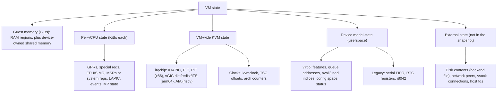
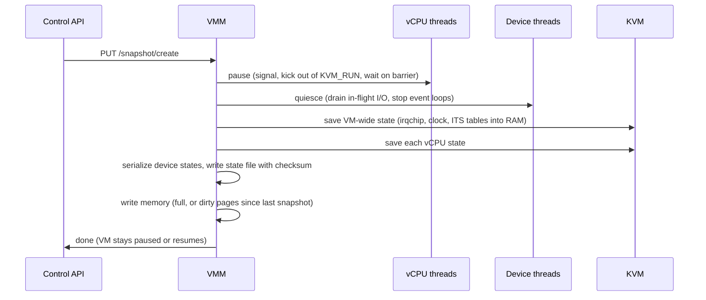
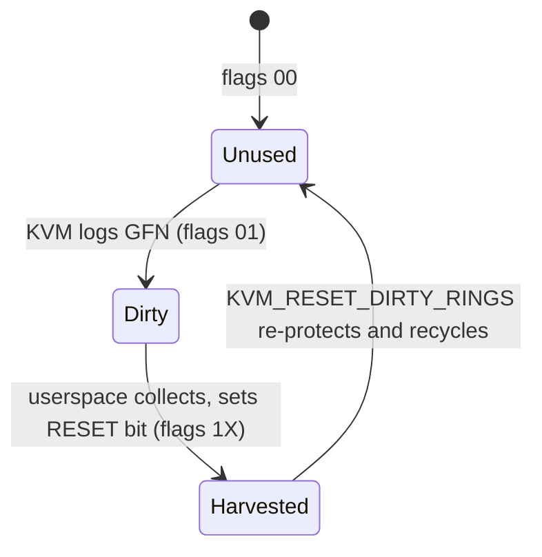

Purpose: define exactly what the state of a running VM is, how to capture it consistently, how to restore it fast (eagerly or lazily), and how to move it between hosts while it keeps running, so your VMM can pause, snapshot, clone and live migrate without corrupting guests or breaking their assumptions about time and identity.

# Snapshots, Live Migration, and Dirty Page Tracking

Related notes: [04 KVM API and the vCPU Run Loop](/compendium/virtualization/kvm-api-and-the-vcpu-run-loop), [05 Memory Virtualization EPT NPT and Guest Memory](/compendium/virtualization/memory-virtualization-ept-npt-and-guest-memory), [06 Interrupts Timers and Interrupt Controller Virtualization](/compendium/virtualization/interrupts-timers-and-interrupt-controller-virtualization), [08 Virtio Devices Virtqueues and vhost](/compendium/virtualization/virtio-devices-virtqueues-and-vhost), [10 Storage and Network Backends](/compendium/virtualization/storage-and-network-backends), [11 Device Passthrough VFIO IOMMU and Nested Virtualization](/compendium/virtualization/device-passthrough-vfio-iommu-and-nested-virtualization), [13 Security Isolation and Attack Surface](/compendium/virtualization/security-isolation-and-attack-surface), [14 Performance Observability and Debugging](/compendium/virtualization/performance-observability-and-debugging), [03 Memory Virtual Memory Paging Allocators and OOM](/compendium/linux-systems-engineering/memory-virtual-memory-paging-allocators-and-oom), [09 Unsafe Rust and the Rust Memory Model](/compendium/rust/unsafe-rust-and-the-rust-memory-model).

## Why this is a VMM design problem, not a feature

Snapshot and migration force you to answer, for every component of your VMM: **where does its state live, can I read it out, can I put it back, and does the guest observe the gap?** If a device keeps state in a host thread's stack, an in-flight io_uring request, or a kernel object you cannot query, it cannot be snapshotted. Designing for this late means rewriting devices. Designing for it early mostly means: keep device state in plain serializable structs, make every device quiesce on request, and keep all guest RAM in memory you can enumerate.

Three operations share the same machinery:

| Operation | Source keeps running? | Destination | Memory transfer | Typical use |
|---|---|---|---|---|
| Snapshot / restore | No (paused, then resumed or killed) | Same or another host, later | Full or diff file | Fast start (Lambda-style), checkpoint, debugging |
| Clone (restore N times) | N/A | Many hosts | Shared base file, copy-on-write | Pre-warmed pools, fuzzing |
| Live migration | Yes, until final switchover | Another host, now | Iterative over the network | Host maintenance, load balancing |

## What VM state is



### Per-vCPU state on x86-64

The x86 list is long and **order of restore matters**. A widely used order (Firecracker and Cloud Hypervisor follow variants of it):

| Step | Restore ioctl | Notes |
|---|---|---|
| 1 | `KVM_SET_CPUID2` | Must precede MSRs and XSAVE: CPUID decides which MSRs and XSAVE components are valid |
| 2 | `KVM_SET_MSRS` (part 1 or all) | Use the MSR list from `KVM_GET_MSR_INDEX_LIST` filtered to what you saved; `IA32_TSC`, `IA32_TSC_DEADLINE`, `IA32_APICBASE`, `IA32_MISC_ENABLE`, syscall MSRs, kvmclock MSRs |
| 3 | `KVM_SET_SREGS` | Control registers, segments, EFER, APIC base |
| 4 | `KVM_SET_XSAVE` / `KVM_SET_XSAVE2` path | FPU, SSE, AVX, AMX state; size from `KVM_CAP_XSAVE2` (at least 4096) |
| 5 | `KVM_SET_XCRS` | XCR0 |
| 6 | `KVM_SET_REGS` | GPRs, RIP, RFLAGS |
| 7 | `KVM_SET_DEBUGREGS` | DR0 to DR7 |
| 8 | `KVM_SET_LAPIC` | After SREGS so the APIC base is right; register page including timer state |
| 9 | `KVM_SET_MP_STATE` | Runnable, halted, wait-for-SIPI |
| 10 | `KVM_SET_VCPU_EVENTS` | Pending exceptions, NMIs, interrupt shadow, SMM state; restore late so nothing above clears them |
| 11 | `KVM_SET_NESTED_STATE` | Only if the guest uses nested virtualization |
| 12 | `KVM_SET_TSC_KHZ` | Before running; so the guest sees the same TSC frequency on a host with different base frequency (TSC scaling) |

Capture order is less strict but has one firm rule: **all vCPUs must be paused (out of `KVM_RUN` and not re-entering)** before you read anything. In kvm-ioctls 0.25.1 these are `VcpuFd::get_regs`, `get_sregs`, `get_xsave`, `get_xsave2` (unsafe, takes `&mut Xsave`), `get_msrs(&mut Msrs) -&gt; usize`, `get_lapic`, `get_vcpu_events`, `get_mp_state`, `get_cpuid2(num_entries)`, `get_xcrs`, `get_debug_regs`, `get_tsc_khz`, and `nested_state`.

Check the return value of `get_msrs`: it returns how many MSRs were read. Fewer than requested means an MSR failed partway and the rest of the list is unread. Firecracker treats this as a fatal snapshot error, which is correct.

### Per-vCPU state on ARM64 and RISC-V

Both architectures expose vCPU state through the generic `KVM_GET_ONE_REG` / `KVM_SET_ONE_REG` interface with a register list from `KVM_GET_REG_LIST`.

| Aspect | ARM64 | RISC-V |
|---|---|---|
| Enumeration | `KVM_GET_REG_LIST` returns every core, FP/SIMD, system register, timer, firmware (PSCI/SMCCC version) register | `KVM_GET_REG_LIST` (core, CSR, FP, timer, ISA extension, SBI extension registers) |
| Core regs | `KVM_REG_ARM_CORE` (x0 to x30, sp, pc, pstate, sp_el1, elr_el1, spsr) | `KVM_REG_RISCV_CORE` (pc, ra, sp, ..., mode) |
| System/CSR | `KVM_REG_ARM64_SYSREG` encoding by op0/op1/CRn/CRm/op2 | `KVM_REG_RISCV_CSR` (sstatus, sie, stvec, sscratch, sepc, scause, stval, sip, satp, and AIA CSRs) |
| Power state | `KVM_GET_MP_STATE` (running vs stopped through PSCI) | `KVM_GET_MP_STATE` (started vs stopped via SBI HSM) |
| Timer | `KVM_REG_ARM_TIMER_CTL`, `_CNT`, `_CVAL` registers, VM-wide counter offset | `KVM_REG_RISCV_TIMER` (frequency, time, compare, state) |
| Restore subtlety | `KVM_ARM_VCPU_INIT` with the same feature set first; some ID registers are writable and must match | ISA extension registers must be set before the vCPU first runs; mismatched extensions fail |

The generic approach (save every ID from `KVM_GET_REG_LIST`, restore in list order) is simple and future-proof, but you still need per-register exceptions: on arm64 the counter registers interact with the counter offset, and some registers must be written before others (for example, ID registers before features that depend on them).

### VM-wide KVM state

| Arch | State | Interface |
|---|---|---|
| x86 | PIC master/slave, IOAPIC | `KVM_GET_IRQCHIP` / `KVM_SET_IRQCHIP` (`VmFd::get_irqchip(&mut kvm_irqchip)`) |
| x86 | PIT | `KVM_GET_PIT2` / `KVM_SET_PIT2` |
| x86 | kvmclock | `KVM_GET_CLOCK` / `KVM_SET_CLOCK` |
| arm64 | vGICv3 distributor, redistributors, CPU interface | `KVM_{GET,SET}_DEVICE_ATTR` on the vGIC device: `KVM_DEV_ARM_VGIC_GRP_DIST_REGS`, `_REDIST_REGS`, `_CPU_SYSREGS`, `_LEVEL_INFO` |
| arm64 | ITS | `KVM_DEV_ARM_ITS_SAVE_TABLES` writes ITS tables into guest RAM (so they must be saved after this call); `KVM_DEV_ARM_ITS_RESTORE_TABLES` on the destination |
| arm64 | LPI pending tables | `KVM_DEV_ARM_VGIC_SAVE_PENDING_TABLES` on the vGICv3 device, also writes to guest RAM |
| riscv | AIA (APLIC, IMSIC) | Device attributes on the AIA device (`KVM_DEV_RISCV_AIA_GRP_*`) |

The arm64 ITS and pending-table saves write into guest memory. Therefore you must issue them **before** capturing memory, and under dirty ring tracking those writes happen without a vCPU context, which is exactly why `KVM_CAP_DIRTY_LOG_RING_WITH_BITMAP` exists (see below).

### Device model state

For each device, save what the guest could observe and what in-flight work implies:

| Device | Must save | Must quiesce first |
|---|---|---|
| virtio (any) | `device_status`, driver features, `queue_select`, per-queue size, ready, desc/avail/used addresses, `next_avail`, `next_used`, event idx state, config generation, interrupt status, MSI-X vector mapping | Stop processing; complete or cancel in-flight requests so used ring and guest memory agree |
| virtio-blk | Above plus nothing else if all requests completed | Drain the I/O queue (io_uring, thread pool) and flush if the guest requested it |
| virtio-net | Above plus MAC and config | Stop tap reads; packets in flight are simply lost (acceptable for networks) |
| vhost-user devices | Ask the backend: `VHOST_USER_GET_VRING_BASE` returns `last_avail_idx` and stops the ring; newer protocol features add device state transfer | Backend must stop and report |
| virtio-vsock | Connections are generally reset on restore | Firecracker resets the device and sends a transport reset event |
| Serial (16550) | Registers, FIFO contents, IRQ state | None |
| RTC / CMOS | CMOS RAM, alarm, register A/B/C | None |
| Block backends | Nothing (disk files are external) | `fsync` the backend before snapshotting so the disk is consistent with memory |

Vhost-kernel devices (vhost-net, vhost-vsock) hold ring state in the kernel: stop them with `VHOST_SET_VRING_BASE`/`GET_VRING_BASE` semantics and read the index back before saving.

## Versioned state serialization

The snapshot format outlives the VMM binary that wrote it. Plan for:

| Problem | Approach |
|---|---|
| New field added to a device | Default values on load; a version number per snapshot or per struct |
| Field removed or meaning changed | Migration function from old version to new |
| Different host kernel with more MSRs or registers | Save the list you read, not the list you would read today; on restore, refuse unknown required entries |
| CPU feature mismatch between hosts | Normalize CPUID with a CPU template on both ends (Firecracker CPU templates, QEMU named CPU models) and refuse to load on hosts lacking a feature |
| Cross-VMM-version restore | Declare a supported window (e.g. N-1 to N) and test it in CI |
| Corruption | Checksum (Firecracker uses CRC64 on the state file); integrity is not authenticity, so sign or encrypt snapshots stored off-host |

History worth knowing: Firecracker used per-struct versioning (`versionize` crate) early on, then moved to a simpler single snapshot format version (MAJOR.MINOR.PATCH) with a compatibility check at load time. The lesson: per-field versioning is expensive to maintain; one format version plus explicit migration code is usually enough.

A minimal Rust shape:

```rust
use serde::{Deserialize, Serialize};

#[derive(Serialize, Deserialize)]
pub struct SnapshotHeader {
    pub magic: u64,               // e.g. b"MYVMSNAP" as u64
    pub format_version: (u16, u16, u16),
    pub arch: Arch,
}

#[derive(Serialize, Deserialize)]
pub enum Arch { X86_64, Aarch64, Riscv64 }

#[derive(Serialize, Deserialize)]
pub struct MicrovmState {
    pub vm: VmState,              // irqchip, clock, counter offset
    pub vcpus: Vec<VcpuState>,    // arch-specific enum inside
    pub devices: DeviceStates,    // one entry per device, tagged by id
    pub memory: MemoryLayout,     // region list: gpa, size, file offset
}

#[derive(Serialize, Deserialize)]
pub struct VirtioQueueState {
    pub size: u16,
    pub ready: bool,
    pub desc_table: u64,
    pub avail_ring: u64,
    pub used_ring: u64,
    pub next_avail: u16,
    pub next_used: u16,
    pub event_idx_enabled: bool,
}
// VmState, VcpuState, DeviceStates, MemoryLayout: full structs in a real crate.
```

kvm-bindings offers a `serde` feature that derives `Serialize`/`Deserialize` for its structs (`kvm_regs`, `kvm_sregs`, `kvm_lapic_state`, and friends), which avoids hand-mirroring every KVM struct. Check that feature name in the kvm-bindings version you pin. The `virtio-queue` crate exposes `QueueState` for the same reason.

## Snapshot and restore design

### Taking a snapshot



Pausing vCPUs correctly is the part most first implementations get wrong:

1. Set a "pause requested" flag per vCPU.
2. Kick each vCPU out of `KVM_RUN` with a signal (vmm-sys-util `register_signal_handler` with a SIGRTMIN-based signal, and use `immediate_exit` in `kvm_run` to close the race where the signal arrives just before `KVM_RUN`).
3. The vCPU thread completes any in-progress exit handling (an MMIO write half-handled must finish), sees the flag, parks on a barrier or condvar.
4. Only then read vCPU state, from the vCPU thread itself (several KVM vCPU ioctls must be issued from the thread that owns the vCPU on some architectures, and doing so on that thread is always safe).

On x86, call `KVM_KVMCLOCK_CTRL` (`VcpuFd::kvmclock_ctrl`) for each paused vCPU so the guest's soft lockup watchdog does not fire when it notices the time jump after resume.

### Memory: full vs diff

| Mode | What is written | Restore | Cost |
|---|---|---|---|
| Full | All guest RAM | Directly resumable | Proportional to RAM size |
| Diff (dirty pages since last snapshot) | Only pages dirtied since tracking started or last snapshot, sparse file | Must be layered on a base (Firecracker: merge with `snapshot-editor edit-memory rebase`) | Proportional to dirtied memory, plus continuous dirty tracking overhead |
| Diff via `mincore(2)` | Pages resident in the host page cache/anonymous memory | Same as diff | No KVM tracking, but only correct when host swap is disabled |

Firecracker's `track_dirty_pages` uses KVM dirty logging for diffs; it is not stored in the snapshot, so it must be set again after load. Dirty tracking costs CPU (write-protection faults) and splits huge pages, so enable it only for VMs that will be diff-snapshotted.

### Restoring eagerly vs lazily

Eager restore reads the whole memory file before resuming. For a 4 GiB guest that is seconds. Fast-start platforms instead map memory lazily:

| Approach | How | Notes |
|---|---|---|
| `mmap(MAP_PRIVATE)` of the memory file | Kernel faults pages in from the file on first touch, copy-on-write keeps the file pristine | Simplest; many clones share page cache for unmodified pages. Firecracker's `File` backend |
| userfaultfd (UFFD) | VMM or an external handler process receives page fault events for guest memory and fills pages with `UFFDIO_COPY` (or `UFFDIO_ZEROPAGE`) | Full control: fetch from network or object storage, prefetch working sets, dedupe. Firecracker's `Uffd` backend |
| UFFD minor faults + shared memory | Pages exist in a shared file (`MAP_SHARED` of shmem/hugetlbfs); handler resolves with `UFFDIO_CONTINUE` | Avoids copies when the content is already in a shared cache |

UFFD mechanics (Linux `userfaultfd(2)`):

1. Create a uffd (`userfaultfd(2)` syscall, or open `/dev/userfaultfd`), handshake with `UFFDIO_API` to negotiate features (e.g. `UFFD_FEATURE_EVENT_REMOVE` for balloon, `UFFD_FEATURE_MISSING_HUGETLBFS`).
2. `UFFDIO_REGISTER` each guest memory range with `UFFDIO_REGISTER_MODE_MISSING` (and/or `MODE_WP`, `MODE_MINOR`).
3. Read `uffd_msg` events. For `UFFD_EVENT_PAGEFAULT`, find the page in the snapshot and `UFFDIO_COPY` it to the faulting address (this wakes the faulting thread). The faulting thread here is a vCPU thread inside `KVM_RUN` (KVM's get_user_pages path hits the missing page) or a device thread reading guest memory.
4. Handle `UFFD_EVENT_REMOVE` (balloon `MADV_DONTNEED`) so you do not later re-fill a page the guest gave back.

Firecracker passes the uffd and a description of the memory mappings (host virtual base address, size, offset in the snapshot file, page size per region) to the handler process over the Unix socket named in `mem_backend.backend_path`. Explicit 2 MiB huge pages with snapshots require the `Uffd` backend.

Lazy restore caveats:

- Every first touch costs a fault round trip (microseconds, more if the page comes over the network). Prefetch the working set recorded during a previous run.
- Devices that access guest memory from host threads (virtio backends, vhost-user processes) also fault; vhost-user backends in another process need the region registered there too, or pages prefaulted.
- Passthrough (VFIO) is incompatible: IOMMU mapping pins pages at map time and device DMA cannot take a userfault ([11 Device Passthrough VFIO IOMMU and Nested Virtualization](/compendium/virtualization/device-passthrough-vfio-iommu-and-nested-virtualization)).

### Restore flow

1. Validate header, format version, architecture, checksum, and CPU compatibility (CPUID/ID registers vs host).
2. Create VM and memory regions (mapping memory per backend: file, UFFD), create irqchip and vCPUs with the same configuration (same vCPU count, same features).
3. Restore VM-wide state; on arm64 ITS restore tables after memory is in place.
4. Restore vCPU state per the ordering above.
5. Re-create devices from saved state, reconnect backends (reopen disk files at the same paths, tap devices), re-register ioeventfds and irqfds.
6. Apply clock fixups.
7. Signal uniqueness change (VM generation ID) if this is a clone or restored from a snapshot used before.
8. Resume vCPUs (Firecracker loads paused unless `resume_vm` is set).

## Dirty page tracking

Both diff snapshots and live migration need to know which guest pages changed. KVM offers two mechanisms.

### Dirty bitmaps

1. Set `KVM_MEM_LOG_DIRTY_PAGES` on the memslot (`KVM_SET_USER_MEMORY_REGION` again with the flag added).
2. KVM write-protects the slot's pages in the stage-2/EPT tables (or uses Intel PML, Page Modification Logging, to log writes without faults on capable hardware), and splits huge pages so that tracking is per 4 KiB page.
3. `KVM_GET_DIRTY_LOG` returns a bitmap of pages dirtied since the previous call; bit 0 is the first page of the slot. With multi address spaces, bits 16 to 31 of `slot` select the address space.
4. Without manual protect, getting the log also clears it and re-write-protects those pages, all under the MMU lock, which for large VMs is a long stall.

`KVM_CAP_MANUAL_DIRTY_LOG_PROTECT2` (x86, arm64, mips) splits get from clear:

| Flag | Effect |
|---|---|
| `KVM_DIRTY_LOG_MANUAL_PROTECT_ENABLE` (bit 0) | `KVM_GET_DIRTY_LOG` no longer clears or write-protects; userspace calls `KVM_CLEAR_DIRTY_LOG` for ranges (`first_page` multiple of 64) when it is about to copy them |
| `KVM_DIRTY_LOG_INITIALLY_SET` (bit 1) | All bits start as 1, so KVM does not need to write-protect everything up front when tracking starts (x86, arm64, riscv) |

The older `KVM_CAP_MANUAL_DIRTY_LOG_PROTECT` (without the 2) had bugs; do not use it. Clearing just before copying narrows the window in which a page is re-dirtied after you copied it.

In kvm-ioctls 0.25.1: `VmFd::get_dirty_log(&self, slot: u32, memory_size: usize) -&gt; Result&lt;Vec&lt;u64&gt;&gt;`. You must have created the region with `KVM_MEM_LOG_DIRTY_PAGES`. vm-memory can also track dirtying done by the VMM itself (devices writing guest memory from userspace are invisible to KVM's log): enable its bitmap backend (`GuestMemoryMmap&lt;AtomicBitmap&gt;`) and OR it with the KVM bitmap.

```rust
// Merge KVM's dirty log with the VMM's own writes (vm-memory AtomicBitmap).
fn collect_dirty(vm: &kvm_ioctls::VmFd, slot: u32, size: usize,
                 vmm_bitmap: &vm_memory::bitmap::AtomicBitmap) -> anyhow::Result<Vec<u64>> {
    let mut words = vm.get_dirty_log(slot, size)?;
    let page = 4096usize;
    for (i, w) in words.iter_mut().enumerate() {
        for bit in 0..64 {
            let addr = (i * 64 + bit) * page;
            if addr < size && vmm_bitmap.is_addr_set(addr) {
                *w |= 1 << bit;
            }
        }
    }
    vmm_bitmap.reset(); // shortcut: resets after merge; racy if devices write concurrently, quiesce first
    Ok(words)
}
```

Check `AtomicBitmap`'s method names (`is_addr_set`, `reset`) in your vm-memory version; they are the ones I recall but did not reverify for this note.

### Dirty ring

The bitmap scales with memory size: a 1 TiB guest has a 32 MiB bitmap per pass, scanned fully even if 100 pages changed. The dirty ring (`KVM_CAP_DIRTY_LOG_RING`, and `KVM_CAP_DIRTY_LOG_RING_ACQ_REL`) instead logs each dirtied GFN into a per-vCPU ring buffer:

- Enable with `KVM_ENABLE_CAP` right after `KVM_CREATE_VM`, before creating vCPUs. Size in bytes, power of two; at least 4096 entries (64 KiB) recommended.
- Architectures: x86, arm64, riscv. Weakly ordered architectures expose only `ACQ_REL`; x86 may expose both.
- Each vCPU's ring is mmapped from the vCPU fd at `KVM_DIRTY_LOG_PAGE_OFFSET * PAGE_SIZE`.
- Entry: `struct kvm_dirty_gfn { __u32 flags; __u32 slot; /* as_id | slot_id */ __u64 offset; }`.
- Flags: `KVM_DIRTY_GFN_F_DIRTY` (bit 0), `KVM_DIRTY_GFN_F_RESET` (bit 1).



Harvest loop per vCPU: read entries in order starting at your private fetch index while `DIRTY` is set and `RESET` is clear (with load-acquire on arm64/riscv), record (slot, offset), set `RESET` (store-release). Then call `KVM_RESET_DIRTY_RINGS` on the VM fd, which re-write-protects the harvested pages. Per the KVM docs, call it before reading the dirty pages' contents, so writes after your copy are re-logged.

When a ring fills, `KVM_RUN` returns `KVM_EXIT_DIRTY_RING_FULL`; the vCPU cannot continue until userspace harvests and resets. That gives natural backpressure (a vCPU that dirties faster than you migrate is throttled), which QEMU exploits for its "dirty limit" convergence feature. Dirty GFNs buffered in hardware (PML) are flushed to the ring when the vCPU exits, so kick vCPUs before the final harvest.

`KVM_CAP_DIRTY_LOG_RING_WITH_BITMAP` exists because some state is dirtied without a running vCPU (arm64 vGIC/ITS table saves are the documented example). It requires `ACQ_REL` enabled and must be enabled before any memslot exists. Collect the backup bitmap with `KVM_GET_DIRTY_LOG` as the **last** step, after saving ITS and pending tables.

kvm-ioctls 0.25.1's documentation did not show a dirty ring wrapper on `VmFd`/`VcpuFd` that I could find; use `VmFd::enable_cap` with `KVM_CAP_DIRTY_LOG_RING_ACQ_REL`, mmap the ring yourself from the vCPU fd, and issue `KVM_RESET_DIRTY_RINGS` with a `vmm-sys-util` ioctl macro, or check whether a newer release added helpers.

| Property | Bitmap | Dirty ring |
|---|---|---|
| Collection cost | Proportional to memory size | Proportional to pages dirtied |
| Granularity | Per memslot | Per vCPU, carries slot and offset |
| Backpressure | None (vCPUs dirty freely) | Ring full exit stops the vCPU |
| Non-vCPU dirtying | Captured | Needs the WITH_BITMAP companion (arm64) |
| Userspace complexity | Low | Moderate (mmap, memory ordering, per-vCPU harvesting) |
| Best for | Small VMs, diff snapshots, simple VMMs | Large VMs, live migration with high dirty rates |

Architecture notes: x86 has PML on Intel to avoid write-protect faults per page. arm64 has hardware dirty-bit management (FEAT_HAFDBS) used by stage-2 on recent kernels in some paths; it still reports through the same interfaces. RISC-V supports both the bitmap and the ring; `KVM_DIRTY_LOG_INITIALLY_SET` is listed as available on riscv, but `KVM_CLEAR_DIRTY_LOG` and `MANUAL_DIRTY_LOG_PROTECT2` are documented for x86, arm64, mips, so verify riscv support in your target kernel before relying on manual protect.

## Live migration

### Pre-copy

The dominant algorithm (QEMU, Cloud Hypervisor, most clouds):

1. Destination VMM starts in "incoming" mode with the same configuration and empty memory.
2. Source enables dirty tracking for all RAM.
3. **Round 0**: send all memory while the guest runs.
4. **Round N**: fetch the dirty set since round N-1 (clearing it), send those pages.
5. Estimate: remaining dirty bytes / bandwidth = expected downtime. When it is below the downtime budget (QEMU's default `downtime-limit` is 300 ms), or after max rounds, go to stop-and-copy.
6. **Stop-and-copy**: pause vCPUs, quiesce devices, final dirty harvest, send remaining pages, vCPU state, VM state, device state.
7. Destination restores state, resumes. Source keeps the VM paused until the destination confirms, then tears down (or resumes it if migration failed: the source is the rollback).

### Post-copy

1. Send device and vCPU state first (after a short or zero pre-copy phase), start the guest on the destination immediately.
2. Destination registers guest memory with userfaultfd; missing pages fault, the destination requests them from the source over a return channel, and a background stream pushes the rest.
3. Done when every page has arrived.

| Property | Pre-copy | Post-copy | Hybrid (pre-copy then switch) |
|---|---|---|---|
| Convergence | Not guaranteed if dirty rate exceeds bandwidth | Guaranteed: each page moves at most once | Guaranteed after switch |
| Downtime | Short if converged | Very short (state only) | Short |
| Performance during migration | Degraded by dirty tracking | Degraded heavily by remote faults on destination | Both, briefly |
| Failure semantics | Source has a full copy until the end; abort is safe | **Neither side has the full VM** during post-copy; network failure loses the VM unless recovery is implemented | Safe until switch, risky after |
| Complexity | Moderate | High (UFFD, request channel, page priority) | Highest |

QEMU supports post-copy (`postcopy-ram` capability) with a recovery mechanism for network interruptions. Many production clouds use pre-copy with convergence aids and fall back to post-copy only when needed.

### Convergence techniques

| Technique | What it does | Tradeoff |
|---|---|---|
| Bandwidth increase / multifd | Multiple parallel streams (QEMU multifd) | Uses more network and CPU |
| Compression, XBZRLE (delta encoding of re-sent pages) | Fewer bytes per dirty page | CPU cost; XBZRLE needs a cache |
| Zero page detection | Send a marker instead of 4 KiB of zeros | Cheap, always do it |
| Auto-converge (CPU throttling) | Steal vCPU time to reduce dirty rate | Guest slows down noticeably |
| Dirty-rate limit via dirty ring | Throttle only vCPUs that dirty fast, using ring-full exits | Needs dirty ring; more precise than global throttle |
| Bigger downtime budget | Accept longer pause | Visible to workloads (TCP retransmits, missed heartbeats) |
| Switch to post-copy | Guarantees completion | Failure exposure, remote fault latency |

Measure the guest's dirty rate before migrating (QEMU has `calc-dirty-rate`); a VM dirtying 2 GB/s over a 10 Gbit/s link (about 1.25 GB/s) will never converge with pre-copy alone.

### Transport and protocol design

For your own VMM, a simple robust protocol:

| Phase | Message | Content |
|---|---|---|
| Handshake | `Hello` | Protocol version, VMM version, arch, CPU model/template, memory layout |
| Config | `Config` | Device list and configuration so the destination can build the same VM |
| Memory | `MemoryRange` | (gpa, length, data) or (gpa, length, zero) |
| Round end | `Iteration` | Round number, remaining dirty estimate |
| Switchover | `State` | Serialized `MicrovmState` |
| Commit | `Complete` / `Abort` | Destination ACK, then source exits |

Cloud Hypervisor's migration uses a similar request/response protocol over a Unix or TCP socket, with memory sent as range tables followed by data. Authenticate and encrypt the channel (TLS or an SSH tunnel); migration streams contain all guest memory, including secrets.

Disk handling is separate: shared storage (both hosts see the same volume), or block migration (mirror the disk with its own dirty tracking, e.g. QEMU's `drive-mirror` / `blockdev-mirror`), finishing before switchover. Network: the destination must attach the guest to the same L2 segment or overlay, with the same MAC and IPs.

## Clock and network fixups after restore

Time is where snapshots most visibly break guests.

| Clock | Problem after restore or migration | Fix |
|---|---|---|
| x86 TSC | Destination host TSC differs; guest sees a jump or, worse, time going backwards | KVM keeps the guest TSC continuous across restore if you restore `IA32_TSC` (or use the `KVM_VCPU_TSC_OFFSET` attribute in the `KVM_VCPU_TSC_CTRL` group) consistently across vCPUs; set `KVM_SET_TSC_KHZ` to the source frequency so scaling applies |
| x86 kvmclock | Guest's monotonic clock must not go backwards | `KVM_GET_CLOCK` on source, `KVM_SET_CLOCK` on destination. With `KVM_CLOCK_REALTIME` set, KVM adds the real time elapsed since capture (needs the source's clock to be TSC-based); Firecracker exposes this as `clock_realtime: true`, needs host Linux 5.16+ |
| x86 soft lockup | Guest watchdog sees vCPUs did not run for a long time | `KVM_KVMCLOCK_CTRL` after pausing each vCPU |
| arm64 generic timer | Virtual counter = physical counter minus offset; different host uptime means a jump | `KVM_ARM_SET_COUNTER_OFFSET` (gated by `KVM_CAP_COUNTER_OFFSET`, VM-wide, applies to virtual and physical counters). Note the docs name it `KVM_ARM_SET_CNT_OFFSET` in places; check the header. After using it, writes to `CNTVCT_EL0`/`CNTPCT_EL0` via SET_ONE_REG are silently ignored |
| riscv time CSR | Similar to arm64 | Restore `KVM_REG_RISCV_TIMER` time register, which KVM converts into an offset |
| Wall clock (all) | Guest wall clock resumes at snapshot time, possibly hours ago | Guest-side resync: NTP/chrony step, `hwclock` from RTC; or a VMClock / PTP-KVM device the guest reads; VMM updates RTC base time on restore |

Decide your policy explicitly: **monotonic time should advance by the real elapsed time** (or by zero, if you want the pause invisible), and wall time must be resynchronized. Firecracker's docs note that the guest wall clock resumes from snapshot time and guests should resync.

Network fixups:

- **Announce the move.** After live migration the guest's MAC is now behind a different switch port. QEMU sends RARP/gratuitous packets on the guest's behalf; virtio-net has `VIRTIO_NET_F_GUEST_ANNOUNCE`, where the device sets `VIRTIO_NET_S_ANNOUNCE` in config status and raises a config interrupt, and the guest sends gratuitous ARP and IPv6 unsolicited neighbor advertisements itself (it knows all its addresses, VLANs, and bonds), then acks with `VIRTIO_NET_CTRL_ANNOUNCE_ACK`.
- **TCP connections** survive live migration if downtime is below retransmit timeouts. They do not survive snapshot restore after long delays (peers time out) and must not survive cloning (two VMs with the same TCP sequence state).
- **vsock**: Firecracker resets the vsock device on restore; open connections close, listening sockets stay with an updated CID.
- **DHCP leases**: a clone restored with the same MAC requests or assumes the same IP; give clones new MACs (requires the guest to re-run network configuration, or a restore hook).

## Uniqueness hazards

Restoring the same snapshot twice produces two VMs with identical memory: same RNG pool, same cached random values, same UUIDs, same TLS session keys, same TCP sequence numbers, same in-memory nonces. Firecracker's docs state plainly that resuming the same snapshot more than once is insecure unless unique state is handled.

| Hazard | Example impact | Mitigation |
|---|---|---|
| Kernel CRNG state | Two clones generate identical "random" keys | VM Generation ID: guest reseeds on notification |
| Userspace PRNG state (OpenSSL, language runtimes) | Identical session keys, nonces, UUIDv4 | Application must reseed; VMGenID or VMClock generation counter can be polled; Linux 5.18+ exposes this to userspace only indirectly (via the kernel RNG reseed), so pools inside processes still need app hooks |
| Cached secrets (tokens, credentials) | Two VMs sharing one identity | Fetch secrets after restore, not before snapshot |
| Machine ID, host keys | Duplicate identities in fleet | Regenerate in a post-restore hook |
| MAC/IP | Network conflicts | Assign per clone |
| Monotonic counters, sequence numbers | Duplicate IDs in distributed systems | Regenerate or include a generation in IDs |

**VM Generation ID (VMGenID).** Originally Microsoft's specification: an ACPI device (with `_CID` "VM_Gen_Counter") whose `ADDR` method returns the guest physical address of a 128-bit generation GUID in guest memory. When the VM is restored or cloned, the VMM writes a new GUID and sends an ACPI notification (`Notify(..., 0x80)`) to the device. Linux's `vmgenid` driver (`CONFIG_VMGENID`) reads the new value and feeds it into the kernel RNG to force a reseed. Per Firecracker's docs, Linux 5.18+ supports it via ACPI and 6.10+ via device tree (a `microsoft,vmgenid` DT binding was added so arm64 and other DT platforms can use it).

**VMClock** is a newer device that exposes clock information plus a `vm_generation_counter` that userspace can map and poll, letting applications detect a restore cheaply. Firecracker's docs say the `poll()` support needs patches merged in Linux 7.0 (or vendor backports). Treat it as an emerging interface.

VMM implementation steps for VMGenID:

1. Reserve a page-aligned guest memory area (reserved in e820/DTB memory map) for the 16-byte GUID.
2. Describe the device in DSDT (x86, ACPI arm64) or DTB (`compatible = "microsoft,vmgenid"`, `reg`, `interrupts`).
3. On restore or clone: write a fresh random GUID, then raise the notification (ACPI GED event or the DT interrupt) before resuming vCPUs, or immediately after, depending on whether you want the reseed to precede any guest execution (before is safer, but the guest only processes it when it runs).
4. Include the address in the snapshot so the destination writes to the same place.

Even with VMGenID there is a window between resume and the guest processing the notification during which old random state can be used. For strong guarantees, the guest application must coordinate (e.g. refuse to generate keys until a post-restore hook confirms reseed).

## Architecture comparison

| Concern | x86-64 | ARM64 | RISC-V |
|---|---|---|---|
| vCPU state API | Many dedicated ioctls, strict order | ONE_REG + REG_LIST | ONE_REG + REG_LIST |
| Interrupt controller state | `KVM_GET_IRQCHIP`, `KVM_GET_LAPIC`, PIT | vGIC device attrs; ITS/pending tables written into guest RAM | AIA device attrs |
| Time continuity | TSC offset/scaling, kvmclock get/set, `KVMCLOCK_CTRL` | VM-wide counter offset | Timer ONE_REG time value |
| Dirty logging | Bitmap, manual protect, dirty ring, PML hardware assist | Bitmap, manual protect, dirty ring ACQ_REL + WITH_BITMAP | Bitmap, dirty ring (check manual protect support) |
| Cross-host CPU compatibility | CPUID templates, MSR feature list, TSC frequency | Writable ID registers (`KVM_ARM_GET_REG_WRITABLE_MASKS`), same GIC version (GICv2 to GICv3 restore impossible) | ISA extension registers must match |
| Uniqueness device | VMGenID via ACPI | VMGenID via ACPI or DT | VMGenID via DT |

## Common pitfalls

- Reading vCPU state while a vCPU might still be in `KVM_RUN`, producing an inconsistent snapshot that restores into a random crash.
- Not draining device I/O before saving virtio queue indices, so the used ring on restore does not match what the guest saw complete (lost or duplicated I/O).
- Forgetting VMM-originated writes to guest memory in dirty tracking (virtio devices writing used rings and data buffers from userspace are not in KVM's log).
- On arm64, capturing memory before `ITS_SAVE_TABLES` / `SAVE_PENDING_TABLES`, or collecting the WITH_BITMAP backup before those saves.
- Restoring MSRs before CPUID, or LAPIC before SREGS, on x86.
- Ignoring the return count of `KVM_GET_MSRS` / `KVM_SET_MSRS`.
- Not setting TSC frequency on the destination, so the guest's TSC runs at a different rate after migration.
- Wall clock never resynced after restore from an old snapshot; certificates appear not yet valid or expired.
- Restoring the same snapshot many times without VMGenID or app-level reseed: duplicated keys and nonces.
- Using `mincore`-based diffs with host swap enabled.
- Leaving dirty tracking on permanently: huge pages split, write faults everywhere, measurable throughput loss.
- Lazy UFFD restore combined with VFIO passthrough, or with a vhost-user backend that is not registered for the faults.
- Post-copy without a recovery plan: a network blip loses the VM.
- Unauthenticated, unencrypted migration or snapshot files: they contain every secret in guest memory ([13 Security Isolation and Attack Surface](/compendium/virtualization/security-isolation-and-attack-surface)).
- Snapshot format with no version field. The first schema change then breaks every stored snapshot.

## Review checklist

- [ ] Every device has a serializable state struct and a quiesce operation; no device state lives only in thread stacks or kernel objects you cannot query.
- [ ] Pause protocol uses signal kick plus `immediate_exit` and a barrier; state is read only when all vCPUs are parked.
- [ ] x86 restore order documented and tested (CPUID, MSRs, SREGS, XSAVE, XCRS, REGS, DEBUGREGS, LAPIC, MP state, events, nested, TSC kHz).
- [ ] arm64/riscv save every register from `KVM_GET_REG_LIST`, with explicit exceptions documented.
- [ ] Snapshot header includes magic, format version, architecture, CPU template, checksum; loader refuses incompatible files with a clear error.
- [ ] Memory backends: file `MAP_PRIVATE` and UFFD both tested; UFFD handles `EVENT_REMOVE`.
- [ ] Dirty tracking merges KVM log with VMM-side writes; manual protect used when available; dirty ring considered for large VMs.
- [ ] Live migration protocol versioned, authenticated, encrypted, with abort leaving the source running.
- [ ] Convergence policy defined (downtime budget, max rounds, throttling or post-copy fallback).
- [ ] Clock policy defined: monotonic continuity, wall clock resync, `KVMCLOCK_CTRL` on x86, counter offset on arm64.
- [ ] Network announce after migration (virtio-net `GUEST_ANNOUNCE` or VMM-sent packets); new MACs for clones.
- [ ] VMGenID device implemented for every architecture you support and triggered on every restore of a reused snapshot.
- [ ] Passthrough VMs are blocked from snapshot/migration unless a VFIO migration driver is present.
- [ ] CI restores snapshots produced by the previous VMM release.

## Primary Sources

- [KVM API documentation (dirty log, dirty ring, clocks, nested state, counter offset)](https://docs.kernel.org/virt/kvm/api.html)
- [KVM arm64 vGIC ITS device documentation](https://docs.kernel.org/virt/kvm/devices/arm-vgic-its.html)
- [KVM arm64 vGICv3 device documentation](https://docs.kernel.org/virt/kvm/devices/arm-vgic-v3.html)
- [KVM vCPU device attributes (x86 TSC control)](https://docs.kernel.org/virt/kvm/devices/vcpu.html)
- [userfaultfd kernel documentation](https://docs.kernel.org/admin-guide/mm/userfaultfd.html)
- [Firecracker snapshot support](https://github.com/firecracker-microvm/firecracker/blob/main/docs/snapshotting/snapshot-support.md)
- [Firecracker snapshot handling with UFFD](https://github.com/firecracker-microvm/firecracker/blob/main/docs/snapshotting/handling-page-faults-on-snapshot-resume.md)
- [Firecracker random for clones](https://github.com/firecracker-microvm/firecracker/blob/main/docs/snapshotting/random-for-clones.md)
- [QEMU migration framework documentation](https://www.qemu.org/docs/master/devel/migration/main.html)
- [QEMU postcopy documentation](https://www.qemu.org/docs/master/devel/migration/postcopy.html)
- [Microsoft Virtual Machine Generation ID specification](https://go.microsoft.com/fwlink/?LinkId=260709)
- [Linux vmgenid driver](https://github.com/torvalds/linux/blob/master/drivers/virt/vmgenid.c)
- [OASIS virtio 1.3 specification (virtio-net GUEST_ANNOUNCE)](https://docs.oasis-open.org/virtio/virtio/v1.3/virtio-v1.3.html)
- [kvm-ioctls VmFd](https://docs.rs/kvm-ioctls/latest/kvm_ioctls/struct.VmFd.html)
- [kvm-ioctls VcpuFd](https://docs.rs/kvm-ioctls/latest/kvm_ioctls/struct.VcpuFd.html)
- [Cloud Hypervisor live migration documentation](https://github.com/cloud-hypervisor/cloud-hypervisor/blob/main/docs/live_migration.md)
