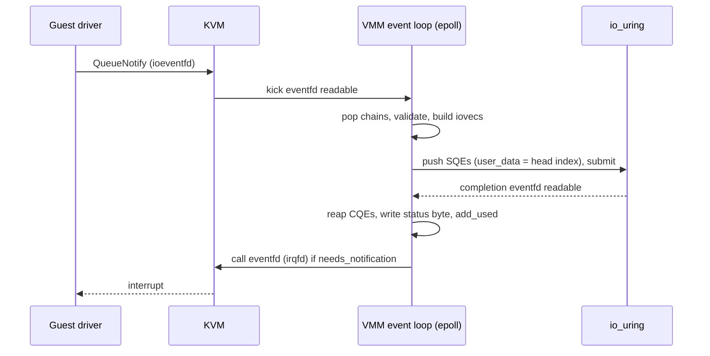
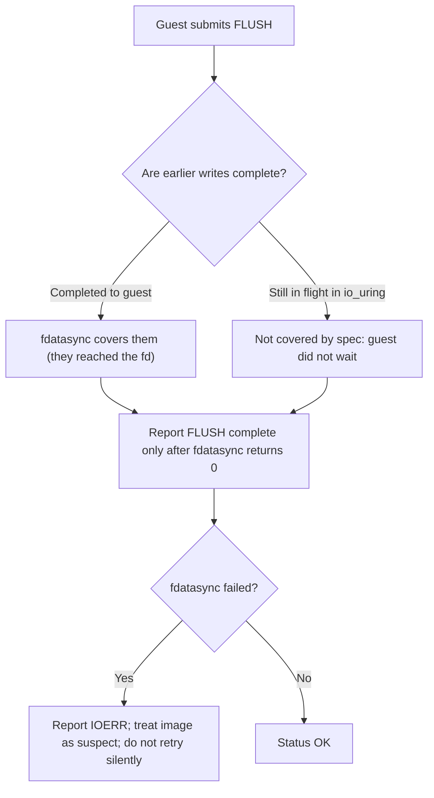

Purpose: explain what sits behind a virtio-blk or virtio-net device in the host (image formats, caching, async I/O, durability, rate limiting, tap and macvtap networking, offloads, metadata services, vsock) so your VMM is fast without lying to the guest about data integrity.

# Storage and Network Backends

Related notes: [08 Virtio Devices Virtqueues and vhost](/compendium/virtualization/virtio-devices-virtqueues-and-vhost), [07 Device Emulation PIO MMIO and the Bus Model](/compendium/virtualization/device-emulation-pio-mmio-and-the-bus-model), [12 Snapshots Live Migration and Dirty Page Tracking](/compendium/virtualization/snapshots-live-migration-and-dirty-page-tracking), [13 Security Isolation and Attack Surface](/compendium/virtualization/security-isolation-and-attack-surface), [14 Performance Observability and Debugging](/compendium/virtualization/performance-observability-and-debugging), [04 Filesystems VFS Block IO Page Cache and Storage](/compendium/linux-systems-engineering/filesystems-vfs-block-io-page-cache-and-storage), [05 Linux Networking TCP IP Routing Firewalling and DNS](/compendium/linux-systems-engineering/linux-networking-tcp-ip-routing-firewalling-and-dns), [13 Systems Programming Networking and IO](/compendium/rust/systems-programming-networking-and-io).

## The backend contract

A virtio device model translates guest requests into host operations. The device front half (rings, features, notifications) is in [08 Virtio Devices Virtqueues and vhost](/compendium/virtualization/virtio-devices-virtqueues-and-vhost). This note is about the back half:

| Guest sees | Host backend options |
|---|---|
| virtio-blk disk | Raw file, sparse file, qcow2 image, host block device (LV, NVMe namespace), network block (NBD, Ceph RBD, iSCSI) via vhost-user or a userspace library |
| virtio-net NIC | tap (with or without vhost-net), macvtap, vhost-user to a userspace switch (DPDK, OVS-DPDK), AF_XDP, vDPA |
| virtio-vsock socket | vhost-vsock in the kernel, Unix socket multiplexer in the VMM |
| Metadata endpoint | MMDS-style link-local HTTP service intercepted in the VMM, or a config disk |

Why it matters for your VMM: backends decide your I/O tail latency, how many host threads you need, whether a host crash loses acknowledged guest writes, and whether a noisy tenant can starve its neighbors.

## Disk image formats

| Format | Structure | Strengths | Weaknesses |
|---|---|---|---|
| Raw | Guest sector N at file offset N * 512 | Zero metadata overhead, trivially correct, works with O_DIRECT and io_uring directly | No snapshots or backing files in the format; size management is the filesystem's job |
| Raw sparse | Same, with holes for never-written ranges | Thin provisioning for free | Fragmentation; ENOSPC can appear at write time |
| qcow2 | Two-level cluster mapping, refcounts, optional backing file | Copy-on-write layers, internal snapshots, compression, thin provisioning | Metadata I/O, cache management, crash-consistency complexity |
| Host block device | LV, partition, NVMe namespace | Predictable performance, no host filesystem | Provisioning outside the VMM |
| VHDX, VMDK | Other hypervisors' formats | Interop | Usually convert to raw or qcow2 on import |

Firecracker supports only raw images, deliberately: it keeps the device model small, and storage features (copy-on-write, snapshots) are delegated to the host (device mapper snapshots, overlay block devices, filesystem reflinks). Cloud Hypervisor and crosvm implement qcow2 (Cloud Hypervisor's `qcow` crate descends from crosvm's).

### Raw files and sparse allocation

Linux filesystems allocate blocks lazily. A raw image created with `truncate -s 20G disk.img` uses no space until written.

| Operation | Syscall | Maps to guest command |
|---|---|---|
| Find allocated ranges | `lseek(fd, off, SEEK_DATA)` / `SEEK_HOLE` | Image copy, snapshot export |
| Deallocate a range | `fallocate(fd, FALLOC_FL_PUNCH_HOLE \| FALLOC_FL_KEEP_SIZE, off, len)` | virtio-blk DISCARD |
| Zero a range efficiently | `fallocate(fd, FALLOC_FL_ZERO_RANGE, off, len)`, or punch hole | virtio-blk WRITE_ZEROES |
| Preallocate | `fallocate(fd, 0, off, len)` | Provisioning, avoiding ENOSPC surprises |
| Discard on a block device | `ioctl(BLKDISCARD)` or `fallocate` on the block device | DISCARD |

Trade-off: sparse images make over-commit possible. Over-commit means a guest can receive ENOSPC (reported as `VIRTIO_BLK_S_IOERR`) on a write to a disk that looks half empty. Decide your policy up front: fail the request, pause the VM until an operator adds space (QEMU's `werror=enospc` behavior), or fully preallocate.

### qcow2 internals

A qcow2 file begins with a header (magic `QFI\xfb`, version 2 or 3) and maps guest offsets through two levels:

```text
guest offset -> L1 index -> L1 entry -> L2 table -> L2 entry -> host cluster offset
```

| Structure | Role |
|---|---|
| Cluster | Allocation unit, default 64 KiB (512 B to 2 MiB allowed) |
| L1 table | One entry per L2 table, contiguous, small |
| L2 table | One cluster of entries, each mapping one guest cluster |
| Refcount table and blocks | Per-host-cluster reference counts, enable snapshots and CoW |
| Backing file | Unallocated guest clusters read from a parent image |
| Snapshot table | Internal snapshots: a copied L1 plus raised refcounts |
| Extended L2 entries (v3) | Subclusters (32 per cluster) to cut CoW amplification |
| Compressed clusters | Read-only in practice, rewritten uncompressed on write |

Costs your implementation must manage:

- **Metadata reads**: every guest I/O needs its L2 entry. Keep an L2 cache sized to the working set (one 64 KiB L2 table covers 512 MiB of guest data with 64 KiB clusters), otherwise random reads double their I/O.
- **Allocating writes**: first write to a cluster allocates a host cluster, possibly copies data from the backing file (copy-on-write), updates the L2 entry, and increments refcounts. That is several dependent writes per guest write.
- **Crash consistency**: write ordering must ensure that metadata never points at unwritten data and refcounts never under-count. The safe order is data, then refcount, then L2 mapping, with flushes between dependent steps when the cache is volatile. qcow2's `lazy_refcounts` option trades a repair pass after a crash for fewer flushes.
- **Dirty bit**: v3 has an incompatible-feature dirty bit; set it while refcounts may be stale, clear it on clean close, and run a consistency check when opening a dirty image.

Rule of thumb: implement raw first. Add qcow2 only if you need backing-file layering inside the VMM; otherwise use host-level CoW (device mapper thin provisioning, LVM snapshots, reflink copies on XFS or btrfs) and keep the VMM on raw.

## Host caching and O_DIRECT

The host page cache sits between your VMM and the disk unless you bypass it. QEMU's cache modes are a useful vocabulary:

| Mode | Host page cache | `O_DIRECT` | Flush honored | Guest-visible write cache | Use |
|---|---|---|---|---|---|
| writeback | Yes | No | Yes (`fdatasync`) | Yes | Default; good for dev, risks memory pressure |
| none | No | Yes | Yes | Yes (disk's cache) | Production default for most clouds |
| writethrough | Yes | No | Every write is `O_DSYNC` | No | Guests that never flush (rare today) |
| directsync | No | Yes | Every write is `O_DSYNC` | No | Strict durability, slow |
| unsafe | Yes | No | Ignored | Yes | Throwaway CI VMs only |

Why most production VMMs choose `O_DIRECT`:

- Guest memory already has a page cache. Caching again in the host doubles memory use and hides real I/O cost.
- Host page cache makes one tenant's I/O affect another's memory and latency.
- Writeback from the host page cache is invisible to the guest, so latency is unpredictable.

`O_DIRECT` rules:

| Constraint | Detail |
|---|---|
| Buffer alignment | Memory address aligned to the device's DMA alignment (often 512, sometimes 4096) |
| Offset and length alignment | Multiples of the logical block size (512 or 4096) |
| Discovery | `statx` with `STATX_DIOALIGN` (Linux 6.1+) reports `stx_dio_mem_align` and `stx_dio_offset_align`; otherwise `ioctl(BLKSSZGET)` on block devices, or assume 4096 |
| Unaligned guest buffers | Virtio descriptors can point anywhere; copy through an aligned bounce buffer when they are not aligned |
| Filesystem support | Most local filesystems support it; tmpfs historically rejected it (recent kernels added support, check your host kernel) |

If the guest's logical block size is 512 but the host device is 4Kn, every guest 512-byte write becomes a read-modify-write in your VMM. Advertise the host's logical block size to the guest with VIRTIO_BLK_F_BLK_SIZE so the guest issues aligned I/O.

## I/O engines in the VMM

| Engine | How | Pros | Cons |
|---|---|---|---|
| Synchronous on the device thread | `preadv`/`pwritev` when the queue is kicked | Simple, deterministic | One slow request blocks the queue (and every device on that thread) |
| Thread pool | Hand requests to workers doing blocking I/O | Works everywhere | Thread wakeups, context switches, locking |
| Linux AIO (`io_submit`) | Kernel async with `O_DIRECT` | Mature | Only truly async for `O_DIRECT`; can block on metadata |
| io_uring | Shared submission and completion rings | Batching, truly async for buffered and direct I/O, fixed buffers, polling | Kernel version dependence, larger kernel attack surface |
| Userspace NVMe (SPDK) via vhost-user | Polling userspace driver | Highest IOPS | Dedicated cores, operational complexity |

Firecracker exposes this choice as the block device `io_engine`: `"Sync"` (default) or `"Async"` (io_uring), the latter requiring host kernel 5.10.51 or newer per its API definition. Cloud Hypervisor uses io_uring when available and falls back to a thread-based async engine.

### io_uring in an epoll-based VMM

Integrate io_uring with your existing event loop by registering an eventfd for completions, so the loop does not block in `io_uring_enter`:



With the `io-uring` crate (checked against 0.7.x; `Submitter::register_eventfd(&self, eventfd: RawFd) -&gt; io::Result&lt;()&gt;` confirmed in source):

```rust
use io_uring::{opcode, types, IoUring};
use std::os::fd::{AsRawFd, RawFd};

pub struct BlockEngine {
    ring: IoUring,
    file_fd: RawFd,
}

impl BlockEngine {
    pub fn new(file_fd: RawFd, completion_evt: RawFd) -> std::io::Result<Self> {
        let ring = IoUring::new(128)?;
        ring.submitter().register_eventfd(completion_evt)?;
        Ok(Self { ring, file_fd })
    }

    /// SAFETY: `iov` and the guest memory it points to must stay valid until the
    /// matching completion is reaped. Guest memory is mapped for the VM lifetime;
    /// the iovec array must be owned by the in-flight request, not the stack.
    pub unsafe fn submit_read(&mut self, iov: *const libc::iovec, n: u32, offset: u64, tag: u64) -> std::io::Result<()> {
        let sqe = opcode::Readv::new(types::Fd(self.file_fd), iov, n)
            .offset(offset)
            .build()
            .user_data(tag);
        self.ring
            .submission()
            .push(&sqe)
            .map_err(|_| std::io::Error::other("submission queue full"))?;
        self.ring.submit()?;
        Ok(())
    }

    pub fn submit_flush(&mut self, tag: u64) -> std::io::Result<()> {
        let sqe = opcode::Fsync::new(types::Fd(self.file_fd))
            .flags(types::FsyncFlags::DATASYNC)
            .build()
            .user_data(tag);
        // SAFETY: fsync carries no buffers.
        unsafe { self.ring.submission().push(&sqe) }
            .map_err(|_| std::io::Error::other("submission queue full"))?;
        self.ring.submit()?;
        Ok(())
    }

    /// Called when the completion eventfd is readable.
    pub fn reap(&mut self, mut done: impl FnMut(u64, i32)) {
        for cqe in self.ring.completion() {
            done(cqe.user_data(), cqe.result()); // negative result is -errno
        }
    }
}
```

Design notes:

- `user_data` carries the descriptor head (and queue index). On completion, map negative results to `VIRTIO_BLK_S_IOERR` (or `UNSUPP` for `-EOPNOTSUPP`), write the status byte, then `add_used`.
- The submission queue can fill. When `push` fails, stop popping descriptor chains and leave them in the avail ring; resume when completions free space. That is natural backpressure to the guest.
- Pinning guest memory: guest RAM is mapped for the VM lifetime, so iovecs can point straight into it. But if you support memory hot-unplug or balloon `MADV_DONTNEED`, an in-flight read into a region being removed must be drained first.
- Registered (fixed) buffers (`IORING_REGISTER_BUFFERS`) over guest memory avoid per-I/O page pinning cost; they pin the whole region, which interacts with balloon and memory overcommit.
- Do not use a general-purpose async runtime (Tokio) on the device hot path unless you have measured it. VMM device loops are better served by a small epoll loop plus io_uring; crosvm built its own executor (`cros_async`) for this reason. See [08 Async Rust Futures Tokio and Runtimes](/compendium/rust/async-rust-futures-tokio-and-runtimes) for the trade-offs.

## Data integrity: flush, FUA, and write ordering

This is the part where VMMs most often lie to guests.

### What the guest is promised

With VIRTIO_BLK_F_FLUSH negotiated, the device presents a **volatile write cache**:

1. A completed write may still be in a volatile cache (host page cache, disk cache).
2. A completed `VIRTIO_BLK_T_FLUSH` guarantees that all writes completed before the flush was submitted are on stable storage.
3. There is no ordering between in-flight requests. The guest filesystem enforces ordering by waiting for completions and issuing flushes.

Without VIRTIO_BLK_F_FLUSH, the device claims to be write-through: every completed write must already be stable. If you do not offer FLUSH but write through the page cache without `O_DSYNC`, you are lying, and a host crash loses acknowledged writes.

VIRTIO_BLK_F_CONFIG_WCE lets the guest switch between writeback and writethrough at runtime through the `writeback` config field. If you offer it, honor it (switch to `O_DSYNC` semantics or flush after each write when writethrough is selected).

### FUA

Forced Unit Access ("this write is durable when it completes") exists in SCSI and NVMe. The virtio-blk request types do not include an FUA flag. A Linux guest on virtio-blk emulates FUA with a post-flush, so FUA-heavy workloads (journal commits) cost a flush each. If you expose virtio-scsi or an emulated NVMe controller instead, you must implement FUA as `pwritev2` with `RWF_DSYNC` (or `O_DSYNC`, or write plus `fdatasync`).

### Mapping to host operations

| Guest operation | Host implementation | Notes |
|---|---|---|
| Write (cache on) | `pwritev`, or io_uring writev, `O_DIRECT` preferred | Completion means "accepted", not durable |
| Flush | `fdatasync` (or io_uring `Fsync` with DATASYNC) | Covers all previously completed writes on that fd |
| Write with FUA (scsi or nvme) | `pwritev2(..., RWF_DSYNC)` | Durable on completion |
| Discard | `fallocate(PUNCH_HOLE \| KEEP_SIZE)` | Must not be reported before it is safe to read zeroes, if `WRITE_ZEROES` semantics were promised |
| Write zeroes | `fallocate(ZERO_RANGE)` or punch hole with unmap allowed | Respect the `unmap` flag in the request |

`fdatasync` vs `fsync`: `fdatasync` skips metadata not needed to read the data back (mtime). It still persists file size changes and block allocation, which is what a sparse image needs. Use `fdatasync`.

`O_DIRECT` does not imply durability. It bypasses the page cache, but the drive's own volatile cache can still hold the data. Flush is still required.

### Ordering hazards in your own code



Pitfalls:

- Completing a write to the guest before the host write was even issued (for example buffering in the VMM to "batch" later). The flush then cannot cover it.
- Ignoring `fdatasync` errors. Since Linux 4.13, writeback errors are reported once per fd; after a failed fsync, the page cache may have dropped the dirty pages. Retrying and getting success does not mean the data is on disk. Treat the first failure as data loss and surface it (fail the request, mark the disk errored, consider stopping the VM).
- Image metadata (qcow2) flushed in the wrong order relative to data. A flush must also persist all metadata that the completed writes depend on.
- Snapshot without flush: before snapshotting the disk at the host level, drain in-flight I/O and flush, or the snapshot is crash-consistent at best. See [12 Snapshots Live Migration and Dirty Page Tracking](/compendium/virtualization/snapshots-live-migration-and-dirty-page-tracking).

## Rate limiting with token buckets

Multi-tenant hosts need per-VM I/O limits. Firecracker's model (from its API definition):

| Field | Meaning |
|---|---|
| `size` | Bucket capacity in tokens (bytes for `bandwidth`, operations for `ops`) |
| `refill_time` | Milliseconds to refill the full bucket; rate = `size / refill_time` |
| `one_time_burst` | Extra initial tokens consumed before the regular refill starts |

Each block or net device can have a `bandwidth` bucket and an `ops` bucket; a request must obtain tokens from both. A bucket with `size` and `refill_time` both 0 disables that limit. Net devices have separate RX and TX limiters, and limits can be patched at runtime.

```json
{
  "bandwidth": { "size": 52428800, "one_time_burst": 104857600, "refill_time": 1000 },
  "ops":       { "size": 5000, "refill_time": 1000 }
}
```

This example allows 50 MiB/s and 5000 IOPS sustained, plus a one-time 100 MiB burst (for example to speed up boot).

### Implementation

```rust
use std::time::Instant;

pub struct TokenBucket {
    size: u64,
    budget: u64,
    one_time_burst: u64,
    refill_time_ms: u64,
    last: Instant,
}

impl TokenBucket {
    pub fn new(size: u64, one_time_burst: u64, refill_time_ms: u64) -> Self {
        Self { size, budget: size, one_time_burst, refill_time_ms, last: Instant::now() }
    }

    fn refill(&mut self, now: Instant) {
        let elapsed_ms = now.duration_since(self.last).as_millis() as u64;
        if elapsed_ms == 0 || self.refill_time_ms == 0 {
            return;
        }
        let add = (self.size as u128 * elapsed_ms as u128 / self.refill_time_ms as u128) as u64;
        if add > 0 {
            self.budget = (self.budget + add).min(self.size);
            self.last = now;
        }
    }

    /// Returns true if `tokens` were consumed. Requests larger than the bucket
    /// are allowed when it is full, then drain it, so huge requests do not starve.
    pub fn try_consume(&mut self, tokens: u64, now: Instant) -> bool {
        if self.size == 0 && self.refill_time_ms == 0 {
            return true; // disabled
        }
        let from_burst = tokens.min(self.one_time_burst);
        self.one_time_burst -= from_burst;
        let tokens = tokens - from_burst;
        if tokens == 0 {
            return true;
        }
        self.refill(now);
        if tokens <= self.budget {
            self.budget -= tokens;
            true
        } else if tokens > self.size && self.budget == self.size {
            self.budget = 0;
            true
        } else {
            false
        }
    }

    /// Milliseconds until `tokens` (capped at size) can be available, for arming a timerfd.
    pub fn wait_ms(&self, tokens: u64) -> u64 {
        let missing = tokens.min(self.size).saturating_sub(self.budget);
        if self.size == 0 { 0 } else { (missing * self.refill_time_ms).div_ceil(self.size) }
    }
}

#[cfg(test)]
mod tests {
    use super::*;
    use std::time::Duration;

    #[test]
    fn burst_then_refill() {
        let t0 = Instant::now();
        let mut b = TokenBucket::new(1000, 500, 1000);
        assert!(b.try_consume(1500, t0)); // 500 burst + 1000 budget
        assert!(!b.try_consume(1, t0));
        assert!(b.try_consume(100, t0 + Duration::from_millis(100)));
    }

    #[test]
    fn oversized_request_drains_full_bucket() {
        let t0 = Instant::now();
        let mut b = TokenBucket::new(100, 0, 1000);
        assert!(b.try_consume(1000, t0));
        assert!(!b.try_consume(1, t0));
    }
}
```

Integration with the device:

1. Before popping a chain, compute its cost (bytes for bandwidth, 1 for ops). If either bucket refuses, stop processing that queue. Do not pop the chain, or put it back by not advancing your avail index (virtio-queue's `Queue` exposes `go_to_previous_position` for exactly this, confirmed on 0.18.0).
2. Arm a `timerfd` for `wait_ms` and add it to the event loop.
3. When the timer fires, resume processing. Ignore guest kicks while throttled (they will be satisfied by the timer).

Throttling by not consuming descriptors is the correct backpressure: the guest sees a slow device and its I/O scheduler queues requests, rather than errors. For vhost-user devices, rate limiting is the back-end's responsibility (Firecracker documents this explicitly). For kernel vhost-net, use host traffic control (`tc`) on the tap, and for block devices, cgroup v2 `io.max`. See [09 cgroups Namespaces Containers and Runtime Isolation](/compendium/linux-systems-engineering/cgroups-namespaces-containers-and-runtime-isolation).

## Networking backends

### tap devices

A tap device is a virtual Ethernet interface whose other end is a file descriptor: frames the host stack sends to the interface are readable from the fd, and frames written to the fd are injected into the host stack.

```rust
use std::fs::{File, OpenOptions};
use std::os::fd::AsRawFd;

const TUNSETIFF: libc::c_ulong = 0x4004_54ca;
const TUNSETOFFLOAD: libc::c_ulong = 0x4004_54d0;
const TUNSETVNETHDRSZ: libc::c_ulong = 0x4004_54d8;
const IFF_TAP: libc::c_short = 0x0002;
const IFF_NO_PI: libc::c_short = 0x1000;
const IFF_VNET_HDR: libc::c_short = 0x4000;
const IFF_MULTI_QUEUE: libc::c_short = 0x0100;
const TUN_F_CSUM: libc::c_uint = 0x01;
const TUN_F_TSO4: libc::c_uint = 0x02;
const TUN_F_TSO6: libc::c_uint = 0x04;

#[repr(C)]
struct IfReq {
    name: [u8; libc::IFNAMSIZ],
    flags: libc::c_short,
    _pad: [u8; 22],
}

/// Opens one queue of an existing, pre-created tap (created by the host agent,
/// so the VMM needs no CAP_NET_ADMIN).
pub fn open_tap_queue(name: &str) -> std::io::Result<File> {
    let file = OpenOptions::new().read(true).write(true).open("/dev/net/tun")?;
    let mut req = IfReq { name: [0; libc::IFNAMSIZ], flags: IFF_TAP | IFF_NO_PI | IFF_VNET_HDR | IFF_MULTI_QUEUE, _pad: [0; 22] };
    let n = name.len().min(libc::IFNAMSIZ - 1);
    req.name[..n].copy_from_slice(&name.as_bytes()[..n]);

    let fd = file.as_raw_fd();
    // SAFETY: valid fd, correctly sized ifreq and int arguments.
    unsafe {
        if libc::ioctl(fd, TUNSETIFF, &mut req) < 0 {
            return Err(std::io::Error::last_os_error());
        }
        let hdr_len: libc::c_int = 12; // virtio 1.x virtio_net_hdr (with num_buffers)
        if libc::ioctl(fd, TUNSETVNETHDRSZ, &hdr_len) < 0 {
            return Err(std::io::Error::last_os_error());
        }
        // Offloads the *guest* accepted (GUEST_CSUM, GUEST_TSO4/6): the tap may
        // now hand us partially checksummed or GSO frames destined for the guest.
        let offloads = TUN_F_CSUM | TUN_F_TSO4 | TUN_F_TSO6;
        if libc::ioctl(fd, TUNSETOFFLOAD, offloads as libc::c_ulong) < 0 {
            return Err(std::io::Error::last_os_error());
        }
    }
    Ok(file)
}
```

Notes:

- The ioctl numbers above are the x86-64 and arm64 and RISC-V encodings (generic `_IOW` layout); the `libc` crate exports `TUNSETIFF` and friends on Linux targets, prefer those constants when available.
- `IFF_VNET_HDR` makes every read and write carry a `virtio_net_hdr`, so offload metadata passes through without translation: the TX path copies the guest's header straight to the tap; the RX path copies the tap's header into the guest buffer.
- Set the tap fd non-blocking and add it to epoll. Read until `EAGAIN`.
- Only enable `TUNSETOFFLOAD` flags that the guest accepted in feature negotiation, and set them after DRIVER_OK. If the guest did not accept GUEST_TSO4 but the tap delivers a 64 KiB GSO frame, the guest drops it.
- `TUN_F_UFO` is legacy; newer kernels (6.2+) add `TUN_F_USO4` and `TUN_F_USO6` for UDP segmentation offload, matching virtio's `GUEST_USO4/6`.

### Feature to offload mapping

| virtio feature (negotiated) | Direction | Host mechanism |
|---|---|---|
| VIRTIO_NET_F_CSUM | Guest TX | Write frames with `NEEDS_CSUM`; tap or NIC completes checksum |
| VIRTIO_NET_F_HOST_TSO4 / TSO6 | Guest TX | Write GSO frames up to 64 KiB; host segments (GSO) or NIC (TSO) |
| VIRTIO_NET_F_GUEST_CSUM | Guest RX | `TUN_F_CSUM` |
| VIRTIO_NET_F_GUEST_TSO4 / TSO6 | Guest RX | `TUN_F_TSO4` / `TUN_F_TSO6` (host may deliver GRO aggregates) |
| VIRTIO_NET_F_MRG_RXBUF | Guest RX | Spread one large frame across several guest buffers, set `num_buffers` |

Offloads are the single biggest throughput lever: without them every guest packet is at most one MTU, and per-packet costs (exits, ring operations, syscalls) dominate. With TSO and GRO, one ring operation moves up to 64 KiB.

### RX and TX paths and backpressure

TX (guest to host):

1. Guest kicks the TX queue (ioeventfd).
2. Pop chain, gather readable descriptors (header plus frame) into an iovec.
3. `writev` to the tap. If `EAGAIN`, stop and retry when the tap is writable.
4. `add_used` with `len = 0` (TX buffers are read-only for the device), notify if needed.

RX (host to guest):

1. Tap becomes readable.
2. If the RX queue has no available buffers, **stop reading the tap** (remove read interest) and wait for the guest to kick the RX queue with fresh buffers. Do not read and drop; the host stack queues frames and TCP backs off naturally.
3. Read one frame into guest buffers (with MRG_RXBUF, possibly several chains; set `num_buffers`).
4. `add_used` with the number of bytes written, notify if needed.

A frame read from the tap that does not fit (no buffers left mid-frame) must be held in a one-frame "deferred" slot and delivered first next time, not dropped, or you create packet loss under load.

### Topologies

| Topology | How | Pros | Cons |
|---|---|---|---|
| tap + Linux bridge | tap enslaved to a bridge with the uplink | Simple L2, guests on the LAN | Bridge and netfilter overhead, MAC learning |
| tap + routing and NAT | tap gets a /30 or /31, host routes and NATs | Isolation per VM, clear policy point | IP management, conntrack cost |
| macvtap (bridge, vepa, private, passthru modes) | Character device `/dev/tapN` attached to a physical NIC | No bridge, near-native path | Host cannot talk to guests in bridge mode via the same NIC; limited filtering |
| tap + vhost-net | Same tap, data path in kernel thread | Large throughput gain, fewer VMM wakeups | Kernel attack surface; VMM loses per-packet hooks (MMDS interception, rate limiting) |
| vhost-user to OVS-DPDK or a userspace switch | Polling back-end | Very high packet rates | Dedicated cores, hugepages |
| AF_XDP | XDP socket bound to a NIC queue | Kernel bypass with kernel driver | Per-NIC support, complexity |
| SR-IOV VF via VFIO or vDPA | Hardware queue per guest | Line rate | Migration hard (VFIO), hardware dependent; see [11 Device Passthrough VFIO IOMMU and Nested Virtualization](/compendium/virtualization/device-passthrough-vfio-iommu-and-nested-virtualization) |

macvtap modes: `bridge` lets guests on the same parent talk directly; `vepa` sends all traffic to the external switch (which must hairpin); `private` isolates guests from each other; `passthru` gives one guest exclusive control of the NIC.

Firecracker runs inside a jailer without network admin rights, so taps are created by the host orchestration before launch and passed by name. This pattern (privileged agent creates, unprivileged VMM opens) is worth copying.

### Multiqueue

A single queue pair serializes all packet processing on one guest vCPU and one host thread. Multiqueue:

1. Create the tap with `IFF_MULTI_QUEUE`; open `/dev/net/tun` once per queue with the same name to get one fd per queue.
2. Offer VIRTIO_NET_F_MQ and VIRTIO_NET_F_CTRL_VQ with `max_virtqueue_pairs = N`.
3. The guest enables pairs with `VIRTIO_NET_CTRL_MQ_VQ_PAIRS_SET` on the control queue; only enabled pairs are active.
4. Run each pair on its own host thread (or vhost worker), and give each its own MSI-X vector so interrupts land on different guest vCPUs. On virtio-mmio there is only one interrupt for all queues, which caps the benefit.

Match queue count to vCPU count; more queues than vCPUs mostly add overhead.

## MMDS-style metadata services

Guests need instance metadata (hostname, SSH keys, credentials, network config). Options:

| Approach | Mechanism | Notes |
|---|---|---|
| Link-local HTTP (MMDS, cloud IMDS) | Guest talks HTTP to `169.254.169.254`; the VMM intercepts frames on a virtio-net device | Familiar to cloud-init and SDKs; needs a tiny TCP stack in the VMM |
| Config disk (cloud-init NoCloud, ConfigDrive) | Extra read-only virtio-blk with a filesystem labeled `cidata` | No network code in the VMM; static after boot |
| Kernel cmdline or FDT `chosen` properties | Small values only | Visible to every guest process |
| vsock agent | Host agent serves metadata over vsock | No IP stack involvement; custom guest agent required |
| fw_cfg (QEMU) | Firmware config interface | QEMU-specific |

Firecracker's MMDS details (from its user guide):

- Default address `169.254.169.254`, configurable with `ipv4_address` in `PUT /mmds/config`, which also lists the `network_interfaces` whose traffic may reach MMDS. Configuration must happen before boot, and the guest needs a route for the address via that interface.
- The VMM inspects frames the guest transmits on that interface; frames for the MMDS address are answered by a minimal in-VMM TCP/IP stack (the `dumbo` module in Firecracker's source) instead of being written to the tap.
- **V2** (session-oriented, IMDSv2-like): the guest `PUT`s `/latest/api/token` with `X-metadata-token-ttl-seconds` (1 to 21600), then sends the token in `X-metadata-token` on each `GET`. AWS-style header names (`X-aws-ec2-metadata-token`, ...) are also accepted. Token requests carrying `X-Forwarded-For` are rejected.
- **V1** (plain `GET`) is deprecated.
- `imds_compat` forces IMDS-format responses regardless of the `Accept` header.

Security lessons from cloud IMDS:

- Token-based access (V2) defeats most SSRF attacks, because typical SSRF cannot issue a `PUT` with custom headers. Reject `X-Forwarded-For` on token requests (proxies add it).
- Keep the response TTL (IP TTL) at 1 for token responses if you want to stop containers or nested hosts from reaching it through extra hops (cloud IMDS does this; check your implementation's default).
- The metadata parser is guest-facing code in your VMM. Bound request sizes, header counts, and connection counts.
- Never put long-lived secrets in metadata without V2 and a short-lived credential design.

## vsock for host-guest control

vsock gives the host a socket into the guest that needs no IP configuration, no NIC, and cannot be reached from the network. It is the standard control channel for guest agents (Kata Containers' agent, Firecracker-based platforms' init agents, command execution, log shipping, file transfer, readiness probes).

| Topic | Detail |
|---|---|
| Addressing | `(CID, port)`; host CID 2, guest CID chosen by the VMM (3 or above, unique per host when using vhost-vsock) |
| Guest API | `socket(AF_VSOCK, SOCK_STREAM, 0)`, `bind` or `connect` to `(VMADDR_CID_HOST, port)` |
| Host API with vhost-vsock | `AF_VSOCK` sockets to `(guest_cid, port)` directly |
| Host API with Firecracker hybrid vsock | Connect to the VMM's Unix socket, write `CONNECT &lt;port&gt;\n`, read `OK &lt;hostport&gt;\n`; guest-initiated connections land on `&lt;uds_path&gt;_&lt;port&gt;` |
| Socket types | `SOCK_STREAM` widely; `SOCK_SEQPACKET` supported in Linux (5.14+) |
| Snapshot and restore | Connections do not survive; Firecracker sends a transport reset event to the guest on restore so the driver drops stale connections |

Design guidance:

- Treat the guest side as untrusted even for "your" agent: the guest kernel is controlled by the tenant. Authenticate requests, bound message sizes, and never let the guest initiate privileged host actions without policy checks.
- Prefer one multiplexed control connection with a framed protocol (ttrpc, gRPC over vsock, or a length-prefixed format) over many ad-hoc ports.
- Use credit flow control correctly in a userspace vsock device (see [08 Virtio Devices Virtqueues and vhost](/compendium/virtualization/virtio-devices-virtqueues-and-vhost)); a guest that never reads must not make the VMM buffer unboundedly.
- Plan for reconnect after snapshot restore and after guest agent restarts.

## Architecture differences

Backends are mostly architecture-neutral; differences appear at the edges:

| Topic | x86-64 | ARM64 | RISC-V |
|---|---|---|---|
| Endianness of virtio headers | Little-endian (native) | Little-endian (native in practice) | Little-endian |
| Memory ordering in backend ring code | TSO hides missing barriers | Needs correct acquire/release | Needs correct acquire/release (RVWMO) |
| DMA coherency | Implicit | `dma-coherent` must be in FDT for software devices | Same as ARM64 |
| Host page size seen by balloon and O_DIRECT | 4 KiB | 4, 16, or 64 KiB host kernels exist; check alignment assumptions | 4 KiB typical |
| vhost-net, vhost-vsock, io_uring | Mature | Mature | Available in mainline, less exercised; test on target kernels |
| Hardware offload (vDPA, SR-IOV NICs) | Widespread | Common on server SoCs and DPUs | Emerging |

ARM64 hosts with 64 KiB pages change `O_DIRECT` and balloon math: the guest balloon still reports 4 KiB PFNs, so the host can only release a host page when all sixteen 4 KiB guest pages inside it are ballooned.

## Common pitfalls

| Pitfall | Symptom | Fix |
|---|---|---|
| Offering no FLUSH while writing through the page cache | Acknowledged writes lost on host crash | Offer FLUSH and implement `fdatasync`, or use `O_DSYNC` |
| Retrying after an `fdatasync` error | Silent data loss | Treat first failure as fatal for that image |
| Completing writes before issuing them | Flush does not cover them | Complete only after the host write returns |
| Unaligned guest buffers with `O_DIRECT` | `EINVAL` on some requests | Bounce buffer for unaligned segments; advertise block size |
| Synchronous I/O on the single device thread | All devices stall during one slow read | io_uring or worker threads |
| Popping chains while throttled | Requests held in VMM memory, ordering issues | Leave chains in the ring; arm a timer |
| Reading the tap with no RX buffers | Dropped packets under load | Stop reading until the guest refills |
| Enabling tap offloads the guest did not accept | Guest drops large or partially checksummed frames | Derive `TUNSETOFFLOAD` from negotiated features |
| Wrong vnet header size (10 vs 12) | Corrupted frames | Set `TUNSETVNETHDRSZ` to 12 for 1.x |
| vhost-net with features that need VMM per-packet logic | MMDS or rate limiting silently bypassed | Choose: VMM data path or vhost-net, not both |
| MMDS V1 left enabled | SSRF can read credentials | Require V2 tokens |
| Sparse images on a full host filesystem | Guest I/O errors on "empty" disk | Monitor, preallocate, or pause-on-ENOSPC policy |
| qcow2 without an L2 cache | Random read throughput halves | Cache L2 tables for the working set |

## Review checklist

- [ ] Write cache semantics are explicit: FLUSH offered, flush maps to `fdatasync`, completions only after host writes.
- [ ] `fdatasync` and write errors propagate as `IOERR` and mark the disk as failed.
- [ ] `O_DIRECT` alignment is discovered (`STATX_DIOALIGN` or block size ioctl) and unaligned buffers bounce.
- [ ] Logical block size advertised to the guest matches the host.
- [ ] DISCARD and WRITE_ZEROES map to the right `fallocate` modes, honoring the unmap flag.
- [ ] Block I/O never blocks the event loop; io_uring completions arrive via a registered eventfd.
- [ ] Submission queue full leads to backpressure (chains stay in the ring), not dropped requests.
- [ ] Rate limiters cover bandwidth and ops, support bursts, and throttle by not consuming descriptors.
- [ ] Taps are pre-created by a privileged agent; the VMM opens them unprivileged.
- [ ] Tap offloads and vnet header size match negotiated virtio features.
- [ ] RX path stops reading the tap when the guest has no buffers, and defers partial frames.
- [ ] Multiqueue pairs map to host threads and per-queue MSI-X vectors.
- [ ] Metadata service requires V2-style tokens and bounds request sizes.
- [ ] vsock agent protocol is authenticated, framed, size-bounded, and reconnects after restore.
- [ ] Snapshot path drains and flushes block I/O before capturing disk state.

## Primary Sources

- [Firecracker design document](https://github.com/firecracker-microvm/firecracker/blob/main/docs/design.md)
- [Firecracker OpenAPI definition (TokenBucket, io_engine)](https://github.com/firecracker-microvm/firecracker/blob/main/src/firecracker/swagger/firecracker.yaml)
- [Firecracker network interface rate limiter example](https://github.com/firecracker-microvm/firecracker/blob/main/docs/api_requests/patch-network-interface.md)
- [Firecracker block device io_engine](https://github.com/firecracker-microvm/firecracker/blob/main/docs/api_requests/block-io-engine.md)
- [Firecracker MMDS user guide](https://github.com/firecracker-microvm/firecracker/blob/main/docs/mmds/mmds-user-guide.md)
- [Firecracker vsock documentation](https://github.com/firecracker-microvm/firecracker/blob/main/docs/vsock.md)
- [OASIS virtio 1.3 specification (block and network devices)](https://docs.oasis-open.org/virtio/virtio/v1.3/csd01/virtio-v1.3-csd01.html)
- [QEMU qcow2 format specification](https://www.qemu.org/docs/master/interop/qcow2.html)
- [QEMU disk image and block driver documentation](https://www.qemu.org/docs/master/system/qemu-block-drivers.html)
- [io-uring crate README and source](https://github.com/tokio-rs/io-uring)
- [io_uring(7) man page](https://man7.org/linux/man-pages/man7/io_uring.7.html)
- [open(2) man page (O_DIRECT, O_DSYNC)](https://man7.org/linux/man-pages/man2/open.2.html)
- [fallocate(2) man page](https://man7.org/linux/man-pages/man2/fallocate.2.html)
- [Linux TUN/TAP documentation](https://docs.kernel.org/networking/tuntap.html)
- [vsock(7) man page](https://man7.org/linux/man-pages/man7/vsock.7.html)
