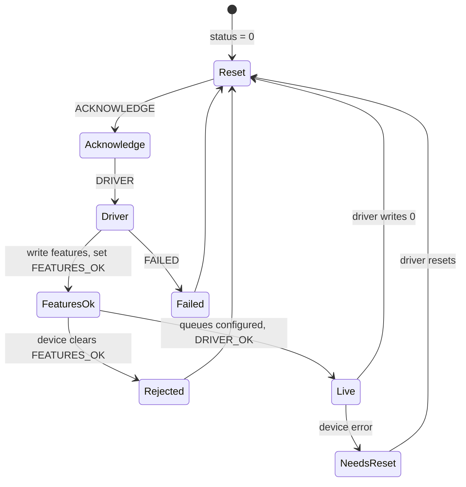
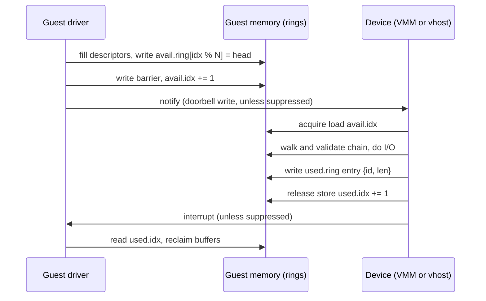
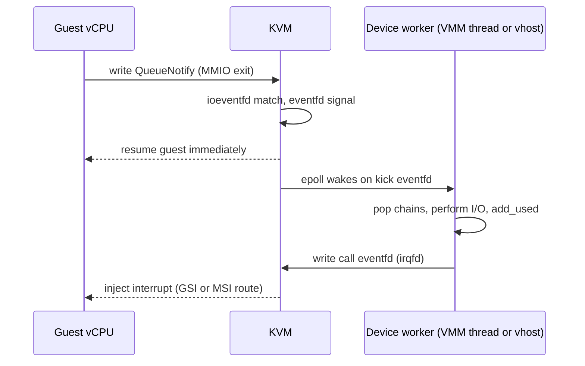

Purpose: teach the virtio 1.x device model end to end (status and feature negotiation, split and packed virtqueues, notifications, transports, the common device types) and the fast paths that take the VMM out of the data path (ioeventfd, irqfd, vhost, vhost-user, vDPA).

# Virtio Devices, Virtqueues, and vhost

Related notes: [07 Device Emulation PIO MMIO and the Bus Model](/compendium/virtualization/device-emulation-pio-mmio-and-the-bus-model), [10 Storage and Network Backends](/compendium/virtualization/storage-and-network-backends), [04 KVM API and the vCPU Run Loop](/compendium/virtualization/kvm-api-and-the-vcpu-run-loop), [05 Memory Virtualization EPT NPT and Guest Memory](/compendium/virtualization/memory-virtualization-ept-npt-and-guest-memory), [06 Interrupts Timers and Interrupt Controller Virtualization](/compendium/virtualization/interrupts-timers-and-interrupt-controller-virtualization), [12 Snapshots Live Migration and Dirty Page Tracking](/compendium/virtualization/snapshots-live-migration-and-dirty-page-tracking), [13 Security Isolation and Attack Surface](/compendium/virtualization/security-isolation-and-attack-surface), [09 Unsafe Rust and the Rust Memory Model](/compendium/rust/unsafe-rust-and-the-rust-memory-model).

## Why virtio

Emulating real hardware (an e1000 NIC, an AHCI controller) costs many exits per I/O, because real drivers poke many registers per operation. Virtio is a paravirtual device standard designed for hypervisors: the guest driver and the device exchange buffers through rings in guest memory, so a typical I/O costs one notification in each direction, and both can be suppressed under load.

The OASIS virtio specification (1.2 published 2022, 1.3 in 2023 to 2024) defines:

| Layer | What it specifies |
|---|---|
| Basic facilities | Device status, feature bits, notifications, config space, virtqueues |
| Transports | virtio-pci, virtio-mmio, virtio-ccw (s390) |
| Device types | net, blk, console, entropy, balloon, scsi, gpu, input, vsock, fs, iommu, mem, sound, and more |

Why it matters for your VMM: virtio is the only device family you need for a production Linux guest. The quality of your virtqueue handling decides throughput, latency, and a large share of your security posture, because every descriptor is guest-controlled.

## Device model basics

Every virtio device exposes four things through its transport:

1. A **device status** byte the driver writes as it initializes.
2. **Feature bits**: device features offered, driver features accepted.
3. A **device-specific configuration space** (MAC address, disk capacity).
4. One or more **virtqueues**, each with a notification mechanism in each direction.

### Device IDs

| ID | Device | Notes |
|---|---|---|
| 1 | Network card | |
| 2 | Block device | |
| 3 | Console | Multiport serial |
| 4 | Entropy source (virtio-rng) | |
| 5 | Memory balloon (traditional) | |
| 8 | SCSI host | |
| 9 | 9P transport | |
| 16 | GPU | |
| 18 | Input | |
| 19 | Socket (vsock) | |
| 23 | IOMMU | |
| 24 | Memory (virtio-mem) | |
| 26 | File system (virtio-fs) | |

On virtio-pci, the modern PCI device ID is `0x1040 + virtio_id` with vendor `0x1AF4`; transitional devices use `0x1000` to `0x103F`.

### Device status

| Bit | Value | Name | Set by |
|---|---|---|---|
| 0 | 1 | ACKNOWLEDGE | Driver: "I found a virtio device" |
| 1 | 2 | DRIVER | Driver: "I know how to drive it" |
| 2 | 4 | DRIVER_OK | Driver: "ready, go" |
| 3 | 8 | FEATURES_OK | Driver: "feature negotiation done" |
| 6 | 64 | DEVICE_NEEDS_RESET | Device: "I hit an unrecoverable error" |
| 7 | 128 | FAILED | Driver: "I gave up" |

Writing 0 to the status resets the device.

### Initialization sequence

The spec's driver initialization (section 3.1.1):

1. Reset the device (write 0 to status).
2. Set ACKNOWLEDGE.
3. Set DRIVER.
4. Read device features; write the subset the driver understands.
5. Set FEATURES_OK. Do not accept new feature bits after this.
6. Re-read status: if FEATURES_OK is not set, the device rejected the subset and is unusable.
7. Device-specific setup: discover virtqueues, write their sizes and addresses, read and write config space.
8. Set DRIVER_OK. The device is live.



Device-side rules your model must enforce:

| Rule | Why |
|---|---|
| Reject a feature set you cannot honor by not keeping FEATURES_OK set | The driver checks it in step 6 |
| Reject writes to the driver feature registers after FEATURES_OK | Spec requirement; also prevents mid-flight renegotiation |
| Do not process queues before DRIVER_OK | Addresses may still be garbage |
| On reset, stop all backend work and forget queue state | A reset driver will reprogram addresses and may reuse memory |
| Activate the backend (open taps, spawn workers) on DRIVER_OK | Features are final and queues are known |

### Reserved feature bits

Device-specific bits are 0 to 23 and 50 to 127; bits 24 to 49 are reserved for the transport and ring.

| Bit | Name | Meaning |
|---|---|---|
| 28 | VIRTIO_F_INDIRECT_DESC (VIRTIO_RING_F_INDIRECT_DESC) | Descriptors may point at indirect tables |
| 29 | VIRTIO_F_EVENT_IDX (VIRTIO_RING_F_EVENT_IDX) | `used_event` and `avail_event` notification suppression |
| 32 | VIRTIO_F_VERSION_1 | Modern (1.x) device; little-endian everything |
| 33 | VIRTIO_F_ACCESS_PLATFORM | Device accesses go through a platform IOMMU or restrictions (required for confidential guests) |
| 34 | VIRTIO_F_RING_PACKED | Packed virtqueue layout |
| 35 | VIRTIO_F_IN_ORDER | Device uses buffers in the order made available |
| 36 | VIRTIO_F_ORDER_PLATFORM | Use platform memory barriers (hardware devices) |
| 37 | VIRTIO_F_SR_IOV | SR-IOV capable |
| 38 | VIRTIO_F_NOTIFICATION_DATA | Driver includes queue position in notifications |
| 39 | VIRTIO_F_NOTIF_CONFIG_DATA | Driver uses a device-provided value in notifications |
| 40 | VIRTIO_F_RING_RESET | Per-queue reset |
| 41 | VIRTIO_F_ADMIN_VQ | Administration virtqueue |

Always offer VIRTIO_F_VERSION_1 and refuse drivers that do not accept it unless you deliberately support legacy guests. Legacy (pre-1.0) devices are native-endian, use a different PCI layout, and double your testing matrix.

### Configuration space and generation

Config fields wider than 32 bits can tear when the device changes them during a read. The transport exposes a **config generation** counter: the driver reads it, reads the fields, reads it again, and retries if it changed. Increment it on every device-initiated config change, and raise a configuration-change interrupt so the driver re-reads (for example virtio-blk capacity after an online resize, or virtio-net link status).

## Split virtqueues

The split virtqueue is the original layout and what most deployments use. It has three areas in guest memory, all little-endian in 1.x:

| Area | Spec name | Written by | Alignment (1.x) | Size for queue size N |
|---|---|---|---|---|
| Descriptor table | Descriptor Area | Driver | 16 | 16 * N |
| Available ring | Driver Area | Driver | 2 | 6 + 2 * N |
| Used ring | Device Area | Device | 4 | 6 + 8 * N |

Queue size N is a power of two, at most 32768.

```c
struct virtq_desc {          /* 16 bytes */
    le64 addr;               /* guest physical address */
    le32 len;
    le16 flags;              /* NEXT = 1, WRITE = 2, INDIRECT = 4 */
    le16 next;               /* index of next descriptor if NEXT */
};

struct virtq_avail {
    le16 flags;              /* VIRTQ_AVAIL_F_NO_INTERRUPT = 1 */
    le16 idx;                /* free-running, wraps at 2^16 */
    le16 ring[N];            /* heads of descriptor chains */
    le16 used_event;         /* only if VIRTIO_F_EVENT_IDX */
};

struct virtq_used_elem {
    le32 id;                 /* head index of the completed chain */
    le32 len;                /* bytes written into device-writable buffers */
};

struct virtq_used {
    le16 flags;              /* VIRTQ_USED_F_NO_NOTIFY = 1 */
    le16 idx;
    struct virtq_used_elem ring[N];
    le16 avail_event;        /* only if VIRTIO_F_EVENT_IDX */
};
```

A **descriptor chain** is a linked list of descriptors through `next`. Device-readable descriptors (no WRITE flag) must come before device-writable ones. A virtio-blk write is typically: header (readable), data (readable), status byte (writable).

**Indirect descriptors** (INDIRECT flag) point at a table of descriptors in guest memory, letting one ring slot carry a long scatter-gather list. An indirect table cannot itself contain an INDIRECT descriptor, and the INDIRECT and NEXT flags must not both be set on the same descriptor.

### Device processing algorithm

1. Read `avail.idx` with acquire semantics.
2. For each new entry between your private `next_avail` and `avail.idx`, read the head index from `avail.ring[next_avail % N]`.
3. Walk the chain, validating every descriptor: index below N, address and length inside guest memory, no loops (bound the walk at N descriptors, or the indirect table length), readable before writable.
4. Perform the I/O.
5. Write `used.ring[next_used % N] = { id: head, len: bytes_written }`.
6. Publish with a release store of `used.idx = next_used + 1`.
7. Decide whether to notify the driver (see notification suppression).



The `len` in the used element is the number of bytes the device wrote into writable buffers, not the total chain length. Drivers rely on it (virtio-net uses it to size received packets). Reporting the wrong length is a common and guest-visible bug.

## Packed virtqueues

The packed layout (VIRTIO_F_RING_PACKED, 1.1 and later) merges the three areas into one descriptor ring plus two small event suppression structures. It was designed for hardware implementations and for better cache behavior: driver and device touch the same cache lines in a predictable order.

```c
struct pvirtq_desc {         /* 16 bytes */
    le64 addr;
    le32 len;
    le16 id;                 /* buffer ID, returned by the device */
    le16 flags;              /* NEXT=1, WRITE=2, INDIRECT=4, AVAIL=1<<7, USED=1<<15 */
};

struct pvirtq_event_suppress {
    le16 desc;               /* bits 0..14 offset, bit 15 wrap counter */
    le16 flags;              /* ENABLE = 0, DISABLE = 1, DESC = 2 */
};
```

How ownership works:

- Driver and device each keep a 1-bit **wrap counter**, starting at 1, flipped each time they pass the end of the ring.
- A descriptor is **available** when its AVAIL flag equals the driver's wrap counter and its USED flag does not.
- The device marks a descriptor **used** by writing it back (in place, at the device's current position) with AVAIL and USED both equal to the device's wrap counter, and the buffer `id` in the `id` field.
- The device can complete buffers out of order; the `id` identifies which buffer finished. With VIRTIO_F_IN_ORDER, the device can write back only the last descriptor of a batch.

| Property | Split | Packed |
|---|---|---|
| Memory areas | 3 (desc, avail, used) | 1 ring + 2 event suppression structs |
| Ownership signal | Indices in avail and used rings | AVAIL and USED flags per descriptor, wrap counters |
| Queue size | Power of two | Any size up to 32768 |
| Cache traffic per buffer | Touches several cache lines | Typically one or two |
| Out-of-order completion | Yes (used ring by head) | Yes (by buffer ID) |
| Software maturity | Universal | Supported in Linux guest, QEMU, DPDK; less common in Rust VMMs |
| Debuggability | Easy to read state from memory dumps | Harder (wrap counters) |

Recommendation: implement split first. The rust-vmm `virtio-queue` crate implements split queues; packed queue support in the rust-vmm ecosystem was still limited at the time of writing, so verify before planning around it.

## Notifications

### Driver to device ("kick", "available buffer notification")

| Transport | Mechanism |
|---|---|
| virtio-mmio | Write queue index to `QueueNotify` (offset `0x050`) |
| virtio-pci | Write to the notify address for that queue: `cap.offset + queue_notify_off * notify_off_multiplier` inside the notify BAR |
| With VIRTIO_F_NOTIFICATION_DATA | Write includes the next available index (and wrap counter for packed), letting the device skip reading the ring |

### Device to driver ("used buffer notification", interrupt)

| Transport | Mechanism |
|---|---|
| virtio-mmio | Set bit 0 (used buffer) or bit 1 (config change) in `InterruptStatus`, raise the device's wired interrupt; driver acks via `InterruptACK` |
| virtio-pci with MSI-X | Per-queue vector (configured via `queue_msix_vector`), config change on `config_msix_vector` |
| virtio-pci without MSI-X | INTx plus the ISR status register (read-to-clear) |

### Suppression

Without suppression, every buffer costs a doorbell exit and an interrupt. Two mechanisms:

| Mechanism | Driver side | Device side |
|---|---|---|
| Flags (no EVENT_IDX) | `avail.flags = NO_INTERRUPT` asks the device not to interrupt | `used.flags = NO_NOTIFY` asks the driver not to kick |
| Event index (EVENT_IDX) | `used_event`: "interrupt me when used.idx passes this" | `avail_event`: "kick me when avail.idx passes this" |

With EVENT_IDX, the device decides whether to notify with the same formula Linux uses (`vring_need_event`):

```rust
/// True if moving the index from `old` to `new` crossed `event`.
/// All arithmetic is mod 2^16, matching the 16-bit ring indices.
fn need_event(event: u16, new: u16, old: u16) -> bool {
    new.wrapping_sub(event).wrapping_sub(1) < new.wrapping_sub(old)
}

#[test]
fn need_event_wraps() {
    assert!(need_event(5, 6, 5));     // crossed exactly
    assert!(!need_event(10, 6, 5));   // not reached
    assert!(need_event(0xffff, 1, 0xfffe)); // across the wrap
}
```

The standard device loop with EVENT_IDX avoids the lost-wakeup race:

1. Disable notifications (write `avail_event` far away, or set NO_NOTIFY).
2. Process all available buffers.
3. Re-enable notifications (write `avail_event = next_avail`).
4. Memory barrier, then re-check `avail.idx`. If new buffers arrived between steps 2 and 3, loop back to step 1.

The barrier in step 4 is essential: without it, the driver may have added a buffer and checked `avail_event` before your write became visible, so neither side notifies and the queue stalls until an unrelated event.

## Transports in detail

### virtio-mmio (version 2)

One register block per device, typically 4 KiB (`0x200` bytes are used). Little-endian 32-bit registers.

| Offset | Name | Access | Notes |
|---|---|---|---|
| `0x000` | MagicValue | R | `0x74726976` ("virt") |
| `0x004` | Version | R | 2 for modern devices (1 is legacy) |
| `0x008` | DeviceID | R | 0 means placeholder, no device |
| `0x00c` | VendorID | R | |
| `0x010` | DeviceFeatures | R | 32 bits selected by DeviceFeaturesSel |
| `0x014` | DeviceFeaturesSel | W | |
| `0x020` | DriverFeatures | W | |
| `0x024` | DriverFeaturesSel | W | |
| `0x030` | QueueSel | W | |
| `0x034` | QueueNumMax | R | 0 if queue unavailable |
| `0x038` | QueueNum | W | |
| `0x044` | QueueReady | RW | |
| `0x050` | QueueNotify | W | Doorbell |
| `0x060` | InterruptStatus | R | Bit 0 used buffer, bit 1 config change |
| `0x064` | InterruptACK | W | |
| `0x070` | Status | RW | Device status |
| `0x080`/`0x084` | QueueDescLow/High | W | |
| `0x090`/`0x094` | QueueDriverLow/High | W | Available ring |
| `0x0a0`/`0x0a4` | QueueDeviceLow/High | W | Used ring |
| `0x0ac`-`0x0bc` | Shared memory regions | RW | SHMSel, length, base |
| `0x0c0` | QueueReset | RW | With VIRTIO_F_RING_RESET |
| `0x0fc` | ConfigGeneration | R | |
| `0x100`+ | Config | RW | Device-specific |

A minimal transport handler (only the core registers shown) shows the shape:

```rust
use virtio_queue::{Queue, QueueT};

pub struct MmioTransport {
    device_features: u64,
    driver_features: u64,
    features_sel: u32,
    queue_sel: u32,
    status: u8,
    interrupt_status: u32,
    queues: Vec<Queue>,
}

impl MmioTransport {
    pub fn write32(&mut self, offset: u64, v: u32) {
        let q = self.queue_sel as usize;
        match offset {
            0x014 => self.features_sel = v,
            0x020 if self.status & 8 == 0 => {
                // Driver features may change only before FEATURES_OK.
                let shift = 32 * (self.features_sel & 1);
                let mask = 0xffff_ffffu64 << shift;
                self.driver_features = (self.driver_features & !mask) | (u64::from(v) << shift);
            }
            0x024 => self.features_sel = v,
            0x030 => self.queue_sel = v,
            0x038 => if let Some(q) = self.queues.get_mut(q) { q.set_size(v as u16) },
            0x044 => if let Some(q) = self.queues.get_mut(q) { q.set_ready(v == 1) },
            0x064 => self.interrupt_status &= !v,
            0x070 => self.set_status(v as u8),
            0x080 => if let Some(q) = self.queues.get_mut(q) { q.set_desc_table_address(Some(v), None) },
            0x084 => if let Some(q) = self.queues.get_mut(q) { q.set_desc_table_address(None, Some(v)) },
            0x090 => if let Some(q) = self.queues.get_mut(q) { q.set_avail_ring_address(Some(v), None) },
            0x094 => if let Some(q) = self.queues.get_mut(q) { q.set_avail_ring_address(None, Some(v)) },
            0x0a0 => if let Some(q) = self.queues.get_mut(q) { q.set_used_ring_address(Some(v), None) },
            0x0a4 => if let Some(q) = self.queues.get_mut(q) { q.set_used_ring_address(None, Some(v)) },
            _ => {} // QueueNotify (0x050) is normally an ioeventfd and never reaches here.
        }
    }

    fn set_status(&mut self, v: u8) {
        if v == 0 {
            self.reset();
            return;
        }
        if v & 8 != 0 && self.status & 8 == 0 {
            // Refuse unknown features by not latching FEATURES_OK.
            if self.driver_features & !self.device_features != 0 {
                return;
            }
        }
        self.status = v;
        if v & 4 != 0 {
            self.activate(); // validate queues with is_valid(), start backend
        }
    }

    fn reset(&mut self) { /* stop backend, reset queues and registers */ }
    fn activate(&mut self) { /* ... */ }
}
```

### virtio-pci (modern)

The device is a PCI function whose configuration structures are located by vendor-specific capabilities (cap ID `0x09`), each naming a BAR, offset, and length:

| `cfg_type` | Structure | Contents |
|---|---|---|
| 1 | VIRTIO_PCI_CAP_COMMON_CFG | Feature select and value, `num_queues`, `device_status`, `config_generation`, `queue_select`, `queue_size`, `queue_msix_vector`, `queue_enable`, `queue_notify_off`, queue addresses |
| 2 | VIRTIO_PCI_CAP_NOTIFY_CFG | Notify region plus `notify_off_multiplier` |
| 3 | VIRTIO_PCI_CAP_ISR_CFG | ISR status byte (INTx only) |
| 4 | VIRTIO_PCI_CAP_DEVICE_CFG | Device-specific config |
| 5 | VIRTIO_PCI_CAP_PCI_CFG | Window to access BARs through config space (for firmware) |
| 8 | VIRTIO_PCI_CAP_SHARED_MEMORY_CFG | Shared memory regions (virtio-fs DAX, virtio-gpu blobs) |

A common layout puts all structures in one 64-bit memory BAR with MSI-X table and PBA in the same or another BAR. Use a `notify_off_multiplier` of 4 (each queue its own dword) or larger so each queue's doorbell has a distinct address that can be an ioeventfd without datamatch.

| Decision | virtio-mmio | virtio-pci |
|---|---|---|
| Interrupts per device | 1 wired, shared by all queues | Up to one MSI-X vector per queue plus config |
| Multiqueue scaling | Poor: one interrupt line serializes completions | Good: per-queue vectors steered to vCPUs |
| Discovery cost | Near zero | PCI enumeration |
| Hotplug | No | Yes |
| Spec maturity on arm64 and RISC-V | Native FDT binding | Needs ECAM host bridge and MSI controller (ITS, IMSIC) |

## Rust: processing a queue with virtio-queue

The `virtio-queue` crate (checked against 0.18.0) provides `Queue`, the `QueueT` trait, and `DescriptorChain`. Relevant signatures:

| Method | Signature (0.18.0) |
|---|---|
| Create | `fn new(max_size: u16) -&gt; Result&lt;Self, Error&gt;` |
| Validate addresses | `fn is_valid&lt;M: GuestMemory&gt;(&self, mem: &M) -&gt; bool` |
| Pop a chain | `fn pop_descriptor_chain&lt;M&gt;(&mut self, mem: M) -&gt; Option&lt;DescriptorChain&lt;M&gt;&gt;` where `M: Clone + Deref&lt;Target: GuestMemory&gt;` |
| Complete | `fn add_used&lt;M: GuestMemory&gt;(&mut self, mem: &M, head_index: u16, len: u32) -&gt; Result&lt;(), Error&gt;` |
| Notification control | `enable_notification`, `disable_notification`, `needs_notification`, each taking `&M` |
| Event index | `fn set_event_idx(&mut self, enabled: bool)` |
| Chain helpers | `DescriptorChain::head_index(&self) -&gt; u16`, `reader(self, mem)`, `writer(self, mem)`, `readable(self)`, `writable(self)` |

A virtio-rng style device (one queue, fill writable buffers with random bytes):

```rust
use std::io::Write;
use virtio_queue::{Queue, QueueT};
use vm_memory::GuestMemoryMmap;
use vmm_sys_util::eventfd::EventFd;

pub fn process_rng_queue(
    queue: &mut Queue,
    mem: &GuestMemoryMmap,
    irq: &EventFd,
) -> anyhow::Result<()> {
    loop {
        queue.disable_notification(mem)?;

        while let Some(chain) = queue.pop_descriptor_chain(mem) {
            let head = chain.head_index();
            // writer() validates every writable descriptor against guest memory.
            let mut writer = chain.writer(mem)?;
            let mut buf = vec![0u8; writer.available_bytes()];
            getrandom::fill(&mut buf).map_err(|e| anyhow::anyhow!("{e}"))?;
            writer.write_all(&buf)?;
            queue.add_used(mem, head, writer.bytes_written() as u32)?;
        }

        // enable_notification returns true if buffers arrived while disabled.
        if !queue.enable_notification(mem)? {
            break;
        }
    }

    if queue.needs_notification(mem)? {
        irq.write(1)?; // irqfd: KVM injects the interrupt
    }
    Ok(())
}
```

Points to notice:

- `Writer::available_bytes` and `Writer::bytes_written` are confirmed on 0.18.0; the descriptor utilities moved between 0.x releases, so re-check when you bump the crate.
- Cap allocations. A malicious driver can post a chain claiming gigabytes of writable space. For virtio-rng, cap each request (Firecracker and Cloud Hypervisor cap and rate limit entropy).
- `getrandom::fill` is the getrandom 0.3 API; older versions use `getrandom::getrandom`.
- On error mid-chain, still return the head to the used ring with `len = 0` (or the device-specific error status) so the driver does not leak the buffer, unless the error indicates a broken driver, in which case set DEVICE_NEEDS_RESET.

### Memory ordering

The rings are shared memory between a guest vCPU and your thread. `virtio-queue` uses acquire loads for `avail.idx` and release stores for `used.idx` through `vm-memory`'s atomic accessors. If you hand-roll ring code, you need exactly that plus a full fence (`SeqCst`) between re-enabling notifications and re-checking `avail.idx`. Plain volatile reads are not enough on arm64 or RISC-V, where the hardware reorders loads. See [09 Unsafe Rust and the Rust Memory Model](/compendium/rust/unsafe-rust-and-the-rust-memory-model) and [07 Concurrency Parallelism and Synchronization](/compendium/rust/concurrency-parallelism-and-synchronization).

## Common device types

### virtio-blk

Request layout:

```c
struct virtio_blk_req {
    le32 type;      /* IN=0, OUT=1, FLUSH=4, GET_ID=8, GET_LIFETIME=10,
                       DISCARD=11, WRITE_ZEROES=13, SECURE_ERASE=14 */
    le32 reserved;
    le64 sector;    /* always 512-byte units, regardless of blk_size */
    /* data[] */
    /* u8 status: OK=0, IOERR=1, UNSUPP=2 (last writable byte) */
};
```

| Feature | Bit | Meaning |
|---|---|---|
| VIRTIO_BLK_F_SIZE_MAX | 1 | Max segment size |
| VIRTIO_BLK_F_SEG_MAX | 2 | Max segments per request |
| VIRTIO_BLK_F_RO | 5 | Read-only |
| VIRTIO_BLK_F_BLK_SIZE | 6 | Logical block size hint |
| VIRTIO_BLK_F_FLUSH | 9 | Flush command supported (device has a volatile write cache) |
| VIRTIO_BLK_F_TOPOLOGY | 10 | Physical block size and alignment hints |
| VIRTIO_BLK_F_CONFIG_WCE | 11 | Guest can toggle writeback cache |
| VIRTIO_BLK_F_MQ | 12 | Multiple request queues |
| VIRTIO_BLK_F_DISCARD | 13 | Discard |
| VIRTIO_BLK_F_WRITE_ZEROES | 14 | Write zeroes |
| VIRTIO_BLK_F_SECURE_ERASE | 16 | Secure erase |
| VIRTIO_BLK_F_ZONED | 17 | Zoned block device |

Validation every implementation needs: the request must have a readable header of at least 16 bytes and a writable status byte at the end; `sector * 512 + len` must not overflow and must be within capacity; data length must be a multiple of 512 for IN and OUT; GET_ID writes at most 20 bytes. Backend semantics (flush, caches, async I/O) are in [10 Storage and Network Backends](/compendium/virtualization/storage-and-network-backends).

### virtio-net

Queues: `receiveq0`, `transmitq0`, ..., then an optional control queue. Each packet is preceded by a header:

```c
struct virtio_net_hdr {
    u8   flags;        /* NEEDS_CSUM = 1, DATA_VALID = 2, RSC_INFO = 4 */
    u8   gso_type;     /* NONE=0, TCPV4=1, UDP=3, TCPV6=4, UDP_L4=5, ECN=0x80 */
    le16 hdr_len;
    le16 gso_size;
    le16 csum_start;
    le16 csum_offset;
    le16 num_buffers;  /* present in 1.x (12-byte header) */
    /* hash fields follow only with VIRTIO_NET_F_HASH_REPORT */
};
```

| Feature | Bit | Meaning |
|---|---|---|
| VIRTIO_NET_F_CSUM | 0 | Device handles partial checksums from the driver (TX offload) |
| VIRTIO_NET_F_GUEST_CSUM | 1 | Driver accepts packets with partial checksums (RX) |
| VIRTIO_NET_F_MAC | 5 | Device has a MAC in config |
| VIRTIO_NET_F_GUEST_TSO4 / TSO6 | 7 / 8 | Driver accepts large TCP segments on RX |
| VIRTIO_NET_F_HOST_TSO4 / TSO6 | 11 / 12 | Device accepts large TCP segments on TX |
| VIRTIO_NET_F_MRG_RXBUF | 15 | One received packet may span several RX buffers (`num_buffers`) |
| VIRTIO_NET_F_STATUS | 16 | Link status in config |
| VIRTIO_NET_F_CTRL_VQ | 17 | Control virtqueue |
| VIRTIO_NET_F_MQ | 22 | Multiqueue with `max_virtqueue_pairs` |

The "host" and "guest" naming is from the device's point of view and confuses everyone: HOST_* features are about packets the guest transmits, GUEST_* about packets the guest receives. The mapping to tap offloads is in [10 Storage and Network Backends](/compendium/virtualization/storage-and-network-backends).

### virtio-vsock

A socket transport between guest and host without a NIC. Addresses are `(CID, port)`: CID 2 is the host, guests get CIDs of 3 and above. Queues: rx, tx, event. Every packet carries a 44-byte header with source and destination CID and port, length, socket type, operation (REQUEST, RESPONSE, RST, SHUTDOWN, RW, CREDIT_UPDATE, CREDIT_REQUEST), and credit fields `buf_alloc` and `fwd_cnt`.

Credit-based flow control is mandatory: a sender may only have `peer_buf_alloc - (tx_cnt - peer_fwd_cnt)` bytes outstanding. If your host side ignores credit, a guest can make you buffer unbounded data.

Implementation options:

| Option | Host endpoint | Users |
|---|---|---|
| vhost-vsock (kernel) | Host processes use `AF_VSOCK` sockets directly | QEMU, Cloud Hypervisor (also supports hybrid), Kata |
| Userspace vsock in the VMM with Unix socket mux ("hybrid vsock") | Host connects to a Unix socket and sends `CONNECT &lt;port&gt;\n`, receives `OK &lt;port&gt;\n` | Firecracker, Cloud Hypervisor |
| vhost-user-vsock backend | Separate process | rust-vmm vhost-device |

Host-guest control use cases are in [10 Storage and Network Backends](/compendium/virtualization/storage-and-network-backends).

### virtio-rng

One request queue; the device fills writable buffers with entropy. It exists so guests do not starve for entropy at boot (less critical since Linux 5.6's `getrandom` changes, still useful for early userspace). Rate limit it, and cap per-request size, because each request consumes host entropy and CPU.

### Balloon

The traditional balloon (ID 5) lets the host reclaim guest memory: the device sets `num_pages` in config, the driver allocates guest pages and reports their PFNs (4 KiB units regardless of guest page size) on the inflate queue, and the host can `madvise(MADV_DONTNEED)` the backing memory.

| Feature | Bit | Meaning |
|---|---|---|
| VIRTIO_BALLOON_F_MUST_TELL_HOST | 0 | Driver must report before reusing deflated pages |
| VIRTIO_BALLOON_F_STATS_VQ | 1 | Memory statistics queue |
| VIRTIO_BALLOON_F_DEFLATE_ON_OOM | 2 | Driver deflates under guest memory pressure |
| VIRTIO_BALLOON_F_FREE_PAGE_HINT | 3 | Hints for migration |
| VIRTIO_BALLOON_F_PAGE_POISON | 4 | Poison value awareness |
| VIRTIO_BALLOON_F_REPORTING | 5 | Free page reporting: guest reports free ranges continuously |

The balloon is cooperative: a malicious or buggy guest can ignore it, so it is never a memory limit. Enforce limits with cgroups on the host. Free page reporting is the modern way to return idle memory from long-running guests. virtio-mem (ID 24) is the alternative for resizing guest memory in larger blocks with stronger guarantees.

### virtio-fs

virtio-fs shares a host directory with the guest using the FUSE protocol over virtqueues: a high-priority queue (for FORGET and interrupts) plus one or more request queues. The device config contains a `tag` the guest mounts (`mount -t virtiofs mytag /mnt`). The optional DAX window (a shared memory region, cap type 8 on PCI) maps file contents directly into guest physical memory so reads bypass the queue entirely.

In practice virtio-fs is always a vhost-user device: the FUSE server is `virtiofsd` (rewritten in Rust, maintained by the virtio-fs project) running as a separate, sandboxed process. Treat the shared directory as a trust boundary: path traversal, symlink races, and xattr handling in the daemon are the main risks.

## Fast paths: ioeventfd and irqfd

The default path for a doorbell is: guest write, VM exit, KVM, return to userspace with `KVM_EXIT_MMIO`, VMM bus lookup, device wakes worker. Two KVM features cut this down:

| Mechanism | Ioctl | Effect |
|---|---|---|
| ioeventfd | `KVM_IOEVENTFD` (`struct kvm_ioeventfd { datamatch, addr, len, fd, flags }`) | KVM matches the write (address, length, optional datamatch) in the kernel, signals an eventfd, and resumes the guest without returning to userspace |
| irqfd | `KVM_IRQFD` (`struct kvm_irqfd { fd, gsi, flags, resamplefd }`) | Writing to the eventfd injects interrupt `gsi`; for MSI, the GSI is routed via `KVM_SET_GSI_ROUTING` |



With kvm-ioctls (0.25.1):

```rust
use kvm_ioctls::{IoEventAddress, NoDatamatch, VmFd};
use vmm_sys_util::eventfd::{EventFd, EFD_NONBLOCK};

pub fn wire_queue(vm: &VmFd, mmio_base: u64, queue_index: u32, gsi: u32) -> std::io::Result<(EventFd, EventFd)> {
    let kick = EventFd::new(EFD_NONBLOCK)?;
    let call = EventFd::new(EFD_NONBLOCK)?;

    // virtio-mmio: all queues share QueueNotify, so match on the written queue index.
    vm.register_ioevent(&kick, &IoEventAddress::Mmio(mmio_base + 0x50), queue_index)
        .map_err(std::io::Error::from)?;
    vm.register_irqfd(&call, gsi).map_err(std::io::Error::from)?;

    Ok((kick, call))
}

// virtio-pci with distinct per-queue notify addresses can skip datamatch:
// vm.register_ioevent(&kick, &IoEventAddress::Mmio(notify_addr), NoDatamatch)?;
```

Caveats:

- A datamatch ioeventfd compares the full access width. Register with the width the guest driver uses (Linux writes 32-bit to `QueueNotify`); KVM derives the length from the datamatch type, so pass a `u32` for a 4-byte match.
- An MMIO ioeventfd still costs a VM exit; it avoids the return to userspace. On x86, KVM has a fast path for EPT misconfig exits on ioeventfd addresses.
- On ARM64, irqfd requires the in-kernel vGIC. On RISC-V, irqfd requires the in-kernel AIA irqchip (added in Linux 6.5 era KVM); without it you inject with `KVM_INTERRUPT` from userspace. Verify against your target kernel.
- Interrupts for level-triggered lines (virtio-mmio on a GIC SPI configured level, or PCI INTx) need `register_irqfd_with_resample` so KVM tells you when the guest EOIs and you can re-assert if still pending.

## vhost: moving the data path into the kernel

vhost-net and vhost-vsock run the virtqueue data path in a host kernel thread. The VMM still owns the control path (feature negotiation, config space, reset), then hands the rings to the kernel:

1. Open `/dev/vhost-net` (or `/dev/vhost-vsock`).
2. `VHOST_SET_OWNER` binds the vhost worker to this process.
3. `VHOST_GET_FEATURES`, then `VHOST_SET_FEATURES` with the negotiated subset.
4. `VHOST_SET_MEM_TABLE` with guest memory regions (GPA, size, userspace address).
5. Per queue: `VHOST_SET_VRING_NUM`, `VHOST_SET_VRING_ADDR` (userspace addresses of the rings), `VHOST_SET_VRING_BASE` (starting avail index), `VHOST_SET_VRING_KICK` (the ioeventfd), `VHOST_SET_VRING_CALL` (the irqfd).
6. Device-specific backend: `VHOST_NET_SET_BACKEND` with the tap fd per queue, or `VHOST_VSOCK_SET_GUEST_CID` then `VHOST_VSOCK_SET_RUNNING`.

From then on, the guest kicks KVM, KVM signals the eventfd, the vhost kernel thread processes the ring and writes the call eventfd, and KVM injects the interrupt. The VMM is not involved. The rust-vmm `vhost` crate provides typed wrappers for these ioctls (kernel vhost backends and the vhost-user frontend).

For live migration, vhost logs guest memory writes into a dirty bitmap the VMM provides (`VHOST_SET_LOG_BASE`, `VHOST_F_LOG_ALL`). See [12 Snapshots Live Migration and Dirty Page Tracking](/compendium/virtualization/snapshots-live-migration-and-dirty-page-tracking). On pause or snapshot, read back each ring's position with `VHOST_GET_VRING_BASE`, which also stops the ring.

## vhost-user: the data path in another process

vhost-user is the same model over a Unix domain socket: the VMM (front-end, formerly "master") sends messages, and a back-end process (formerly "slave") implements the device. Guest memory must be shareable: back it with `memfd` or hugetlbfs files so the fds can be passed with `SCM_RIGHTS` and mapped by the back-end. Anonymous private memory cannot be used with vhost-user.

| Message | Purpose |
|---|---|
| `VHOST_USER_GET_FEATURES` / `SET_FEATURES` | Virtio feature negotiation (plus `VHOST_USER_F_PROTOCOL_FEATURES`, bit 30) |
| `VHOST_USER_GET_PROTOCOL_FEATURES` / `SET_PROTOCOL_FEATURES` | Protocol extensions (MQ, config, reply ack, inflight, device state) |
| `VHOST_USER_SET_OWNER` | Start session |
| `VHOST_USER_SET_MEM_TABLE` | Memory regions plus fds |
| `VHOST_USER_SET_VRING_NUM` / `ADDR` / `BASE` | Ring configuration |
| `VHOST_USER_SET_VRING_KICK` / `CALL` / `ERR` | Eventfds for kick, call, and errors |
| `VHOST_USER_SET_VRING_ENABLE` | Enable a ring |
| `VHOST_USER_GET_VRING_BASE` | Stop a ring and return its position |
| `VHOST_USER_GET_CONFIG` / `SET_CONFIG` | Device config space |

Benefits: the device runs in its own sandbox (seccomp, namespaces, unprivileged user), can be written in any language, restarted, or offloaded to DPDK or SPDK. Costs: shared memory makes the guest's memory visible to another process, reconnect after a back-end crash is hard (needs inflight tracking), and you need careful version and feature negotiation.

### Writing a back-end with vhost-user-backend

The rust-vmm `vhost-user-backend` crate (checked against 0.24.0 and the `main` branch source) provides the daemon, message handling, and per-queue epoll threads. You implement `VhostUserBackend`:

```rust
use std::io::Result;
use std::sync::Mutex;
use vhost::vhost_user::message::VhostUserProtocolFeatures;
use vhost_user_backend::{VhostUserBackend, VhostUserDaemon, VringRwLock, VringT};
use virtio_queue::QueueT;
use vm_memory::{GuestMemoryAtomic, GuestMemoryMmap};
use vmm_sys_util::epoll::EventSet;

const VIRTIO_F_VERSION_1: u64 = 1 << 32;
const VIRTIO_RING_F_EVENT_IDX: u64 = 1 << 29;
const VHOST_USER_F_PROTOCOL_FEATURES: u64 = 1 << 30;

struct RngBackend {
    mem: Mutex<Option<GuestMemoryAtomic<GuestMemoryMmap>>>,
}

impl VhostUserBackend for RngBackend {
    type Bitmap = ();
    type Vring = VringRwLock;

    fn num_queues(&self) -> usize { 1 }
    fn max_queue_size(&self) -> usize { 256 }

    fn features(&self) -> u64 {
        VIRTIO_F_VERSION_1 | VIRTIO_RING_F_EVENT_IDX | VHOST_USER_F_PROTOCOL_FEATURES
    }

    fn protocol_features(&self) -> VhostUserProtocolFeatures {
        VhostUserProtocolFeatures::MQ | VhostUserProtocolFeatures::CONFIG
    }

    fn set_event_idx(&self, _enabled: bool) {}

    fn update_memory(&self, mem: GuestMemoryAtomic<GuestMemoryMmap>) -> Result<()> {
        *self.mem.lock().unwrap() = Some(mem);
        Ok(())
    }

    fn handle_event(
        &self,
        device_event: u16,
        _evset: EventSet,
        vrings: &[VringRwLock],
        _thread_id: usize,
    ) -> Result<()> {
        let vring = &vrings[device_event as usize];
        // Pop chains via vring.get_mut().get_queue_mut(), fill, then:
        // vring.add_used(head, len)?; and if vring.needs_notification()? { vring.signal_used_queue()?; }
        let _ = vring;
        Ok(())
    }
}

fn main() -> anyhow::Result<()> {
    let backend = RngBackend { mem: Mutex::new(None) };
    let mem = GuestMemoryAtomic::new(GuestMemoryMmap::new());
    let mut daemon = VhostUserDaemon::new("vhost-user-rng".into(), backend, mem)
        .map_err(|e| anyhow::anyhow!("{e:?}"))?;
    daemon.serve("/run/vhost-user-rng.sock").map_err(|e| anyhow::anyhow!("{e:?}"))?;
    Ok(())
}
```

Signatures confirmed for 0.24.0: `VhostUserDaemon::new(name: String, backend: T, atomic_mem: GuestMemoryAtomic&lt;GuestMemoryMmap&lt;T::Bitmap&gt;&gt;) -&gt; Result&lt;Self&gt;`, `serve&lt;P: AsRef&lt;Path&gt;&gt;(&mut self, socket: P) -&gt; Result&lt;()&gt;`, and `VringT` methods `add_used(&self, desc_index: u16, len: u32)`, `needs_notification(&self)`, `signal_used_queue(&self) -&gt; std::io::Result&lt;()&gt;`. The `GuestMemoryAtomic`/`GuestMemoryMmap` generic parameters and the `VringRwLock` default generic have changed across releases; expect to adjust type paths when pinning. The rust-vmm `vhost-device` repository has complete back-ends (vsock, gpio, i2c, rng, scmi, sound, and more) to copy from.

## vDPA: virtio data path in hardware

vDPA (virtio data path acceleration) lets a hardware device (SmartNIC, DPU) implement the virtio ring format directly, while its control path is vendor-specific and mediated by a kernel vDPA driver. The kernel exposes it on the vDPA bus, from which it can bind to:

| Binding | Consumer |
|---|---|
| `vhost-vdpa` (`/dev/vhost-vdpa-N`) | A VMM, using vhost-style ioctls; the guest sees a normal virtio device and the hardware DMAs into guest memory via the IOMMU |
| `virtio-vdpa` | The host kernel itself, as a virtio device (for containers or bare-metal workloads) |

Variants: VDUSE implements a vDPA device in a userspace process (useful for storage), and software vDPA simulators exist for testing. Compared with VFIO passthrough ([11 Device Passthrough VFIO IOMMU and Nested Virtualization](/compendium/virtualization/device-passthrough-vfio-iommu-and-nested-virtualization)), vDPA keeps the guest on standard virtio drivers, which makes live migration feasible because the device state is the virtio ring state.

## Choosing where each device lives

| Path | Latency and throughput | Isolation | Complexity | When |
|---|---|---|---|---|
| VMM userspace, exit per kick | Lowest throughput | Device bugs in VMM process | Lowest | Bring-up, control devices |
| VMM userspace with ioeventfd and irqfd | Good | Same | Low | Default for blk, rng, balloon |
| vhost-net, vhost-vsock (kernel) | Very good | Host kernel attack surface | Medium | High packet rates, standard tap networking |
| vhost-user back-end | Very good, can poll | Separate sandbox | High | virtio-fs, DPDK or SPDK, multi-tenant isolation |
| vDPA hardware | Line rate | Hardware and driver trust | High | SmartNIC deployments |

## Architecture notes

| Topic | x86-64 | ARM64 | RISC-V |
|---|---|---|---|
| Doorbell | PIO (legacy) or MMIO | MMIO | MMIO |
| Interrupt fast path | irqfd to IOAPIC pin or MSI | irqfd needs in-kernel vGIC; MSI needs GICv3 ITS | irqfd needs in-kernel AIA; MSI needs IMSIC |
| Preferred transport in microVMs | virtio-mmio (Firecracker) or PCI | virtio-mmio via FDT, PCI via ECAM | virtio-mmio via FDT |
| Memory ordering in ring code | TSO hides many bugs | Weak ordering exposes missing barriers | Weak ordering (RVWMO) exposes missing barriers |
| DMA coherency description | Implicit | `dma-coherent` in FDT | `dma-coherent` in FDT |

Ring code that "works on x86" frequently fails on arm64 because x86 TSO already orders stores with respect to other stores. Test on weakly ordered hosts.

## Common pitfalls

| Pitfall | Symptom | Fix |
|---|---|---|
| Accepting features after FEATURES_OK | Inconsistent device behavior | Ignore feature writes once FEATURES_OK is set |
| Processing queues before DRIVER_OK or after reset | Writes to stale guest addresses | Gate the data path on status; stop workers on reset |
| Wrong used `len` | Guest truncates or over-reads packets | Report bytes written to writable buffers only |
| Unbounded chain walk | Infinite loop on a cyclic chain | Bound by queue size; let the crate validate |
| Trusting descriptor lengths for allocation | Host OOM | Cap allocations per request |
| Missing fence after re-enabling notifications | Queue stalls under load | Use the crate, or SeqCst fence plus re-check |
| Shared ioeventfd without datamatch on virtio-mmio | All queues wake one handler | Use datamatch per queue index |
| Level-triggered irqfd without resample | Lost or stuck interrupts | Use resample fd or edge semantics |
| vhost-user with private anonymous memory | Back-end cannot map guest RAM | Back guest RAM with memfd or hugetlbfs |
| Not stopping vhost rings before snapshot | Ring indices change after state was saved | `GET_VRING_BASE` before saving |
| Treating the balloon as a memory limit | Guest ignores it, host OOMs | Enforce with host cgroups |
| HOST and GUEST feature names swapped | Offloads misconfigured, checksum errors | Remember: names are from the device's point of view |

## Review checklist

- [ ] Device status machine enforces FEATURES_OK and DRIVER_OK ordering and full reset on 0.
- [ ] VIRTIO_F_VERSION_1 is offered and required.
- [ ] Every descriptor chain is validated against guest memory and bounded in length.
- [ ] Per-request allocations are capped.
- [ ] Used `len` equals bytes written.
- [ ] EVENT_IDX loop re-checks after re-enabling notifications.
- [ ] Doorbells are ioeventfds and interrupts are irqfds, with datamatch or distinct addresses per queue.
- [ ] Config generation increments on device-side config changes and raises a config interrupt.
- [ ] Device workers stop and drop guest memory references on reset.
- [ ] Snapshot path stops vhost and vhost-user rings and records their indices.
- [ ] vhost-user guest memory is shareable (memfd or hugetlbfs) and back-ends run sandboxed.
- [ ] Ring code is tested on a weakly ordered host (arm64 or RISC-V).
- [ ] Fuzzing covers malformed chains (rust-vmm `virtio-queue` ships fuzz targets to copy).

## Primary Sources

- [OASIS virtio 1.3 specification (HTML)](https://docs.oasis-open.org/virtio/virtio/v1.3/csd01/virtio-v1.3-csd01.html)
- [OASIS virtio 1.2 specification](https://docs.oasis-open.org/virtio/virtio/v1.2/virtio-v1.2.html)
- [virtio-queue `QueueT` on docs.rs](https://docs.rs/virtio-queue/latest/virtio_queue/trait.QueueT.html)
- [virtio-queue `DescriptorChain` on docs.rs](https://docs.rs/virtio-queue/latest/virtio_queue/struct.DescriptorChain.html)
- [vhost-user-backend `VhostUserBackend`](https://docs.rs/vhost-user-backend/latest/vhost_user_backend/trait.VhostUserBackend.html)
- [vhost-user-backend `VhostUserDaemon`](https://docs.rs/vhost-user-backend/latest/vhost_user_backend/struct.VhostUserDaemon.html)
- [vhost-user-backend `VringT`](https://docs.rs/vhost-user-backend/latest/vhost_user_backend/trait.VringT.html)
- [rust-vmm vhost repository (backend.rs)](https://github.com/rust-vmm/vhost/blob/main/vhost-user-backend/src/backend.rs)
- [kvm-ioctls `VmFd`](https://docs.rs/kvm-ioctls/latest/kvm_ioctls/struct.VmFd.html)
- [Linux KVM API: KVM_IOEVENTFD and KVM_IRQFD](https://docs.kernel.org/virt/kvm/api.html)
- [QEMU vhost-user protocol specification](https://www.qemu.org/docs/master/interop/vhost-user.html)
- [vDPA kernel framework documentation](https://vdpa-dev.gitlab.io/)
- [Linux VDUSE documentation](https://docs.kernel.org/userspace-api/vduse.html)
- [virtio-fs project](https://virtio-fs.gitlab.io/)
- [Firecracker vsock documentation](https://github.com/firecracker-microvm/firecracker/blob/main/docs/vsock.md)
- [Firecracker design document](https://github.com/firecracker-microvm/firecracker/blob/main/docs/design.md)
- [rust-vmm vhost-device repository](https://github.com/rust-vmm/vhost-device)
