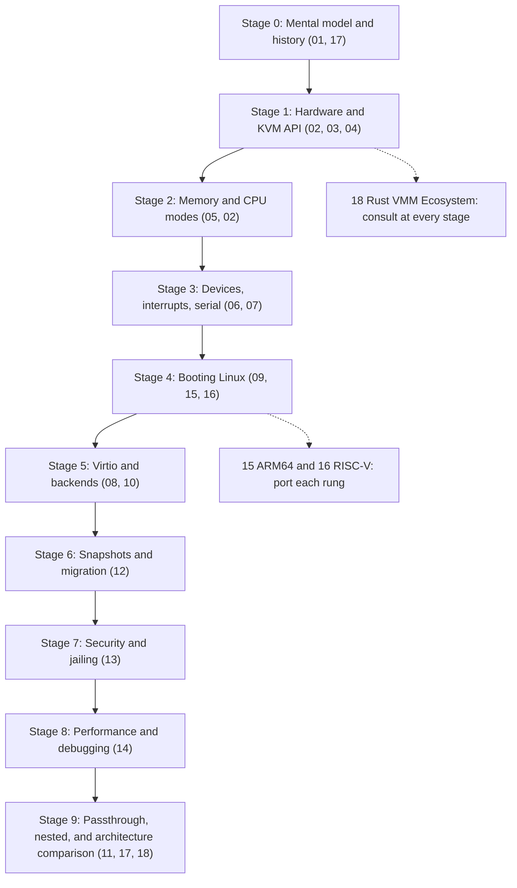

Purpose: A staged study plan through notes 01 to 18 and a project ladder that ends with a jailed, snapshot-capable Rust VMM on KVM booting Linux on x86-64, ARM64 and RISC-V, with mastery checks that expose real gaps at each stage.

# Virtualization Mastery Roadmap

Related notes: [01 Virtualization Mental Model and History](/compendium/virtualization/virtualization-mental-model-and-history), [04 KVM API and the vCPU Run Loop](/compendium/virtualization/kvm-api-and-the-vcpu-run-loop), [17 Hypervisor Architectures Compared](/compendium/virtualization/hypervisor-architectures-compared), [18 Rust VMM Ecosystem and Project Templates](/compendium/virtualization/rust-vmm-ecosystem-and-project-templates), [01 Linux Mental Model User Space Kernel and Hardware](/compendium/linux-systems-engineering/linux-mental-model-user-space-kernel-and-hardware), [09 Unsafe Rust and the Rust Memory Model](/compendium/rust/unsafe-rust-and-the-rust-memory-model).

This roadmap is the operating plan for the Virtualization compendium. It is written for an engineer who wants to build a production-grade VMM in Rust on top of KVM, not just read about one. Each stage pairs reading with a concrete rung of a single growing project, so by the end you own a codebase that does what Firecracker does at its core, on three architectures.

The path moves from mechanism to platform to product:

1. Understand what virtualization is and what the hardware gives you.
2. Drive KVM directly: memory, vCPUs, exits.
3. Build a platform the guest believes in: CPU mode setup, interrupt controller, timer, serial.
4. Boot real Linux.
5. Add paravirtual I/O with production backends.
6. Add state: snapshots and migration.
7. Harden: isolation, jailing, observability, performance.
8. Generalize across architectures and compare against the incumbents.

## Prerequisites

| Prerequisite | Why it matters for a VMM | Vault anchor |
|---|---|---|
| Linux user/kernel split, syscalls, file descriptors | KVM is an fd-and-ioctl API; your VMM is a Linux process | [01 Linux Mental Model User Space Kernel and Hardware](/compendium/linux-systems-engineering/linux-mental-model-user-space-kernel-and-hardware), [06 System Calls ABI libc and User Kernel Boundaries](/compendium/linux-systems-engineering/system-calls-abi-libc-and-user-kernel-boundaries) |
| Virtual memory and paging | Guest memory is `mmap`; EPT/stage-2 sit on top of host paging; you will write guest page tables | [03 Memory Virtual Memory Paging Allocators and OOM](/compendium/linux-systems-engineering/memory-virtual-memory-paging-allocators-and-oom) |
| Block I/O and page cache | virtio-blk backends, `O_DIRECT`, flush semantics | [04 Filesystems VFS Block IO Page Cache and Storage](/compendium/linux-systems-engineering/filesystems-vfs-block-io-page-cache-and-storage) |
| Networking, tap devices | virtio-net backends | [05 Linux Networking TCP IP Routing Firewalling and DNS](/compendium/linux-systems-engineering/linux-networking-tcp-ip-routing-firewalling-and-dns) |
| Namespaces, cgroups, seccomp | The jailer | [09 cgroups Namespaces Containers and Runtime Isolation](/compendium/linux-systems-engineering/cgroups-namespaces-containers-and-runtime-isolation) |
| Kernel driver model | How the guest discovers and drives your devices | [13 Kernel Architecture Modules Drivers and Device Model](/compendium/linux-systems-engineering/kernel-architecture-modules-drivers-and-device-model) |
| Profiling | Measuring exits and boot time | [11 Performance Engineering perf Flamegraphs and Capacity](/compendium/linux-systems-engineering/performance-engineering-perf-flamegraphs-and-capacity) |
| Unsafe Rust | Guest memory pointers, ioctls, signal handlers | [09 Unsafe Rust and the Rust Memory Model](/compendium/rust/unsafe-rust-and-the-rust-memory-model) |
| Threads and synchronization | vCPU threads, device locks, kicks | [07 Concurrency Parallelism and Synchronization](/compendium/rust/concurrency-parallelism-and-synchronization) |
| Low-level I/O in Rust | epoll, eventfd, io_uring | [13 Systems Programming Networking and IO](/compendium/rust/systems-programming-networking-and-io) |
| FFI and repr(C) | kvm-bindings structs, boot protocol structs | [14 FFI Embedded WebAssembly and Interop](/compendium/rust/ffi-embedded-webassembly-and-interop) |
| Some assembly | Writing tiny guest payloads, reading boot code | Arch notes 02, 15, 16 |

Hardware and environment:

| Target | What you need | Fallback |
|---|---|---|
| x86-64 | Linux host with VT-x or AMD-V enabled, `/dev/kvm` accessible to your user (kvm group) | Nested virtualization in a cloud VM that exposes it |
| ARM64 | Linux on ARM64 hardware with KVM: AWS Graviton metal or a VM with nested virt, Ampere servers, a Raspberry Pi 4/5 (GICv2 on Pi 4, check), or an Apple silicon Mac running Linux natively | QEMU TCG emulating an ARM64 host with `virtualization=on` (slow) |
| RISC-V | A board whose cores implement the H extension, or QEMU `virt` with the H extension enabled and a host kernel with KVM | QEMU TCG with H extension, running Linux with KVM inside, running your VMM (nested emulation, slow but correct) |

Verify early: `ls -l /dev/kvm`, `dmesg | grep -i kvm`, and on x86 `grep -E 'vmx|svm' /proc/cpuinfo`.

## Roadmap overview

Each stage has four outputs:

- Conceptual command: explain the mechanism without hand-waving, including what differs per architecture.
- Working code: the project rung for that stage runs.
- Failure literacy: you can diagnose the stage's typical failures (`KVM_EXIT_FAIL_ENTRY`, triple faults, silent hangs, missing interrupts).
- Evidence: a test, trace or measurement proves it.

## Stage 0: Mental model and history

Read: [01 Virtualization Mental Model and History](/compendium/virtualization/virtualization-mental-model-and-history), then skim [17 Hypervisor Architectures Compared](/compendium/virtualization/hypervisor-architectures-compared) for the landscape.

Goal: know what you are building and where it sits. Your project is a VMM (user space), KVM is the hypervisor (kernel). Know trap-and-emulate, why x86 needed help, paravirtualization, and the difference between containers, microVMs and full VMs.

Exercises:

- Explain the Popek and Goldberg subset condition and name three x86 instructions that violated it.
- Draw the KVM split for your future VMM: which exits reach user space, which stay in the kernel.
- Write one paragraph each on how x86 (VMX root/non-root), ARM64 (EL2, VHE vs nVHE) and RISC-V (HS/VS modes) place the hypervisor.
- Run Firecracker or Cloud Hypervisor once with a provided kernel and rootfs. Time it to a shell.

Mastery check:

- [ ] You can explain why "is KVM type 1 or type 2" is the wrong question and replace it with three better ones.
- [ ] You can say why a microVM has a smaller attack surface than QEMU `q35` with firmware, in terms of reachable code.

## Stage 1: Hardware virtualization and the KVM API

Read: [02 x86-64 Architecture for Hypervisor Authors](/compendium/virtualization/x86-64-architecture-for-hypervisor-authors), [03 Intel VT-x and AMD-V Hardware Virtualization](/compendium/virtualization/intel-vt-x-and-amd-v-hardware-virtualization), [04 KVM API and the vCPU Run Loop](/compendium/virtualization/kvm-api-and-the-vcpu-run-loop). Skim the KVM sections of [15 ARM64 Virtualization EL2 VHE and GIC](/compendium/virtualization/arm64-virtualization-el2-vhe-and-gic) and [16 RISC-V Virtualization and the Hypervisor Extension](/compendium/virtualization/risc-v-virtualization-and-the-hypervisor-extension).

Goal: understand VMCS/VMCB at a conceptual level, VM entry and exit, and the KVM fd hierarchy (`/dev/kvm` system fd, VM fd, vCPU fd, device fd), `KVM_RUN` and the shared `kvm_run` page, `KVM_CHECK_EXTENSION`, and the user-space exit reasons.

### Rung 1: real-mode hello world with a PIO exit (x86-64)

Build it with raw ioctls first (in C or with `libc::ioctl` from Rust), then rewrite with `kvm-ioctls`. Steps:

1. Open `/dev/kvm`, check `KVM_GET_API_VERSION` equals 12.
2. `KVM_CREATE_VM`, `mmap` a few pages of anonymous memory, `KVM_SET_USER_MEMORY_REGION`.
3. Copy a tiny real-mode payload: load `0x3f8` into `dx`, add two registers, `out dx, al`, `hlt`.
4. `KVM_CREATE_VCPU`, `mmap` the `kvm_run` region (size from `KVM_GET_VCPU_MMAP_SIZE`).
5. Set `cs.base = 0`, `cs.selector = 0`, `rip` to the load address, `rflags = 0x2`.
6. Loop on `KVM_RUN`, handle `KVM_EXIT_IO` (print the byte), stop on `KVM_EXIT_HLT`.

The kvm-ioctls crate-level example (0.25.1) does exactly this and includes MMIO read/write exits and dirty-log checking. See [18 Rust VMM Ecosystem and Project Templates](/compendium/virtualization/rust-vmm-ecosystem-and-project-templates) for the restructured skeleton.

### Rung 1b and 1c: the same on ARM64 and RISC-V

There is no PIO on ARM64 or RISC-V; every device is MMIO.

| Step | x86-64 | ARM64 | RISC-V |
|---|---|---|---|
| vCPU init | `KVM_CREATE_VCPU`, then set regs/sregs | `KVM_CREATE_VCPU`, `KVM_ARM_PREFERRED_TARGET`, `KVM_ARM_VCPU_INIT` (mandatory before running) | `KVM_CREATE_VCPU` |
| Register access | `KVM_GET/SET_REGS`, `KVM_GET/SET_SREGS` | `KVM_SET_ONE_REG` with core register IDs (PC, X0..X30, PSTATE) | `KVM_SET_ONE_REG` with core register IDs (PC, A0..) |
| First observable exit | `KVM_EXIT_IO` from `out` | `KVM_EXIT_MMIO` from a store to an address outside any memory slot | `KVM_EXIT_MMIO` from a store outside any slot |
| How the payload stops | `hlt` gives `KVM_EXIT_HLT` (without in-kernel irqchip) | No user-visible halt; break after the MMIO exit, or loop | Same as ARM64 |

Mastery check:

- [ ] You can list the fd hierarchy and which ioctls go to which fd.
- [ ] You can explain why `KVM_EXIT_HLT` disappears once you create an in-kernel irqchip on x86.
- [ ] You can decode a `KVM_EXIT_FAIL_ENTRY` with `hardware_entry_failure_reason` and find the cause in the SDM's VM-entry checks (most often invalid guest segment state).
- [ ] You can explain why ARM64 needs `KVM_ARM_VCPU_INIT` and what `KVM_ARM_VCPU_PSCI_0_2` and `KVM_ARM_VCPU_POWER_OFF` features do.
- [ ] You have the same "MMIO write observed" test passing on all three architectures (RISC-V under QEMU is acceptable).

## Stage 2: Memory virtualization and CPU modes

Read: [05 Memory Virtualization EPT NPT and Guest Memory](/compendium/virtualization/memory-virtualization-ept-npt-and-guest-memory) and the paging and mode sections of [02 x86-64 Architecture for Hypervisor Authors](/compendium/virtualization/x86-64-architecture-for-hypervisor-authors).

Goal: understand guest-virtual to guest-physical (guest page tables) to host-virtual (your `mmap`) to host-physical, how memory slots work, EPT/NPT/stage-2/G-stage faults, dirty logging, and guest memory layout design (RAM below the 32-bit MMIO hole, high RAM above 4 GiB on x86; RAM at a fixed base such as 0x8000_0000 on ARM64 and RISC-V `virt`-style layouts).

### Rung 2: long mode with page tables (x86-64)

1. Allocate guest memory with `vm-memory` (`GuestMemoryMmap::from_ranges`), register slots.
2. Write a GDT with a 64-bit code segment and data segment into guest memory.
3. Build identity-mapped page tables (PML4, PDPT, PD with 2 MiB pages) for the first 1 GiB.
4. Set `cr3`, `cr4.PAE`, `efer.LME | efer.LMA`, `cr0.PE | cr0.PG`, and load 64-bit segment descriptors into `sregs` (the hidden parts: base, limit, type, `l = 1`, `db = 0`, present).
5. Jump straight into 64-bit code that writes to the serial port and halts.
6. Add a second slot above 4 GiB and prove the guest can touch it.
7. Enable `KVM_MEM_LOG_DIRTY_PAGES`, run code that writes to known pages, read the bitmap with `KVM_GET_DIRTY_LOG`, assert the expected bits.

ARM64 and RISC-V equivalent: there is no mode-switch dance. The guest kernel enables its own MMU; you enter with the MMU off at EL1 (ARM64) or VS-mode with `satp` bare (RISC-V). The rung there is: lay out RAM at the platform base, put code above it, take MMIO exits for a UART region, and prove dirty logging on each architecture.

Mastery check:

- [ ] You can translate a guest-virtual address by hand through your own page tables.
- [ ] You can explain why EPT/NPT removed shadow paging and what an EPT violation vs EPT misconfiguration means.
- [ ] You can explain what happens on a guest access to a guest-physical address with no slot (MMIO exit) and why that is the basis of device emulation.
- [ ] You can describe your memory map for each architecture in a table, including where MMIO devices live.
- [ ] You know why the `GuestMemoryMmap` must outlive the VM and how your code enforces it.

## Stage 3: Devices, interrupts and the serial console

Read: [07 Device Emulation PIO MMIO and the Bus Model](/compendium/virtualization/device-emulation-pio-mmio-and-the-bus-model), [06 Interrupts Timers and Interrupt Controller Virtualization](/compendium/virtualization/interrupts-timers-and-interrupt-controller-virtualization).

Goal: a bus that dispatches PIO/MMIO exits to devices, an in-kernel interrupt controller, interrupt delivery through irqfd, and a 16550 UART that a real kernel can drive.

### Rung 3: serial console with interrupts

1. Implement the bus (range map from address to device) and route exits to it.
2. Wrap `vm_superio::Serial` at port 0x3f8 (x86) or at an MMIO base on ARM64/RISC-V.
3. Create the in-kernel irqchip:
   - x86: `KVM_CREATE_IRQCHIP` (PIC, IOAPIC, LAPIC in kernel), `KVM_CREATE_PIT2` if you want the PIT, `KVM_SET_TSS_ADDR` and `KVM_SET_IDENTITY_MAP_ADDR` on Intel.
   - ARM64: `KVM_CREATE_DEVICE` with `KVM_DEV_TYPE_ARM_VGIC_V3` (or V2 on older hosts), set distributor and redistributor addresses, initialize after vCPUs are created.
   - RISC-V: `KVM_CREATE_DEVICE` with the AIA device type (`KVM_DEV_TYPE_RISCV_AIA`) where supported, configure APLIC and IMSIC addresses; otherwise fall back to a user-space PLIC model.
4. Register an irqfd for the UART's interrupt line with `KVM_IRQFD` and have the serial's `Trigger` write to it.
5. Feed host stdin into the UART with `enqueue_raw_bytes` from the event loop.
6. Add the vCPU kick (real-time signal plus `immediate_exit`) and a clean shutdown path.

Mastery check:

- [ ] You can trace one keystroke from host stdin to guest `read()` and name every component and fd on the way.
- [ ] You can explain level vs edge interrupts, and why irqfd needs a resample fd for level-triggered lines.
- [ ] You can explain the difference between LAPIC/IOAPIC (x86), GICv3 distributor/redistributor/ITS (ARM64) and APLIC/IMSIC (RISC-V AIA).
- [ ] You can explain where the guest's timer interrupt comes from on each architecture (LAPIC timer and TSC deadline on x86, generic timer virtual timer on ARM64, `vstimecmp` with Sstc or SBI timer calls on RISC-V).
- [ ] Pausing and stopping the VM works reliably with all vCPUs in `KVM_RUN`.

## Stage 4: Booting Linux

Read: [09 Booting Guests Firmware and the Linux Boot Protocol](/compendium/virtualization/booting-guests-firmware-and-the-linux-boot-protocol), then the boot sections of [15 ARM64 Virtualization EL2 VHE and GIC](/compendium/virtualization/arm64-virtualization-el2-vhe-and-gic) and [16 RISC-V Virtualization and the Hypervisor Extension](/compendium/virtualization/risc-v-virtualization-and-the-hypervisor-extension).

Goal: direct kernel boot on all three architectures, no firmware.

### Rung 4a: Linux bzImage on x86-64

1. Load the kernel with `linux-loader` (`BzImage` or `Elf` for vmlinux), and an initramfs.
2. Build the zero page (`boot_params`): setup header from the image, `type_of_loader`, command line pointer, initrd address and size, e820 map describing your RAM and holes.
3. Configure CPUID (`KVM_GET_SUPPORTED_CPUID` filtered, then `KVM_SET_CPUID2` per vCPU, with correct APIC IDs and topology leaves), MSRs, FPU state, LAPIC LINT0/LINT1.
4. Enter at the 64-bit entry point (`code32_start + 0x200` after loading the protected-mode kernel) with `rsi` pointing at `boot_params`, paging on with identity map. Alternatively use the PVH entry with a `hvm_start_info` structure.
5. Provide MP tables or ACPI (MADT) so the kernel finds the LAPIC/IOAPIC and secondary vCPUs.
6. Command line: `console=ttyS0 reboot=k panic=1 pci=off` to start; add `earlyprintk=serial` while debugging.
7. Handle reset: i8042 port 0x64 write of 0xFE, or `KVM_EXIT_SHUTDOWN` on triple fault.

### Rung 4b: Image plus DTB on ARM64

1. Load the `Image` at a 2 MiB-aligned address in RAM (respect `text_offset` and `image_size` from the Image header).
2. Generate a DTB with `vm-fdt`: `/memory`, `/cpus` with `enable-method = "psci"`, `/psci` node, GIC node with `interrupt-controller` and correct `reg` for distributor and redistributors, `/timer` (arch timer PPIs), UART (PL011 or 16550 `ns16550a`), `/chosen` with `bootargs`, `stdout-path`, initrd properties.
3. Place the DTB in RAM (8-byte aligned, not overlapping the kernel), set `x0` to its address, `x1..x3` to zero, PC to the Image entry, PSTATE to EL1h with interrupts masked.
4. Secondary vCPUs start powered off (`KVM_ARM_VCPU_POWER_OFF`) and are brought up by the guest via PSCI `CPU_ON`, which KVM handles in kernel.
5. Shutdown and reboot arrive as `KVM_EXIT_SYSTEM_EVENT` (PSCI `SYSTEM_OFF` / `SYSTEM_RESET`).

### Rung 4c: Image plus DTB on RISC-V

1. Load the RISC-V `Image` at a 2 MiB-aligned address (RV64), check the Image header magic.
2. Generate a DTB: `/cpus` with `riscv,isa` (or `riscv,isa-base` and `riscv,isa-extensions`), `mmu-type`, a per-hart `interrupt-controller` node (`riscv,cpu-intc`), the platform interrupt controller (APLIC/IMSIC for AIA, or PLIC), timebase frequency, UART, `/chosen`.
3. Set PC to the Image, `a0` to the hart ID, `a1` to the DTB address.
4. SBI calls from the guest (console, timer, HSM for hart start, SRST for reset) are mostly handled by KVM; unhandled ones arrive as `KVM_EXIT_RISCV_SBI` for your VMM to implement or reject.

Mastery check:

- [ ] Linux boots to an initramfs shell over your serial console on at least x86-64 and one of ARM64 or RISC-V; the third works under emulation.
- [ ] You can explain every field you set in `boot_params` and every DTB node you emit, and what Linux does if it is missing.
- [ ] You can debug a silent hang: earlycon/earlyprintk, `KVM_GET_REGS` on a stuck vCPU, guest symbol lookup from `System.map`.
- [ ] SMP works: 4 vCPUs visible in `/proc/cpuinfo`, brought up via INIT-SIPI (x86, in-kernel LAPIC), PSCI (ARM64) and SBI HSM (RISC-V).
- [ ] You measured time from process start to guest init and can explain where the time goes.

## Stage 5: Virtio devices and backends

Read: [08 Virtio Devices Virtqueues and vhost](/compendium/virtualization/virtio-devices-virtqueues-and-vhost), [10 Storage and Network Backends](/compendium/virtualization/storage-and-network-backends).

Goal: virtio-mmio transport, virtio-blk and virtio-net with real backends, ioeventfd for notifications, irqfd for completions.

### Rung 5: virtio-blk and virtio-net

1. Implement the virtio-mmio transport register file (magic, version 2, device ID, features, queue select/size/ready/addresses, status, interrupt status/ack, config space).
2. Advertise it to the guest: `virtio_mmio.device=` on the command line (x86) or DTB nodes `compatible = "virtio,mmio"` (ARM64, RISC-V).
3. Use `virtio-queue` to walk descriptor chains with bounds checks.
4. virtio-blk: `VIRTIO_BLK_T_IN`, `T_OUT`, `T_FLUSH`, `T_GET_ID`; backend on a raw file first (`pread`/`pwrite`), then io_uring. Honor flush semantics.
5. virtio-net: tap device backend (`/dev/net/tun`, `IFF_TAP | IFF_NO_PI | IFF_VNET_HDR`), offload feature negotiation, RX and TX queues, rate limiting later.
6. Register an ioeventfd per queue notify address; handle in the event loop.
7. Optional: replace your net backend with vhost-net, or run a vhost-user block backend, to feel the offload model.

Mastery check:

- [ ] Guest `dd` and `fio` against `/dev/vda` produce correct data and survive `sync` plus VMM restart.
- [ ] Guest can ping the host and fetch over TCP through the tap.
- [ ] You can explain feature negotiation, `VIRTIO_F_VERSION_1`, `VIRTIO_F_EVENT_IDX` and what breaks if you get notification suppression wrong.
- [ ] A fuzz target feeds arbitrary descriptor tables to your block device and finds nothing after a long run.
- [ ] You counted user-space exits per I/O before and after ioeventfd/irqfd and can show the difference.

## Stage 6: Snapshots and live migration

Read: [12 Snapshots Live Migration and Dirty Page Tracking](/compendium/virtualization/snapshots-live-migration-and-dirty-page-tracking).

Goal: pause, serialize full VM state, restore in a new process; then iterative pre-copy migration.

### Rung 6: snapshot and restore

1. Pause: kick all vCPUs out of `KVM_RUN`, quiesce devices (stop processing queues, finish in-flight I/O).
2. Save vCPU state per architecture:
   - x86: regs, sregs, FPU/XSAVE, XCRs, MSRs (a carefully chosen list), LAPIC, vCPU events, debug regs, MP state, CPUID, TSC (and TSC frequency); VM-level: irqchip (PIC, IOAPIC), PIT, kvmclock.
   - ARM64: all registers enumerated by `KVM_GET_REG_LIST` (core, system registers, timer), vGIC state through the device attributes, MP state.
   - RISC-V: `KVM_GET_REG_LIST` registers (core, CSR, timer, ISA extension and SBI config registers), AIA state, MP state.
3. Save device state (a versioned format) and guest memory (file-backed, or dumped).
4. Restore into a fresh process, mapping the memory file (private or shared), and resume.
5. Diff snapshots with dirty logging; then live migration over a socket with pre-copy rounds and a final stop-and-copy.

Mastery check:

- [ ] A guest running a counter loop resumes after restore without time going backwards or the network breaking.
- [ ] You can explain why snapshot clones of the same image share entropy and clock state, and how virtio-rng, VM generation ID and clock adjustments mitigate it.
- [ ] Your state format has a version and you have a test that restores a snapshot from the previous version.
- [ ] You can explain why CPU model and feature consistency (CPUID, ARM64 ID registers, RISC-V ISA extensions) between source and destination is mandatory.

## Stage 7: Security, isolation and jailing

Read: [13 Security Isolation and Attack Surface](/compendium/virtualization/security-isolation-and-attack-surface) and [09 cgroups Namespaces Containers and Runtime Isolation](/compendium/linux-systems-engineering/cgroups-namespaces-containers-and-runtime-isolation).

Goal: the VMM runs unprivileged in a minimal environment with per-thread seccomp, and you have a written threat model.

### Rung 7: jailer and seccomp

1. Write a separate `jailer` binary: create cgroup, unshare mount/PID/network/IPC/UTS namespaces, `pivot_root` into a per-VM directory containing only the kernel, rootfs and `/dev/kvm` and `/dev/net/tun` nodes, set resource limits, drop to an unprivileged uid/gid, close inherited fds, exec the VMM.
2. In the VMM, install seccomp filters per thread type (API, event loop, vCPU) with `seccompiler`; start permissive in logging mode, then deny by default.
3. Validate every guest-supplied address and length; ban panics on guest input (return errors, mark device failed).
4. Write the threat model: what a malicious guest can reach (KVM, your device models, backends), what a compromised VMM process can reach (only its jail).

Mastery check:

- [ ] `strace -f -c` of a full boot and I/O run lists exactly the syscalls in your filters.
- [ ] Killing a seccomp-violating thread produces a clear audit log entry, not silent death.
- [ ] You can name the guest-reachable code paths in your VMM and the fuzz target for each.
- [ ] You can explain side-channel mitigations relevant to multi-tenant VMs (SMT, L1TF, MDS, Spectre v2 on x86; Spectre-BHB on ARM64) at the level of what the host must configure.

## Stage 8: Performance, observability and debugging

Read: [14 Performance Observability and Debugging](/compendium/virtualization/performance-observability-and-debugging), with [11 Performance Engineering perf Flamegraphs and Capacity](/compendium/linux-systems-engineering/performance-engineering-perf-flamegraphs-and-capacity).

Goal: measure exits, latency and throughput, and have a debugging toolkit.

Exercises:

1. `perf kvm stat record` / `report` during boot and I/O load; classify exits.
2. Enable KVM tracepoints (`kvm:kvm_exit`, `kvm:kvm_entry`, `kvm:kvm_mmio`, `kvm:kvm_pio`) and correlate with your VMM logs.
3. Add metrics: exits by reason, device queue depth, I/O latency histograms, boot timestamps.
4. Implement a gdbstub (`KVM_SET_GUEST_DEBUG`) or at least register dumps on demand.
5. Compare boot time and I/O throughput against Firecracker and Cloud Hypervisor with the same kernel and rootfs.

Mastery check:

- [ ] You can explain each of the top five exit reasons in your workload and how to eliminate or cheapen each.
- [ ] Your VMM is within a stated, measured margin of Firecracker on boot time to init.
- [ ] You can attach gdb to a guest kernel through your VMM and set a breakpoint, at least on x86.

## Stage 9: Passthrough, nested virtualization and the big picture

Read: [11 Device Passthrough VFIO IOMMU and Nested Virtualization](/compendium/virtualization/device-passthrough-vfio-iommu-and-nested-virtualization), [17 Hypervisor Architectures Compared](/compendium/virtualization/hypervisor-architectures-compared), [18 Rust VMM Ecosystem and Project Templates](/compendium/virtualization/rust-vmm-ecosystem-and-project-templates), [15 ARM64 Virtualization EL2 VHE and GIC](/compendium/virtualization/arm64-virtualization-el2-vhe-and-gic), [16 RISC-V Virtualization and the Hypervisor Extension](/compendium/virtualization/risc-v-virtualization-and-the-hypervisor-extension).

Goal: optional advanced features and a design review of your VMM against the incumbents.

Exercises:

1. Add virtio-pci transport (config space, BARs, MSI-X with `KVM_SET_GSI_ROUTING` and irqfd), then VFIO passthrough of a NIC or NVMe device with `vfio-ioctls`.
2. Run your VMM inside a VM (nested) and measure the cost.
3. Write a one-page design review comparing your VMM to Firecracker and Cloud Hypervisor on device placement, sandbox, boot, state and architecture support, using the decision table in [17 Hypervisor Architectures Compared](/compendium/virtualization/hypervisor-architectures-compared).

Mastery check:

- [ ] You can explain DMA remapping and interrupt remapping and why passthrough without an IOMMU is unsafe.
- [ ] Your design review names three decisions you would change if starting over.

## Project ladder

```mermaid
flowchart LR
    P1["1: Real-mode PIO hello (x86) and MMIO hello (ARM64, RISC-V)"] --> P2["2: Long mode, page tables, dirty log"]
    P2 --> P3["3: Serial console with irqchip and irqfd"]
    P3 --> P4["4: Boot Linux: bzImage, Image plus DTB x2"]
    P4 --> P5["5: virtio-blk and virtio-net"]
    P5 --> P6["6: Snapshot, restore, migration"]
    P6 --> P7["7: Jailer and seccomp"]
    P7 --> P8["8: Metrics, tracing, gdbstub"]
    P8 --> P9["9: virtio-pci, VFIO, design review"]
```

| Rung | Deliverable | x86-64 | ARM64 | RISC-V | Evidence |
|---|---|---|---|---|---|
| 1 | Minimal KVM program | PIO `out` to 0x3f8, `hlt` | MMIO store, observe exit | MMIO store, observe exit | Test asserting exit kind and data |
| 2 | Memory and modes | Long mode with own GDT and page tables, high memory slot | RAM at platform base, MMU-off entry | RAM at platform base, VS-mode entry | Dirty-log test |
| 3 | Serial console | 16550 at PIO 0x3f8, in-kernel PIC/IOAPIC/LAPIC | UART MMIO, vGICv3 | UART MMIO, AIA (or PLIC) | Interactive echo, irqfd counters |
| 4 | Boot Linux | bzImage or vmlinux (or PVH), zero page, e820, MP/ACPI | Image + DTB, PSCI | Image + DTB, SBI | Shell prompt, SMP, boot time number |
| 5 | Virtio | virtio-mmio blk and net | same | same | fio and ping results, fuzz run |
| 6 | State | Snapshot/restore incl. TSC, irqchip | Snapshot incl. vGIC, timer | Snapshot incl. AIA, timer | Restore test, version test |
| 7 | Hardening | Jailer, seccomp per thread | same | same (check seccompiler arch support) | strace audit, threat model |
| 8 | Observability | perf kvm, tracepoints, gdbstub | perf, tracepoints | tracepoints | Exit profile report |
| 9 | Advanced | virtio-pci, VFIO | virtio-pci (ECAM), VFIO with SMMU | virtio-pci | Design review |

The ladder is cumulative. Later rungs keep earlier discipline: the snapshot rung still needs validated guest input; the jailer rung still needs tests for every architecture.

## Diagnostic question bank

CPU and KVM:

- What exactly happens between `ioctl(KVM_RUN)` and the guest executing its first instruction?
- Which exits are handled in kernel and which reach your VMM, for each architecture?
- What does `KVM_EXIT_FAIL_ENTRY` tell you that `KVM_EXIT_INTERNAL_ERROR` does not?

Memory:

- What is the full translation chain for a guest load, and which component owns each stage?
- What happens if two memory slots overlap, or if a slot's host mapping is unmapped while the VM runs?
- How does dirty logging interact with hugepages?

Interrupts and time:

- How does an interrupt get from your device to a guest handler on x86, ARM64 and RISC-V?
- Why can guest time jump after restore, and what does kvmclock or the ARM64 counter offset do about it?

Devices:

- Which guest-controlled values does each device trust, and where are they validated?
- What is the device's behavior when the guest violates the spec?

Boot:

- Which fields of `boot_params` or which DTB nodes does Linux strictly require?
- How do secondary vCPUs start on each architecture?

Security and operations:

- What can a compromised device model do from inside your jail?
- What is your upgrade story for snapshots taken by an older VMM version?

## Mastery checklists

Foundation:

- [ ] I can explain trap-and-emulate, hardware assist and paravirtualization, and map each to KVM mechanisms.
- [ ] I can drive KVM with raw ioctls on x86-64 and with `set_one_reg` on ARM64 and RISC-V.
- [ ] I can set up x86 long mode from scratch and explain each control register bit I set.

Platform:

- [ ] I can design a memory map and device layout for each architecture.
- [ ] I can wire an in-kernel interrupt controller and deliver interrupts via irqfd.
- [ ] I can boot Linux directly on three architectures and debug a silent hang.

I/O:

- [ ] I can implement virtio-mmio and virtio-pci transports and a virtio-blk and virtio-net device.
- [ ] I can explain when to move a device to vhost or vhost-user.

Production:

- [ ] My VMM snapshots and restores correctly across versions.
- [ ] My VMM runs unprivileged in a jail with per-thread seccomp.
- [ ] I can profile exits and boot time and compare with Firecracker and Cloud Hypervisor.

## Common study traps

- Reading the Intel SDM cover to cover before writing a line of code. Read the chapter for the rung you are on.
- Starting with x86 boot and never porting. Port each rung to ARM64 and RISC-V while it is small; architecture assumptions harden fast.
- Copying Firecracker's code without understanding why a value is set. Every magic constant should be explainable from a spec.
- Building PCI, hotplug and a hypervisor abstraction before booting a kernel.
- Testing only the happy path of devices. Guests are adversaries.
- Measuring boot time without stating the endpoint (API ready, kernel entry, init, app ready).
- Running everything as root during development and discovering permission and seccomp problems at the end.

## Evidence standard for mastery

| Claim | Minimum evidence |
|---|---|
| "I understand VM exits" | Explain the path from guest instruction to your handler on each architecture, and show a trace of it |
| "My VMM boots Linux" | Reproducible kernel config, command line, boot log and time-to-init on each architecture |
| "My device is correct" | Spec section references, guest-driver tests, fuzz corpus, malformed-input tests |
| "My VMM is secure" | Threat model, seccomp audit, jail description, fuzzing evidence, list of `unsafe` blocks with invariants |
| "My VMM is fast" | Exit profile, boot breakdown, I/O benchmarks with hardware and kernel versions, comparison methodology |
| "Snapshots work" | Restore tests across versions, clock and entropy handling explained |

## Weekly review routine

At the end of each week, write a short entry with:

- Notes read, as wikilinks.
- The rung or sub-step completed, and on which architectures.
- One VM exit, fault or hang you debugged and its root cause.
- One spec section you read in the primary source (SDM, APM, Arm ARM, RISC-V privileged spec, virtio spec, kernel docs).
- One test or fuzz target added.
- The weakest stage and the next action.

## Primary Sources

- [Linux KVM API documentation](https://docs.kernel.org/virt/kvm/api.html)
- [Linux x86 boot protocol](https://docs.kernel.org/arch/x86/boot.html)
- [Linux arm64 booting](https://docs.kernel.org/arch/arm64/booting.html)
- [Linux RISC-V boot requirements](https://docs.kernel.org/arch/riscv/boot.html)
- [Intel 64 and IA-32 Architectures Software Developer Manuals](https://www.intel.com/content/www/us/en/developer/articles/technical/intel-sdm.html)
- [AMD64 Architecture Programmer's Manual Volume 2](https://www.amd.com/en/search/documentation/hub.html)
- [Arm Architecture Reference Manual for A-profile](https://developer.arm.com/documentation/ddi0487/latest)
- [RISC-V ISA manual (privileged spec with H extension)](https://github.com/riscv/riscv-isa-manual)
- [OASIS Virtual I/O Device (VIRTIO) specification](https://docs.oasis-open.org/virtio/virtio/v1.2/virtio-v1.2.html)
- [kvm-ioctls docs.rs](https://docs.rs/kvm-ioctls/latest/kvm_ioctls/)
- [rust-vmm community](https://github.com/rust-vmm/community)
- [Firecracker](https://github.com/firecracker-microvm/firecracker)
- [Cloud Hypervisor](https://github.com/cloud-hypervisor/cloud-hypervisor)
- [crosvm book](https://crosvm.dev/book/)
