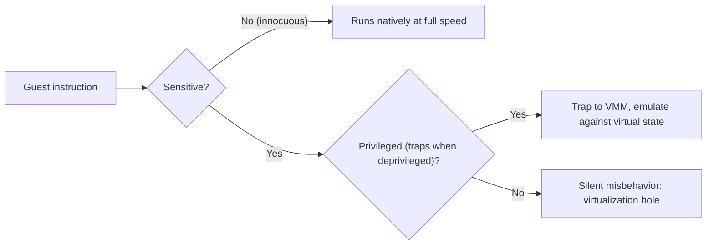
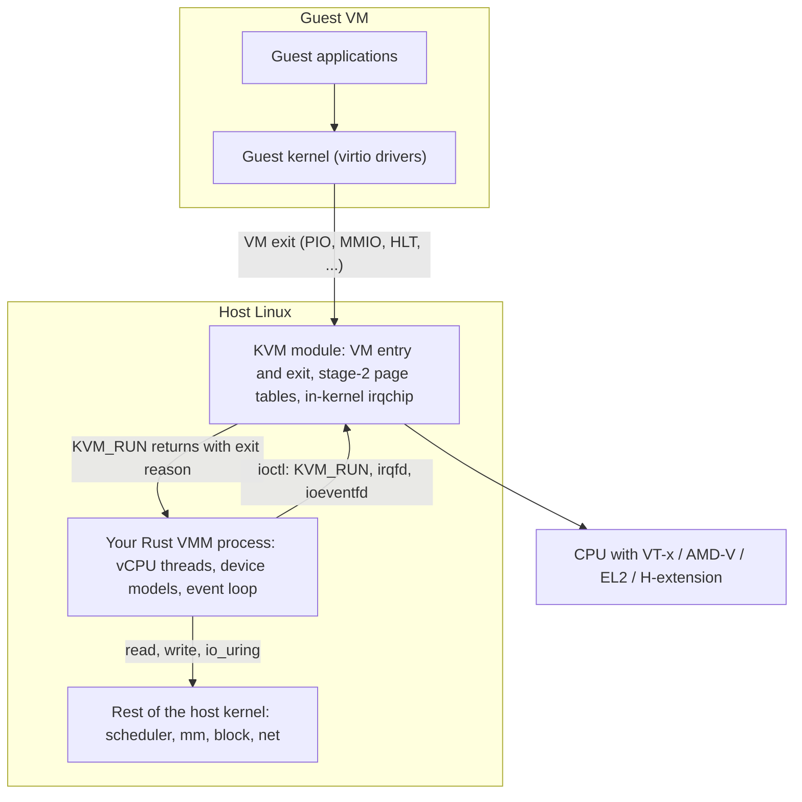
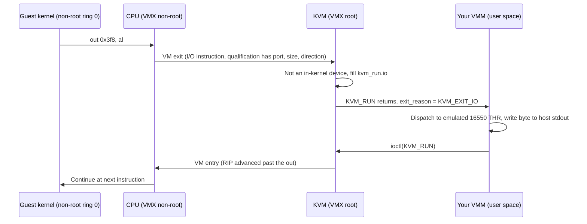

Purpose: Build the mental model every later note depends on (what a virtual machine is, what makes an ISA virtualizable, how the industry got from trap-and-emulate to KVM) so that design decisions in your own Rust VMM rest on first principles instead of folklore.

# Virtualization Mental Model and History

Related notes: [00 Virtualization Mastery Roadmap](/compendium/virtualization/virtualization-mastery-roadmap), [02 x86-64 Architecture for Hypervisor Authors](/compendium/virtualization/x86-64-architecture-for-hypervisor-authors), [03 Intel VT-x and AMD-V Hardware Virtualization](/compendium/virtualization/intel-vt-x-and-amd-v-hardware-virtualization), [04 KVM API and the vCPU Run Loop](/compendium/virtualization/kvm-api-and-the-vcpu-run-loop), [13 Security Isolation and Attack Surface](/compendium/virtualization/security-isolation-and-attack-surface), [17 Hypervisor Architectures Compared](/compendium/virtualization/hypervisor-architectures-compared), [01 Linux Mental Model User Space Kernel and Hardware](/compendium/linux-systems-engineering/linux-mental-model-user-space-kernel-and-hardware), [09 cgroups Namespaces Containers and Runtime Isolation](/compendium/linux-systems-engineering/cgroups-namespaces-containers-and-runtime-isolation).

A virtual machine is an illusion maintained by software (and, today, by hardware that helps the software). The guest believes it owns a CPU, physical memory, interrupt controllers, timers and devices. In reality it owns none of them exclusively: a host component decides when the guest runs, which host pages back its "physical" memory, and what happens when the guest touches something that is not real.

Everything in this compendium is a refinement of one loop:

1. Put the guest on the CPU with some state loaded.
2. Let it run natively for as long as possible.
3. When it does something the host must see, stop it (a trap, a VM exit).
4. Emulate the effect of that action on virtual state.
5. Resume.

The art of building a VMM is making step 2 long, step 3 rare and precise, and step 4 correct.

## The three properties: Popek and Goldberg

In 1974 Gerald Popek and Robert Goldberg published "Formal Requirements for Virtualizable Third Generation Architectures" in Communications of the ACM. They defined a virtual machine monitor (VMM) as a control program with three properties:

| Property | Meaning | What it means for your VMM |
|---|---|---|
| Equivalence (fidelity) | A program running under the VMM behaves essentially identically to running on the real machine, except for timing and resource availability. | Every architecturally visible behavior you emulate must match the spec: register reset values, CPUID leaves, MSR side effects, device register semantics. |
| Efficiency (performance) | A statistically dominant fraction of guest instructions execute directly on the hardware without VMM intervention. | You are not writing an emulator. If most guest instructions trap, you built QEMU TCG, not a hypervisor. |
| Resource control (safety) | The VMM is in complete control of system resources; the guest cannot access any resource not explicitly allocated to it. | Guest memory slots, device access, interrupts and time must be mediated. A guest escaping its memory map is a security bug, not a feature gap. |

Their model splits instructions into classes:

- Privileged instructions: trap when executed in user mode, do not trap in supervisor mode.
- Sensitive instructions, of two kinds:
  - Control-sensitive: they change the configuration of system resources (change the processor mode, change the memory map, mask interrupts).
  - Behavior-sensitive: their result depends on the configuration of resources (their effect differs depending on the current mode or on where in real memory they execute).
- Innocuous instructions: neither.

The central theorem:

&gt; For any conventional third-generation computer, a VMM may be constructed if the set of sensitive instructions for that computer is a subset of the set of privileged instructions.

The intuition: if you run the guest kernel deprivileged (in user mode), every sensitive instruction it executes traps to the VMM, and the VMM can emulate it against virtual state. Every innocuous instruction runs at native speed. This is trap-and-emulate.

A second theorem covers recursive virtualization (a VMM running under itself) and a weaker result introduces the hybrid VMM for machines where "user-sensitive" instructions are a subset of privileged ones: all supervisor-mode guest code is interpreted, but user code runs natively.

The bottom-right box is the entire history of x86 virtualization before 2005.

## Why classic x86 was not virtualizable

The 32-bit x86 architecture (IA-32) violated the Popek and Goldberg condition. John Scott Robin and Cynthia Irvine ("Analysis of the Intel Pentium's Ability to Support a Secure Virtual Machine Monitor", USENIX Security 2000) catalogued 17 instructions that were sensitive but not privileged. Representative examples:

| Instruction | Why it is a problem when the guest kernel runs at ring 1 or 3 |
|---|---|
| `POPF` / `POPFD` | In user mode, attempts to change `IF` (interrupt flag) are silently ignored instead of trapping. The guest kernel thinks it disabled interrupts; nothing happened. |
| `PUSHF` | Reveals the real `EFLAGS`, including the real `IOPL` and `IF`, so the guest can see it is not where it thinks. |
| `SGDT`, `SIDT`, `SLDT` | Store descriptor-table registers without trapping in user mode, leaking the host's tables. (The "Red Pill" VM detection trick used `SIDT`.) |
| `SMSW` | Stores part of `CR0` without trapping. |
| `STR` | Stores the task register selector. |
| `MOV` from segment register, `PUSH CS` | Expose the current privilege level (CPL in the low bits of `CS`), so the guest kernel can observe that it is not at ring 0. |
| `LAR`, `LSL`, `VERR`, `VERW` | Behavior depends on CPL vs descriptor privilege checks. |
| `CALL`, `JMP`, `INT n`, `RET` through call gates / task gates | Privilege checks depend on CPL. |

There were also structural problems beyond individual instructions:

- Ring compression: the guest kernel and guest user both had to run in deprivileged rings, but x86 paging only distinguishes supervisor (rings 0-2) from user (ring 3). Putting the guest kernel at ring 1 kept it protected from guest user, but segment limits were needed to protect the VMM, which broke in 64-bit mode where segmentation is mostly gone.
- Address-space compression: the VMM must live somewhere in the guest's virtual address space (for interrupt and trap handlers), and the guest can try to touch it.
- Hidden state: segment descriptor caches are not readable or restorable through normal instructions.
- Interrupt virtualization: the guest's `cli`/`sti` pattern runs millions of times per second.

The practical consequence: pure trap-and-emulate could not provide equivalence on x86. Three engineering answers emerged.

## Answer 1: Binary translation (VMware, 1998 onward)

VMware Workstation (first released 1999) ran guest user code directly (it was mostly innocuous) and ran guest kernel code through a dynamic binary translator. The translator:

1. Decoded basic blocks of guest kernel code on first execution.
2. Emitted translated code into a translation cache. Most instructions were copied "identically" (IDENT); sensitive ones were replaced by calls or inline sequences that operated on virtual CPU state.
3. Chained translated blocks so the translator was rarely re-entered.
4. Used tracing (write-protecting guest page tables and descriptor tables) to keep shadow structures coherent.

Key ideas worth knowing even though you will not implement them:

- Shadow page tables: the VMM maintains page tables that map guest-virtual directly to host-physical, derived from the guest's own page tables, which it write-protects. Every guest page-table write traps. This is the expensive part that EPT/NPT later eliminated, see [05 Memory Virtualization EPT NPT and Guest Memory](/compendium/virtualization/memory-virtualization-ept-npt-and-guest-memory).
- Adaptive translation: if a guest instruction keeps causing traces (page faults on protected pages), translate it differently.
- The "hybrid" model from Popek and Goldberg, in practice: guest user runs natively, guest kernel is translated.

Adams and Agesen ("A Comparison of Software and Hardware Techniques for x86 Virtualization", ASPLOS 2006) showed the counter-intuitive result that first-generation VT-x was often slower than VMware's binary translator, because VM exits were expensive (thousands of cycles) and the hardware did nothing for MMU virtualization. Hardware won only once exit latency dropped and nested paging arrived.

## Answer 2: Paravirtualization (Xen, 2003)

Xen ("Xen and the Art of Virtualization", SOSP 2003, Barham et al., University of Cambridge) took the opposite stance: change the guest. A paravirtualized (PV) guest kernel:

- Runs in ring 1 (on 32-bit x86) and knows it.
- Replaces privileged operations with hypercalls (the guest equivalent of system calls into the hypervisor): page-table updates are batched and validated by Xen, interrupt masking is a write to a shared memory flag ("event channel" mask), and the timer is virtual.
- Uses split drivers: a frontend driver in the guest talks over shared-memory rings and event channels to a backend driver in a privileged domain (dom0), which owns real hardware.

Paravirtualization gave near-native performance on hardware with no virtualization support. The cost was a modified guest kernel. Its intellectual descendants are everywhere:

- virtio is paravirtualized I/O standardized (see [08 Virtio Devices Virtqueues and vhost](/compendium/virtualization/virtio-devices-virtqueues-and-vhost)): a guest driver that knows it is talking to a hypervisor, using shared rings and notifications instead of emulating a real NIC register by register.
- kvmclock, PV spinlocks, PV TLB flush, PV EOI and steal-time are paravirtual features on top of hardware-assisted KVM.
- Xen PVH mode: a hardware-assisted guest that still boots through a PV-style entry point with no emulated firmware.

## Answer 3: Hardware assist (2005 onward)

Intel VT-x (2005) and AMD-V (2006, originally "Pacifica"/SVM) solved the problem by adding a new orthogonal dimension of privilege instead of reusing rings:

- Intel: VMX root operation (host) vs VMX non-root operation (guest). Each has its own rings 0-3. The guest kernel runs at ring 0 non-root, so `PUSH CS` shows CPL 0 and `POPF` changes `IF` for real (in the guest's context).
- AMD: host mode vs guest mode, entered with `VMRUN`.
- A control structure in memory (Intel VMCS, AMD VMCB) holds guest state, host state and execution controls that say which events cause a VM exit.
- Sensitive instructions that matter (`CPUID`, `HLT`, `IN`/`OUT`, `RDMSR`/`WRMSR`, `MOV CR`, `INVLPG`, and so on) cause VM exits, conditionally or unconditionally per the controls.

That makes x86 satisfy Popek and Goldberg in spirit: every sensitive thing either runs safely inside the guest's private context or exits to the hypervisor.

The second generation fixed the MMU: Intel EPT (Nehalem, 2008) and AMD NPT/RVI (Barcelona, 2007) added a second level of address translation done by hardware (guest-virtual to guest-physical by the guest's page tables, guest-physical to host-physical by the hypervisor's tables). Shadow paging became unnecessary for most workloads. Later generations added VPID/ASID tagging (no TLB flush on every exit), APIC virtualization (APICv, AVIC), posted interrupts, VMCS shadowing for nested virtualization, and TSC scaling. Details live in [03 Intel VT-x and AMD-V Hardware Virtualization](/compendium/virtualization/intel-vt-x-and-amd-v-hardware-virtualization).

### Other architectures were designed for this

| Architecture | Classic virtualizability | Hardware assist | Where the hypervisor runs |
|---|---|---|---|
| IBM System/370 | Yes, virtualization was a design goal (VM/370, 1972). | SIE instruction (Start Interpretive Execution) later. | CP (Control Program). |
| x86 (IA-32) | No (17 sensitive unprivileged instructions). | VT-x / AMD-V, then EPT / NPT. | VMX root / host mode, orthogonal to rings. |
| ARMv7-A (without extensions) | No (several sensitive unprivileged instructions, for example `CPS` behavior, reads of `CPSR` mode bits). | Virtualization Extensions added a Hyp mode. | Hyp mode (PL2). |
| ARMv8-A / ARM64 | Designed with EL2 from the start. | EL2 with stage-2 translation, virtual GIC, generic timer virtualization; VHE (ARMv8.1) lets a host kernel run at EL2. | EL2. See [15 ARM64 Virtualization EL2 VHE and GIC](/compendium/virtualization/arm64-virtualization-el2-vhe-and-gic). |
| RISC-V | The base privileged ISA was designed to be classically virtualizable (trap-and-emulate works for S-mode). | H extension (ratified 2021): HS-mode, VS-mode, VU-mode, two-stage translation (`vsatp` + `hgatp`), virtual interrupts; AIA for interrupt virtualization. | HS-mode. See [16 RISC-V Virtualization and the Hypervisor Extension](/compendium/virtualization/risc-v-virtualization-and-the-hypervisor-extension). |

An important asymmetry for a VMM author: on x86 the hypervisor mode is orthogonal to rings (root vs non-root), while on ARM64 and RISC-V the hypervisor is a higher privilege level in a linear hierarchy (EL2 above EL1, HS above VS). This changes how a host kernel coexists with the hypervisor. On ARM64 without VHE, KVM is split: a small "hyp" component at EL2 and the bulk of KVM in the host kernel at EL1, with a world switch through EL2 on every guest entry. With VHE, the host kernel itself runs at EL2 and KVM looks much like the x86 model. Since Linux 5.x, pKVM (protected KVM, used by Android) deliberately goes back to a split design to deprivilege the host.

## Type 1 vs type 2, and why the labels are blurry

Goldberg's 1973 thesis introduced the terms:

- Type 1 (native, bare-metal): the hypervisor runs directly on hardware and is itself the most privileged software; operating systems run above it. Examples: IBM CP, VMware ESXi, Xen, Microsoft Hyper-V.
- Type 2 (hosted): the hypervisor runs as a component or application on top of a conventional OS. Examples: VMware Workstation, VirtualBox, Parallels, QEMU without acceleration.

Where does KVM sit? Arguments exist both ways and the honest answer is "the taxonomy predates it":

- KVM is a Linux kernel module. When loaded, the Linux kernel itself executes in VMX root (or EL2 under VHE) and directly controls hardware virtualization. Linux is the hypervisor. That is type-1-like.
- But the VM is a normal Linux process (your VMM), scheduled by CFS/EEVDF, with memory from the host's page allocator, and device models in user space. That is type-2-like.

crosvm's documentation, for instance, describes itself as a hosted (type 2) VMM, while KVM marketing often says type 1. Do not argue about labels; reason about these questions instead:

| Question | Why it matters more than the label |
|---|---|
| What runs in the most privileged mode? | That is your TCB floor. With KVM it is the whole Linux kernel. With Xen it is Xen plus, effectively, dom0. |
| Where do device models run? | Device emulation is the largest attack surface. In-kernel, in a privileged VM, in a per-VM process, or per-device process. |
| Who schedules vCPUs? | Host scheduler (KVM), hypervisor scheduler (Xen credit2, ESXi), or root partition (Hyper-V). |
| Who owns physical devices? | Host kernel drivers (KVM), dom0 (Xen), root partition (Hyper-V), vmkernel (ESXi). |

## Terminology: hypervisor vs VMM

The words are used interchangeably in marketing. This compendium uses them precisely:

| Term | Meaning in this compendium | In the KVM world |
|---|---|---|
| Hypervisor | The privileged component that uses hardware virtualization to enter and exit guests, enforces memory isolation (stage-2 tables) and owns the world switch. | The KVM kernel module (`kvm.ko`, `kvm-intel.ko`/`kvm-amd.ko`, arch code in `arch/arm64/kvm`, `arch/riscv/kvm`). |
| VMM (virtual machine monitor) | The component that defines the virtual platform: memory layout, vCPU count and setup, firmware or kernel loading, device models, the event loop, the management API. | Your user-space Rust process: QEMU, Firecracker, Cloud Hypervisor, crosvm, or yours. |
| Device model | Emulation of a device's guest-visible interface. | Code in the VMM (PIO/MMIO handlers, virtio devices), in a vhost-user backend process, or in the kernel (vhost-net, in-kernel LAPIC/IOAPIC/GIC). |
| Guest | The OS and software inside the VM. | |
| vCPU | A virtual CPU, backed by a host thread that calls `KVM_RUN`. | `VcpuFd` in kvm-ioctls. |

In Popek and Goldberg's original usage, "VMM" meant the whole control program. KVM split that role in two: the kernel does the parts that need privilege and speed, user space does policy and platform definition. When you say "I am writing a hypervisor in Rust on KVM", what you are writing is a VMM. That is good news: your bugs crash a process, not the host.

## Containers vs microVMs vs full VMs

Isolation is a spectrum defined by what the workload shares with the host and how wide the interface is.

| Dimension | Container (runc) | gVisor | microVM (Firecracker, Cloud Hypervisor) | Full VM (QEMU with firmware, ESXi) |
|---|---|---|---|---|
| Isolation boundary | Namespaces, cgroups, seccomp, LSM over a shared host kernel. See [09 cgroups Namespaces Containers and Runtime Isolation](/compendium/linux-systems-engineering/cgroups-namespaces-containers-and-runtime-isolation). | User-space kernel (Sentry) in Go intercepts syscalls; host syscall surface reduced and seccomp-filtered. | Hardware virtualization; guest has its own kernel. | Hardware virtualization; guest has its own kernel and firmware. |
| Interface to attack | Full Linux syscall ABI (hundreds of syscalls) | Sentry's Linux ABI implementation plus its narrow host surface | A handful of virtio devices, a serial port, KVM itself | Many emulated devices (chipset, USB, VGA, IDE, ...), firmware, KVM |
| Guest kernel | Shared with host | gVisor Sentry | Own, minimal | Own, general purpose |
| Boot time | Milliseconds (process start) | Tens of milliseconds | About 100 ms to a few hundred ms to guest init (Firecracker's spec targets at most 125 ms to `/sbin/init`) | Seconds (firmware, bootloader) |
| Memory overhead per instance | Near zero beyond the app | Tens of MB | A few MB for the VMM (Firecracker spec: at most 5 MiB of VMM overhead for a 1 vCPU, 128 MiB guest) plus guest kernel memory | Tens to hundreds of MB |
| Hardware support needed | None | None (systrap platform) or KVM | KVM | KVM or other hypervisor |
| Typical use | Trusted multi-tenant within one org | Untrusted code with syscall-level sandboxing | Serverless, multi-tenant untrusted code, sandboxes | Legacy OS, Windows, arbitrary images, desktop |

Important nuances:

- A microVM is not a different technology from a full VM; it is a full VM with a deliberately minimal platform: no BIOS or UEFI by default (direct kernel boot), no PCI or a minimal PCI, virtio-mmio or virtio-pci, a serial port, maybe an i8042 for reset, an RTC. Fewer devices means less code reachable from the guest.
- Containers inside microVMs (Kata Containers, Firecracker in AWS Lambda and Fargate) combine container ergonomics with VM isolation.
- The guest kernel inside a microVM is still a full Linux kernel, so guest-internal isolation is unchanged. You gain a second, independent kernel boundary.
- "VM boundary" security is only as strong as the hypervisor plus the device models plus the VMM's jail. A memory-safe VMM in a tight seccomp jail with few devices is the whole point of the Firecracker design, see [13 Security Isolation and Attack Surface](/compendium/virtualization/security-isolation-and-attack-surface).

## A short timeline

| Year | Event |
|---|---|
| 1967-1972 | IBM CP-40 and CP-67, then VM/370: production virtualization on mainframes. |
| 1973 | Goldberg's thesis, "Architectural Principles for Virtual Computer Systems", introduces type 1 and type 2. |
| 1974 | Popek and Goldberg formalize virtualizability. |
| 1997 | Disco (Stanford, Bugnion, Devine, Rosenblum) runs commodity OSes on a ccNUMA MIPS machine; the team founds VMware in 1998. |
| 1999 | VMware Workstation 1.0: binary translation on x86. |
| 2000 | Robin and Irvine list x86's sensitive unprivileged instructions. |
| 2001 | VMware ESX Server (type 1). |
| 2003 | Xen paper at SOSP: paravirtualization. |
| 2003 | QEMU first release (Fabrice Bellard): dynamic translation emulator. |
| 2005-2006 | Intel VT-x and AMD-V ship. |
| 2006-2007 | KVM (Avi Kivity, Qumranet) merged into Linux 2.6.20 (released February 2007). |
| 2007-2008 | AMD NPT and Intel EPT: hardware two-dimensional paging. |
| 2008 | Microsoft Hyper-V ships with Windows Server 2008. |
| 2011 | ARMv7 Virtualization Extensions; ARMv8-A announced with EL2. |
| 2013 | KVM/ARM merged (Linux 3.9 for 32-bit ARM, 3.11 for ARM64). |
| 2014 | bhyve ships in FreeBSD 10.0. |
| 2017 | crosvm development starts at Google for Chrome OS. |
| 2018 | Firecracker open sourced by AWS; rust-vmm community forms to share components between Firecracker and crosvm. |
| 2018 | Cloud Hypervisor work starts at Intel (open sourced 2019). |
| 2020 | Apple Hypervisor.framework on Apple silicon (EL2 owned by macOS). |
| 2021 | RISC-V H extension ratified (Privileged spec 1.12). |
| 2021-2022 | KVM RISC-V merged (Linux 5.16). |

## One instruction, four eras: `cli` in a guest kernel

Following a single sensitive instruction through each technique makes the trade-offs concrete. `cli` clears the interrupt flag; a guest kernel executes it constantly around critical sections.

| Technique | What happens on `cli` | Cost |
|---|---|---|
| Pure trap-and-emulate (hypothetical, if x86 had trapped) | Guest kernel runs deprivileged, `cli` traps, VMM clears a virtual `IF` bit in its vCPU structure, resumes | One trap per `cli`; prohibitive at millions per second |
| Classic x86 deprivileged (broken) | At ring 1 or 3 with `IOPL` below CPL, `cli` raises #GP and could be emulated, but `popf` restoring `IF` silently does nothing, so the pair is inconsistent | Correctness failure, not a performance one |
| Binary translation (VMware) | The translator rewrites `cli` into an inline store to a virtual `IF` in VMM memory; no trap at all | A few cycles; translation cost amortized by the translation cache |
| Paravirtualization (Xen PV) | The PV kernel never issues `cli`; it writes a mask byte in the shared info page (`evtchn_upcall_mask`) | A memory write; requires a modified kernel |
| Hardware assist (VT-x / AMD-V) | Guest runs at non-root ring 0; `cli` executes natively and clears the guest's `RFLAGS.IF` held in VMCS/VMCB guest state; no exit | Native; the hypervisor only learns about `IF` when it needs to inject an interrupt (interrupt-window exiting) |

The same exercise for ARM64: `msr daifset, #2` masks IRQs at EL1 and executes natively inside the guest; the vGIC and the virtual interrupt lines (`HCR_EL2.VI`, or the GIC list registers) deliver interrupts that respect the guest's own mask. For RISC-V: `csrc sstatus, SIE` in VS-mode actually accesses `vsstatus` (the H extension swaps in VS-level CSRs transparently), so it also runs natively.

That table is the whole argument for hardware assist: the expensive cases disappear because the guest has a private copy of the state it believes is privileged.

## Where each architecture forces an exit

A preview of the exit landscape you will meet in [04 KVM API and the vCPU Run Loop](/compendium/virtualization/kvm-api-and-the-vcpu-run-loop), [15 ARM64 Virtualization EL2 VHE and GIC](/compendium/virtualization/arm64-virtualization-el2-vhe-and-gic) and [16 RISC-V Virtualization and the Hypervisor Extension](/compendium/virtualization/risc-v-virtualization-and-the-hypervisor-extension):

| Cause | x86-64 (VT-x / AMD-V) | ARM64 (EL2) | RISC-V (H extension) | Usually handled by |
|---|---|---|---|---|
| Port I/O | `IN`/`OUT` exit (I/O bitmap) | No port I/O exists | No port I/O exists | VMM (or in-kernel PIT/PIC) |
| Access to unmapped guest-physical memory | EPT violation / NPT fault | Stage-2 data abort | Guest-page fault (G-stage) | KVM if RAM, VMM if MMIO |
| CPU identification | `CPUID` always exits | ID registers trapped via `HCR_EL2.TID*` or read from virtualized copies | `misa` and ISA config exposed as ONE_REG registers | KVM, configured by VMM |
| Model-specific / system registers | `RDMSR`/`WRMSR` per MSR bitmap | System register traps (`HCR_EL2`, fine-grained traps) | CSR accesses to unimplemented or trapped CSRs (virtual instruction exception) | KVM; some MSRs can be forwarded to user space |
| Halting | `HLT` | `WFI` / `WFE` (trapped via `HCR_EL2.TWI`/`TWE`) | `WFI` (trapped via `hstatus.VTW`) | KVM blocks the vCPU when irqchip is in kernel |
| Firmware or hypervisor calls | `VMCALL` / `VMMCALL` | `HVC` (PSCI), `SMC` | `ECALL` from VS-mode (SBI) | KVM for PSCI and core SBI; VMM for the rest |
| Interrupts while guest runs | External-interrupt exiting, posted interrupts avoid it | Physical IRQ to EL2, then virtual IRQ via GIC list registers | Interrupt to HS-mode, then `hvip` or IMSIC guest files | KVM |
| Triple fault / fatal | Triple fault exit | No direct equivalent; guest calls PSCI `SYSTEM_RESET` or hangs | SBI SRST | VMM (`KVM_EXIT_SHUTDOWN`, `KVM_EXIT_SYSTEM_EVENT`) |

## Glossary

| Term | Meaning |
|---|---|
| VM exit | Transition from guest to hypervisor context caused by a configured event. Called a "#VMEXIT" on AMD, a trap to EL2 on ARM64, a trap to HS-mode on RISC-V. |
| VM entry | Transition into the guest (`VMLAUNCH`/`VMRESUME`, `VMRUN`, `ERET` to EL1, `SRET` with `hstatus.SPV` set). |
| World switch | Saving host context and loading guest context (or the reverse), including registers the hardware does not switch for you. |
| Shadow page tables | Software-maintained guest-virtual to host-physical tables, kept coherent by write-protecting guest page tables. |
| Two-dimensional paging | Hardware walks guest page tables, then hypervisor tables for every guest-physical reference (EPT, NPT, stage-2, G-stage). |
| Hypercall | Explicit guest call into the hypervisor (`VMCALL`, `HVC`, `ECALL`). |
| Paravirtual | Guest is aware of the hypervisor and uses an interface designed for virtualization rather than emulated hardware. |
| Enlightenment | Microsoft's term for a paravirtual optimization a guest OS opts into. |
| Device model | Software that implements a device's guest-visible registers and behavior. |
| microVM | A VM with a deliberately minimal virtual platform, typically direct kernel boot and a few virtio devices. |
| TCB | Trusted computing base: code whose compromise breaks the isolation guarantee. |

## How this shapes your VMM

The history is not trivia; each era left a mechanism you will touch directly:

1. Trap-and-emulate is what you implement for every VM exit you handle in user space: `KVM_EXIT_IO`, `KVM_EXIT_MMIO`, `KVM_EXIT_SYSTEM_EVENT`, `KVM_EXIT_RISCV_SBI` and friends. Equivalence (fidelity) is your correctness bar: a Linux guest probes devices and will misbehave on subtly wrong register semantics.
2. Paravirtualization survives as virtio, kvmclock and PV features. You will choose paravirtual devices over emulating real hardware because each emulated register access is a VM exit.
3. Hardware assist means you never translate guest code. You configure state (registers, CPUID, MSRs, system registers) and memory slots and call `KVM_RUN`.
4. Second-level paging means guest memory is just an `mmap` in your process. Slots map guest-physical ranges to your host-virtual ranges; KVM builds the EPT/NPT/stage-2/G-stage tables lazily on faults.
5. The efficiency property is your performance bar: every exit you can avoid (ioeventfd instead of MMIO exit for a queue notify, irqfd instead of an ioctl for interrupt injection, in-kernel irqchip instead of user-space APIC) is a measurable win. See [14 Performance Observability and Debugging](/compendium/virtualization/performance-observability-and-debugging).
6. The resource-control property is your security bar: validate every guest-provided address and length, never trust descriptor contents, and assume the guest is hostile.

## Common pitfalls

- Treating "hypervisor" and "VMM" as synonyms in design discussions, then being unable to say which component owns a bug or a security boundary.
- Assuming the KVM boundary alone isolates tenants. Your VMM's device models run in a host process reachable from the guest; a bug there is a host-side compromise of that process.
- Believing hardware virtualization is automatically faster. It is faster only if exits are rare; a chatty emulated device can make a hardware-assisted VM slower than a paravirtual one.
- Emulating real hardware (e1000, IDE) for performance-sensitive paths when the guest can use virtio.
- Ignoring architecture differences in privilege layout: an x86-centric design that assumes "root vs non-root" will mis-model ARM64 (EL2 vs EL1, VHE vs nVHE) and RISC-V (HS vs VS).
- Conflating microVM with container. A microVM still needs a guest kernel, a root filesystem image and a boot path; a container image is not directly bootable.
- Over-indexing on the Popek and Goldberg theorem as a binary property. Modern ISAs plus hardware assist are virtualizable for practical purposes, but timing, performance counters and side channels still leak the presence of a hypervisor (the theorem explicitly exempts timing).

## Review checklist

- [ ] I can state the three Popek and Goldberg properties and give a VMM design decision that serves each.
- [ ] I can define sensitive, privileged and innocuous instructions and explain the subset condition.
- [ ] I can name at least four x86 instructions that broke classic virtualization and say why (`POPF`, `PUSHF`, `SGDT`/`SIDT`, `SMSW`, segment register reads).
- [ ] I can explain binary translation, shadow page tables, and why early VT-x lost to them.
- [ ] I can explain paravirtualization and trace its descendants (virtio, kvmclock, PVH).
- [ ] I can describe VMX root/non-root and how it differs from EL2 on ARM64 and HS-mode on RISC-V.
- [ ] I can argue both sides of "is KVM type 1 or type 2" and replace the label with concrete questions.
- [ ] I can draw the KVM split: kernel hypervisor vs user-space VMM, and say which exits reach user space.
- [ ] I can compare containers, gVisor, microVMs and full VMs on boundary, attack surface, boot time and overhead.

## Primary Sources

- [Popek and Goldberg, "Formal Requirements for Virtualizable Third Generation Architectures", CACM 1974](https://dl.acm.org/doi/10.1145/361011.361073)
- [Robin and Irvine, "Analysis of the Intel Pentium's Ability to Support a Secure Virtual Machine Monitor", USENIX Security 2000](https://www.usenix.org/legacy/events/sec2000/full_papers/robin/robin.pdf)
- [Adams and Agesen, "A Comparison of Software and Hardware Techniques for x86 Virtualization", ASPLOS 2006](https://dl.acm.org/doi/10.1145/1168857.1168860)
- [Bugnion et al., "Bringing Virtualization to the x86 Architecture with the Original VMware Workstation", ACM TOCS 2012](https://dl.acm.org/doi/10.1145/2382553.2382554)
- [Barham et al., "Xen and the Art of Virtualization", SOSP 2003](https://dl.acm.org/doi/10.1145/945445.945462)
- [Kivity et al., "kvm: the Linux Virtual Machine Monitor", Ottawa Linux Symposium 2007](https://www.kernel.org/doc/ols/2007/ols2007v1-pages-225-230.pdf)
- [Linux KVM API documentation](https://docs.kernel.org/virt/kvm/api.html)
- [Firecracker specification (boot time and overhead targets)](https://github.com/firecracker-microvm/firecracker/blob/main/SPECIFICATION.md)
- [crosvm book (self-description as a hosted VMM)](https://crosvm.dev/book/)
- [gVisor platform guide](https://gvisor.dev/docs/architecture_guide/platforms/)
- [RISC-V Privileged Architecture specification (H extension)](https://github.com/riscv/riscv-isa-manual)
- [Arm Architecture Reference Manual for A-profile](https://developer.arm.com/documentation/ddi0487/latest)
