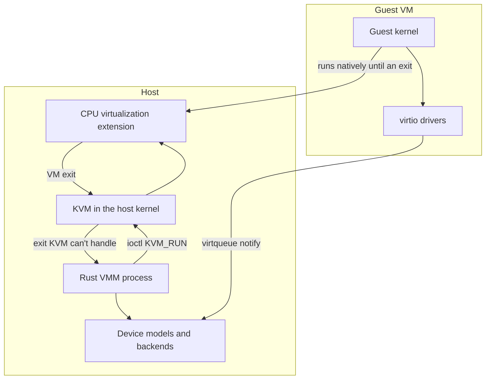

Purpose: Root navigation map for learning hardware virtualization deeply enough to build a production-minded Rust VMM on KVM for x86-64, ARM64, and RISC-V.

# Virtualization

A virtual machine monitor is a user-space program that asks the kernel (KVM) to run guest code directly on the CPU, then emulates everything the CPU cannot do safely on its own: devices, firmware tables, interrupts, clocks, and boot. Hardware does the heavy lifting for CPU and memory isolation. The VMM owns policy, devices, lifecycle, and the attack surface.

This note is the map, not the content. Use it to choose what to read next and to see how the pieces depend on each other.

The fastest path is not "read every spec, then write a VMM." It is: understand trap-and-emulate, run a few guest instructions through `KVM_RUN`, then grow the VMM one exit reason, one device, and one architecture at a time.

## Note set

| Layer | Notes | What they are for | Exit signal |
|---|---|---|---|
| Orientation | [00 Virtualization Mastery Roadmap](/compendium/virtualization/virtualization-mastery-roadmap), [01 Virtualization Mental Model and History](/compendium/virtualization/virtualization-mental-model-and-history) | Study order, project ladder, and the core trap-and-emulate model. | You can explain why classic x86 needed binary translation and what VT-x changed. |
| CPU | [02 x86-64 Architecture for Hypervisor Authors](/compendium/virtualization/x86-64-architecture-for-hypervisor-authors), [03 Intel VT-x and AMD-V Hardware Virtualization](/compendium/virtualization/intel-vt-x-and-amd-v-hardware-virtualization), [15 ARM64 Virtualization EL2 VHE and GIC](/compendium/virtualization/arm64-virtualization-el2-vhe-and-gic), [16 RISC-V Virtualization and the Hypervisor Extension](/compendium/virtualization/risc-v-virtualization-and-the-hypervisor-extension) | Privilege models, paging, system registers, and the hardware virtualization extension of each architecture. | You can set up a vCPU to enter 64-bit code directly on each architecture. |
| KVM core | [04 KVM API and the vCPU Run Loop](/compendium/virtualization/kvm-api-and-the-vcpu-run-loop), [05 Memory Virtualization EPT NPT and Guest Memory](/compendium/virtualization/memory-virtualization-ept-npt-and-guest-memory), [06 Interrupts Timers and Interrupt Controller Virtualization](/compendium/virtualization/interrupts-timers-and-interrupt-controller-virtualization) | The ioctl surface, the run loop, guest memory, interrupt injection, and time. | Your VMM boots a guest that takes timer interrupts and halts cleanly. |
| Devices | [07 Device Emulation PIO MMIO and the Bus Model](/compendium/virtualization/device-emulation-pio-mmio-and-the-bus-model), [08 Virtio Devices Virtqueues and vhost](/compendium/virtualization/virtio-devices-virtqueues-and-vhost), [10 Storage and Network Backends](/compendium/virtualization/storage-and-network-backends), [11 Device Passthrough VFIO IOMMU and Nested Virtualization](/compendium/virtualization/device-passthrough-vfio-iommu-and-nested-virtualization) | Emulated devices, paravirtual virtio devices, host backends, and real hardware passthrough. | The guest has a console, a root disk, and a network interface. |
| Lifecycle | [09 Booting Guests Firmware and the Linux Boot Protocol](/compendium/virtualization/booting-guests-firmware-and-the-linux-boot-protocol), [12 Snapshots Live Migration and Dirty Page Tracking](/compendium/virtualization/snapshots-live-migration-and-dirty-page-tracking) | Getting a kernel running, and capturing or moving a running VM. | You can boot Linux in under a second and restore it from a snapshot. |
| Production | [13 Security Isolation and Attack Surface](/compendium/virtualization/security-isolation-and-attack-surface), [14 Performance Observability and Debugging](/compendium/virtualization/performance-observability-and-debugging) | Threat model, sandboxing, exit costs, tracing, and debugging. | You can justify every device you expose and measure every exit you take. |
| Ecosystem | [17 Hypervisor Architectures Compared](/compendium/virtualization/hypervisor-architectures-compared), [18 Rust VMM Ecosystem and Project Templates](/compendium/virtualization/rust-vmm-ecosystem-and-project-templates) | How existing VMMs are built and which rust-vmm crates to reuse. | You can sketch your VMM's crate layout and defend each design choice. |

## Adjacent vault anchors

- [01 Linux Mental Model User Space Kernel and Hardware](/compendium/linux-systems-engineering/linux-mental-model-user-space-kernel-and-hardware) and [13 Kernel Architecture Modules Drivers and Device Model](/compendium/linux-systems-engineering/kernel-architecture-modules-drivers-and-device-model) for the host kernel side of KVM.
- [03 Memory Virtual Memory Paging Allocators and OOM](/compendium/linux-systems-engineering/memory-virtual-memory-paging-allocators-and-oom) before [05 Memory Virtualization EPT NPT and Guest Memory](/compendium/virtualization/memory-virtualization-ept-npt-and-guest-memory).
- [09 cgroups Namespaces Containers and Runtime Isolation](/compendium/linux-systems-engineering/cgroups-namespaces-containers-and-runtime-isolation) for the containment around a VMM process.
- [09 Unsafe Rust and the Rust Memory Model](/compendium/rust/unsafe-rust-and-the-rust-memory-model) and [14 FFI Embedded WebAssembly and Interop](/compendium/rust/ffi-embedded-webassembly-and-interop) for the unsafe and ioctl boundaries a Rust VMM lives on.

## Mental model

Three questions frame every design decision:

1. **Who handles this exit?** Hardware, KVM in the kernel, or your VMM in user space. Each step outward costs more time.
2. **What does the guest see?** Every register, device, table, and clock is part of a contract you must keep stable across restore and migration.
3. **What can a hostile guest reach?** Every byte the guest can write into your VMM is attack surface.

## Study paths

| Goal | Path |
|---|---|
| First working VMM on x86 | 00, 01, 02, 04, 05, 07, 09 |
| Fast Linux microVM | add 06, 08, 10, 14 |
| Multi-architecture VMM | add 03, 15, 16 |
| Production hardening | add 11, 12, 13, 17, 18 |

## Review checklist

- [ ] Every leaf note links back to this map or the roadmap.
- [ ] Architecture-specific claims name the architecture.
- [ ] Facts are checked against the Primary Sources listed in each note.
- [ ] New notes use the `NN Title` filename pattern and the shared frontmatter.
