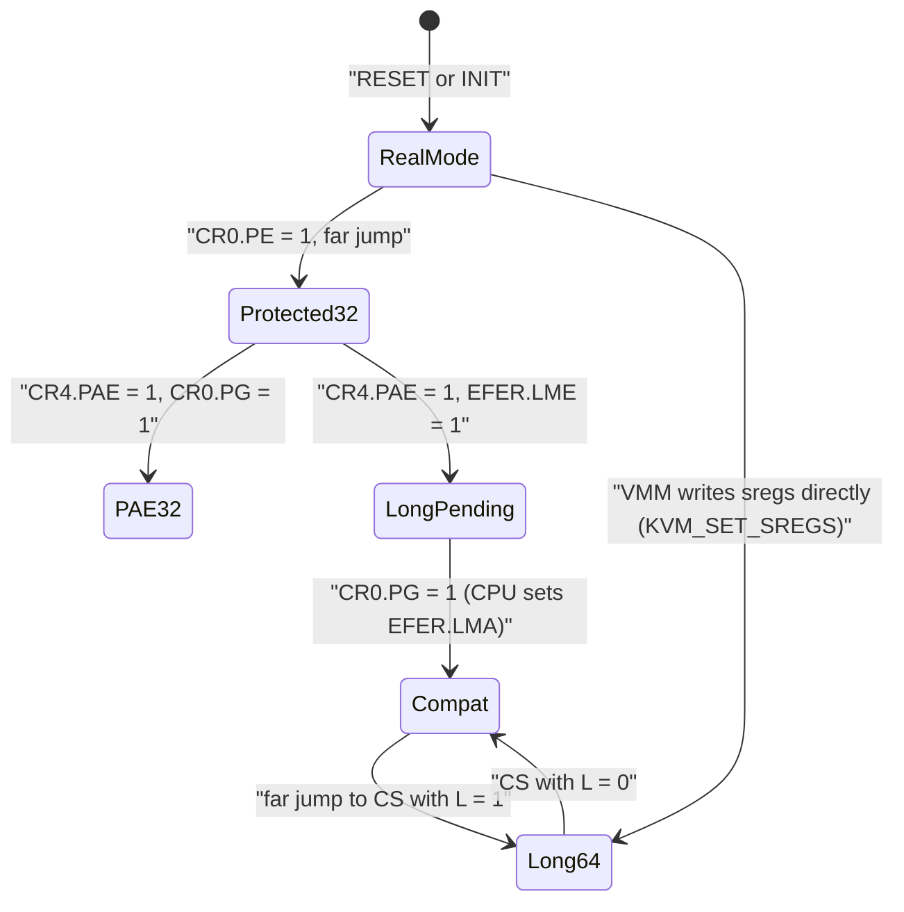
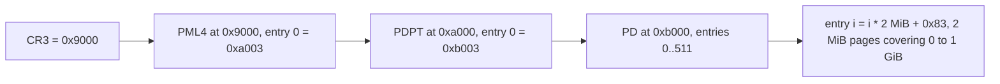
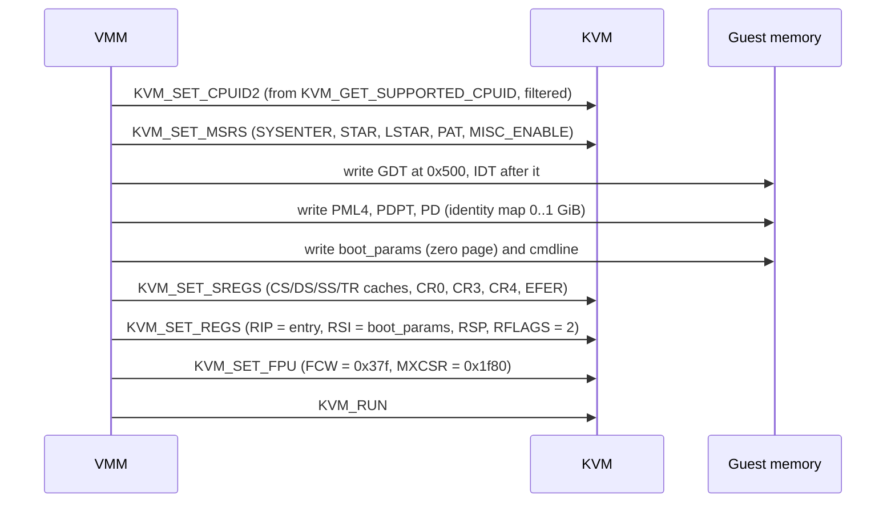

Purpose: give a VMM author the exact x86-64 machine model (modes, segmentation, paging, control registers, MSRs, CPUID, exceptions, reset state) needed to put a vCPU into a valid state through KVM, and contrast it with ARM64 and RISC-V.

# x86-64 Architecture for Hypervisor Authors

Related notes: [01 Virtualization Mental Model and History](/compendium/virtualization/virtualization-mental-model-and-history), [03 Intel VT-x and AMD-V Hardware Virtualization](/compendium/virtualization/intel-vt-x-and-amd-v-hardware-virtualization), [04 KVM API and the vCPU Run Loop](/compendium/virtualization/kvm-api-and-the-vcpu-run-loop), [05 Memory Virtualization EPT NPT and Guest Memory](/compendium/virtualization/memory-virtualization-ept-npt-and-guest-memory), [06 Interrupts Timers and Interrupt Controller Virtualization](/compendium/virtualization/interrupts-timers-and-interrupt-controller-virtualization), [09 Booting Guests Firmware and the Linux Boot Protocol](/compendium/virtualization/booting-guests-firmware-and-the-linux-boot-protocol), [15 ARM64 Virtualization EL2 VHE and GIC](/compendium/virtualization/arm64-virtualization-el2-vhe-and-gic), [16 RISC-V Virtualization and the Hypervisor Extension](/compendium/virtualization/risc-v-virtualization-and-the-hypervisor-extension), [03 Memory Virtual Memory Paging Allocators and OOM](/compendium/linux-systems-engineering/memory-virtual-memory-paging-allocators-and-oom), [09 Unsafe Rust and the Rust Memory Model](/compendium/rust/unsafe-rust-and-the-rust-memory-model).

## Why a VMM author needs the ISA, not just KVM

KVM does the privileged work: it owns VMX/SVM, the VMCS or VMCB, and the second-level page tables. What it does not do is decide what state your guest starts in. When you call `KVM_SET_SREGS` and `KVM_SET_REGS` you are writing architectural state directly: CR0, CR3, CR4, EFER, segment descriptor caches, GDTR, IDTR, RIP, RFLAGS. If that state is inconsistent, the CPU refuses VM entry and you get `KVM_EXIT_FAIL_ENTRY` (VMX exit reason 33, "invalid guest state") or a triple fault reported as `KVM_EXIT_SHUTDOWN`. Neither tells you which bit you got wrong.

So the job of this note is narrow and practical:

1. Know the processor modes and which ones a guest passes through.
2. Know the registers that define a mode: CR0, CR4, EFER, CS descriptor.
3. Know the page table formats, because a VMM that boots Linux directly must build an identity map in guest memory.
4. Know CPUID and MSRs, because they are the guest's view of the "hardware" and you configure both.
5. Know the reset state, because firmware-style boots start there.

Everything here is from the guest's point of view. Note 03 covers what the host CPU does to virtualize it; note 05 covers the second translation stage.

## Processor modes

x86-64 is a stack of compatibility layers. A physical CPU leaves reset in real mode and firmware or a bootloader climbs the stack. A VMM can skip the climb by writing the final state directly.

| Mode | Address size | Enabled by | Segmentation | Paging | Typical user |
|---|---|---|---|---|---|
| Real mode | 20-bit (plus A20 quirks) | Reset state | `base = selector &lt;&lt; 4` | None | BIOS, early SeaBIOS, boot sectors |
| Protected mode (16/32-bit) | 32-bit | CR0.PE = 1 | Descriptor tables (GDT/LDT) | Optional (CR0.PG) | 32-bit kernels, transitional code |
| PAE protected mode | 32-bit linear, up to 52-bit physical | CR4.PAE = 1, CR0.PG = 1 | Descriptors | 3-level PAE | 32-bit kernels on large-RAM hosts |
| Long mode, compatibility submode | 32-bit code under a 64-bit kernel | EFER.LME + CR4.PAE + CR0.PG, CS.L = 0 | Descriptors, mostly flat | 4 or 5 level | 32-bit user space |
| Long mode, 64-bit submode | 48-bit (4-level) or 57-bit (5-level) linear | as above, CS.L = 1 | Flat, except FS/GS bases | 4 or 5 level | Every modern OS |
| System Management Mode | special | SMI | special | special | Firmware; KVM emulates it when enabled |
| Virtual-8086 | 20-bit inside protected mode | EFLAGS.VM | real-mode style | yes | Legacy; not available in long mode |

Rules worth memorizing:

- Long mode requires paging. There is no "64-bit without page tables". EFER.LMA (long mode active) is set by the CPU when CR0.PG is turned on while EFER.LME = 1 and CR4.PAE = 1.
- In 64-bit mode CS, DS, ES, SS bases are treated as 0 and limits are not checked. FS and GS bases are still honored (via the `IA32_FS_BASE` and `IA32_GS_BASE` MSRs or the hidden descriptor cache). This is how TLS and per-CPU data work.
- The descriptor cache (hidden base, limit, attributes) is what the CPU actually uses. Loading a selector refreshes the cache from the GDT. KVM's `kvm_segment` is that cache, which is why you can set CS to a 64-bit code segment without the guest ever executing a far jump.



The bottom edge is the whole point of direct kernel boot: Firecracker, Cloud Hypervisor and crosvm never execute a single real-mode instruction for a Linux guest. They write a long-mode state and set RIP to the kernel's 64-bit entry point. See [09 Booting Guests Firmware and the Linux Boot Protocol](/compendium/virtualization/booting-guests-firmware-and-the-linux-boot-protocol).

### Unrestricted guest and real mode

Early VT-x could not run real mode or "big real mode" natively, because VMX non-root required protected mode with paging. KVM emulated real mode with vm86 tricks, which is why `KVM_SET_TSS_ADDR` and `KVM_SET_IDENTITY_MAP_ADDR` exist: the kernel needs a three-page TSS region and a one-page identity-map page table somewhere in guest physical space below 4 GiB, outside RAM and MMIO. Modern CPUs have the "unrestricted guest" secondary control, so the vm86 path is mostly dead, but KVM still documents `KVM_SET_TSS_ADDR` as required on Intel hosts. Set it once per VM (Firecracker uses `0xfffb_d000`) and move on.

## Segmentation, GDT, IDT, TSS

Segmentation is vestigial in 64-bit mode but not gone. You still need:

- A GDT with a 64-bit code descriptor (L = 1, D = 0) and a data descriptor.
- A TR (task register) pointing to a valid 64-bit TSS descriptor. VM entry checks TR even if the guest never uses the TSS. The TSS holds RSP0 for privilege transitions and the IST stack pointers.
- An IDT, possibly empty at entry if interrupts are disabled. The Linux kernel installs its own almost immediately.
- LDTR marked unusable, unless you really want an LDT.

### Segment descriptor (legacy 8-byte form)

| Bits | Field | Notes |
|---|---|---|
| 15:0 | Limit 15:0 | |
| 39:16 | Base 23:0 | |
| 43:40 | Type | Code: 0xA or 0xB (execute/read, accessed). Data: 0x2 or 0x3 (read/write, accessed). TSS: 0x9 (available) or 0xB (busy) |
| 44 | S | 1 = code/data, 0 = system (TSS, LDT, gates) |
| 46:45 | DPL | Descriptor privilege level |
| 47 | P | Present |
| 51:48 | Limit 19:16 | |
| 52 | AVL | Software use |
| 53 | L | 64-bit code segment |
| 54 | D/B | Default operand size. Must be 0 when L = 1 |
| 55 | G | Granularity: limit counted in 4 KiB units |
| 63:56 | Base 31:24 | |

System descriptors (TSS, LDT) are 16 bytes in long mode because the base is 64 bits. Gates in the IDT are 16 bytes too.

A classic flat 64-bit code descriptor is `0x00af_9b00_0000_ffff`: base 0, limit 0xfffff, G = 1, L = 1, D = 0, P = 1, DPL 0, S = 1, type 0xB. The data descriptor is `0x00cf_9300_0000_ffff`.

### KVM's view: `kvm_segment`

KVM does not read your GDT to fill CS. It takes the descriptor cache from `kvm_sregs` (x86 uapi):

```c
struct kvm_segment {
    __u64 base;
    __u32 limit;
    __u16 selector;
    __u8  type;
    __u8  present, dpl, db, s, l, g, avl;
    __u8  unusable;
    __u8  padding;
};

struct kvm_sregs {
    struct kvm_segment cs, ds, es, fs, gs, ss;
    struct kvm_segment tr, ldt;
    struct kvm_dtable gdt, idt;
    __u64 cr0, cr2, cr3, cr4, cr8;
    __u64 efer;
    __u64 apic_base;
    __u64 interrupt_bitmap[(KVM_NR_INTERRUPTS + 63) / 64];
};
```

The `limit` here is the expanded byte limit (with G = 1, 0xfffff becomes 0xffff_ffff). You still write a matching GDT into guest memory because the guest will reload selectors (any `iretq`, `mov ss`, or interrupt reloads from the GDT), and a mismatch between cache and table is a delayed crash.

### IDT and exception delivery

The IDT is an array of 256 gate descriptors indexed by vector. In long mode each gate is 16 bytes: handler offset (64 bits), code selector, IST index (0 to 7), type (0xE interrupt gate, 0xF trap gate), DPL, P. IDTR holds base and limit.

## Exceptions and interrupts

Vectors 0 to 31 are reserved for architectural exceptions. 32 to 255 are free for external interrupts, IPIs and software interrupts.

| Vector | Mnemonic | Name | Error code | VMM relevance |
|---|---|---|---|---|
| 0 | #DE | Divide error | No | |
| 1 | #DB | Debug | No | Guest debugging via `KVM_SET_GUEST_DEBUG` |
| 2 | NMI | Non-maskable interrupt | No | `KVM_NMI`, watchdogs |
| 3 | #BP | Breakpoint (INT3) | No | Software breakpoints |
| 4 | #OF | Overflow | No | |
| 5 | #BR | Bound range | No | |
| 6 | #UD | Invalid opcode | No | Guest used an instruction its CPUID did not advertise |
| 7 | #NM | Device not available | No | Lazy FPU (historical) |
| 8 | #DF | Double fault | Yes (0) | A fault while delivering a fault |
| 10 | #TS | Invalid TSS | Yes | Bad TR setup |
| 11 | #NP | Segment not present | Yes | |
| 12 | #SS | Stack fault | Yes | |
| 13 | #GP | General protection | Yes | Bad MSR write, non-canonical address, bad segment |
| 14 | #PF | Page fault | Yes | CR2 holds faulting linear address |
| 16 | #MF | x87 FP error | No | |
| 17 | #AC | Alignment check | Yes | Split-lock detection |
| 18 | #MC | Machine check | No | Host MCEs forwarded with `KVM_X86_SET_MCE` |
| 19 | #XM | SIMD FP | No | |
| 20 | #VE | Virtualization exception | No | EPT-violation #VE, TDX |
| 21 | #CP | Control protection | Yes | CET shadow stacks |
| 29 | #VC | VMM communication | Yes | AMD SEV-ES / SEV-SNP guests |

If an exception occurs while delivering another one, the CPU may raise #DF. If delivering #DF faults, the CPU triple-faults and enters shutdown. Under KVM a triple fault becomes `KVM_EXIT_SHUTDOWN`. When you see that exit during bring-up, it almost always means: no valid IDT, page tables that do not map the IDT or the stack, or a GDT that does not contain the selectors the guest reloads.

Interrupt delivery is controlled by RFLAGS.IF (maskable interrupts), the "interrupt shadow" after `sti` and `mov ss`, and the local APIC's TPR/PPR. KVM tracks all of this; you see it through `kvm_vcpu_events` and `kvm_run.ready_for_interrupt_injection`. Details in [06 Interrupts Timers and Interrupt Controller Virtualization](/compendium/virtualization/interrupts-timers-and-interrupt-controller-virtualization).

## Control registers

### CR0

| Bit | Name | Meaning | Long-mode boot value |
|---|---|---|---|
| 0 | PE | Protection enable | 1 |
| 1 | MP | Monitor coprocessor | usually 1 once FPU is set up |
| 2 | EM | x87 emulation | 0 (1 makes SSE fault) |
| 3 | TS | Task switched (lazy FPU) | 0 |
| 4 | ET | Extension type, hardwired 1 on modern CPUs | 1 |
| 5 | NE | Native x87 error reporting | 1 recommended |
| 16 | WP | Write protect in ring 0 | 1 for Linux |
| 18 | AM | Alignment mask | 0 |
| 29 | NW | Not write-through | 0 |
| 30 | CD | Cache disable | 0 (reset value is 1) |
| 31 | PG | Paging | 1 |

VMX constrains CR0 through `IA32_VMX_CR0_FIXED0` and `IA32_VMX_CR0_FIXED1` (bits that must be 1 or may be 1 in VMX operation). With unrestricted guest, PE and PG may be 0 in the guest. KVM hides the fixed bits by using CR0 guest/host masks and read shadows, so the guest sees what it wrote.

### CR2, CR3, CR8

- CR2: faulting linear address after #PF.
- CR3: physical address of the top-level page table (PML4 or PML5), plus PCID in bits 11:0 when CR4.PCIDE = 1, and bit 63 "no flush" on writes with PCID.
- CR8: task priority register alias (TPR bits 7:4 of the APIC), 64-bit mode only.

### CR4

| Bit | Name | Meaning |
|---|---|---|
| 0 | VME | Virtual-8086 extensions |
| 1 | PVI | Protected-mode virtual interrupts |
| 2 | TSD | RDTSC restricted to ring 0 |
| 3 | DE | Debugging extensions |
| 4 | PSE | 4 MiB pages in 32-bit paging |
| 5 | PAE | Physical address extension, required for long mode |
| 6 | MCE | Machine check enable |
| 7 | PGE | Global pages |
| 8 | PCE | RDPMC in ring 3 |
| 9 | OSFXSR | OS supports FXSAVE/FXRSTOR (SSE) |
| 10 | OSXMMEXCPT | OS handles #XM |
| 11 | UMIP | User-mode instruction prevention |
| 12 | LA57 | 5-level paging |
| 13 | VMXE | VMX enable (guest only if nested VMX is exposed) |
| 14 | SMXE | Safer mode extensions |
| 16 | FSGSBASE | RDFSBASE and friends |
| 17 | PCIDE | Process-context identifiers |
| 18 | OSXSAVE | XSAVE and XGETBV enabled |
| 20 | SMEP | Supervisor mode execution prevention |
| 21 | SMAP | Supervisor mode access prevention |
| 22 | PKE | Protection keys for user pages |
| 23 | CET | Control-flow enforcement |
| 24 | PKS | Protection keys for supervisor pages |

KVM rejects `KVM_SET_SREGS` if CR4 sets a bit that the vCPU's CPUID does not advertise. This is a frequent surprise: set CPUID first (`KVM_SET_CPUID2`), then sregs.

### EFER (MSR 0xC000_0080)

| Bit | Name | Meaning |
|---|---|---|
| 0 | SCE | SYSCALL/SYSRET enable |
| 8 | LME | Long mode enable (software sets) |
| 10 | LMA | Long mode active (CPU sets) |
| 11 | NXE | No-execute bit in page tables honored |
| 12 | SVME | SVM enable (AMD; guest-visible only with nested SVM) |
| 13 | LMSLE | Long mode segment limit enable (AMD, obsolete) |
| 14 | FFXSR | Fast FXSAVE/FXRSTOR (AMD) |
| 15 | TCE | Translation cache extension (AMD) |

When you write sregs directly, set both LME and LMA. Firecracker does exactly `sregs.efer |= EFER_LME | EFER_LMA`. VM entry checks that LMA matches the "IA-32e mode guest" entry control, which KVM derives from EFER.LMA.

## Paging

### 4-level paging (48-bit linear)

A 64-bit linear address must be canonical: bits 63:48 equal bit 47. The walk:

| Level | Table | Index bits | Entry maps |
|---|---|---|---|
| 4 | PML4 | 47:39 | 512 GiB per entry |
| 3 | PDPT | 38:30 | 1 GiB per entry, or a 1 GiB page if PS = 1 |
| 2 | PD | 29:21 | 2 MiB per entry, or a 2 MiB page if PS = 1 |
| 1 | PT | 20:12 | 4 KiB page |

Each table is 4 KiB holding 512 eight-byte entries.

### 5-level paging (57-bit linear)

With CR4.LA57 = 1 a PML5 table indexed by bits 56:48 sits above PML4, and canonical means bits 63:57 equal bit 56. Each PML5 entry covers 256 TiB. CR4.LA57 can only change outside long mode (with paging off), so a VMM that wants a 5-level guest must set it in the initial sregs, and CPUID leaf 7 must advertise LA57 to the guest.

### Page table entry bits (4 KiB leaf)

| Bit | Name | Meaning |
|---|---|---|
| 0 | P | Present |
| 1 | R/W | Writable |
| 2 | U/S | User accessible |
| 3 | PWT | Write-through |
| 4 | PCD | Cache disable |
| 5 | A | Accessed (set by CPU) |
| 6 | D | Dirty (set by CPU, leaf only) |
| 7 | PS / PAT | Page size in non-leaf levels; PAT index bit in 4 KiB PTE |
| 8 | G | Global |
| 51:12 | Address | Physical frame (bounded by MAXPHYADDR) |
| 62:59 | PK | Protection key (with CR4.PKE) |
| 63 | XD/NX | Execute disable (with EFER.NXE) |

Common entry constants you will write by hand: `0x03` (present + writable) for non-leaf entries and `0x83` (present + writable + PS) for a 2 MiB leaf in a PD.

MAXPHYADDR (CPUID 0x8000_0008 EAX[7:0]) bounds the physical address width. Bits above MAXPHYADDR in an entry are reserved and cause a #PF with the RSVD bit set. KVM exploits this on the host side for MMIO caching (note 05), and it is also why exposing a larger guest MAXPHYADDR than the host supports is dangerous.

### Minimal identity map for direct boot

To enter 64-bit mode you need at least the region containing RIP, the stack, the GDT, IDT and boot_params identity-mapped. Firecracker maps the first 1 GiB with 2 MiB pages: one PML4 entry, one PDPT entry, 512 PD entries.



Linux rebuilds its own page tables during early boot, so this map only needs to survive until `startup_64` takes over. The 64-bit boot protocol requires that the kernel image range (`init_size`), boot_params and the command line be identity-mapped.

## MSRs

Model-specific registers are a 32-bit index space accessed with `rdmsr`/`wrmsr` (ECX = index, EDX:EAX = value). For a VMM they fall into three groups: those KVM handles fully, those you must initialize, and those you may want to trap to user space.

| MSR | Index | Role | VMM action |
|---|---|---|---|
| IA32_TSC | 0x10 | Time stamp counter | KVM handles; set for migration |
| IA32_APIC_BASE | 0x1B | APIC base address, enable, x2APIC, BSP flag | Set via `kvm_sregs.apic_base` |
| IA32_FEATURE_CONTROL | 0x3A | VMX lock and enable | Only matters with nested VMX |
| IA32_SYSENTER_CS/ESP/EIP | 0x174/0x175/0x176 | Legacy fast syscall | Initialize to 0 |
| IA32_MISC_ENABLE | 0x1A0 | Fast strings and misc | Firecracker sets fast-string bit |
| IA32_PAT | 0x277 | Page attribute table | Reset value 0x0007_0406_0007_0406 |
| IA32_TSC_DEADLINE | 0x6E0 | APIC timer deadline | KVM handles with in-kernel LAPIC |
| IA32_VMX_* | 0x480 to 0x492 | VMX capability reporting | Read-only, only for nested |
| IA32_EFER | 0xC000_0080 | Mode control | Via `kvm_sregs.efer` |
| IA32_STAR | 0xC000_0081 | SYSCALL segment selectors | Initialize to 0 |
| IA32_LSTAR | 0xC000_0082 | SYSCALL 64-bit entry | Initialize to 0 |
| IA32_CSTAR | 0xC000_0083 | SYSCALL compat entry | Initialize to 0 |
| IA32_FMASK | 0xC000_0084 | SYSCALL RFLAGS mask | Initialize to 0 |
| IA32_FS_BASE | 0xC000_0100 | FS base | Via `kvm_sregs.fs.base` |
| IA32_GS_BASE | 0xC000_0101 | GS base | Via `kvm_sregs.gs.base` |
| IA32_KERNEL_GS_BASE | 0xC000_0102 | swapgs shadow | Initialize to 0 |
| IA32_TSC_AUX | 0xC000_0103 | RDTSCP aux value | Initialize to 0 |

Use `Kvm::get_msr_index_list()` to learn which MSRs KVM can save and restore (needed for snapshots, see [12 Snapshots Live Migration and Dirty Page Tracking](/compendium/virtualization/snapshots-live-migration-and-dirty-page-tracking)), and `Kvm::get_msr_feature_index_list()` for feature MSRs such as `IA32_ARCH_CAPABILITIES`. With `KVM_CAP_X86_USER_SPACE_MSR` and `KVM_X86_SET_MSR_FILTER` you can route selected MSR accesses to user space as `KVM_EXIT_X86_RDMSR` / `KVM_EXIT_X86_WRMSR` (note 03).

## CPUID

CPUID is how the guest discovers "hardware". Under KVM every CPUID executed by the guest exits (it is unconditionally intercepted on VMX) and is answered in-kernel from the table you set with `KVM_SET_CPUID2`. You build that table from `KVM_GET_SUPPORTED_CPUID` and then filter it.

| Leaf | Contents | What a VMM changes |
|---|---|---|
| 0x0 | Max basic leaf, vendor string | Usually pass through |
| 0x1 | Family/model/stepping; EBX[31:24] initial APIC ID; ECX/EDX features | Set APIC ID per vCPU; set ECX bit 31 (hypervisor present) |
| 0x4 | Deterministic cache parameters, cores per package | Topology |
| 0x6 | Thermal and power | Often masked |
| 0x7 | Structured extended features (SMEP, SMAP, AVX-512, LA57, etc.) | Mask features you do not want to migrate |
| 0xA | Architectural PMU | Mask or expose PMU |
| 0xB / 0x1F | Extended topology (x2APIC ID, SMT/core levels) | Per-vCPU x2APIC ID |
| 0xD | XSAVE state components and sizes | Must match host XCR0 support |
| 0x4000_0000 | Hypervisor vendor leaf ("KVMKVMKVM") | Paravirt discovery |
| 0x4000_0001 | KVM paravirt features (kvmclock, PV EOI, etc.) | Select PV features |
| 0x8000_0001 | Extended features: LM, NX, SYSCALL, SVM | Mask SVM unless nesting |
| 0x8000_0008 | Physical and linear address sizes | Guest MAXPHYADDR |
| 0x8000_000A | SVM revision and features | Only for nested SVM |

Rules:

- CPUID is per vCPU. The APIC ID fields must be unique and consistent with the MADT/MP tables you generate.
- A guest that sees a feature in CPUID will use it. If the host lacks it, the guest gets #UD. If you migrate to a host without it, the guest breaks after migration. This is why Firecracker and Cloud Hypervisor ship CPU templates that normalize CPUID and MSRs.
- KVM checks consistency between CPUID and other state (for example CR4 bits and XCR0), so set CPUID before sregs and XCRs.

## Reset state

A physical x86 CPU after RESET (and largely after INIT) is in this state (Intel SDM Vol. 3A, "Processor State After Reset"):

| Register | Value |
|---|---|
| CR0 | 0x6000_0010 (CD = 1, NW = 1, ET = 1) |
| CR2, CR3, CR4 | 0 |
| EFER | 0 |
| RFLAGS | 0x0000_0002 (bit 1 is reserved, always 1) |
| RIP | 0x0000_FFF0 |
| CS | selector 0xF000, base 0xFFFF_0000, limit 0xFFFF |
| DS, ES, FS, GS, SS | selector 0, base 0, limit 0xFFFF |
| GDTR, IDTR | base 0, limit 0xFFFF |
| EDX | Family/model/stepping signature |
| Other GPRs | 0 |
| DR7 | 0x0000_0400 |
| IA32_APIC_BASE | 0xFEE0_0900 on the BSP (base 0xFEE0_0000, enabled, BSP bit) |

The first instruction fetch therefore comes from linear address 0xFFFF_FFF0, 16 bytes below 4 GiB, which is why firmware ROM is mapped at the top of the 32-bit space. A freshly created KVM vCPU starts in this reset state, so a VMM that loads SeaBIOS, OVMF, or a custom real-mode stub only needs to map the firmware at the top of the 4 GiB hole and call `KVM_RUN`. Application processors (APs) wait for INIT-SIPI-SIPI and start at the SIPI vector page in real mode; KVM's in-kernel LAPIC models this via `kvm_mp_state` (`KVM_MP_STATE_INIT_RECEIVED` and friends).

## What a VMM must set to enter 64-bit mode directly

This is the sequence Firecracker, Cloud Hypervisor and most rust-vmm based VMMs perform for a Linux bzImage or ELF `vmlinux` using the 64-bit boot protocol (Documentation/arch/x86/boot.rst).



The register contract from the boot protocol:

- 64-bit mode with paging enabled.
- Kernel image, boot_params and command line identity-mapped.
- A GDT loaded with flat 4 GiB descriptors for `__BOOT_CS` (selector 0x10, execute/read) and `__BOOT_DS` (selector 0x18, read/write). CS must be `__BOOT_CS`; DS, ES, SS must be `__BOOT_DS`.
- Interrupts disabled (RFLAGS.IF = 0).
- RSI holds the physical address of `struct boot_params`.
- RIP is the 64-bit entry: load address of the protected-mode kernel plus 0x200 for a bzImage, or the ELF entry point for `vmlinux`.

Note that Firecracker places CODE at selector 0x08 and DATA at 0x10, which works in practice because Linux reloads its own GDT very early. If you are writing a new VMM, follow the documented selectors.

### Rust: building the 64-bit state

Checked against kvm-ioctls 0.25.1, kvm-bindings 0.14.2, vm-memory 0.18.0. Error handling is collapsed into `anyhow` for brevity.

```rust
use kvm_bindings::{kvm_fpu, kvm_regs, kvm_segment};
use kvm_ioctls::VcpuFd;
use vm_memory::{Bytes, GuestAddress, GuestMemoryMmap};

const GDT_ADDR: u64 = 0x500;
const IDT_ADDR: u64 = 0x540; // after the 5-entry GDT (0x500..0x528)
const PML4_ADDR: u64 = 0x9000;
const PDPT_ADDR: u64 = 0xa000;
const PD_ADDR: u64 = 0xb000;
const BOOT_STACK: u64 = 0x8ff0;

const CR0_PE: u64 = 1 << 0;
const CR0_ET: u64 = 1 << 4;
const CR0_PG: u64 = 1 << 31;
const CR4_PAE: u64 = 1 << 5;
const EFER_LME: u64 = 1 << 8;
const EFER_LMA: u64 = 1 << 10;

/// Pack a legacy 8-byte descriptor (same layout as Firecracker's helper).
/// `flags` = 0xGA_PT: high nibble of the upper byte is G, D/B, L, AVL; low byte is P, DPL, S, type.
fn gdt_entry(flags: u16, base: u32, limit: u32) -> u64 {
    let (flags, base, limit) = (flags as u64, base as u64, limit as u64);
    ((base & 0xff00_0000) << 32)
        | ((flags & 0xf0ff) << 40)
        | ((limit & 0x000f_0000) << 32)
        | ((base & 0x00ff_ffff) << 16)
        | (limit & 0x0000_ffff)
}

fn seg(selector: u16, type_: u8, s: u8, l: u8, db: u8) -> kvm_segment {
    kvm_segment {
        base: 0,
        limit: 0xffff_ffff, // descriptor cache holds the expanded byte limit
        selector,
        type_,
        present: 1,
        dpl: 0,
        db,
        s,
        l,
        g: 1,
        avl: 0,
        unusable: 0,
        padding: 0,
    }
}

pub fn enter_long_mode(
    vcpu: &VcpuFd,
    mem: &GuestMemoryMmap,
    entry: u64,
    boot_params: u64,
) -> anyhow::Result<()> {
    // GDT: [0] null, [1] unused, [2] __BOOT_CS = 0x10, [3] __BOOT_DS = 0x18, [4] TSS = 0x20.
    let gdt = [
        0u64,
        0,
        gdt_entry(0xa09b, 0, 0xfffff), // 64-bit code: G=1 L=1, P=1 S=1 type=0xB
        gdt_entry(0xc093, 0, 0xfffff), // data: G=1 D/B=1, P=1 S=1 type=0x3
        gdt_entry(0x808b, 0, 0xfffff), // busy 64-bit TSS (placeholder)
    ];
    for (i, d) in gdt.iter().enumerate() {
        mem.write_obj(*d, GuestAddress(GDT_ADDR + (i as u64) * 8))?;
    }
    mem.write_obj(0u64, GuestAddress(IDT_ADDR))?;

    // Identity map 0..1 GiB with 2 MiB pages.
    mem.write_obj(PDPT_ADDR | 0x03, GuestAddress(PML4_ADDR))?;
    mem.write_obj(PD_ADDR | 0x03, GuestAddress(PDPT_ADDR))?;
    for i in 0..512u64 {
        mem.write_obj((i << 21) | 0x83, GuestAddress(PD_ADDR + i * 8))?;
    }

    let mut sregs = vcpu.get_sregs()?;
    sregs.gdt.base = GDT_ADDR;
    sregs.gdt.limit = (gdt.len() * 8 - 1) as u16;
    sregs.idt.base = IDT_ADDR;
    sregs.idt.limit = 7;

    let code = seg(0x10, 0xb, 1, 1, 0);
    let data = seg(0x18, 0x3, 1, 0, 1);
    sregs.cs = code;
    sregs.ds = data;
    sregs.es = data;
    sregs.fs = data;
    sregs.gs = data;
    sregs.ss = data;
    sregs.tr = seg(0x20, 0xb, 0, 0, 0); // system segment, busy 64-bit TSS

    sregs.cr3 = PML4_ADDR;
    sregs.cr4 |= CR4_PAE;
    sregs.cr0 |= CR0_PE | CR0_ET | CR0_PG;
    sregs.efer |= EFER_LME | EFER_LMA;
    vcpu.set_sregs(&sregs)?;

    let regs = kvm_regs {
        rflags: 0x2,
        rip: entry,
        rsp: BOOT_STACK,
        rbp: BOOT_STACK,
        rsi: boot_params,
        ..Default::default()
    };
    vcpu.set_regs(&regs)?;

    let fpu = kvm_fpu { fcw: 0x37f, mxcsr: 0x1f80, ..Default::default() };
    vcpu.set_fpu(&fpu)?;
    Ok(())
}
```

Notes on the example:

- `kvm_segment` field `type_` is how bindgen names the C `type` field.
- `get_sregs` first, then modify: this keeps `apic_base` and other fields KVM initialized at vCPU creation.
- The TSS descriptor is not a real TSS; it exists so VM entry's TR checks pass. Linux installs a real one.
- Set CPUID (`set_cpuid2`) and MSRs (`set_msrs`) before this function.
- The `linux-loader` crate provides `configurator::linux::LinuxBootConfigurator` for writing boot_params and `loader::KernelLoader` implementations for bzImage and ELF; it does not build sregs for you.

## ARM64 and RISC-V equivalents

The concepts map, but the mechanisms differ. Neither ARM64 nor RISC-V has segmentation, a reset-into-16-bit-mode legacy, or CPUID-as-an-instruction. Both expose guest registers in KVM through `KVM_GET_ONE_REG` / `KVM_SET_ONE_REG` instead of `kvm_sregs`.

| Concept | x86-64 | ARM64 (AArch64) | RISC-V (RV64 + H) |
|---|---|---|---|
| Privilege levels | Rings 0 to 3, plus VMX root/non-root or SVM host/guest | EL0 (user), EL1 (kernel), EL2 (hypervisor), EL3 (secure monitor) | U, S, M; with H: VU, VS (virtualized), HS (hypervisor-extended S), M |
| Guest kernel runs in | Ring 0, non-root | EL1 | VS-mode |
| Hypervisor runs in | Ring 0, root (VMX) / host (SVM) | EL2 (or EL2 with VHE so the host kernel lives there) | HS-mode |
| Mode switch into guest | VMLAUNCH / VMRESUME / VMRUN | ERET from EL2 with HCR_EL2 configured | SRET with hstatus.SPV = 1 |
| Page table root | CR3 | TTBR0_EL1 / TTBR1_EL1 (split lower/upper VA) | satp (vsatp for the guest) |
| Page table formats | 4-level 48-bit, 5-level 57-bit, 4 KiB granule | 4 KiB, 16 KiB or 64 KiB granule, 39 to 52-bit VA via TCR_EL1.TnSZ | Sv39, Sv48, Sv57 (4 KiB pages) |
| Second stage | EPT / NPT | Stage 2, VTTBR_EL2 + VTCR_EL2 | G-stage, hgatp (Sv39x4, Sv48x4, Sv57x4) |
| Mode control registers | CR0, CR4, EFER | SCTLR_EL1, TCR_EL1, HCR_EL2 | sstatus, satp, hstatus |
| Feature discovery | CPUID instruction | ID_AA64*_EL1 system registers (trappable via HCR_EL2.TID3) | misa CSR, Device Tree / ACPI `riscv,isa` strings, SBI probe |
| Model-specific state | MSRs (rdmsr/wrmsr) | System registers (mrs/msr) | CSRs (csrr/csrw) |
| Exception vector base | IDTR | VBAR_EL1 | stvec (vstvec for the guest) |
| Exception cause | Vector number + error code | ESR_EL1 (EC + ISS), FAR_EL1 | scause, stval |
| Firmware interface | ACPI, legacy BIOS, UEFI | PSCI (via HVC/SMC), UEFI, Device Tree or ACPI | SBI (via ecall), Device Tree or ACPI |
| Timer | TSC, LAPIC timer, HPET | Generic timer (CNTVCT_EL0, CNTV_CTL_EL0) | time CSR, sstc stimecmp, or SBI timer |
| Interrupt controller | LAPIC + IOAPIC (x2APIC) | GICv2/v3/v4 | PLIC/APLIC + IMSIC (AIA) |
| Entry state for Linux | 64-bit mode, paging on, RSI = boot_params | EL1 (or EL2), MMU off, x0 = DTB physical address | S-mode, MMU off, a0 = hart ID, a1 = DTB physical address |
| KVM register API | KVM_SET_REGS / KVM_SET_SREGS / KVM_SET_MSRS | KVM_ARM_VCPU_INIT + KVM_SET_ONE_REG | KVM_SET_ONE_REG |

Key consequence: on ARM64 and RISC-V the VMM does not build page tables to boot Linux. The kernel starts with the MMU off, so you only load the image, the device tree, set a handful of registers (PC, x0 or a0/a1) and run. x86 is the outlier that demands a pre-built identity map for direct boot. See [15 ARM64 Virtualization EL2 VHE and GIC](/compendium/virtualization/arm64-virtualization-el2-vhe-and-gic) and [16 RISC-V Virtualization and the Hypervisor Extension](/compendium/virtualization/risc-v-virtualization-and-the-hypervisor-extension).

## Debugging invalid guest state

When `KVM_RUN` returns `FailEntry(reason, cpu)` with reason 0x8000_0021 (bit 31 set plus exit reason 33), the CPU rejected the guest state. Check, in order:

1. CR0.PG = 1 requires CR0.PE = 1.
2. EFER.LMA must equal CR0.PG && EFER.LME; KVM derives the IA-32e entry control from it.
3. In IA-32e mode, CR4.PAE must be 1.
4. CS: if L = 1 then D/B must be 0. Type must be a code type with accessed bit set (9, 11, 13 or 15).
5. SS.DPL must equal CS.DPL (both 0 for a kernel).
6. TR: must be present, type 11 (busy 64-bit TSS) in IA-32e mode, S = 0, not unusable.
7. LDTR: unusable, or a valid LDT descriptor.
8. RFLAGS bit 1 set, reserved bits clear, VM = 0 in long mode.
9. RIP canonical in 64-bit mode.
10. CR3 bits above MAXPHYADDR clear.

KVM's own `KVM_SET_SREGS` validation catches some of these earlier with `EINVAL`. The kernel tracepoint `kvm:kvm_entry` and `kvm:kvm_exit` (see [14 Performance Observability and Debugging](/compendium/virtualization/performance-observability-and-debugging)) show what happened next.

## Common pitfalls

- Setting sregs before CPUID: KVM rejects CR4 bits whose features are not in the vCPU's CPUID, returning EINVAL with no further detail.
- Setting EFER.LME but not EFER.LMA when writing sregs directly. The CPU only sets LMA on a real CR0.PG transition, which never happens when you write the final state.
- Forgetting RFLAGS bit 1. `kvm_regs::default()` yields RFLAGS = 0, which fails entry checks.
- Page tables that map the kernel but not the stack, GDT, IDT or boot_params page. Triple fault on first push or first interrupt, reported as `KVM_EXIT_SHUTDOWN`.
- GDT in memory that does not match the descriptor cache in sregs. Works until the first `iretq`, then crashes.
- Using a TR with `unusable = 1` on Intel: VM entry requires a usable TR.
- Exposing host CPUID verbatim, then migrating to an older host. Guest gets #UD in the middle of a crypto routine.
- Duplicated APIC IDs in CPUID across vCPUs. SMP boot hangs on AP bring-up.
- Exposing a guest MAXPHYADDR larger than the host's. Guest builds PTEs with bits the host treats as reserved.
- Placing `KVM_SET_TSS_ADDR` or the identity map page inside a RAM memslot or an MMIO window.
- Assuming ARM64/RISC-V need the same page table setup. They boot with the MMU off.

## Review checklist

- [ ] CPUID is built from `KVM_GET_SUPPORTED_CPUID`, filtered, and set per vCPU with a unique APIC ID before sregs.
- [ ] CPUID leaf 0x1 ECX bit 31 (hypervisor present) is set and leaf 0x4000_0000 is intentional.
- [ ] MSRs (SYSENTER, STAR, LSTAR, CSTAR, FMASK, KERNEL_GS_BASE, TSC_AUX, PAT, MISC_ENABLE) are initialized.
- [ ] GDT in guest memory matches the `kvm_segment` caches, with `__BOOT_CS` 0x10 and `__BOOT_DS` 0x18.
- [ ] TR is a present, usable, busy 64-bit TSS descriptor.
- [ ] CR0 has PE, ET, PG; CR4 has PAE (and LA57 only if CPUID advertises it); EFER has LME and LMA.
- [ ] CR3 points to a PML4 that identity-maps RIP, stack, GDT, IDT, boot_params and cmdline.
- [ ] RFLAGS = 0x2, RSI = boot_params address, RIP = 64-bit entry.
- [ ] FPU state sets FCW = 0x37f and MXCSR = 0x1f80.
- [ ] `KVM_SET_TSS_ADDR` (and identity map address if used) point into an unused hole below 4 GiB.
- [ ] Firmware boots rely on reset state and map ROM at the top of the 4 GiB space.
- [ ] `FailEntry` and `Shutdown` exits are logged with full sregs and regs dumps.
- [ ] ARM64 and RISC-V paths use `KVM_SET_ONE_REG` and do not build guest page tables.

## Primary Sources

- [Intel 64 and IA-32 Architectures Software Developer's Manuals](https://www.intel.com/content/www/us/en/developer/articles/technical/intel-sdm.html) (Vol. 3A: system programming, paging, reset state; Vol. 3C: VMX guest-state checks)
- [AMD64 Architecture Programmer's Manual](https://www.amd.com/content/dam/amd/en/documents/processor-tech-docs/programmer-references/24593.pdf) (Vol. 2: System Programming)
- [KVM API documentation](https://docs.kernel.org/virt/kvm/api.html) (KVM_SET_SREGS, KVM_SET_TSS_ADDR, KVM_SET_IDENTITY_MAP_ADDR, KVM_SET_CPUID2)
- [Linux x86 boot protocol](https://docs.kernel.org/arch/x86/boot.html) (64-bit boot protocol section)
- [x86 KVM uapi header, struct kvm_sregs](https://github.com/torvalds/linux/blob/master/arch/x86/include/uapi/asm/kvm.h)
- [Firecracker x86_64 register setup (regs.rs)](https://github.com/firecracker-microvm/firecracker/blob/main/src/vmm/src/arch/x86_64/regs.rs)
- [Firecracker x86_64 memory layout (layout.rs)](https://github.com/firecracker-microvm/firecracker/blob/main/src/vmm/src/arch/x86_64/layout.rs)
- [kvm-ioctls VcpuFd docs](https://docs.rs/kvm-ioctls/latest/kvm_ioctls/struct.VcpuFd.html)
- [vm-memory docs](https://docs.rs/vm-memory/latest/vm_memory/)
- [Linux arm64 booting requirements](https://docs.kernel.org/arch/arm64/booting.html)
- [RISC-V ISA manual, hypervisor chapter](https://github.com/riscv/riscv-isa-manual/blob/main/src/priv/hypervisor.adoc)
