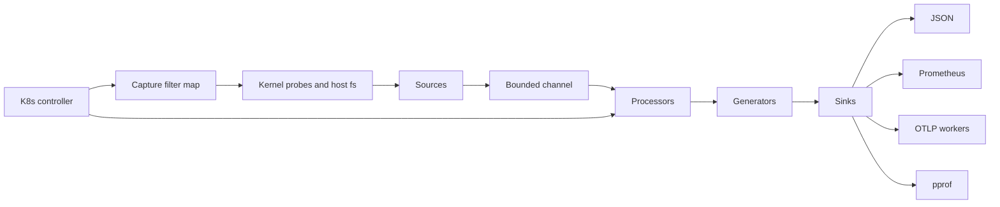

## At a glance

| Fact | Value |
| --- | --- |
| Status | 0.7.0 (2026-10-15), pre-1.0; the project's own boundaries doc calls it a pre-release signal plane |
| History | 917 commits from 2026-06-12, 25 tags including release candidates |
| Code | 13 workspace crates, about 154k lines of Rust, of which about 8.9k are kernel-side eBPF programs |
| Decisions | 22 accepted ADRs |
| Verification | 31 fuzz targets, roughly 1,700 test attributes, homelab proof campaigns with checked-in analyzers |
| Distribution | Signed multi-platform OCI images and an OCI Helm chart, SPDX SBOMs, keyless Cosign signatures |

## The problem

Node-level observability on Kubernetes usually means running several privileged agents: one for application traces, one for continuous profiling, one for host metrics. Each one has its own kernel footprint, its own failure modes, and its own idea of what a workload is. The concrete target in my case was a Grafana Beyla plus Grafana Alloy stack, and I wanted one node-local process that could do the capture, attribution and export itself.

The hard part is not attaching probes. It is that eBPF tooling makes it very easy to say more than you know. A program that compiles is not a program the verifier accepts on another kernel. A demo that produces spans is not proof of overhead. A cgroup id that looks right is not necessarily the cgroup you think it is. I wanted an agent where every public capability is tied to recorded evidence, and where anything that cannot be proven is written down as a non-claim.

## Constraints

- **Privileged code runs on every node.** Anything in the kernel path executes for every syscall it hooks, on every workload, including the ones nobody asked to observe.
- **Kernels differ.** The homelab ran Linux 6.6.68 on amd64; local development ran an arm64 7.0 kernel under OrbStack. Verifier limits, available program types and BTF all vary.
- **Memory and cardinality must be bounded by construction.** A collector that grows with traffic is a node outage waiting for a traffic spike.
- **Backends are not mine.** Export goes to Prometheus, OTLP receivers and Pyroscope. E-Navigator is explicitly not a storage backend, query engine or UI.
- **One engineer.** Every claim had to be checkable by a script, not by my memory.

## Architecture



The agent is one Rust process with a statically registered `Source -> Processor -> Generator -> Sink` pipeline. There is no runtime plugin loading: configuration can enable or disable registered modules, but it cannot load code.

**Sources** observe process exec and exit, TCP lifecycle and byte counts, DNS, HTTP and a set of application protocols (gRPC, Kafka, MongoDB, MySQL, NATS, PostgreSQL, Redis, metadata-only WebSocket and gRPC-Web), TLS plaintext at supported userspace library boundaries, host resources from procfs, sysfs and cgroups, and CPU, off-CPU and futex-wait profile samples. The Aya crates are the only places allowed to use `unsafe`, for FFI and raw event decoding. Every other crate forbids it.

**Processors** attach process, container, Kubernetes, owner and service context, but only when the evidence supports it. Missing context is represented as missing context or a structured warning, never a guessed identity.

**Generators** derive metrics, dependency edges, request spans, trace paths, profile sessions and runtime security findings. Each generator returns a bounded vector from a synchronous `observe` call, and the runner bounds per-generator output, total derivation breadth and derivation depth, so no generator can start an unbounded cascade.

**Sinks** emit newline-delimited JSON, serve Prometheus and local pprof, or route metrics, traces, profiles and logs through independent OTLP workers. Each worker owns its own batching, timeout, retry, circuit breaker and shutdown state, and destination I/O never runs on the shared signal path. A dead profile backend cannot stall metric capture.

A single **Kubernetes controller** owns Pod, Service and EndpointSlice discovery. Attribution and the capture filter consume the same snapshot, so two API clients cannot disagree during Pod churn. The capture filter writes only cgroup ids and 0 or 1 verdict bytes into a kernel map; a privacy test asserts that no namespace or label strings ever reach it.

## Key decisions

### Decide capture in the kernel, and fail closed

The cheapest event is the one never emitted. Every eBPF handler checks the current cgroup id against a verdict map before doing work. The decision function is small enough to quote:

```rust
pub(crate) const fn capture_allowed(control: u32, explicit_verdict: Option<u8>) -> bool {
    if control == CAPTURE_FILTER_DISABLED {
        return true;
    }
    match explicit_verdict {
        Some(verdict) => verdict != 0,
        None => control == CAPTURE_FILTER_UNKNOWN_CAPTURE,
    }
}
```

The alternative was filtering in userspace, which is simpler but pays the full kernel and transport cost for workloads nobody wants. The trade-off is a convergence window: a new Pod is unknown until discovery catches up, which is a coverage gap under an allowlist and a capture leak under a denylist. I replaced polling discovery with bounded inotify plus Kubernetes watches. On five counterbalanced homelab runs the first-signal window dropped from a 1,148.131 ms median to 0.463 ms, with a 2-second scan kept as the loss-recovery boundary.

The same join key forced a harder call (ADR 0011). `bpf_get_current_cgroup_id()` returns the task's default-hierarchy cgroup, while cgroup v1 can expose many controller hierarchies with unrelated inode ids. Guessing one would let an unrelated inode inherit another workload's verdict. So cgroup v1 and hybrid layouts are a permanent non-claim: a bounded probe detects them and overrides the kernel control word to deny before any program attaches. A guarded run against a legacy marker fixture decoded zero signals and accounted 3,012 suppressed kernel events.

### Two eBPF objects instead of one with a runtime branch

BPF ring buffers are nicer than per-CPU perf arrays, but older kernels reject the ring-buffer map type when the object loads, before any branch can choose the fallback. I build two objects from the same source, one per transport, with an identical raw event ABI so the decoders and fuzz targets cover both (ADR 0006). In `auto` mode the agent probes the map type and falls back to perf only when the probe positively reports it unsupported. An unexpected probe error fails startup instead of silently changing the transport, because a seccomp or permission failure is not evidence about the kernel.

The homelab A/B did not show the win I expected. RingBuf measured 0.56% lower throughput, 1.46% higher mean latency, 11.40% higher summed agent CPU and 4.45% lower RSS over three short runs, all within noisy variance. The proof report records it as evidence of transport operation and accounting, not a RingBuf overhead win.

### Adopt fexit only after it cleared a predeclared gate

Byte accounting used four syscall tracepoints plus a pending-I/O map keyed by thread. BTF-backed fexit on `ksys_read` and `ksys_write` replaces that with two programs that see the arguments and the return value together, at the cost of depending on tracing program support and valid kernel BTF (ADR 0007). Before the run I wrote down the bar: exact byte parity, zero transport loss, at least 5% more throughput, at most 2% more mean latency. Fexit measured 7.971% more operations per second and 7.710% lower mean latency, with every run's close event matching the workload byte total exactly. It also used about 13.4 MiB more summed RSS and was still 7.045% slower than no agent, and the ADR says so. Tracepoints stay as a strict compatibility path.

### Native contracts, not compatibility aliases

E-Navigator owns one versioned signal contract (ADR 0001). Observed facts and inferred relationships are different signal kinds, inference carries a confidence or a warning, and every string, map, queue and cache has a validated bound. Standard protocols (OTLP, Prometheus exposition, pprof, W3C Trace Context) are used at the edges, but I refused to copy another collector's metric names or labels. The trade-off is migration work for anyone coming from Beyla or Alloy, which is why the repo ships a collector migration guide rather than aliases.

## What was hard

**The verifier is a moving target.** One fix records the HTTP classification helper reaching a combined stack of 608 bytes on the amd64 6.6 verifier, over the 512-byte limit, while the arm64 7.0 build fit. The fix writes the verdict through the map value pointer in place, which also removed a read-modify-write race against the byte counters. A day later the opposite happened: a 40-slot iovec loop loaded on amd64 6.6 but exceeded the one-million-instruction budget on arm64 7.0, disabling protocol capture there. It now consumes at most eight slots per tail-call round, keeping the chain at eleven of the kernel's thirty-three tail calls. Earlier in the project I committed failed verifier attempts as "not proven" records instead of quietly dropping them.

**I invalidated my own benchmark.** The first 33-run head-to-head against Beyla plus Alloy looked fine and passed its gates. Then I found that the workload's Redis proxy opened its backend connection before the collector attached, so none of the 9,600 Redis operations per arm ever reached E-Navigator. The aggregate signal gate stayed green because HTTP and gRPC traffic kept it nonzero. The report is preserved for provenance with an erratum, the workload now opens backend connections after attachment, and the analyzer rejects any arm whose protocol signals fall below the successful operation count. That gate would have failed every affected arm.

**Honest performance work is slow.** Profile-first optimization campaigns cut E-Navigator CPU by 11.833% from the `v0.5.0-rc.4` baseline in campaign 6, and campaign 9 removed allocated strings from warning fingerprints for a 22.2% faster warning path. The whole-agent target still was not met: in campaign 9 E-Navigator used 20.13% more CPU than Beyla plus Alloy combined, while using 17.65% less RSS. The report is titled a CPU NO-GO.

## Verification

The repo separates evidence tiers on purpose: synthetic CLI output, unit and golden tests, Docker smoke, Helm rendering, and guarded Linux or Kubernetes runtime proof are never treated as interchangeable. A claim is runtime proven only when a capable host recorded agent output, pod state, workload output and cleanup evidence.

- **Local gate.** `scripts/quality.sh` runs formatting, a docs policy checker (including a ban on em-dashes in public prose), release identity tests, Clippy, rustdoc, workspace tests, fuzz target compilation for all 31 targets, the synthetic pipeline, supply-chain policy, Docker smoke, Helm lint and Kubernetes schema checks.
- **Criterion benches** for parsers, raw decoders, generators and sinks, documented as hot-path hygiene, not overhead proof.
- **Homelab campaigns** on a two-node k3s cluster, each with a guarded shell harness and a Python analyzer under `benchmarks/runner/`. They use counterbalanced arms, a no-agent baseline, predeclared gates, and restore the standing Argo CD deployment afterwards. Candidate images were loaded into node containerd directly and never pushed.
- **Supply chain.** Releases are built from tags, signed with keyless Cosign through GitHub OIDC, and ship checksums, SPDX SBOMs and a release manifest. Prereleases never move `latest`, and published tags are immutable.

## Results

- **Reduced privilege.** An opt-in Helm profile drops `SYS_ADMIN` on the proven Linux 6.6.68 posture. Exec, network, DNS, HTTP and Redis sources ran with only `BPF` and `PERFMON`; Go TLS and cross-UID symbolization added `SYS_PTRACE`; host resources ran with no effective capabilities. It is explicitly not rootless.
- **Profiling overhead.** CPU, off-CPU and futex profiling together cost 2.049% busy-loop throughput on one pinned CPython 3.11 workload, with stack-capture failures at 0.0042 to 0.0049% against a 0.1% gate.
- **Go TLS.** All six clients completed 4,000 of 4,000 requests, the unstripped Go 1.26.4 binary was captured, and the stripped control was rejected for its missing symbol.
- **Head-to-head.** Campaign 9 completed 591,030 measured operations across 33 arms with zero errors and zero hard loss, and lost on CPU as described above.

The `boundaries.md` file lists what is not claimed: HTTP/3 and QUIC semantics, connections that predate attachment, universal stack unwinding, cgroup v1 filtering, rootless operation, and lower resource use than another stack. I think that list is the most useful document in the repo.

## What I would do next

I would close the CPU gap before adding anything else, starting from the remaining profile hot spots in campaign 9 rather than from guesses. I would get a second kernel and a second architecture into the runtime proof matrix, since the automatic perf and tracepoint fallbacks are still only unit-tested. And I would build an identity-safe way to observe connections that predate attachment, because the invalidated benchmark showed how easily that gap hides.
