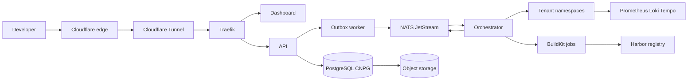

## At a glance

| Dimension | Fact |
| --- | --- |
| What it is | A Git push PaaS for Brazilian developers, billed in BRL, running in the São Paulo region |
| Timeline | First commit February 2026, in production since March 2026, sold in 2026 |
| Codebase | Monorepo with 6 apps (API, orchestrator, user dashboard, admin, CLI, Rust AI gateway) and 10 shared packages, about 3,960 commits |
| Production footprint | 9 worker nodes, 29 ArgoCD applications, 58 tenant project namespaces, about 230 pods at the time of the architecture report |
| Operations | Over 200 Prometheus alert rules (about 70 written for the platform), one Grafana dashboard with 166 panels |
| Tests | About 1,400 TypeScript test files plus Rust integration tests, and 19 custom architecture policy rules enforced in CI |

## The problem

Brazilian teams that want a Heroku style workflow have two options. They can use a US platform that bills in dollars and usually runs outside Brazil, or they can drop down to raw infrastructure and become their own platform team. The first option exposes a small team's monthly bill to exchange rate swings that have nothing to do with their usage. The second option costs expertise most small teams do not have.

There is also a regulatory angle. Brazil's LGPD does not strictly require data to stay in the country, but hosting in São Paulo makes the compliance story simpler for anyone selling to Brazilian customers.

Guara Cloud was my answer: connect a repository, push code, and get a running service with TLS, DNS, logs, metrics and managed databases, priced in reais, without writing YAML or learning pod scheduling.

## Constraints

- **One engineer.** The commit history is mine plus automation bots. Every layer, from the Stripe webhook handler to the Calico network policies, had to be something I could reason about alone at 3 a.m.
- **Shared multi tenant cluster.** Tenants run arbitrary code I do not control, on shared nodes. Isolation, abuse detection and resource budgets were not optional.
- **Money is involved.** Subscriptions, overage, Pix checkout and usage metering had to be correct under retries and concurrent webhook deliveries.
- **Cost discipline.** A bootstrapped platform cannot pay for a managed service per concern. The report records explicit resource budget targets: below 55 percent of cluster CPU requests and below 35 percent of memory requests.
- **Local infrastructure.** Everything runs on Linode Kubernetes Engine in the `br-gru` region, with Linode Object Storage as the S3 compatible backend.

## Architecture



**Edge.** Traffic enters through Cloudflare, reaches the cluster over an outbound only Cloudflare Tunnel, and is routed by Traefik. There is no public load balancer address and no open inbound port. Traefik also issues Let's Encrypt certificates for tenant custom domains.

**Control plane.** The API is a NestJS service that owns the domain: projects, services, deployments, domains, billing, incidents, support and audit logs. It never touches Kubernetes directly. Every multi step mutation writes its domain rows and an outbox message in the same database transaction, then returns `202 Accepted`. A worker drains the outbox into NATS JetStream.

**Orchestrator.** A second NestJS service acts as the platform's Kubernetes controller. It consumes commands from NATS and turns them into namespaces, BuildKit build jobs, Deployments, Services, IngressRoutes and autoscalers, then publishes status events back for the API to record. It runs two replicas with Kubernetes Lease based leader election, and only the leader subscribes to NATS. Over time it grew reconciliation, an orphan sweeper, a health monitor and a VPA backed rightsizer.

**Messaging.** NATS JetStream carries four streams defined in one shared package: `COMMANDS` (work queue retention, 72 hours), `EVENTS` (24 hours), `NOTIFICATIONS` (interest based) and a `DLQ` kept for 30 days for post mortems.

**Data.** PostgreSQL runs in cluster under CloudNativePG as a two instance HA cluster with PgBouncer poolers, and archives WAL continuously to object storage for point in time recovery. Redis is a pure cache with no persistence. Harbor stores images on object storage and scans them with Trivy.

**Managed services catalog.** Tenants can provision backing services from a typed catalog that ships 19 definitions, including PostgreSQL, MySQL, MongoDB, Redis, Valkey, NATS, RabbitMQ, Meilisearch, Qdrant and MinIO. Catalog volumes get scheduled Longhorn snapshots managed by the orchestrator.

**AI gateway.** Late in the project I added an OpenAI compatible gateway written in Rust, with API key auth, fail closed entitlements, Redis backed rate and concurrency limits, credit reservation before calling the upstream model provider, and transactional usage and ledger writes. It shipped behind a feature flag as a beta.

**Delivery.** Terraform provisions the cluster, ArgoCD reconciles 29 applications in sync waves (CRDs, then operators, then data, then ingress and registry, then observability, then the Guara applications), and GitHub Actions rebuilds only the images whose source changed.

## Key decisions

### Transactional outbox instead of publishing from request handlers

The simple path is to write to the database and then publish to NATS in the same handler. That loses events whenever the process dies between the two, or when NATS is briefly unavailable. I made the outbox a first class model and a hard rule: outbox messages are only created inside the domain transaction.

```ts
await this.outboxService.createMessage(transaction, {
  eventType,
  payload,
  aggregateType,
  aggregateId,
});
```

The outbox also stamps start and stop commands with a desired state generation, taken under a row lock on the service, so the orchestrator can tell a stale command from a current one. The trade-off is at least once delivery, which pushes idempotency onto every consumer, and an extra hop of latency before builds start. For a deploy pipeline measured in minutes, that was the right price.

### Self operated PostgreSQL over a managed database

A managed database would have removed operational work. I chose CloudNativePG because it put failover, replication lag and pooler health in the same telemetry plane as everything else, and it ran on compute I was already paying for. The cost is that backups, restores and upgrades became my job. WAL archiving to object storage and a replication lag alert were the minimum I accepted for taking that on.

### Rules as code, not as a wiki page

As a single engineer working with AI coding assistants, the conventions that keep a codebase coherent drift fast. I wrote them down in `AGENTS.md`, then turned the important ones into a policy checker that runs in CI. The 19 rules include `no-outbox-outside-transaction`, `no-webhook-without-idempotency`, `no-local-nats-subjects`, `no-unvalidated-env-access`, `no-direct-tier-config-imports` and `no-high-cardinality-metric-labels`. The alternative, code review alone, does not scale when the reviewer and the author are the same person. The cost is maintaining an AST based checker and its own tests, which the pipeline runs as a separate job.

### Rehearsed deployments instead of a launch day

Rather than deploy production once and debug it live, I provisioned throwaway clusters from scratch, recorded every failure, fixed it in code, destroyed the cluster and started again. The commit history shows at least eight rehearsals in late March 2026, each with its own instructions and learnings document. The trade-off is time spent before launch. What it bought is a cluster that can be rebuilt from the repository with no manual steps.

### Redis as disposable

Every Redis consumer degrades gracefully: rate limiting falls back to in memory counters, the token denylist to a short lived local cache, and cache misses go to the database. Keeping Redis without persistence means a Redis failure costs performance, never data, and it removed a stateful component from the backup story.

## What was hard

**Getting to a zero intervention deploy.** The first rehearsal brought up 71 percent of applications healthy, covered 21 applications and took about an hour. Early problems were structural: wrong API versions, CRDs that did not exist yet when operators tried to use them, and memory overcommitment. I fixed ordering with sync waves and custom ArgoCD Lua health checks, including one that blocks a wave until secrets from the secrets operator are actually synchronized. By the release baseline it was 100 percent healthy across 30 applications in about twenty minutes, with zero manual interventions.

**Billing under concurrency.** Stripe retries webhooks and can deliver them concurrently. Every webhook handler (Stripe, GitHub, Cloudflare) runs inside one transaction that takes a PostgreSQL advisory lock keyed on the event, checks a deduplication table, applies the change and writes any notifications to the outbox. Emails are sent only after commit. On top of that sit trials, downgrades with impact previews, overage calculation and reconciliation, Pix checkout and usage metering from Prometheus data. Each of those is a separate service in the billing module, because lifecycle transitions were where the edge cases lived.

**Running untrusted code on shared nodes.** Each tenant project gets its own namespace with network policies and RBAC scoping. Falco watches syscalls for shells in app containers, package manager execution, privilege escalation and crypto mining indicators, and a dedicated Prometheus rule file looks for mining patterns. Beyla adds eBPF based request metrics for tenant apps without touching their code.

**Backups that do not stampede.** Scheduled snapshots for catalog volumes initially risked firing together. The backup scheduler now spreads each job into a stable slot derived from a per service key. I also built downloadable native backups in June 2026, spent a week hardening job isolation, cleanup and rollout safety, and then removed the download feature rather than keep a path I did not trust; snapshots on named volumes stayed.

**Keeping observability honest.** Loki runs without its optional memcached caches; I removed them after checking real query patterns and saw p95 query latency stay under three seconds for 24 hour ranges. I also added self monitoring alerts so that a stalled Prometheus, Loki or Tempo pipeline pages me, rather than looking like a quiet night.

## Verification

- **Unit tests everywhere.** About 1,400 TypeScript test files across the apps and packages, plus Rust integration tests for the gateway covering auth, streaming, ledger writes, rate limiting and HTTP parity. The house rule is that every change ships with unit tests and that end to end tests are not added.
- **CI gates.** The GitHub Actions pipeline runs policy check and policy tests, lint, type check, build, Helm render validation for default and production values, script tests (with `promtool` for alert rules), and per app test jobs.
- **Startup validation.** Every service validates its environment with Zod at boot (typed config in Rust for the gateway), so a missing secret crashes the pod at startup instead of failing a request later.
- **Rehearsals as regression tests.** Each rehearsal re-verified every earlier fix from a clean cluster. Priority one alerts were checked for firing and routing across those clean deployments, not just reviewed in code.
- **Tracing across the async boundary.** W3C trace context flows from the dashboard through the API, across NATS and into the orchestrator's Kubernetes calls, so one trace shows where a failed deploy broke.

## Results

- Guara Cloud went from first commit in February 2026 to a public production launch in March 2026, and stayed in production with paying customers billed in reais through Stripe.
- At the time of the architecture report, the cluster ran 9 nodes, 29 ArgoCD applications, 58 tenant project namespaces and about 230 pods, with about 900 GiB of block storage provisioned.
- The platform shipped Git push and image deploys, custom domains with automatic TLS, autoscaling, live logs and metrics, a 19 entry managed services catalog with volume snapshots, a CLI, an admin console with incident management, a bilingual (pt-BR and en) dashboard, and a beta AI gateway in Rust.
- The deployment converged from 71 percent healthy and many manual steps to 100 percent healthy, zero manual steps, in about twenty minutes from an empty account.
- Guara Cloud was sold in 2026. I owned it end to end until the sale: product, platform, billing, Kubernetes, observability and backups.

Limits I am explicit about: the platform ran in a single region, the identity model was built around individual accounts rather than organizations, and the AI gateway was still a feature flagged beta. Multi region resilience and organization level billing were on the roadmap, not shipped.

## What I would do next

I would put a second region behind the same rehearsal process before adding more features, because single region was the biggest risk I carried. I would move to organizations and team roles earlier, since retrofitting tenancy boundaries touches billing, entitlements and every authorization check. And I would start the policy checker on day one rather than after the conventions had already drifted once; it was the cheapest reliability work in the whole project.
