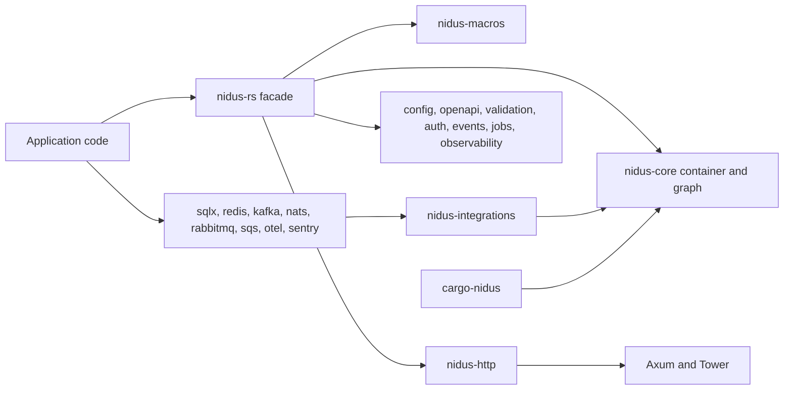

## At a glance

| Fact | Value | Source |
| --- | --- | --- |
| Published crates | 25, versioned together as one cohort | `Cargo.toml`, `docs/release-1-2-0.md` |
| Releases | 20 tags, `v1.0.0` on 2026-06-28 to `v1.2.0` on 2026-10-08 | `git tag` |
| History | 540 commits since the first one on 2026-06-23 | `git log` |
| Code | about 46,000 lines of Rust under `crates/` | `wc -l` |
| 1.2.0 test run | 647 workspace tests and doctests, zero failures | `docs/validation/release-1.2.0.md` |
| Toolchain | Rust 1.96, edition 2024, dual MIT or Apache-2.0 | `Cargo.toml` |

## The problem

Axum is a good HTTP library, but it is only that. Once a Rust service grows past a few handlers, it also has to answer composition questions: which component owns the database pool, which features consume it, when it is initialized, how it is released on shutdown. In most Axum codebases those answers live in a long `main.rs` full of constructors and `Arc` clones, and every team invents its own shape.

NestJS answered the same questions for Node with modules, providers, controllers, imports and exports. I wanted that vocabulary in Rust without the parts that do not translate: runtime reflection, string tokens, and a framework that owns the HTTP stack. The goal of Nidus is a common, inspectable composition layer that sits on top of Axum, Tower and Tokio instead of replacing them.

## Constraints

- **Do not fork the ecosystem.** Handlers must stay Axum handlers, middleware must stay Tower layers, and native clients (SQLx pools, Kafka consumers, Redis connections) must stay reachable.
- **No reflection.** Rust has none, and faking it with string registries would throw away the type system.
- **Nothing on the hot path that does not need to be there.** The module graph must not be traversed per request.
- **Lean dependency graph.** An app that does not use Kafka should never compile `rdkafka`.
- **Explicit over magic.** From `docs/mental-model.md`: "Nidus should organize code, not replace Rust's normal debugging and tooling model."

## Architecture



The workspace is split into focused crates that depend inward:

- **`nidus-core`** owns the type-keyed container, module definitions, graph validation, lifecycle and errors.
- **`nidus-macros`** turns `#[module]`, `#[injectable]`, `#[controller]`, `#[routes]` and route attributes into small, plain Rust fragments.
- **`nidus-http`** composes controllers into ordinary Axum routers and ships opt-in production defaults (request IDs, body limits, timeouts, security headers, error envelopes, health, metrics) as normal Tower layers that apps can reorder or replace.
- **The `nidus-rs` facade**, imported as `nidus`, re-exports everything behind Cargo features. Defaults are `http`, `config` and `tracing`; everything else is opt-in.
- **Adapters** (`nidus-sqlx`, `nidus-redis`, `nidus-kafka`, `nidus-nats`, `nidus-rabbitmq`, `nidus-sqs`, `nidus-jobs-sqlx`, `nidus-opentelemetry`, `nidus-sentry`, `nidus-cache`) are separate crates outside the facade's dependency graph. `nidus-integrations` holds shared envelopes and correlation.
- **`cargo-nidus`** scaffolds projects and inspects routes, the module graph and OpenAPI from source.

A feature module reads like this (from the white paper, adapted from the modular-monolith example):

```rust
#[module]
struct UsersModule {
    imports: (DatabaseModule, AuditModule),
    providers: (UsersRepository, UsersService),
    controllers: (UsersController,),
    exports: (UsersService,),
}

#[controller("/users")]
struct UsersController {
    service: Inject<UsersService>,
}
```

Work happens in three stages. At **compile time**, macros validate syntax and generate registration code that Rust then type-checks. At **startup**, the facade builder (`Nidus::create` followed by `build`) discovers and validates the graph (missing imports, cycles, duplicate modules, invalid exports, ambiguous providers), runs synchronous registrars dependency-first, then runs async initializers sequentially, then builds controllers and merges their routers. **Per request**, it is just Axum and Tower; controllers hold shared references resolved at construction time.

## Key decisions

### Typed runtime DI, and saying so

The obvious pitch for a Rust DI framework is "compile-time dependency injection". I considered building the full graph in the type system so a missing provider would fail `cargo build`. The cost is heavy generic signatures, poor error messages, and friction with async initialization and factories that need I/O.

I chose a runtime container keyed by `TypeId`, with resolution through typed generic calls such as `resolve` and `inject`. Macros catch malformed declarations and Rust checks types and traits, but missing registrations, factory failures and circular factory resolution are runtime errors. The white paper states it directly: "Calling the mechanism compile-time dependency injection would overstate its guarantees." The mitigation is that bootstrap validates the graph and builds every controller before the server accepts traffic, so a broken dependency chain behind any module controller surfaces on startup rather than mid-request. Factory-backed singletons resolved lazily elsewhere can still fail later.

A second honest limit: module exports describe the intended architecture but do not create private runtime containers. Access isolation still needs Rust visibility and crate boundaries.

### Macros only where the expansion is obvious

Macros are the ergonomic layer, but each one has a narrow contract. `#[injectable]` accepts only fields wrapped in `Inject` or `Optional`; anything else is a compile error pointing at the field:

```text
error: #[injectable] fields must use Inject<T> or Optional<T>; use an explicit factory for literal or default state
 --> tests/ui/injectable_plain_field.rs:5:19
  |
5 |     database_url: String,
  |                   ^^^^^^
```

The alternative, inferring defaults or reading config inside generated constructors, would hide initialization logic. Instead the escape hatch is a plain Rust factory:

```rust
container.register_singleton_factory(|container| {
    Ok(UsersRepository::new(container.inject::<DatabasePool>()?))
})?;
```

Every macro path has a hand-written equivalent, and the trybuild suite pins the diagnostics: 35 UI cases, 23 of them with expected compiler error output.

### Request scope is opt-in and loud

Singleton is the default lifetime. Transient and request lifetimes exist, but request-scoped providers must be resolved through an explicit `RequestScope` (via `request_scope_layer` and the `RequestScoped` extractor). Resolving one from the root container returns `RequestScopeRequired` instead of quietly behaving like a transient. NestJS's implicit request scope bubbling was the alternative; I rejected it because it silently changes the cost of every request that touches the chain. The benchmark table shows why that matters: a request-scoped route measured 1.58 us against 778 ns for a controller with an injected singleton service.

### A lean facade with adapters as separate crates

I could have shipped one `nidus` crate with feature flags for every backend. That makes the facade's resolved graph depend on what other crates in the workspace enable, which is exactly the kind of leak that is hard to see. Adapters live in their own crates, and the facade does not pull them transitively. The repo measures this: making `tower-http` optional dropped a core-only `nidus-rs --no-default-features` graph from 53 to 33 unique packages, and moving SQLite selection into each crate's own feature dropped a PostgreSQL-only `nidus-sqlx` graph from 149 to 142 packages (`docs/performance.md`).

Adapters also refuse a lowest-common-denominator queue API. Kafka offsets, RabbitMQ acks and SQS visibility receipts stay backend-specific, and delivery is documented as at-most-once or at-least-once, never as universal exactly-once.

### One coordinated version for 25 crates

The crate name `nidus` is not what users install: the facade is published as `nidus-rs` and renamed in `Cargo.toml` with `package = "nidus-rs"`. All 25 crates share one workspace version, so users never have to solve a compatibility matrix between `nidus-http 1.x` and `nidus-core 1.y`. The trade-off is that a fix in one adapter bumps the whole cohort, which I accept for the simpler mental model.

## What was hard

**Publishing a 25-crate cohort to crates.io.** Crates have to be uploaded in dependency order, and the registry rate-limits bursts. The publish workflow uploads in an explicit order, checks whether each version is already published so reruns are idempotent, parses the `Too Many Requests` retry window, and retries up to 20 times per crate. Release packaging verifies all 25 archives in one Cargo invocation against a temporary registry, so the unpublished cohort resolves before anything is uploaded.

**Diamond module graphs.** Discovery used to create a fresh typed-discovery set per explicit definition, so two features importing the same dependency module failed with `DuplicateModule`. The fix in July shared one set across the whole graph. The regression test was written first and failed on the untouched source.

**Cancellation.** HTTP metrics had to account for requests cancelled before their first poll, during a pending inner call, or during unwinding. 1.1.0 added `nidus_http_cancelled_requests_total` and guarantees the in-flight gauge returns to zero on every terminal path. The same release added managed applications that close task admission while draining, join accepted tasks before resource cleanup, and roll back partially started resources in reverse order.

**Smaller correctness bugs that only show up under real use:** the auth guard service was not honoring Tower's readiness contract, a provider panic could leave a request scope unusable, and the event bus dropped evicted values while holding queue locks. Each has its own fix commit in the history.

**Production and test composition drift.** The 1.0.17 white paper documented that `nidus-testing` bootstrapped modules separately from the production builder, so tests did not exercise the real composition. 1.1.0 closed that gap with `ApplicationPlan`, one composition path shared by production HTTP apps, workers and `TestApp::from_managed`.

## Verification

- **Tests:** 647 workspace tests and doctests passed for 1.2.0, with 23 ignored cases documented (illustrative macro doctests and service tests covered elsewhere).
- **Compile-fail tests:** the trybuild UI suite locks in macro diagnostics.
- **API compatibility:** `cargo semver-checks` ran against 1.1.0 for all 23 supported library targets.
- **Fuzzing:** `cargo-fuzz` targets for config env parsing, route path normalization and OpenAPI path normalization.
- **Feature matrix:** a script checks the facade's default, minimal, HTTP, observability and all-feature configurations with warnings denied and `--locked`.
- **Supply chain:** the 1.2.0 audit covered four consumer graphs and 539 third-party package versions and checksums, and the lockfile was updated for RUSTSEC-2026-0285.
- **Published artifacts:** every downloaded archive matches its registry checksum and is byte-for-byte identical to the clean tagged source; docs.rs pages for all 25 crates were checked; fresh consumer apps resolve only from the public registry.
- **Benchmarks:** Criterion suites for dependency resolution, configuration, routing, request lifecycle, event bus and integration hot paths, with raw Axum baselines where comparable and a 5% noise threshold for the integration suite. When unchanged code moved about 8.6% between runs, I recorded that as environment noise and rejected the optimization it was supposed to justify.

## Results

- Nidus is published on crates.io at 1.2.0 as 25 crates, with 20 tagged releases between 2026-06-28 and 2026-10-08, and a technical white paper in the repo.
- Framework overhead on a simple request is small and measured, not asserted: a raw Axum baseline request at 688 ns against 716 ns for a Nidus hello-world controller request, and 778 ns with an injected service (local Criterion, `docs/performance.md`).
- The 1.0.6 optimization pass took singleton resolution from 11.78 ns to 3.96 ns, and the rate-limit store check with 10,000 identities from 27.54 us to 32.4 ns.
- A paced Kubernetes end-to-end campaign compared 1.0.12 with 1.0.4 alongside FastAPI, Spring Boot and Express on a PostgreSQL-backed contract. It is published as "qualified", not accepted, because one Spring cell missed a variance limit. It is a paced workload, not a throughput or capacity claim, and the harness is not in the repo.
- Two standalone example apps (support desk and commerce) build from crates.io-style manifests with no workspace path dependencies.

What I do not claim: compile-time DI, runtime module isolation, exactly-once messaging, or a measured productivity improvement. For a small service with a few dependencies, plain constructors and an Axum router may still be the clearer choice, and the docs say so.

## What I would do next

I would make more composition errors fail at compile time, starting with providers no module registers, as long as the error messages stay readable. I would add inspection built from the same `ApplicationPlan` the runtime uses, so `cargo nidus graph` reports what actually runs instead of what the source declares. I would also commit a reproducible end-to-end benchmark harness, so the next performance campaign can be rerun by someone other than me.
