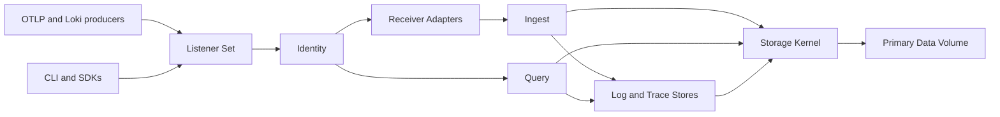

## At a glance

| Fact | Value |
| --- | --- |
| Status | Pre-release, Release 1 in progress |
| Scope | Native Logs and Traces in one process; Metrics and Profiles explicitly deferred |
| History | 523 commits since 2026-07-26, all mine |
| Codebase | 15 Rust crates, roughly 530,000 lines of Rust under `crates/` including tests |
| Decisions | 75 accepted ADRs plus byte-level format specs for segments, blocks, catalog and exports |
| Verification | 62 fuzz targets, close to 4,000 test functions, a 90% line-coverage gate |

## The problem

A typical observability stack is several databases pretending to be one: a log store, a trace store, a search engine, an object store, queues and coordinators. Each has its own durability story, its own retention clock and its own idea of what a tenant is. When something goes wrong, the operator has to reason about all of them at once.

Positron's premise is written at the top of the vision document: "One binary. One process. One storage kernel. Every observability signal." Release 1 narrows that to logs and traces. It accepts OTLP over gRPC and HTTP, plus Loki Push, decodes everything into a native signal model, and stores it in signal-specific layouts on a shared kernel.

The interesting part is not the ingestion protocols. It is the contract behind a `200 OK`. I wanted an acknowledgment to mean that the bytes are encrypted, durable and recoverable, and that recovery can prove it later instead of guessing.

## Constraints

- **No acknowledged data loss.** Standalone mode acknowledges only after store blocks are durably flushed to the local active segment (ADR-0004). There is no memory-only acknowledgment, and no tenant can opt into a weaker guarantee.
- **Encryption is mandatory.** Every managed persistent object is authenticated-encrypted (ADR-0031, ADR-0035).
- **Everything is bounded.** The design invariants forbid any unbounded queue, task, cursor, lease or maintenance backlog. Overload must surface as typed backpressure.
- **Tenancy is physical.** A segment never mixes tenants or signals, and every query is scoped to one authenticated tenant (ADR-0006, ADR-0062).
- **Rust only.** The server, kernel, stores, receivers, query engine and CLI ship without another language runtime (ADR-0027).
- **Honest semantics.** Delivery is at least once. Version 1 does not claim exactly-once ingestion, global deduplication or request atomicity (ADR-0013).

## Architecture



**Receiver Adapters** are deliberately thin. They decode one bounded protocol request into a native batch and render the outcome back in protocol terms. They never persist vendor payloads.

**Ingest** owns one operation, `accept(batch) -> IngestOutcome`, and the exact pipeline behind it: snapshot the ingest policy, apply it, validate, split records into Admission Groups by tenant, signal and virtual shard, reserve memory, queue slots and disk headroom, ask the owning Signal Store to prepare canonical blocks, commit each group, then return committed, retryable and permanently rejected outcomes per group.

**Signal Stores** own the physical layout. The Log Store owns full-text structures, typed attribute indexes and schema discovery. The Trace Store owns immutable span observations, consolidation into logical spans, summary deltas and quiescence. The store interface is about behavior (`prepare`, `scan`, `plan_maintenance`), not one universal record shape.

**The Storage Kernel** owns everything that must be identical across signals: the active segment ledger, the Catalog, encryption, the Resource Governor, maintenance scheduling, the lifecycle clock and integrity checks. It hands callers narrow capability handles (`KernelIngest`, `KernelQuery`, `KernelControl`, `KernelInspect`). No caller gets raw file, key or catalog access.

**Query** owns parsing, typed plans, budgets, snapshots, cursors and terminal status. Signal Stores receive typed plan fragments, never query strings.

## Key decisions

### Active segments instead of a separate WAL

Signal Stores encode telemetry directly into canonical, checksummed store blocks, and the kernel appends those blocks to an active segment. Sealing renames the same bytes into the sealed directory without copying, decrypting or re-encoding (ADR-0003).

The alternative was the classic WAL plus a separate columnar write. That gives each store freedom to change its format, but it doubles the durable representation and the write amplification. The trade-off I accepted is that every store's block format becomes part of the recovery contract, which is why each one has a byte-level specification with versioned readers. The Log Store is on block format v3 and still reads v1 and v2.

The acknowledgment order is spelled out in the format spec and enforced in code:

```text
1. write the frame-length prefix, protect the frame, complete its bytes
2. synchronize the segment file
3. write and synchronize a new temporary frontier
4. rename it over the published frontier
5. synchronize the frontier directory
```

The frontier is an authenticated record of how many bytes are durable. Bytes past it are unacknowledged and may be truncated during recovery. A failure after the rename but before the directory sync is treated as commit-ambiguous: no receipt is returned, and reopen decides.

### Encrypt independent frames and never reuse a nonce

Each segment gets a fresh 256-bit data key, and every frame derives its 96-bit AES-256-GCM nonce from an immutable sequence number (ADR-0034). Associated data binds tenant, signal store, shard, segment, payload kind, sequence and format version, so a block moved to the wrong context fails authentication.

The consequence for recovery is strict: the kernel never appends to an interrupted segment. It seals it and creates a fresh successor with a fresh key. Any post-write append failure poisons the live ledger so a retry cannot reuse a sequence. Keeping blocks, indexes, statistics and metadata as separate frames preserves random access, and only the bootstrap fields needed to recover the wrapped key stay plaintext.

### A shared kernel with store-defined layouts

ADR-0001 and ADR-0002 reject both extremes. One universal physical format would force logs and traces into structures that fit neither. Fully independent engines would duplicate durability, encryption and lifecycle logic and break the single-system model. The kernel owns a common envelope (identity, tenant, shard, signal, time ranges, checksums), and each store owns what is inside.

### Two query languages, one typed plan, explicit budgets

Release 1 has a typed native pipeline over an explicit Logs, Spans or Traces source, plus a read-only SQL subset with `SELECT`, `WHERE`, `GROUP BY`, `ORDER BY`, aggregates and `LIMIT` (ADR-0020). Both compile to the same logical plan. I chose not to claim LogQL, TraceQL or PostgreSQL compatibility until a conformance suite exists for each.

Every query runs under a tenant budget for lookback, scanned bytes, decoded records, output, memory, CPU, wall time and trace traversal, below ingestion in scheduler priority (ADR-0021). Runtime counters enforce limits when planning estimates are wrong. Streams end with an explicit `Complete` or an incomplete error; truncation is never reported as success. Wall time and the Snapshot Lease share a compiled one-hour ceiling.

Search follows the same discipline. Full-text search is a case-sensitive substring predicate, regex uses a bounded finite-automaton matcher with size, nesting and program limits, and an optional per-block trigram summary (capped at 4,096 trigrams) can only prove that a candidate is absent. Partial, stale or missing summaries fall back to the authenticated scan.

### Traces are never "complete"

A trace is not an atomic ingest object. Every committed span is queryable immediately, even before its parent arrives (ADR-0023). After an ingest-time quiet period a trace becomes quiescent, and a late span reopens it. Every accepted span is kept as an immutable observation; identical retries consolidate with an observation count, and disagreeing retries stay visible as variants that mark the span conflicted (ADR-0024). The alternative, last-write-wins, would have been simpler and would have silently destroyed evidence.

## What was hard

**Recovery that is correct under every crash point.** The 2026-10-08 application audit found that active-ledger recovery treated a missing durability frontier as an empty segment even when acknowledged payload existed, which could silently truncate acknowledged data. The fix publishes an authenticated empty frontier before a new segment becomes reachable, and a payload-bearing segment without that proof now fences recovery instead of truncating. This is exactly the class of bug the whole design exists to prevent, and it was found by tests written against the contract, not in production.

**Bounded resources versus restartability.** The same audit found that startup schema reconstruction compared a growing cumulative replay estimate against a small per-tenant CPU capacity. Enough valid acknowledged ingestion could make the instance unable to restart. The fix, recorded in ADR-0056, distinguishes a peak worker claim from the total work of recovery while keeping each replay step under its own checked ceiling.

**Small algorithmic bugs with large effects.** The trace-summary binary search used `upper / 2` instead of a midpoint relative to `lower`. It broke sorted insertion and missed retries. After the fix, an end insertion among 4,096 span identities takes 12 comparisons instead of 4,096.

**The long tail of operational surface.** A large share of the recent history is backup verification, key providers, reproducible packaging for Debian, RPM, Homebrew and Nix, and test fixtures that had to respect real capacity refusals and deadlines rather than paper over them. One audit note sums up the stance: it does "not enlarge production quotas to make a test pass".

## Verification

The repository policy is short and enforced: `cargo fmt`, warning-free Clippy, unit and integration tests, fuzz tests for parsers, decoders, storage and state machines, and at least 90% production line coverage with no production code excluded to reach it.

- **Fault injection in the ledger.** The kernel enumerates every file event in the durability path (`WriteFrame`, `SynchronizeFrame`, `RenameFrontier`, `SynchronizeFrontierDirectory`, `RenameSealSegment` and more) and tests inject failures at each one to prove predecessor-or-successor outcomes.
- **Fuzzing.** 62 cargo-fuzz targets cover OTLP and Loki decoders, block decoders, the active segment ledger, Catalog generations, cursors, the tail state machine, SQL, search and trace summaries. Several are stateful.
- **The audit numbers.** On 2026-10-08, 2,964 test executions passed with zero failures, coverage was 91.17% across 139,403 production lines, and bounded smoke campaigns ran all 46 fuzz targets that existed then for 10,606 inputs without a crash. The audit itself labels these as smoke campaigns, not exhaustive exploration.
- **A real binary test.** An executable integration test boots `positron serve`, ingests OTLP JSON, OTLP gRPC and Loki, sends SIGKILL, restarts, and checks that acknowledged history reopens.
- **CI.** Every pull request runs formatting, Clippy and the test suites. Authenticated-frame test vectors run on Linux x86_64 and ARM and on Intel and Apple Silicon macOS. Native archives are built twice from independent source trees and compared byte for byte.

## Results

- One Rust binary that ingests OTLP logs and traces over gRPC and HTTP, plus Loki Push, with encryption at rest, per-tenant isolation and fail-closed recovery.
- A native query pipeline with bounded SQL parity, full-text and regex search, resumable cursors, a gap-free live tail, and durable exports with signed manifests. A bounded Log query endpoint shipped through the public API on 2026-10-18.
- 75 ADRs and versioned byte-level format documents, so every durability claim has a written contract to test against.

On performance I have deliberately few numbers, because I have not built a benchmark suite yet. The only throughput figure in the repo is a diagnostic: a debug build with durable loopback ingested 16 serial requests of 64 records in 7.005 seconds, about 9.1 records per second, including storage synchronization costs. The audit states plainly that this is not a capacity benchmark. It also documents known costs: trace staging can copy accumulated state per observation, resumable pages materialize and hash the result to find a resume key, and log execution scans committed history before applying the temporal filter, so a 67-record fixture already exceeds the default 16-unit query CPU ceiling.

## What I would do next

I would build a representative benchmark workload before touching any hot path, then fix the measured problems in order: temporal pruning before the scan, trace staging without repeated copies, and cheaper resume keys. I would also qualify crash recovery on Linux, containers and real filesystems beyond my local macOS evidence, and finish the remaining public query surfaces and Grafana integration. Clustering and the Metric and Profile stores stay out until Release 1 is solid. The seams for them exist, and nothing ships behind a disabled flag.
